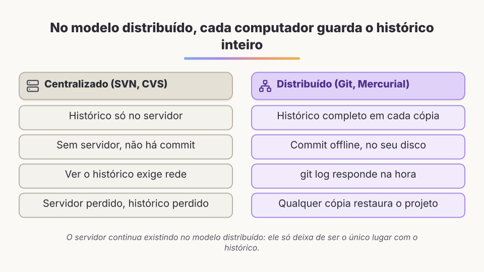
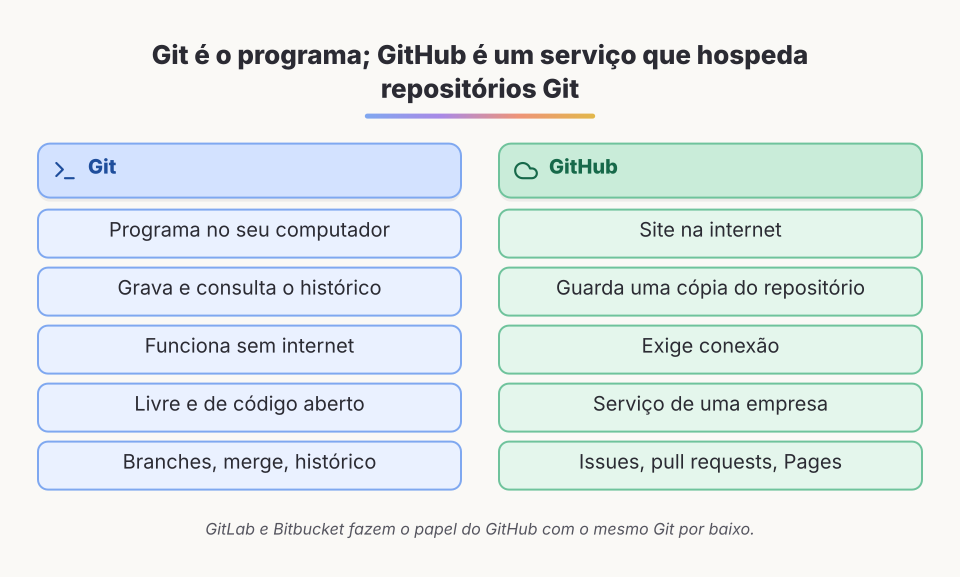
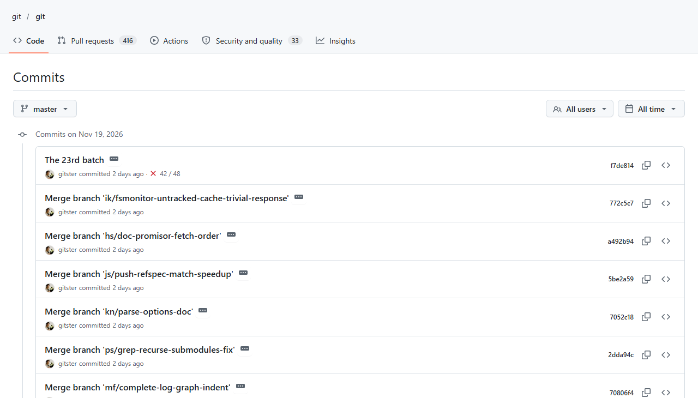

# 1. Por que controlar versões

> 🗺️ **Neste capítulo:** o problema que o controle de versão resolve, a diferença entre o modelo centralizado e o distribuído, e por que Git e GitHub são coisas diferentes. · ⏱️ ~30 min

## O problema das cópias com nome de “final”

A lanchonete do bairro guarda o cardápio numa pasta compartilhada. Depois de alguns meses, a pasta está assim:

```text
cardapio.txt
cardapio-final.txt
cardapio-final-2.txt
cardapio-final-revisado-joana.txt
```

Um cliente reclama que o X-salada subiu de R$ 18,00 para R$ 21,00. O dono quer saber três coisas: **quem** mudou o preço, **quando** e **por quê**. As cópias não respondem nenhuma delas. A data do arquivo mostra só a última vez que alguém o salvou, o nome “revisado-joana” não diz o que a Joana revisou, e ninguém sabe qual das quatro cópias é a certa.

Esse é o problema que um sistema de controle de versão resolve. **Controle de versão é um sistema que registra cada mudança nos arquivos de um projeto, com autor, data e motivo, e deixa você voltar a qualquer versão anterior.**

Em vez de quatro cópias, existe um arquivo só, e o sistema guarda a sequência de versões dele. Cada versão registrada se chama **commit** (do inglês, “confirmar”, “registrar”). O conjunto dos commits é o **histórico**.

Antes de seguir, preveja: se a lanchonete usasse controle de versão, que informações você esperaria encontrar para cada mudança no cardápio?

Veja o histórico real desse cardápio num repositório Git. O comando `git log` lista os commits, do mais novo para o mais antigo (você vai rodar esse comando a partir do capítulo 3; por enquanto, só leia):

```text
ce3dc3c Joana Lima 01/04/2026 08:05
    Reajusta o X-salada por causa do preço do queijo
cf762e2 Rafael Souza 05/03/2026 16:40
    Inclui suco de caju
4df55bb Joana Lima 02/03/2026 09:10
    Cria o cardápio com os lanches
```

Cada bloco é um commit. O código no começo da linha (`ce3dc3c`) identifica o commit, como um número de protocolo. Depois vêm o autor, a data e a mensagem que a pessoa escreveu explicando a mudança. As três perguntas do dono estão respondidas na primeira linha: foi a Joana, em 1º de abril, por causa do preço do queijo.

O Git também mostra **o que** mudou dentro do arquivo. As linhas com `-` saíram e as com `+` entraram:

```text
-X-salada .... R$ 18,00
+X-salada .... R$ 21,00
 X-bacon ..... R$ 22,00
 Suco de caju  R$ 9,00
```

Com isso, o controle de versão permite:

- **Saber o que aconteceu:** quem mudou o quê, quando e por quê.
- **Voltar atrás:** se o reajuste foi um engano, dá para recuperar a versão de 2 de março.
- **Trabalhar em paralelo:** a Joana e o Rafael editam ao mesmo tempo, e o sistema junta as mudanças depois.
- **Experimentar sem medo:** uma ideia nova pode ser testada numa linha de trabalho separada, sem estragar o cardápio que está valendo.

> ⚠️ **Erro comum:** achar que controle de versão é o mesmo que backup. Um backup guarda uma cópia do estado atual. O controle de versão guarda **a sequência de mudanças**, cada uma com autor e motivo. Um backup do cardápio de hoje não conta quem mudou o preço do X-salada.

## Centralizado × distribuído

Os sistemas de controle de versão se dividem em dois modelos, e a diferença está em **onde fica o histórico**.

**No modelo centralizado, o histórico inteiro mora num servidor; cada pessoa tem só os arquivos da versão atual.** Para registrar uma mudança ou consultar o histórico, é preciso falar com o servidor. Subversion (SVN) e CVS funcionam assim.

**No modelo distribuído, cada pessoa tem uma cópia completa do projeto, com o histórico inteiro, no próprio computador.** Registrar uma mudança e consultar o histórico acontecem no seu disco, sem rede. Quando quiser, você troca commits com outras cópias. Git e Mercurial funcionam assim.

Preveja: a internet da lanchonete caiu. A Joana precisa registrar um novo preço e conferir quando o suco entrou no cardápio. Em qual dos dois modelos ela consegue fazer as duas coisas?



No modelo distribuído, ela consegue fazer as duas coisas. O commit fica gravado no computador dela e vai para as outras cópias quando a internet voltar. No centralizado, ela teria de esperar.

Há uma segunda vantagem, menos óbvia: se o servidor central pegar fogo, no modelo centralizado o histórico vai junto. No distribuído, qualquer cópia de qualquer pessoa da equipe tem o histórico inteiro e pode recriar o projeto.

| | Centralizado | Distribuído |
| --- | --- | --- |
| Onde está o histórico | Só no servidor | Em cada cópia |
| Commit sem rede | Não | Sim |
| Se o servidor sumir | O histórico se perde | Qualquer cópia restaura |
| Exemplos | Subversion, CVS | Git, Mercurial |

> ⚠️ **Erro comum:** pensar que “distribuído” quer dizer “sem servidor”. Equipes que usam Git quase sempre combinam um repositório central, num serviço como o GitHub, para todo mundo sincronizar. A diferença é que esse servidor deixa de ser o **único** lugar onde o histórico existe.

### De onde veio o Git

O Git nasceu em 2005, criado pela comunidade que desenvolve o kernel do Linux, em especial por Linus Torvalds, o criador do Linux. O projeto usava desde 2002 um sistema distribuído chamado BitKeeper, e em 2005 ele deixou de ser gratuito para a comunidade. Os desenvolvedores decidiram criar a própria ferramenta, com metas que explicam muito do Git atual:

- ser rápido;
- ter um design simples;
- aguentar milhares de linhas de trabalho paralelas;
- ser totalmente distribuído;
- dar conta de projetos enormes, como o próprio kernel.

Essas metas aparecem ao longo do livro: o commit sem rede deste capítulo, as linhas de trabalho paralelas (*branches*) do capítulo 6.

## Git × GitHub e outros serviços

Muita gente começa achando que Git e GitHub são a mesma coisa, porque os dois aparecem sempre juntos. Separar os dois evita confusão em quase todos os capítulos seguintes.

**Git é um programa que roda no seu computador e grava o histórico do projeto.** Você o usa pelo terminal ou pelo editor de código. Ele é livre, de código aberto e funciona sem internet.

**GitHub é um serviço na internet que hospeda repositórios Git** (repositório é a pasta do projeto junto com o histórico dela). Ele guarda uma cópia do seu repositório num servidor e acrescenta recursos para trabalhar em equipe: páginas para discutir tarefas (*issues*), pedidos de revisão de código (*pull requests*), hospedagem de sites (*GitHub Pages*), entre outros.



Veja os dois juntos. O próprio Git é desenvolvido com Git, e uma cópia do repositório dele fica no GitHub. A página abaixo é o mesmo tipo de histórico que você leu no cardápio: cada linha é um commit, com a mensagem, o autor e o código que identifica o commit à direita.



*Página pública de commits do projeto Git no GitHub, capturada em 21/11/2026.*

Quem gravou esses commits foi o Git, nos computadores das pessoas que desenvolvem o projeto. O GitHub recebeu uma cópia e a mostra numa página da web.

O GitHub não é o único serviço desse tipo. GitLab e Bitbucket fazem o mesmo papel, e todos usam o mesmo Git por baixo. Os comandos que você vai aprender valem para qualquer um deles. Também dá para usar Git sem nenhum desses serviços: a lanchonete poderia manter o histórico do cardápio só no computador do caixa.

> ⚠️ **Erro comum:** achar que é preciso estar conectado ao GitHub para fazer um commit. O commit é do Git e acontece no seu computador. O GitHub só entra quando você decide **enviar** os commits para a cópia que está lá, assunto do capítulo 8.

## 🏋️ Pratique

Neste capítulo você ainda não tem o Git instalado (isso é o capítulo 2). Os exercícios treinam a **leitura** de um histórico e a escolha do modelo certo. Use o histórico do cardápio mostrado no começo do capítulo.

**1. Exemplo resolvido.** Pelo histórico do cardápio, quantos dias o X-salada custou R$ 18,00 antes do reajuste?

1. O preço de R$ 18,00 apareceu no primeiro commit, `4df55bb`, em 02/03/2026.
2. O reajuste é o commit `ce3dc3c`, em 01/04/2026.
3. De 2 de março a 1º de abril são 30 dias (março tem 31 dias: 29 dias até o fim de março, mais 1 de abril).

Resposta: **30 dias.** Repare que você só precisou do histórico: nenhuma cópia de arquivo, nenhuma pergunta para a equipe.

**2. Complete.** O dono quer saber quem incluiu o suco de caju e em que dia. Complete com o que o histórico mostra:

```text
Commit: ________   Autor: ______________   Data: __/__/____
```

<details>
<summary>Ver resposta</summary>

```text
Commit: cf762e2   Autor: Rafael Souza   Data: 05/03/2026
```

A mensagem “Inclui suco de caju” identifica o commit. Um erro comum é responder com o commit `ce3dc3c` só porque ele aparece primeiro: o `git log` lista do mais novo para o mais antigo, então o primeiro da lista é o mais recente, não o que você procura.

</details>

**3. Sozinho.** Para cada situação, diga se ela favorece o modelo centralizado ou se só funciona bem no distribuído, e por quê.

- a) Uma desenvolvedora trabalha num avião, sem internet, e quer registrar três mudanças separadas.
- b) O servidor da empresa teve o disco destruído e não havia backup.
- c) Um colega quer ver quem mexeu num arquivo há dois anos, mas a rede do escritório está fora do ar.

<details>
<summary>Ver resposta</summary>

As três só funcionam bem no **distribuído**.

- a) No distribuído, cada commit fica gravado no computador dela; no centralizado, ela não consegue registrar nada sem falar com o servidor.
- b) No distribuído, a cópia de qualquer pessoa da equipe tem o histórico completo e recria o projeto; no centralizado, o histórico estava só naquele disco.
- c) No distribuído, o histórico está no disco do colega e a consulta não usa a rede.

Se você respondeu “centralizado” em algum item, releia a tabela da seção anterior: a pergunta-chave é sempre **onde está o histórico**.

</details>

**4. Desafio.** Uma amiga diz: “Não vou usar Git no meu TCC porque não quero deixar meu texto público no GitHub.” Explique, em duas ou três frases, o que está errado no raciocínio dela.

<details>
<summary>Ver resposta</summary>

Ela está confundindo Git com GitHub. O Git roda no computador dela e guarda o histórico localmente, sem enviar nada para lugar nenhum. O GitHub é opcional; e, mesmo nele, um repositório pode ser privado.

Confira sua resposta com estes critérios:

- separa Git (programa local) de GitHub (serviço na internet);
- diz que dá para usar Git sem GitHub;
- não afirma que o GitHub é obrigatoriamente público.

</details>

## 🧠 Revisão rápida

1. Que três informações o histórico guarda sobre cada mudança, além do conteúdo alterado?
2. Por que um backup não substitui o controle de versão?
3. No modelo distribuído, existe servidor? Qual é o papel dele?
4. Git ou GitHub: qual dos dois grava o commit?

<details>
<summary>Ver resposta</summary>

1. Autor, data e mensagem (o motivo). Cada commit também tem um código que o identifica.
2. O backup guarda o estado de um momento; o controle de versão guarda a sequência de mudanças com quem, quando e por quê.
3. Pode existir, e quase sempre existe, mas não é o único lugar com o histórico: cada cópia tem o histórico completo.
4. O Git, no seu computador. O GitHub só recebe uma cópia quando você envia os commits.

</details>

## 🤖 Estude com um tutor de IA

Copie um destes pedidos para um assistente de IA:

```text
Faça 5 perguntas sobre controle de versão centralizado e distribuído,
uma de cada vez. Espere minha resposta antes de comentar e não me dê
as respostas antes.
```

```text
Expliquei a diferença entre Git e GitHub assim: <sua explicação>.
Aponte o que está errado ou impreciso, sem reescrever a explicação para mim.
```

> ➡️ **Próximo passo:** no capítulo 2 você instala o Git, diz a ele quem você é (nome e e-mail que vão nos commits) e prepara o acesso ao GitHub sem senha.

## 📌 Resumo

| Item | Em uma frase |
| --- | --- |
| Controle de versão | Registra cada mudança com autor, data e motivo, e deixa voltar a qualquer versão. |
| Commit | Uma versão registrada do projeto, identificada por um código como `ce3dc3c`. |
| Histórico | A sequência de commits; o `git log` mostra do mais novo para o mais antigo. |
| Centralizado | O histórico mora só no servidor (Subversion, CVS). |
| Distribuído | Cada cópia tem o histórico completo e funciona sem rede (Git, Mercurial). |
| Git | Programa livre que grava o histórico no seu computador. |
| GitHub | Serviço na internet que hospeda repositórios Git e acrescenta recursos de colaboração. |

## 📚 Fontes

- [Pro Git, 1.1 — About Version Control](https://git-scm.com/book/en/v2/Getting-Started-About-Version-Control) (consultado em 21/11/2026)
- [Pro Git, 1.2 — A Short History of Git](https://git-scm.com/book/en/v2/Getting-Started-A-Short-History-of-Git) (consultado em 21/11/2026)
- [Commits do projeto Git no GitHub](https://github.com/git/git/commits/master) (consultado em 21/11/2026)
- Anotações do curso “Git e GitHub Essencial para o Desenvolvedor” (Geek University, Udemy), seção 1: estrutura e tópicos.
