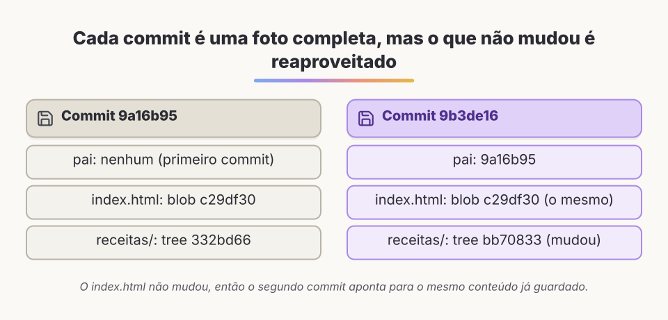
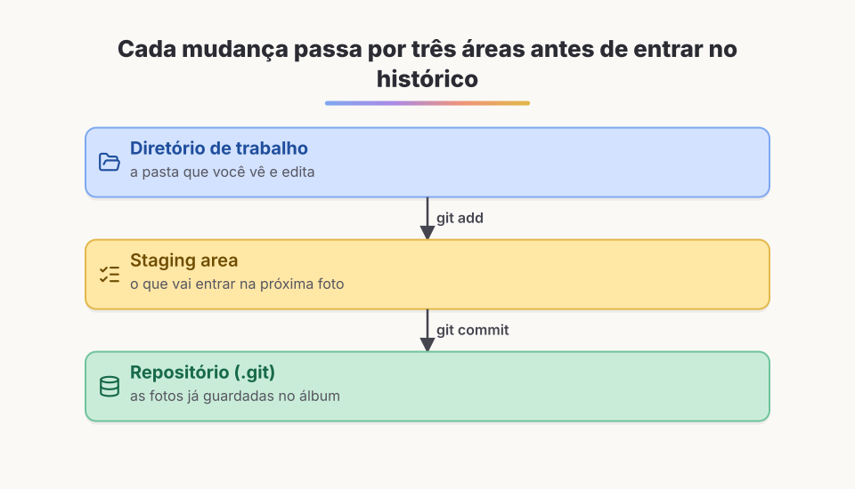
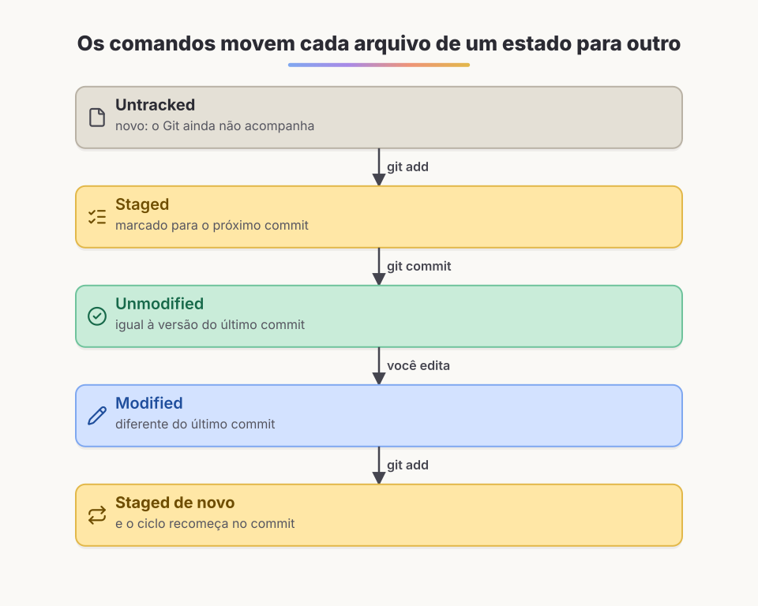

# 3. Como o Git pensa

> 🗺️ **Neste capítulo:** o que o Git guarda a cada commit, as três áreas por onde passa cada mudança, os estados de um arquivo e como esconder do Git o que não deve ir para o histórico. Você cria o projeto `receitas`, que acompanha o resto do livro. · ⏱️ ~45 min

> 🔥 **Aquecimento:**
>
> 1. (Capítulo 2) Você configurou `user.email` sem `--global` dentro de um repositório. Em que arquivo esse valor foi gravado?
> 2. (Capítulo 1) O que o histórico registra sobre cada mudança, além do conteúdo?
>
> <details>
> <summary>Ver resposta</summary>
>
> 1. No `.git/config` daquele repositório.
> 2. Autor, data e mensagem, e um código que identifica o commit.
>
> </details>

## De onde paramos

No capítulo 2 você deixou o Git instalado e com a sua identidade configurada. Agora vai criar um repositório de verdade e entender o modelo que explica quase tudo o que o Git faz: o que é um commit por dentro, por onde uma mudança passa até virar commit, e em que estado cada arquivo está a cada momento. Quem entende esse modelo consegue prever o que `git status` vai mostrar antes de rodá-lo.

## Snapshots e hashes

### Criar o repositório

Você vai montar um pequeno site de receitas. Crie a pasta e transforme-a num repositório:

```bash
mkdir receitas
cd receitas
git init
```

```text
Initialized empty Git repository in C:/Users/ana/receitas/.git/
```

**Um repositório Git é uma pasta de projeto que tem dentro dela a pasta oculta `.git`, onde o Git guarda o histórico inteiro.** O `git init` criou só essa pasta; os seus arquivos continuam onde estão. Veja o que tem lá dentro:

```bash
ls -A
ls .git
```

```text
.git
HEAD
config
description
hooks
info
objects
refs
```

Você já conhece o `config`: é o arquivo do nível local, do capítulo 2. Os commits vão morar em `objects`.

> ⚠️ **Erro comum:** apagar a pasta `.git` para “limpar” o projeto. Os arquivos continuam lá, mas o histórico inteiro vai embora junto com ela. E nunca edite nada lá dentro à mão: use os comandos do Git.

### O que um commit guarda

Crie os dois primeiros arquivos do site, com o editor que preferir.

<!-- project: receitas -->

**index.html**

```html
<!DOCTYPE html>
<html lang="pt-BR">
<head><meta charset="utf-8"><title>Receitas da Ana</title></head>
<body>
  <h1>Receitas da Ana</h1>
  <!-- cada receita nova ganha um item nesta lista -->
  <ul>
    <li><a href="receitas/bolo-de-cenoura.md">Bolo de cenoura</a></li>
  </ul>
</body>
</html>
```

**receitas/bolo-de-cenoura.md**

```markdown
# Bolo de cenoura

- 3 cenouras médias
- 4 ovos
- 2 xícaras de açúcar

Forno: 180 °C por 40 min.
```

Agora registre o primeiro commit. Os dois comandos abaixo são explicados na próxima seção; por enquanto, rode-os para ter algo dentro do repositório:

```bash
git add index.html receitas
git commit -m "Cria a página inicial e a receita de bolo"
```

```text
[main (root-commit) 9a16b95] Cria a página inicial e a receita de bolo
 2 files changed, 18 insertions(+)
 create mode 100644 index.html
 create mode 100644 receitas/bolo-de-cenoura.md
```

O `9a16b95` é o começo do **hash** do commit. **Hash é um código de 40 caracteres hexadecimais calculado a partir do conteúdo do commit; qualquer mudança no conteúdo gera outro hash.** O seu hash vai ser diferente do livro, porque o conteúdo inclui o seu nome e a hora exata do commit. Na prática, os 7 primeiros caracteres bastam para identificar um commit.

Para ver o que o commit guardou, use o `git cat-file -p`, que mostra um objeto do Git por dentro:

```bash
git cat-file -p HEAD
```

```text
tree 6baf91a23256a39cb4821ab52d0f6ed385cf07ca
author Ana Ribeiro <ana.ribeiro@example.com> 1795266000 -0300
committer Ana Ribeiro <ana.ribeiro@example.com> 1795266000 -0300

Cria a página inicial e a receita de bolo
```

`HEAD` quer dizer “o commit atual” (o capítulo 4 detalha). O commit tem autor, data (em segundos desde 1970, com o fuso `-0300`) e mensagem, como você viu no capítulo 1. E aponta para uma **tree**: a lista dos arquivos e pastas do projeto naquele momento.

```bash
git cat-file -p 6baf91a2
```

```text
100644 blob c29df307e5f32155def09fafa059360b7b036c2b	index.html
040000 tree 332bd662c66c05fe04d5641224a85c1165d17fbc	receitas
```

O `index.html` é um **blob** (o conteúdo de um arquivo, guardado pelo hash) e a pasta `receitas` é outra tree. **Snapshot é essa fotografia completa do projeto num momento: todos os arquivos, e não só o que mudou.**

Preveja: se você mudar só a receita do bolo e fizer um segundo commit, o Git guarda uma cópia nova do `index.html`?

Mude o tempo de forno no arquivo do bolo para 45 min, faça o segundo commit e compare as trees dos dois commits (os comandos ficam para o laboratório; aqui estão os resultados):

```text
# commit 9a16b95 (o primeiro)
100644 blob c29df307e5f32155def09fafa059360b7b036c2b	index.html
040000 tree 332bd662c66c05fe04d5641224a85c1165d17fbc	receitas
# commit 9b3de16 (o segundo)
100644 blob c29df307e5f32155def09fafa059360b7b036c2b	index.html
040000 tree bb70833c050ec766446954cc67596c51a44eb668	receitas
```



Não guarda. O `index.html` tem o mesmo hash nos dois commits: o conteúdo é igual, então o segundo snapshot aponta para o blob que já existia. Só a pasta `receitas` ganhou uma tree nova, porque o bolo mudou. É assim que o Git guarda fotos completas sem encher o disco. E cada commit, a partir do segundo, guarda também o hash do commit anterior (o **pai**), o que forma a corrente do histórico.

> ⚠️ **Erro comum:** achar que o Git guarda só as diferenças entre versões. Ele guarda snapshots completos e economiza espaço reaproveitando o que não mudou. As diferenças (as linhas com `-` e `+` do capítulo 1) são calculadas na hora, quando você pede.

## As três áreas

Num commit entram só as mudanças que você escolheu. Imagine que você corrigiu o bolo e, no meio do caminho, começou a mexer no título do site, que ainda não está pronto. Você quer registrar só a correção do bolo. Para isso, o Git separa o trabalho em três áreas.

**O Git organiza o trabalho em três áreas: o diretório de trabalho, onde você edita; a staging area, onde você monta o próximo commit; e o repositório, onde ficam os commits.**

| Área | Também chamada de | O que contém |
| --- | --- | --- |
| Diretório de trabalho | *working directory*, *working tree* | os arquivos da pasta, como você os vê no editor |
| Staging area | área de preparação, *index* | a versão de cada arquivo que vai entrar no próximo commit |
| Repositório | a pasta `.git` | todos os commits já feitos |



Dois comandos movem as mudanças entre as áreas:

- **`git add <arquivo>`** copia a versão atual do arquivo para a staging area.
- **`git commit -m "mensagem"`** grava tudo o que está na staging area como um commit novo no repositório.

> 💡 **Analogia:** pense no repositório como um **álbum de fotos do projeto**. O diretório de trabalho é a cena real, que muda o tempo todo. A staging area é a mesa onde você arruma o que vai aparecer na próxima foto. O `git commit` tira a foto, com data e legenda (a mensagem), e cola no álbum. Uma foto colada não muda mais; para registrar algo novo, você tira outra. A analogia quebra num ponto: uma foto de verdade capta tudo o que está na frente da câmera, e o commit só capta o que você pôs na mesa (a staging area). O que ficou de fora continua na cena, esperando a próxima foto.

> ⚠️ **Erro comum:** achar que o `git add` já guarda no histórico. Ele só põe a mudança na mesa; nada entra no álbum até o `git commit`. Se você apagar o arquivo antes do commit, aquela versão não fica registrada como commit.

## Untracked, modified, staged, committed

O `git status` mostra em que pé está cada arquivo. Para ler o que ele diz, você precisa conhecer os estados.

**Cada arquivo da pasta está num destes estados: não rastreado (*untracked*), quando o Git ainda não o acompanha; ou rastreado, e então sem modificação (*unmodified*), modificado (*modified*) ou preparado (*staged*).**

| Estado | O que quer dizer | Como chega lá |
| --- | --- | --- |
| Untracked | arquivo novo, que nunca passou por um `git add` | você cria o arquivo |
| Staged | a versão atual está na staging area | `git add` |
| Unmodified (*committed*) | igual à versão do último commit | `git commit`, ou nenhuma edição desde ele |
| Modified | diferente do último commit, e a diferença ainda não está na staging area | você edita um arquivo rastreado |



### Os estados no terminal

Veja os estados aparecendo no projeto `receitas`. Logo depois de criar os dois arquivos, antes de qualquer `git add`:

```bash
git status
```

```text
On branch main

No commits yet

Untracked files:
  (use "git add <file>..." to include in what will be committed)
	index.html
	receitas/

nothing added to commit but untracked files present (use "git add" to track)
```

Os dois estão *untracked*. Preveja: depois de `git add index.html`, onde cada arquivo aparece?

```bash
git add index.html
git status
```

```text
On branch main

No commits yet

Changes to be committed:
  (use "git rm --cached <file>..." to unstage)
	new file:   index.html

Untracked files:
  (use "git add <file>..." to include in what will be committed)
	receitas/

```

O `index.html` foi para *Changes to be committed* (staged); a pasta `receitas` continua *untracked*. Repare que o próprio `git status` sugere o próximo comando entre parênteses.

Há uma forma curta do `status`, útil quando você já conhece os estados:

```bash
git add receitas
git status -s
```

```text
A  index.html
A  receitas/bolo-de-cenoura.md
```

O `-s` mostra duas colunas antes de cada nome: a primeira é a **staging area**, a segunda é o **diretório de trabalho**. `A` quer dizer adicionado (*added*), `M` modificado e `??` não rastreado. Depois do commit, o status volta ao estado limpo:

```text
On branch main
nothing to commit, working tree clean
```

### O mesmo arquivo em dois estados

Agora o caso que confunde quase todo mundo. Mude o tempo de forno do bolo de 40 para 45 min e rode `git add`. Depois, **sem rodar `git commit`**, acrescente uma dica no fim da receita.

Preveja: o arquivo está staged ou modified?

```bash
git status -s
```

```text
MM receitas/bolo-de-cenoura.md
```

Os dois. O `M` da primeira coluna é a versão com 45 min, que está na staging area. O `M` da segunda é a dica, que só existe no diretório de trabalho. O `git status` completo mostra o arquivo nas duas listas:

```text
On branch main
Changes to be committed:
  (use "git restore --staged <file>..." to unstage)
	modified:   receitas/bolo-de-cenoura.md

Changes not staged for commit:
  (use "git add <file>..." to update what will be committed)
  (use "git restore <file>..." to discard changes in working directory)
	modified:   receitas/bolo-de-cenoura.md

```

Se você fizer o commit agora, entra só o que está na staging area:

```bash
git commit -m "Ajusta o tempo de forno do bolo"
git status -s
```

```text
[main 9b3de16] Ajusta o tempo de forno do bolo
 1 file changed, 1 insertion(+), 1 deletion(-)
 M receitas/bolo-de-cenoura.md
```

O commit registrou uma linha trocada (40 → 45 min); a dica ficou de fora e o arquivo continua *modified*. O `git add` copia a versão **daquele momento**, não “o arquivo” em geral.

> ⚠️ **Erro comum:** editar depois do `git add` e commitar achando que a edição nova foi junto. Rode `git status` antes de cada commit: se o arquivo aparece nas duas listas, falta um `git add`.

Para fechar esta parte, registre a dica num terceiro commit:

```bash
git add receitas/bolo-de-cenoura.md
git commit -m "Inclui dica de untar a forma"
```

**receitas/bolo-de-cenoura.md**

```markdown
# Bolo de cenoura

- 3 cenouras médias
- 4 ovos
- 2 xícaras de açúcar

Forno: 180 °C por 45 min.

Dica: unte a forma com manteiga e farinha.
```

> 💡 No Windows, ao criar arquivos com algumas ferramentas, o Git pode avisar `warning: in the working copy of 'arquivo', LF will be replaced by CRLF the next time Git touches it`. O aviso trata do caractere de fim de linha, que é diferente no Windows e no Linux; o Git converte sozinho e nada se perde.

## .gitignore

Nem tudo o que está na pasta deve ir para o histórico. O site de receitas vai ganhar três tipos de arquivo que precisam ficar de fora:

- `.env`, com uma chave de API (um segredo: se for para o histórico, vaza para quem tiver acesso ao repositório);
- `servidor.log`, gerado toda vez que o site roda (muda o tempo todo e não interessa a ninguém);
- a pasta `rascunhos/`, com receitas ainda não testadas.

Sem nenhuma regra, eles poluem o `git status` e correm o risco de entrar num `git add .` distraído (o `.` quer dizer “tudo nesta pasta”):

```text
?? .env
?? rascunhos/
?? servidor.log
```

**O `.gitignore` é um arquivo de texto, na raiz do repositório, com um padrão por linha; arquivos que combinam com algum padrão e ainda não são rastreados ficam invisíveis para o Git.**

| Padrão | O que ignora |
| --- | --- |
| `.env` | qualquer arquivo ou pasta com esse nome, em qualquer nível |
| `*.log` | tudo que termina em `.log` (`*` é “qualquer sequência de caracteres”) |
| `rascunhos/` | a pasta `rascunhos` inteira (a barra no fim quer dizer “só pastas”) |
| `/config.ini` | só o `config.ini` da raiz (a barra no início fixa o nível do `.gitignore`) |
| `**/cache` | `cache` em qualquer nível de subpasta |
| `!publicar.md` | exceção: volta a mostrar o que uma regra anterior ignorou |
| `# texto` | comentário |

A Ana quer ignorar os rascunhos, mas a torta de limão (`rascunhos/publicar.md`) já está pronta para ir ao site. Primeira tentativa:

**.gitignore**

```gitignore
# segredos: nunca vão para o histórico
.env

# gerados ao rodar o site
*.log

# ideias ainda não testadas
rascunhos/
!rascunhos/publicar.md
```

Preveja: a torta aparece no `git status`?

```bash
git status -s
```

```text
?? .gitignore
```

Não aparece. Os três itens sumiram, e o próprio `.gitignore` aparece como novo, porque ele também vai para o histórico (assim todo mundo do projeto usa as mesmas regras). Mas a exceção não funcionou. Para descobrir por quê, pergunte ao Git qual regra está ignorando o arquivo:

```bash
git check-ignore -v rascunhos/publicar.md
```

```text
.gitignore:8:rascunhos/	rascunhos/publicar.md
```

A regra da linha 8 (`rascunhos/`) ignora a **pasta**. Quando uma pasta está ignorada, o Git nem olha o que tem dentro dela, então a exceção da linha 9 nunca é aplicada. A documentação do Git é direta: não é possível reincluir um arquivo se a pasta-pai dele está excluída.

A correção é ignorar o **conteúdo** da pasta, e não a pasta:

**.gitignore**

```gitignore
# segredos: nunca vão para o histórico
.env

# gerados ao rodar o site
*.log

# ideias ainda não testadas
rascunhos/*
!rascunhos/publicar.md
```

```bash
git status -s
```

```text
?? .gitignore
?? rascunhos/
```


Agora `rascunhos/` aparece, e dentro dela só o `publicar.md`. Para conferir tudo o que está sendo ignorado, e por qual regra:

```bash
git check-ignore -v .env rascunhos/pudim.md servidor.log
```

```text
.gitignore:2:.env	.env
.gitignore:8:rascunhos/*	rascunhos/pudim.md
.gitignore:5:*.log	servidor.log
```

Registre as regras com `git add .gitignore rascunhos` e um commit. Você não precisa escrever um `.gitignore` do zero para cada linguagem: o repositório [github/gitignore](https://github.com/github/gitignore) tem modelos prontos para Node, Python, Java e muitas outras.

### Arquivo que já estava no histórico

A Ana commitou um `preferencias.json` com o tema do editor dela e depois percebeu que cada pessoa tem o próprio. Ela acrescenta `preferencias.json` ao `.gitignore`, troca o tema para claro e roda o status:

```text
 M .gitignore
 M preferencias.json
```

O arquivo continua aparecendo como modificado. **O `.gitignore` não vale para arquivos que já são rastreados.** Para o Git parar de acompanhar o arquivo sem apagá-lo do disco, tire-o da staging area com `--cached`:

```bash
git rm --cached preferencias.json
git add .gitignore
git commit -m "Para de versionar as preferências do editor"
```

```text
rm 'preferencias.json'
[main fef4e44] Para de versionar as preferências do editor
 2 files changed, 1 insertion(+), 1 deletion(-)
 delete mode 100644 preferencias.json
```

O commit registra o arquivo como apagado do repositório (`delete mode`), mas ele continua na pasta, agora ignorado. As versões antigas, porém, continuam nos commits anteriores.

> ⚠️ **Erro comum:** commitar um segredo e depois resolver com `.gitignore` e `git rm --cached`. A chave sai dos próximos commits, mas continua nos antigos, e qualquer pessoa com uma cópia do repositório consegue lê-la. Se um segredo entrou num commit, **troque o segredo** (gere uma chave nova e revogue a antiga). Por isso o `.env` entra no `.gitignore` antes do primeiro `git add`.

## 🧪 Laboratório: o projeto receitas

Monte o projeto do zero, conferindo cada passo com o `git status -s`.

1. Crie a pasta `receitas`, rode `git init` e confira que existe a pasta `.git` (`ls -A`).
2. Crie o `index.html` e o `receitas/bolo-de-cenoura.md` deste capítulo. Confira: os dois aparecem com `??`.
3. Rode `git add index.html receitas` e confira: os dois com `A` na primeira coluna.
4. Faça o commit “Cria a página inicial e a receita de bolo”. Confira: `git status` diz `working tree clean`.
5. Troque 40 por 45 min no bolo, rode `git add`, e acrescente a dica no fim do arquivo. Confira: `MM`.
6. Faça o commit “Ajusta o tempo de forno do bolo”. Confira: o bolo continua com ` M` (só a segunda coluna).
7. Compare as trees dos dois commits e confira que o `index.html` tem o mesmo blob nas duas:

   ```bash
   git cat-file -p HEAD^{tree}
   git cat-file -p HEAD~1^{tree}
   ```

   (`HEAD~1` é o commit anterior ao atual; o capítulo 4 explica.)
8. Faça o commit da dica. Depois crie `.env`, `servidor.log`, `rascunhos/pudim.md` e `rascunhos/publicar.md`, escreva o `.gitignore` corrigido e confira: aparecem só `.gitignore` e `rascunhos/`.
9. Rode `git status -s --ignored`. Confira: os ignorados aparecem com `!!`.
10. Faça o commit do `.gitignore` e da pasta `rascunhos`.

Pronto quando: `git status` mostra `working tree clean` e `git log --oneline` mostra 4 commits.

## 🏋️ Pratique

**1. Exemplo resolvido.** Num repositório limpo, a Ana roda a sequência abaixo. Qual é a saída do `git status -s` no fim?

```bash
echo "# Feijoada" > receitas/feijoada.md
git add receitas/feijoada.md
# acrescenta uma linha depois do add, sem novo add
echo "- 1 kg de feijão preto" >> receitas/feijoada.md
git status -s
```

1. `echo ... >` cria o arquivo: ele nasce *untracked* (`??`).
2. `git add` copia essa versão (só o título) para a staging area: vira `A` na primeira coluna.
3. `echo ... >>` acrescenta uma linha no diretório de trabalho: agora o arquivo difere da staging area, e aparece `M` na segunda coluna.

Resposta: `AM receitas/feijoada.md`. Um commit agora levaria só o título.

**2. Complete.** Preencha as colunas do `git status -s` em cada momento (use `??`, `A`, `M` ou espaço):

| Momento | Saída |
| --- | --- |
| Criou `sobremesas.md` | `__ sobremesas.md` |
| Rodou `git add sobremesas.md` | `__ sobremesas.md` |
| Fez o commit | (nada aparece) |
| Editou `sobremesas.md` | `__ sobremesas.md` |
| Rodou `git add sobremesas.md` | `__ sobremesas.md` |

<details>
<summary>Ver resposta</summary>

| Momento | Saída |
| --- | --- |
| Criou | `?? sobremesas.md` |
| `git add` | `A  sobremesas.md` |
| Commit | (nada aparece: arquivo *unmodified*) |
| Editou | ` M sobremesas.md` (espaço, depois M) |
| `git add` | `M  sobremesas.md` (M, depois espaço) |

O erro mais comum é trocar as colunas na edição: logo depois de editar, a mudança está só no diretório de trabalho, que é a **segunda** coluna. Outro é usar `A` no último passo: `A` é para arquivo novo; um arquivo que já estava no histórico e foi alterado aparece como `M`.

</details>

**3. Sozinho.** Escreva um `.gitignore` para um projeto com: a pasta `node_modules/`; todos os arquivos `.tmp`; o arquivo `credenciais.json` só da raiz; e a pasta `fotos/`, exceto `fotos/capa.jpg`. Teste no seu repositório com `git check-ignore -v`.

<details>
<summary>Ver resposta</summary>

```gitignore
node_modules/
*.tmp
/credenciais.json
fotos/*
!fotos/capa.jpg
```

Confira estes pontos: `/credenciais.json` tem a barra no início (sem ela, um `credenciais.json` em qualquer subpasta também seria ignorado); a pasta de fotos usa `fotos/*`, e não `fotos/`, senão a exceção não funciona. Para testar, crie os arquivos (inclusive um `credenciais.json` numa subpasta) e rode:

```bash
git check-ignore -v fotos/capa.jpg fotos/praia.jpg
git status -s -uall
```

```text
.gitignore:5:!fotos/capa.jpg	fotos/capa.jpg
.gitignore:4:fotos/*	fotos/praia.jpg
?? .gitignore
?? fotos/capa.jpg
?? sub/credenciais.json
```

Repare que o `check-ignore -v` também mostra a regra de exceção: a linha com `!` quer dizer que a última regra que combinou com o `capa.jpg` o **reincluiu**. Quem confirma é o `status`: o `capa.jpg` aparece (`??`) e o `praia.jpg`, não. O `-uall` lista cada arquivo novo em vez de só o nome da pasta.

</details>

**4. Desafio.** Um colega commitou o arquivo `.env` com a senha do banco de dados há três commits. Ele propõe: “Ponho `.env` no `.gitignore` e pronto.” Explique por que isso não resolve e o que ele deve fazer, na ordem.

<details>
<summary>Ver resposta</summary>

O `.gitignore` não afeta arquivos já rastreados, então o `.env` continua sendo commitado a cada mudança. E, mesmo que ele pare de rastrear, a senha continua nos três commits antigos: cada snapshot guarda o arquivo completo.

1. Trocar a senha do banco imediatamente (a antiga deve ser considerada vazada).
2. Pôr `.env` no `.gitignore`.
3. Rodar `git rm --cached .env` e commitar junto com o `.gitignore`.

Confira sua resposta: ela diz que o `.gitignore` não vale para arquivos rastreados, que os commits antigos ainda têm a senha, e põe a troca da senha em primeiro lugar.

</details>

## 🧠 Revisão rápida

1. O que é um snapshot, e por que ele não enche o disco?
2. Em qual área fica a versão que vai entrar no próximo commit?
3. O que quer dizer `MM` no `git status -s`?
4. Por que `!rascunhos/publicar.md` não funciona depois de `rascunhos/`?
5. (Capítulo 2) Qual comando mostra de qual arquivo de configuração veio um valor?

<details>
<summary>Ver resposta</summary>

1. É a fotografia completa do projeto num commit; o que não mudou é reaproveitado (o commit aponta para o mesmo blob).
2. Na staging area.
3. O arquivo tem uma mudança na staging area e outra, mais nova, só no diretório de trabalho.
4. Porque a pasta inteira está ignorada e o Git não olha dentro dela; use `rascunhos/*`.
5. `git config --show-origin <item>`.

</details>

## 🤖 Estude com um tutor de IA

```text
Descreva 5 sequências curtas de comandos Git (criar, editar, git add,
git commit) e me peça para prever a saída do git status -s em cada uma,
uma de cada vez. Espere minha resposta antes de corrigir.
```

```text
Escrevi este .gitignore para o exercício 3: <seu .gitignore>.
Aponte o que não funciona como pedido, sem me dar a versão corrigida.
```

> ➡️ **Próximo passo:** você já sabe o que é um commit por dentro. O capítulo 4 ensina a fazer bons commits (pequenos e com mensagens úteis) e a encontrar qualquer mudança no histórico com `git log`, `git show` e `git diff`.

## 📌 Resumo

| Item | Em uma frase |
| --- | --- |
| Repositório | Pasta do projeto com a pasta oculta `.git`, onde fica o histórico. |
| Snapshot | Fotografia completa do projeto em cada commit; o que não mudou é reaproveitado. |
| Hash | Código de 40 caracteres calculado do conteúdo; identifica commits, trees e blobs. |
| Três áreas | Diretório de trabalho (edita), staging area (monta o próximo commit) e repositório (guarda os commits). |
| Estados | Untracked, staged, unmodified e modified; um arquivo pode estar staged e modified ao mesmo tempo. |
| `git status -s` | Primeira coluna = staging area; segunda = diretório de trabalho. |
| `.gitignore` | Padrões de arquivos que o Git deve ignorar; não vale para o que já é rastreado. |
| `git rm --cached` | Para de rastrear um arquivo sem apagá-lo do disco. |

## 📚 Fontes

- [Pro Git, 1.3 — What is Git?](https://git-scm.com/book/en/v2/Getting-Started-What-is-Git%3F) (consultado em 21/11/2026)
- [Pro Git, 2.2 — Recording Changes to the Repository](https://git-scm.com/book/en/v2/Git-Basics-Recording-Changes-to-the-Repository) (consultado em 21/11/2026)
- [gitignore](https://git-scm.com/docs/gitignore), [git-check-ignore](https://git-scm.com/docs/git-check-ignore) e [git-rm](https://git-scm.com/docs/git-rm) — Git Reference Manual (Git 2.56, consultados em 21/11/2026)
- [github/gitignore — modelos de .gitignore](https://github.com/github/gitignore) (consultado em 21/11/2026)
- Anotações do curso “Git e GitHub Essencial para o Desenvolvedor” (Geek University, Udemy), aulas 2.1 a 2.3: estrutura e tópicos.

> 🔁 **Revise hoje:** capítulo 2 (níveis de configuração e identidade).
