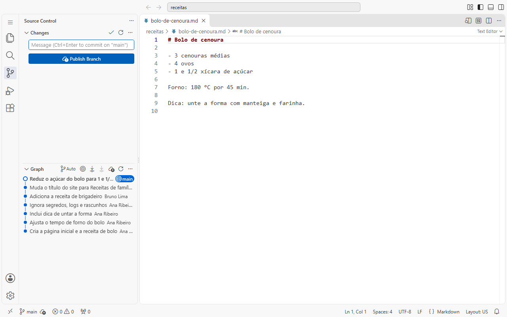
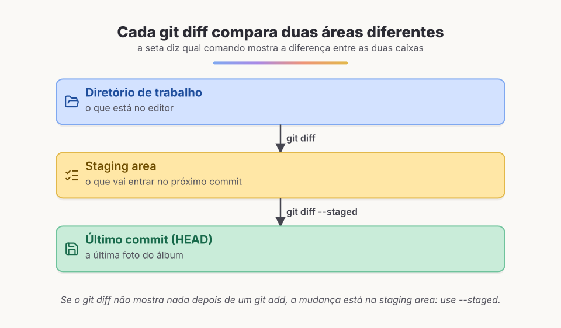
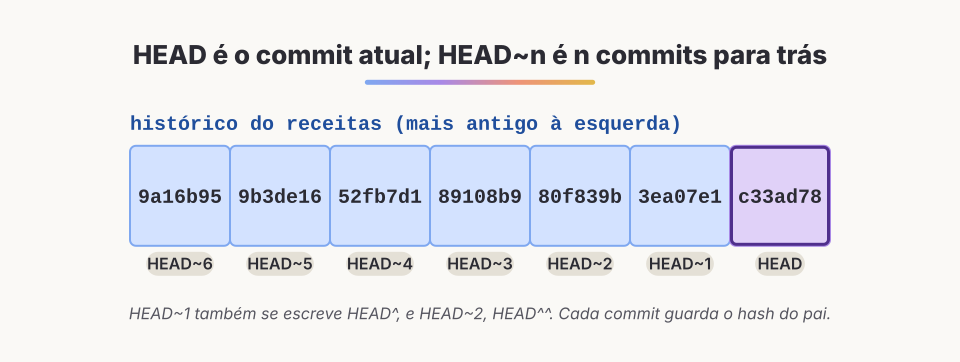

# 4. Commits e histórico

## 📇 Parte 2 de 3: o repositório no seu computador


- [4. Commits e histórico](04-commits-e-historico.md)
- [5. Desfazendo erros com segurança](05-desfazendo-erros-com-seguranca.md)
- [6. Branches, stash e merge](06-branches-stash-e-merge.md)
- [7. Rebase e histórico limpo](07-rebase-e-historico-limpo.md)

> 🗺️ **Neste capítulo:** como montar commits pequenos e com mensagens que explicam a mudança, e como encontrar qualquer coisa no histórico: quem mudou, quando, o quê e por quê. O projeto `receitas` ganha uma receita nova e três commits. · ⏱️ ~50 min

> 🔥 **Aquecimento:**
>
> 1. (Capítulo 3) O `git status -s` mostra `MM receitas/bolo-de-cenoura.md`. Se você rodar `git commit` agora, o que entra no commit?
> 2. (Capítulo 2) Em que arquivo fica o `user.name` gravado com `--global`?
>
> <details>
> <summary>Ver resposta</summary>
>
> 1. Só a versão que está na staging area (o `M` da primeira coluna). A mudança da segunda coluna continua no diretório de trabalho.
> 2. No `~/.gitconfig`, na pasta do seu usuário.
>
> </details>

## De onde paramos

No capítulo 3 você criou o projeto `receitas` com quatro commits e viu o que um commit guarda por dentro. Agora o foco muda: como fazer commits que sirvam para alguém (inclusive você daqui a seis meses) e como consultar o histórico para responder perguntas como “quando o tempo de forno mudou?” ou “quem pôs esta linha aqui?”.

Os hashes deste capítulo continuam os do capítulo 3. Os seus vão ser diferentes, porque dependem do seu nome e da hora de cada commit; compare as mensagens e a ordem, não os códigos.

## git add e git commit

Imagine que numa tarde você acrescenta uma receita, corrige o bolo e muda o título do site, e registra tudo num commit só, “várias mudanças”. Uma semana depois o título novo não agrada. Desfazer aquele commit desfaz também a receita e a correção, que estavam certas. Commits pequenos evitam isso.

**Um commit é um registro permanente de um conjunto de mudanças que formam uma unidade: uma coisa só, que faz sentido sozinha.** Uma receita nova é uma unidade; a mudança de título é outra. Cada uma merece o seu commit.

### Escolher o que entra

O Bruno, irmão da Ana, mandou por mensagem a receita de brigadeiro. A Ana cria o arquivo e acrescenta um item na lista do `index.html`.

<!-- project: receitas -->

**receitas/brigadeiro.md**

```markdown
# Brigadeiro

- 1 lata de leite condensado
- 1 colher de sopa de manteiga
- 3 colheres de sopa de chocolate em pó

Fogo baixo, mexendo sem parar, até soltar do fundo da panela.
```

**index.html**

```html
<!DOCTYPE html>
<html lang="pt-BR">
<head><meta charset="utf-8"><title>Receitas da Ana</title></head>
<body>
  <h1>Receitas da Ana</h1>
  <!-- cada receita nova ganha um item nesta lista -->
  <ul>
    <li><a href="receitas/bolo-de-cenoura.md">Bolo de cenoura</a></li>
    <li><a href="receitas/brigadeiro.md">Brigadeiro</a></li>
  </ul>
</body>
</html>
```

Preveja: o que o `git status -s` mostra para cada arquivo?

```bash
git status -s
```

```text
 M index.html
?? receitas/brigadeiro.md
```

O `index.html` já era rastreado e foi alterado (` M`); o brigadeiro é novo (`??`). As duas mudanças formam uma unidade (a receita e o link para ela), então vão juntas:

```bash
git add index.html receitas/brigadeiro.md
git status -s
```

```text
M  index.html
A  receitas/brigadeiro.md
```

### Commitar em nome de outra pessoa

A receita é do Bruno, e o histórico deve dizer isso. Todo commit tem dois nomes, como você viu no `git cat-file` do capítulo 3: o **autor** (*author*), quem escreveu a mudança, e o **committer**, quem a registrou no repositório. Normalmente são a mesma pessoa. A opção `--author` muda só o autor:

```bash
# a barra no fim da linha continua o comando na linha de baixo
git commit --author="Bruno Lima <bruno.lima@example.com>" \
  -m "Adiciona a receita de brigadeiro"
```

```text
[main 80f839b] Adiciona a receita de brigadeiro
 Author: Bruno Lima <bruno.lima@example.com>
 2 files changed, 8 insertions(+)
 create mode 100644 receitas/brigadeiro.md
```

O Git avisa na segunda linha que o autor é diferente de você. O committer continua sendo a Ana, com a identidade do capítulo 2.

### O atalho `-a` e o que ele deixa de fora

O `git commit -a` (ou `-am`, junto com a mensagem) faz o `git add` de todos os arquivos **já rastreados** e commita, num passo só. Parece prático, mas veja o que acontece se a Ana usar o atalho no momento em que o status mostrava ` M index.html` e `?? receitas/brigadeiro.md` (teste feito numa cópia do repositório):

```bash
git commit -am "Adiciona a receita de brigadeiro"
git status -s
```

```text
[main 04e01b2] Adiciona a receita de brigadeiro
 1 file changed, 1 insertion(+)
?? receitas/brigadeiro.md
```

O commit levou só o link (`1 file changed`). O arquivo da receita, que era *untracked*, ficou de fora: o site agora tem um link para uma página que não existe no histórico.

> ⚠️ **Erro comum:** confiar no `git commit -am` para incluir arquivos novos. O `-a` só pega o que o Git já rastreia. Arquivo novo precisa de `git add` explícito. Na dúvida, rode `git status` antes de commitar e leia o número de arquivos na saída do commit.

## Mensagens de commit

Daqui a alguns meses, o histórico do `receitas` vai ter dezenas de commits. Quem procura “quando o açúcar mudou” lê as mensagens, não o código. Uma lista de “ajustes”, “update” e “várias mudanças” obriga a abrir commit por commit.

**Uma boa mensagem de commit tem uma primeira linha curta (até 50 caracteres) que diz o que o commit faz, e, quando o motivo não é óbvio, uma linha em branco seguida de um corpo explicando por quê.** O Git trata o texto até a primeira linha em branco como o título do commit, e é esse título que aparece no `git log --oneline`, no GitHub e em quase toda ferramenta.


Regras que funcionam na prática:

| Regra | Exemplo |
| --- | --- |
| Título com até 50 caracteres | `Reduz o açúcar do bolo para 1 e 1/2 xícara` (42) |
| Verbo no presente, dizendo o que o commit faz | “Adiciona”, “Corrige”, “Remove”; não “Adicionei” nem “Adicionando” |
| Sem ponto final no título | `Muda o título do site para Receitas de família` |
| Corpo explica o porquê, não repete o quê | “No teste de domingo o bolo ficou doce demais.” |
| Linhas do corpo com até ~72 caracteres | facilita a leitura no terminal |

Em projetos em inglês, a convenção é o imperativo (“Add”, “Fix”). Em português, muitos projetos usam o presente na terceira pessoa, como se o título completasse a frase “Este commit…”; é a forma deste livro. Escolha uma forma e use sempre a mesma no projeto.

### Título e corpo no mesmo comando

O bolo ficou doce demais no teste de domingo, e a Ana reduz o açúcar. Esse é o tipo de mudança em que o porquê importa: sem ele, alguém pode “corrigir” o valor de volta. Cada `-m` vira um parágrafo da mensagem:

```bash
git commit -m "Reduz o açúcar do bolo para 1 e 1/2 xícara" \
  -m "No teste de domingo o bolo ficou doce demais. Com meia xícara a menos
a massa continua macia."
```

```text
[main c33ad78] Reduz o açúcar do bolo para 1 e 1/2 xícara
 1 file changed, 1 insertion(+), 1 deletion(-)
```

O primeiro `-m` é o título; o segundo, o corpo, e o Git põe a linha em branco entre eles. Para mensagens maiores, rode `git commit` sem `-m`: o Git abre o editor que você configurou no capítulo 2 (`core.editor`), e você escreve o título, deixa uma linha em branco e escreve o corpo.

> ⚠️ **Erro comum:** escrever a mensagem pensando em você agora (“arrumei aquilo”). Escreva para quem vai ler o histórico sem saber de nada: o que mudou, e por que, se não for óbvio.

## git log e seus filtros

Com sete commits, o histórico do `receitas` já responde a perguntas. Mas é preciso saber perguntar.

**O `git log` lista os commits do mais novo para o mais antigo, com hash, autor, data e mensagem de cada um.**

Preveja: quantos commits aparecem, e quem é o autor do terceiro?

```bash
git log
```

```text
commit c33ad780bfd27d8b2f1abeeb894319ee4c2d05d2
Author: Ana Ribeiro <ana.ribeiro@example.com>
Date:   Sun Nov 22 18:00:00 2026 -0300

    Reduz o açúcar do bolo para 1 e 1/2 xícara
    
    No teste de domingo o bolo ficou doce demais. Com meia xícara a menos
    a massa continua macia.

commit 3ea07e15cad31169ba5d29bd3578d567bc70f2f3
Author: Ana Ribeiro <ana.ribeiro@example.com>
Date:   Sun Nov 22 09:40:00 2026 -0300

    Muda o título do site para Receitas de família

commit 80f839b6e2a90d394287770d9b9d8427594c1888
Author: Bruno Lima <bruno.lima@example.com>
Date:   Sun Nov 22 09:00:00 2026 -0300

    Adiciona a receita de brigadeiro

commit 89108b9cb63bbb7b87112659b067fac86c3db7ad
Author: Ana Ribeiro <ana.ribeiro@example.com>
Date:   Sat Nov 21 11:30:00 2026 -0300

    Ignora segredos, logs e rascunhos

commit 52fb7d1c944bcd359f1c6b67abeb570326e50301
Author: Ana Ribeiro <ana.ribeiro@example.com>
Date:   Sat Nov 21 11:00:00 2026 -0300

    Inclui dica de untar a forma

commit 9b3de16ce2245ddfb640e8901a24b788ecdc3af6
Author: Ana Ribeiro <ana.ribeiro@example.com>
Date:   Sat Nov 21 10:30:00 2026 -0300

    Ajusta o tempo de forno do bolo

commit 9a16b9557891a882ef8a194288634daeb36d515c
Author: Ana Ribeiro <ana.ribeiro@example.com>
Date:   Sat Nov 21 10:00:00 2026 -0300

    Cria a página inicial e a receita de bolo
```

Sete commits; o terceiro de cima para baixo é o do Bruno. (Para seguir este capítulo, faça também o commit “Muda o título do site para Receitas de família”, trocando “Receitas da Ana” por “Receitas de família” no `<title>` e no `<h1>` do `index.html`; o laboratório tem o passo a passo.)

> 💡 Num terminal de verdade, quando a lista não cabe na tela, o Git a mostra num **paginador** (o programa `less`): a tela para e espera. Use as setas ou a barra de espaço para rolar e **`q` para sair**. Quem não conhece costuma achar que o terminal travou.

### Os filtros do dia a dia

A saída completa é longa. Estas opções resolvem quase tudo:

| Opção | Mostra |
| --- | --- |
| `--oneline` | um commit por linha: hash curto e título |
| `-n 2` | só os 2 commits mais recentes |
| `--stat` | quais arquivos cada commit mudou, e quantas linhas |
| `-p` | a diferença completa (*patch*) de cada commit |
| `--author=Bruno` | só commits cujo autor contém “Bruno” |
| `--since` e `--until` | só commits dentro de um intervalo de datas |
| `--grep=bolo` | só commits cuja mensagem contém “bolo” |
| `-- <arquivo>` | só commits que mexeram nesse arquivo |

A forma que você vai usar o tempo todo:

```bash
git log --oneline
```

```text
c33ad78 Reduz o açúcar do bolo para 1 e 1/2 xícara
3ea07e1 Muda o título do site para Receitas de família
80f839b Adiciona a receita de brigadeiro
89108b9 Ignora segredos, logs e rascunhos
52fb7d1 Inclui dica de untar a forma
9b3de16 Ajusta o tempo de forno do bolo
9a16b95 Cria a página inicial e a receita de bolo
```

Repare que só o título aparece: o corpo do commit do açúcar ficou de fora. É por isso que o título precisa se sustentar sozinho.

Editores também leem o histórico. No VS Code, a seção **Graph**, no fim do painel Source Control, mostra os mesmos sete commits, com o autor ao lado de cada título:



*O histórico do `receitas` na seção Graph do VS Code. O botão Publish Branch envia o repositório para o GitHub, assunto do capítulo 8. Captura do VS Code (code-server).*

Para ver o que cada commit tocou, sem o conteúdo:

```bash
git log --stat -n 2
```

```text
commit c33ad780bfd27d8b2f1abeeb894319ee4c2d05d2
Author: Ana Ribeiro <ana.ribeiro@example.com>
Date:   Sun Nov 22 18:00:00 2026 -0300

    Reduz o açúcar do bolo para 1 e 1/2 xícara
    
    No teste de domingo o bolo ficou doce demais. Com meia xícara a menos
    a massa continua macia.

 receitas/bolo-de-cenoura.md | 2 +-
 1 file changed, 1 insertion(+), 1 deletion(-)

commit 3ea07e15cad31169ba5d29bd3578d567bc70f2f3
Author: Ana Ribeiro <ana.ribeiro@example.com>
Date:   Sun Nov 22 09:40:00 2026 -0300

    Muda o título do site para Receitas de família

 index.html | 4 ++--
 1 file changed, 2 insertions(+), 2 deletions(-)
```

Os sinais `+` e `-` são proporcionais às linhas inseridas e removidas. Trocar uma linha conta como uma remoção e uma inserção.

Três perguntas, três filtros:

```bash
# Quais commits são do Bruno?
git log --oneline --author=Bruno
# Quais commits mexeram no bolo?
git log --oneline -- receitas/bolo-de-cenoura.md
# Quais mensagens falam do bolo?
git log --oneline --grep=bolo
```

```text
80f839b Adiciona a receita de brigadeiro
c33ad78 Reduz o açúcar do bolo para 1 e 1/2 xícara
52fb7d1 Inclui dica de untar a forma
9b3de16 Ajusta o tempo de forno do bolo
9a16b95 Cria a página inicial e a receita de bolo
c33ad78 Reduz o açúcar do bolo para 1 e 1/2 xícara
9b3de16 Ajusta o tempo de forno do bolo
9a16b95 Cria a página inicial e a receita de bolo
```

Compare as duas últimas listas. O filtro por arquivo (`--`) encontrou o commit `52fb7d1`, da dica de untar a forma, cuja mensagem não tem a palavra “bolo”. O `--grep` procura só nas mensagens; o `--` procura no que o commit mudou de fato. O `--` separa as opções do nome do arquivo e evita que o Git confunda um arquivo com o nome de um commit.

### Filtrar por data

Preveja: `git log --oneline --since=2026-11-22` mostra os três commits do dia 22?

```bash
git log --oneline --since=2026-11-22
```

```text
c33ad78 Reduz o açúcar do bolo para 1 e 1/2 xícara
```

Só um. Quando você dá uma data sem hora, o Git completa com **a hora atual do relógio**. O comando acima rodou às 15h44, então virou “desde 22/11 às 15h44”, e só o commit das 18h passou no filtro. Se você rodar o mesmo comando às 8h da manhã, vai ver os três. Para não depender da hora, diga a hora:

```bash
git log --oneline --since="2026-11-22 00:00"
```

```text
c33ad78 Reduz o açúcar do bolo para 1 e 1/2 xícara
3ea07e1 Muda o título do site para Receitas de família
80f839b Adiciona a receita de brigadeiro
```

O `--until` funciona da mesma forma para o fim do intervalo, e os dois combinam:

```bash
git log --oneline --since="2026-11-21 10:45" --until="2026-11-22 09:30"
```

```text
80f839b Adiciona a receita de brigadeiro
89108b9 Ignora segredos, logs e rascunhos
52fb7d1 Inclui dica de untar a forma
```

O `--since` também aceita formas relativas, como `--since="2 weeks ago"` (há duas semanas).

> ⚠️ **Erro comum:** concluir que “não houve commits naquele dia” porque o filtro por data voltou vazio ou curto. Confira se você deu a hora; sem ela, o resultado muda conforme a hora em que você roda o comando.

### Escolher o formato

O `--format` monta cada linha como você quiser. `%h` é o hash curto, `%an` o nome do autor, `%ad` a data do autor e `%s` o título:

```bash
git log --format="%h %an, %ad: %s" --date=short
```

```text
c33ad78 Ana Ribeiro, 2026-11-22: Reduz o açúcar do bolo para 1 e 1/2 xícara
3ea07e1 Ana Ribeiro, 2026-11-22: Muda o título do site para Receitas de família
80f839b Bruno Lima, 2026-11-22: Adiciona a receita de brigadeiro
89108b9 Ana Ribeiro, 2026-11-21: Ignora segredos, logs e rascunhos
52fb7d1 Ana Ribeiro, 2026-11-21: Inclui dica de untar a forma
9b3de16 Ana Ribeiro, 2026-11-21: Ajusta o tempo de forno do bolo
9a16b95 Ana Ribeiro, 2026-11-21: Cria a página inicial e a receita de bolo
```

A lista completa dos marcadores está na documentação do `git log`, na seção *PRETTY FORMATS*. Quando o projeto tiver branches (capítulo 6), a opção `--graph` desenha as linhas de trabalho ao lado dos commits.

## git show, git diff, git blame

O `git log` diz **quais** commits existem. Para ver **o que** mudou, existem três comandos, cada um com uma pergunta.

| Pergunta | Comando |
| --- | --- |
| O que este commit mudou? | `git show <commit>` |
| O que mudou entre duas versões? | `git diff` |
| Que commit mexeu por último em cada linha deste arquivo? | `git blame <arquivo>` |

### git show

**O `git show` mostra um commit: a mensagem completa e a diferença que ele introduziu.** Sem argumento, mostra o commit atual:

```bash
git show
```

```text
commit c33ad780bfd27d8b2f1abeeb894319ee4c2d05d2
Author: Ana Ribeiro <ana.ribeiro@example.com>
Date:   Sun Nov 22 18:00:00 2026 -0300

    Reduz o açúcar do bolo para 1 e 1/2 xícara
    
    No teste de domingo o bolo ficou doce demais. Com meia xícara a menos
    a massa continua macia.

diff --git a/receitas/bolo-de-cenoura.md b/receitas/bolo-de-cenoura.md
index cf98285..da75515 100644
--- a/receitas/bolo-de-cenoura.md
+++ b/receitas/bolo-de-cenoura.md
@@ -2,7 +2,7 @@
 
 - 3 cenouras médias
 - 4 ovos
-- 2 xícaras de açúcar
+- 1 e 1/2 xícara de açúcar
 
 Forno: 180 °C por 45 min.
 
```

Como ler a diferença:

- `--- a/...` é a versão antes; `+++ b/...` é a versão depois.
- `@@ -2,7 +2,7 @@` diz onde está o trecho: a partir da linha 2, com 7 linhas, nas duas versões.
- Linhas com `-` saíram; com `+` entraram; sem sinal são contexto, para você se localizar.
- A linha `index cf98285..da75515` traz os hashes dos blobs antes e depois, os mesmos objetos do capítulo 3.

O `git show` também aceita um hash ou opções do `log`, como `git show --stat 80f839b`. E mostra um arquivo como ele era em qualquer commit, com `<commit>:<caminho>`:

```bash
git show 3ea07e1:index.html
```

```text
<!DOCTYPE html>
<html lang="pt-BR">
<head><meta charset="utf-8"><title>Receitas de família</title></head>
<body>
  <h1>Receitas de família</h1>
  <!-- cada receita nova ganha um item nesta lista -->
  <ul>
    <li><a href="receitas/bolo-de-cenoura.md">Bolo de cenoura</a></li>
    <li><a href="receitas/brigadeiro.md">Brigadeiro</a></li>
  </ul>
</body>
</html>
```

Isso só **mostra** a versão antiga; o arquivo na sua pasta não muda. Trazer uma versão antiga de volta é assunto do capítulo 5.

### git diff

**O `git diff` mostra a diferença entre duas versões do projeto; qual par ele compara depende de como você o chama.**

Antes do commit do açúcar, a Ana editou o bolo e rodou `git diff` sem argumentos:

```bash
git diff
```

```text
diff --git a/receitas/bolo-de-cenoura.md b/receitas/bolo-de-cenoura.md
index cf98285..da75515 100644
--- a/receitas/bolo-de-cenoura.md
+++ b/receitas/bolo-de-cenoura.md
@@ -2,7 +2,7 @@
 
 - 3 cenouras médias
 - 4 ovos
-- 2 xícaras de açúcar
+- 1 e 1/2 xícara de açúcar
 
 Forno: 180 °C por 45 min.
 
```

Preveja: depois de `git add receitas/bolo-de-cenoura.md`, o que o mesmo `git diff` mostra?

```bash
git add receitas/bolo-de-cenoura.md
git diff
```

O comando não mostra nada. O `git diff` sem argumentos compara o diretório de trabalho com a staging area, e agora os dois são iguais. A mudança não sumiu: foi para a staging area. Para vê-la, compare a staging area com o último commit:

```bash
git diff --staged
```

```text
diff --git a/receitas/bolo-de-cenoura.md b/receitas/bolo-de-cenoura.md
index cf98285..da75515 100644
--- a/receitas/bolo-de-cenoura.md
+++ b/receitas/bolo-de-cenoura.md
@@ -2,7 +2,7 @@
 
 - 3 cenouras médias
 - 4 ovos
-- 2 xícaras de açúcar
+- 1 e 1/2 xícara de açúcar
 
 Forno: 180 °C por 45 min.
 
```



O `git diff --staged` é exatamente o que vai entrar no próximo commit. Rodá-lo antes de `git commit` é a melhor revisão que existe. (`--cached` é outro nome para a mesma opção.)

Para comparar dois commits, passe os dois. A ordem importa: primeiro o “antes”, depois o “depois”. Com `--stat`, você vê o resumo:

```bash
git diff 89108b9 c33ad78 --stat
```

```text
 index.html                  | 5 +++--
 receitas/bolo-de-cenoura.md | 2 +-
 receitas/brigadeiro.md      | 7 +++++++
 3 files changed, 11 insertions(+), 3 deletions(-)
```

Essa é a soma dos três commits do dia 22: o brigadeiro, o título e o açúcar.

> ⚠️ **Erro comum:** rodar `git diff` depois do `git add`, não ver nada e achar que a mudança se perdeu. Ela está na staging area; use `git diff --staged`.

### git blame

**O `git blame` mostra, para cada linha de um arquivo, o último commit que a alterou, com autor e data.** Ele responde “de onde veio esta linha?”:

```bash
git blame receitas/bolo-de-cenoura.md
```

```text
^9a16b95 (Ana Ribeiro 2026-11-21 10:00:00 -0300 1) # Bolo de cenoura
^9a16b95 (Ana Ribeiro 2026-11-21 10:00:00 -0300 2) 
^9a16b95 (Ana Ribeiro 2026-11-21 10:00:00 -0300 3) - 3 cenouras médias
^9a16b95 (Ana Ribeiro 2026-11-21 10:00:00 -0300 4) - 4 ovos
c33ad780 (Ana Ribeiro 2026-11-22 18:00:00 -0300 5) - 1 e 1/2 xícara de açúcar
^9a16b95 (Ana Ribeiro 2026-11-21 10:00:00 -0300 6) 
9b3de16c (Ana Ribeiro 2026-11-21 10:30:00 -0300 7) Forno: 180 °C por 45 min.
52fb7d1c (Ana Ribeiro 2026-11-21 11:00:00 -0300 8) 
52fb7d1c (Ana Ribeiro 2026-11-21 11:00:00 -0300 9) Dica: unte a forma com manteiga e farinha.
```

Cada linha começa com o hash do commit responsável. O `^` em `^9a16b95` marca o commit de limite (*boundary*), onde o histórico começa: aqui, o primeiro commit do repositório. Para ver só um trecho, use `-L início,fim`: `git blame -L 5,7 receitas/bolo-de-cenoura.md`.

A linha 7 diz `9b3de16`. Com o hash na mão, `git show 9b3de16` mostra a mensagem e a mudança completa: “Ajusta o tempo de forno do bolo”, 40 → 45 min. É assim que se chega do “que linha estranha é esta?” ao “por que ela é assim?”.

> ⚠️ **Erro comum:** tomar o `blame` como “quem escreveu esta linha”. Ele mostra **o último commit que mexeu nela**. Se alguém só trocou um espaço numa linha antiga, o nome dessa pessoa aparece. Apesar do nome (*blame* é “culpa”), o comando serve para encontrar o contexto de uma mudança, não um culpado.

## HEAD e HEAD~n

Copiar hashes é chato e fácil de errar. Muitas vezes você quer algo como “o commit anterior” ou “três commits atrás”, sem procurar o código.

**`HEAD` é o nome do commit em que você está agora: normalmente, o último commit da linha de trabalho atual.** Veja para onde ele aponta:

```bash
cat .git/HEAD
cat .git/refs/heads/main
```

```text
ref: refs/heads/main
c33ad780bfd27d8b2f1abeeb894319ee4c2d05d2
```

O `HEAD` aponta para `main`, o nome da linha de trabalho (a **branch**, assunto do capítulo 6), e `main` aponta para o último commit, `c33ad78`. A cada commit novo, `main` avança, e o `HEAD` vai junto.

A partir do `HEAD`, você conta para trás:

| Escrita | Quer dizer | No `receitas` |
| --- | --- | --- |
| `HEAD` | o commit atual | `c33ad78` (açúcar) |
| `HEAD~1` ou `HEAD^` | o pai do atual | `3ea07e1` (título) |
| `HEAD~2` ou `HEAD^^` | o avô | `80f839b` (brigadeiro) |
| `HEAD~n` | n commits para trás, seguindo sempre o primeiro pai | `HEAD~6` = `9a16b95` |



Preveja: o que `git show -s --oneline HEAD~2` mostra? (O `-s` esconde a diferença.)

```bash
git show -s --oneline HEAD~2
```

```text
80f839b Adiciona a receita de brigadeiro
```

Esses nomes funcionam em qualquer comando que espera um commit. `git diff HEAD~3 HEAD --stat` dá o mesmo resultado do `git diff 89108b9 c33ad78 --stat` de antes, sem copiar nenhum hash. E `git log --oneline HEAD~2` lista o histórico a partir do brigadeiro, como se os dois últimos commits não existissem.

> 💡 **Analogia:** no álbum de fotos do projeto, o `HEAD` é o **marcador de página** na foto mais recente. `HEAD~2` quer dizer “volte duas fotos a partir do marcador”. Quando você cola uma foto nova (faz um commit), o marcador passa para ela, e todos os `HEAD~n` passam a apontar uma foto mais para trás. A analogia quebra num ponto: no álbum, você pode abrir qualquer página e o marcador fica onde estava; no Git, o `HEAD` também define **onde a próxima foto vai entrar**. Mudar o marcador de lugar de propósito é o que você vai fazer no capítulo 5.

> ⚠️ **Erro comum:** achar que `HEAD~2` é sempre o mesmo commit. Ele é relativo: depois de um commit novo, `HEAD~2` passa a ser outro. Para apontar um commit fixo (numa anotação, numa conversa com um colega), use o hash.

Se você contar para trás além do primeiro commit, o Git avisa que a revisão não existe:

```bash
git rev-parse HEAD~7
```

```text
fatal: ambiguous argument 'HEAD~7': unknown revision or path not in the working tree.
Use '--' to separate paths from revisions, like this:
'git <command> [<revision>...] -- [<file>...]'
HEAD~7
```

(O `git rev-parse` traduz um nome como `HEAD~2` para o hash completo; útil para conferir para onde um nome aponta.)

## 🧪 Laboratório: três commits no receitas

Continue no repositório `receitas` do capítulo 3, conferindo cada passo.

1. Confira o ponto de partida: `git log --oneline` mostra 4 commits e `git status` diz `working tree clean`.
2. Crie `receitas/brigadeiro.md` e acrescente o item do brigadeiro no `index.html`, como neste capítulo. Confira: `git status -s` mostra ` M index.html` e `?? receitas/brigadeiro.md`.
3. Rode `git add index.html receitas/brigadeiro.md` e faça o commit com `--author="Bruno Lima <bruno.lima@example.com>"`. Confira: a saída do commit tem a linha `Author: Bruno Lima` e diz `2 files changed`.
4. Troque “Receitas da Ana” por “Receitas de família” no `<title>` e no `<h1>`. Rode `git diff` e confira: duas linhas com `-` e duas com `+`.
5. Faça `git add index.html` e o commit “Muda o título do site para Receitas de família”.
6. Mude `- 2 xícaras de açúcar` para `- 1 e 1/2 xícara de açúcar` no bolo. Rode `git diff`, depois `git add`, depois `git diff` de novo (vazio) e `git diff --staged` (a mudança).
7. Faça o commit com título e corpo (dois `-m`), como neste capítulo. Confira com `git log -n 1`: o corpo aparece recuado, depois de uma linha em branco.
8. Responda com o histórico: qual commit mexeu por último na linha do tempo de forno? (`git blame`.) E quais commits mexeram no `index.html`? (`git log --oneline -- index.html`.)
9. Confira os nomes relativos: `git show -s --oneline HEAD~2` deve mostrar o commit do brigadeiro.

Pronto quando: `git log --oneline` mostra 7 commits, o terceiro de cima é do Bruno (`git log --author=Bruno`), e `git status` diz `working tree clean`.

Os arquivos, como ficam no fim do capítulo:

**index.html**

```html
<!DOCTYPE html>
<html lang="pt-BR">
<head><meta charset="utf-8"><title>Receitas de família</title></head>
<body>
  <h1>Receitas de família</h1>
  <!-- cada receita nova ganha um item nesta lista -->
  <ul>
    <li><a href="receitas/bolo-de-cenoura.md">Bolo de cenoura</a></li>
    <li><a href="receitas/brigadeiro.md">Brigadeiro</a></li>
  </ul>
</body>
</html>
```

**receitas/bolo-de-cenoura.md**

```markdown
# Bolo de cenoura

- 3 cenouras médias
- 4 ovos
- 1 e 1/2 xícara de açúcar

Forno: 180 °C por 45 min.

Dica: unte a forma com manteiga e farinha.
```

## 🏋️ Pratique

**1. Exemplo resolvido.** A Ana quer saber quando e por que o tempo de forno do bolo passou a ser 45 min, sem lembrar de nada. Como ela descobre?

1. `git blame -L 7,7 receitas/bolo-de-cenoura.md` aponta a linha do forno para o commit `9b3de16`, de 21/11 às 10h30.
2. `git show 9b3de16` mostra a mensagem (“Ajusta o tempo de forno do bolo”) e a diferença: `-Forno: 180 °C por 40 min.` e `+Forno: 180 °C por 45 min.`

Resposta: no commit `9b3de16`; o tempo era 40 min. A mensagem diz o quê, mas não o porquê: esse commit seria melhor com um corpo (“com 40 min o meio ficava cru”). Repare no caminho: `blame` dá o hash, `show` dá a história.

**2. Complete.** Preencha o comando que responde cada pergunta no `receitas`:

| Pergunta | Comando |
| --- | --- |
| Os 3 commits mais recentes, um por linha | `git log ______ -n 3` |
| O que vai entrar no próximo commit | `git diff ______` |
| Commits que mexeram no brigadeiro | `git log --oneline ______ receitas/brigadeiro.md` |
| Commits com “título” na mensagem | `git log --oneline ______` |
| O commit anterior ao atual, só a mensagem | `git show -s ______` |

<details>
<summary>Ver resposta</summary>

| Pergunta | Comando |
| --- | --- |
| 3 mais recentes | `git log --oneline -n 3` |
| Próximo commit | `git diff --staged` (ou `--cached`) |
| Mexeram no brigadeiro | `git log --oneline -- receitas/brigadeiro.md` |
| “título” na mensagem | `git log --oneline --grep=título` |
| Commit anterior | `git show -s HEAD~1` (ou `HEAD^`) |

O erro mais comum é usar `git diff` sem `--staged` na segunda linha: ele mostra o que ainda **não** foi para a staging area. Outro é esquecer o `--` antes do arquivo: na maioria das vezes funciona, mas, se um arquivo tiver o mesmo nome de uma branch, o Git não sabe qual dos dois você quis dizer.

</details>

**3. Sozinho.** No seu `receitas`, acrescente ao brigadeiro a linha `Rende 25 unidades.` e mude “Fogo baixo” para “Fogo médio-baixo”. Decida se isso é um commit ou dois, escreva as mensagens e faça os commits. Depois confira com `git log --stat -n 2`.

<details>
<summary>Ver resposta</summary>

São duas unidades diferentes (uma informação nova e uma correção de preparo), então o ideal são dois commits, cada um com o seu `git add` e a sua mensagem. Para separar duas mudanças do mesmo arquivo, faça uma de cada vez: edite, `git add`, commit; depois a outra. Um exemplo:

```text
Informa o rendimento do brigadeiro
Muda o fogo do brigadeiro para médio-baixo
```

Confira com esta régua:

- Cada título tem até 50 caracteres e começa com um verbo no presente.
- Nenhum título é genérico (“ajustes”, “update”).
- A mudança de fogo tem um corpo dizendo por quê, se o motivo não é óbvio (por exemplo, “no fogo baixo demorava 40 min”).
- O `git log --stat -n 2` mostra `receitas/brigadeiro.md | 1 +` num commit e `| 2 +-` no outro.

Juntar tudo num commit não é errado no sentido técnico, mas, se só a mudança do fogo precisar ser desfeita, a outra vai junto.

</details>

**4. Desafio.** Num projeto maior, o site parou de mostrar o brigadeiro em algum momento da última semana. Você não sabe qual commit causou isso. Monte uma sequência de comandos do `log`, `show` e `diff` para chegar ao commit culpado sem abrir commit por commit. Explique o papel de cada um.

<details>
<summary>Ver resposta</summary>

Uma sequência possível:

1. `git log --oneline --since="1 week ago" -- index.html` lista só os commits da semana que mexeram na página que tem o link.
2. `git log -p --since="1 week ago" -- index.html` mostra a diferença de cada um deles; procure uma linha `-` com `brigadeiro`.
3. `git show <hash>` mostra o commit encontrado inteiro, com a mensagem, para entender se a remoção foi de propósito.
4. Alternativa: `git blame index.html` mostra a origem das linhas que estão lá hoje; o `blame` não mostra linhas apagadas, por isso aqui ele é menos útil que o `log -p`.

Confira sua resposta: ela usa o filtro por arquivo (`-- index.html`) para reduzir a lista, usa `-p` ou `git show` para ver o conteúdo, e percebe que `blame` não encontra o que foi removido. O capítulo 5 mostra como desfazer o commit encontrado.

</details>

## 🧠 Revisão rápida

1. O que o `git commit -am` deixa de fora?
2. Quais são as três partes de uma boa mensagem de commit?
3. Por que `git log --since=2026-11-22` pode trazer resultados diferentes de manhã e à tarde?
4. O `git diff` não mostra nada, mas você editou um arquivo. O que provavelmente aconteceu?
5. (Capítulo 3) O que o `index cf98285..da75515` de um diff tem a ver com os blobs?
6. (Capítulo 1) Que informações o histórico guarda sobre cada mudança?

<details>
<summary>Ver resposta</summary>

1. Arquivos novos (*untracked*): o `-a` só inclui os já rastreados.
2. Título curto (até 50 caracteres) dizendo o que o commit faz, uma linha em branco e um corpo explicando o porquê, quando não for óbvio.
3. Porque, sem hora, o Git usa a hora atual do relógio no filtro.
4. Você rodou `git add`: a mudança está na staging area, e aparece com `git diff --staged`.
5. São os hashes do blob do arquivo antes e depois da mudança.
6. O conteúdo, quem fez, quando e a mensagem; e o hash que identifica o commit.

</details>

## 🤖 Estude com um tutor de IA

```text
Vou te mostrar mensagens de commit que escrevi num projeto meu. Para cada
uma, diga se o título passa nas regras (até 50 caracteres, verbo no
presente, diz o que mudou) e se falta um corpo explicando o porquê.
Não reescreva por mim: me faça perguntas até eu melhorar sozinho.
<cole aqui a saída de git log -n 5>
```

```text
Faça 5 perguntas sobre um histórico Git imaginário (quem mudou, quando,
o quê), uma de cada vez. Eu respondo com o comando git log, git show,
git diff ou git blame que usaria. Corrija só depois da minha resposta.
```

> ➡️ **Próximo passo:** agora você encontra qualquer mudança no histórico. O capítulo 5 ensina a desfazer: descartar uma edição, tirar um arquivo da staging area, corrigir o último commit e voltar atrás em commits inteiros, sempre com o caminho mais seguro primeiro.

## 📌 Resumo

| Item | Em uma frase |
| --- | --- |
| Commit | Registro permanente de uma unidade de mudança; um assunto por commit. |
| `--author` | Registra outra pessoa como autora; você continua como committer. |
| `git commit -am` | Adiciona e commita só os arquivos já rastreados; arquivo novo fica de fora. |
| Mensagem de commit | Título de até 50 caracteres, linha em branco e corpo com o porquê. |
| `git log` | Lista os commits do mais novo ao mais antigo; `--oneline`, `--stat`, `-p`, `-n`. |
| Filtros do log | `--author`, `--grep`, `--since`/`--until` (com hora!) e `-- <arquivo>`. |
| `git show` | Mostra um commit inteiro; com `<commit>:<arquivo>`, um arquivo naquela versão. |
| `git diff` | Trabalho × staging; `--staged`, staging × último commit; `A B`, entre dois commits. |
| `git blame` | Mostra o último commit que alterou cada linha de um arquivo. |
| `HEAD` e `HEAD~n` | O commit atual e o commit n passos para trás; são nomes relativos. |

## 📚 Fontes

- [Pro Git, 2.3 — Viewing the Commit History](https://git-scm.com/book/en/v2/Git-Basics-Viewing-the-Commit-History) (consultado em 21/11/2026)
- [Pro Git, 5.2 — Contributing to a Project: Commit Guidelines](https://git-scm.com/book/en/v2/Distributed-Git-Contributing-to-a-Project) (consultado em 21/11/2026)
- [git-commit](https://git-scm.com/docs/git-commit) (seção *DISCUSSION*, sobre o título de até 50 caracteres), [git-log](https://git-scm.com/docs/git-log), [git-show](https://git-scm.com/docs/git-show), [git-diff](https://git-scm.com/docs/git-diff), [git-blame](https://git-scm.com/docs/git-blame) e [gitrevisions](https://git-scm.com/docs/gitrevisions) — Git Reference Manual (Git 2.56, consultados em 21/11/2026)
- Anotações do curso “Git e GitHub Essencial para o Desenvolvedor” (Geek University, Udemy): “Como fazer os commits”, “Como consultar o histórico do projeto”, “Conhecendo alguns comandos úteis” e “Consultando histórico de commits”: estrutura e tópicos.

> 🔁 **Revise hoje:** capítulos 1 (o que o histórico guarda) e 3 (as três áreas e os estados).
