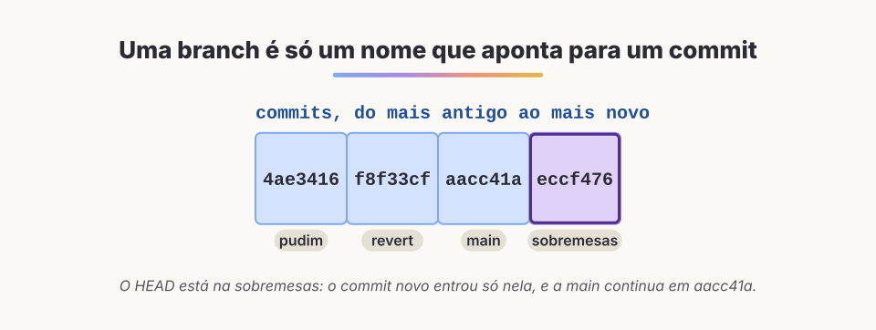

# 6. Branches, stash e merge

> 🗺️ **Neste capítulo:** trabalhar em mais de uma frente ao mesmo tempo com branches, guardar trabalho pela metade com `git stash` e juntar as frentes com `git merge`, inclusive quando as duas mudaram a mesma linha. O `receitas` ganha uma seção de sobremesas e passa pelo primeiro conflito. · ⏱️ ~60 min

> 🔥 **Aquecimento:**
>
> 1. (Capítulo 5) O que o `.git/HEAD` contém em detached HEAD, e o que contém normalmente?
> 2. (Capítulo 4) Que comando mostra só os commits que mexeram em `receitas/pudim.md`?
>
> <details>
> <summary>Ver resposta</summary>
>
> 1. Em detached HEAD, o hash de um commit; normalmente, `ref: refs/heads/main` (o nome da branch).
> 2. `git log --oneline -- receitas/pudim.md`.
>
> </details>

## De onde paramos

No capítulo 5 a palavra **branch** apareceu várias vezes: a `main` para onde o `HEAD` aponta, o commit do forno a 200 °C que ficou “sem branch”, o aviso sugerindo `git branch <nome>`. Agora ela ganha o seu capítulo. O `receitas` está com a receita de pudim, o título de volta a “Receitas da Ana” e o `estilo.css` recuperado do reflog (último commit `aacc41a`).

## Branch como ponteiro

A Ana quer criar uma seção de sobremesas com várias receitas novas. Vai levar alguns dias, e no meio do caminho o site precisa continuar certo: se alguém avisar de um erro no pudim, ela quer corrigir na hora, sem publicar sobremesas pela metade. Ela precisa de duas linhas de trabalho independentes no mesmo repositório.

**Uma branch é um nome que aponta para um commit; quando você faz um commit na branch, o nome avança para o commit novo.** A `main` que você usa desde o capítulo 3 é uma branch: a que o `git init` cria.

Veja as branches que existem e crie uma:

```bash
git branch
git branch sobremesas
git branch
```

```text
* main
* main
  sobremesas
```

O `*` marca a branch atual. Preveja: o que tem dentro do arquivo da branch nova?

```bash
cat .git/refs/heads/sobremesas
git log --oneline -n 1
```

```text
aacc41ac8901cb3137e41f89de019a0d14e51e8b
aacc41a Adiciona estilo com fundo escuro
```

Um hash, e mais nada. Criar a branch gravou um arquivo de 41 bytes (40 caracteres e uma quebra de linha), sem copiar nenhum arquivo do projeto. Por isso criar branches no Git é instantâneo, e você pode criar quantas quiser.

> ⚠️ **Erro comum:** achar que uma branch é uma cópia da pasta do projeto. Ela é apenas um nome para um commit. Os arquivos que você vê na pasta são os do commit para onde o `HEAD` aponta; trocar de branch troca esses arquivos (próxima seção).

## git switch

### Trocar de branch

`git branch sobremesas` criou o nome, mas o `HEAD` continua na `main`: os próximos commits ainda iriam para ela. **O `git switch <branch>` muda o `HEAD` para outra branch e deixa os arquivos da pasta iguais ao último commit dela.**

```bash
git switch sobremesas
cat .git/HEAD
```

```text
Switched to branch 'sobremesas'
ref: refs/heads/sobremesas
```

A Ana cria a primeira sobremesa e põe o link no `index.html`, logo abaixo do pudim:

<!-- project: receitas -->

**receitas/mousse-de-maracuja.md**

```markdown
# Mousse de maracujá

- 1 lata de leite condensado
- 1 caixa de creme de leite
- 1 xícara de suco concentrado de maracujá

Bata tudo no liquidificador e leve à geladeira por 3 h.
```

```bash
git add .
git commit -m "Adiciona a receita de mousse de maracujá"
```

```text
[sobremesas eccf476] Adiciona a receita de mousse de maracujá
 2 files changed, 8 insertions(+)
 create mode 100644 receitas/mousse-de-maracuja.md
```

A primeira linha da saída diz em que branch o commit entrou. Só a `sobremesas` avançou:



Preveja: o que acontece com a pasta `receitas` quando a Ana volta para a `main`?

```bash
git switch main
ls receitas
```

```text
Switched to branch 'main'
bolo-de-cenoura.md
brigadeiro.md
pudim.md
```

A mousse sumiu da pasta. Ela não foi apagada: está no commit `eccf476`, e volta quando a Ana trocar para a `sobremesas`. Na `main`, o site continua exatamente como estava.

Para criar uma branch e já trocar para ela, use `git switch -c <nome>` (de *create*). Na forma antiga, o mesmo era `git checkout -b <nome>`, e trocar era `git checkout <nome>`.

> 💡 **Analogia:** no álbum de fotos do projeto, cada branch é um **marcador com etiqueta** (“main”, “sobremesas”) preso numa foto. O `HEAD` diz qual marcador você está segurando. Quando você cola uma foto nova, ela entra depois da foto do seu marcador, e só esse marcador avança. Duas pessoas podem continuar o álbum a partir da mesma foto em direções diferentes, cada uma com o seu marcador. A analogia quebra num ponto: um álbum de papel não tem como ter duas continuações para a mesma página; o Git tem, porque cada commit só guarda quem é o pai dele, e vários commits podem ter o mesmo pai.

### Trocar com mudanças pela metade

De volta à `main`, a Ana começa a mudar o título do `index.html` e, antes de commitar, tenta trocar para a `sobremesas`:

```bash
git status -s
git switch sobremesas
```

```text
 M index.html
error: Your local changes to the following files would be overwritten by checkout:
	index.html
Please commit your changes or stash them before you switch branches.
Aborting
```

O Git se recusou. A `sobremesas` tem outra versão do `index.html` (com o link da mousse), e trocar de branch substituiria o arquivo, apagando a edição que ainda não foi commitada. Ele sugere duas saídas: commitar ou guardar com `stash`. A Ana descarta o rascunho do título (`git restore index.html`) e segue.

> ⚠️ **Erro comum:** achar que as mudanças não commitadas “pertencem” à branch onde você estava. Elas estão só no diretório de trabalho e na staging area, que são os mesmos para todas as branches. Quando o arquivo não conflita com a outra branch, o Git troca e leva a edição junto, o que surpreende ainda mais. Antes de trocar, deixe o `git status` limpo: commite ou use o `stash`.

## Stash

Na `sobremesas`, a Ana começa a torta de limão. Escreve metade da receita e o link, e aí a tia avisa: o pudim leva 1 h no forno, não 1 h 30. O site está errado agora, e a correção precisa sair da `main`, sem a torta pela metade.

```bash
git status -s
```

```text
 M index.html
?? receitas/torta-de-limao.md
```

A torta não está pronta para virar commit. **O `git stash` guarda as mudanças não commitadas numa pilha à parte e deixa o diretório de trabalho limpo, igual ao último commit.**

Preveja: depois de `git stash`, o que sobra no `git status -s`?

```bash
git stash
git status -s
```

```text
Saved working directory and index state WIP on sobremesas: eccf476 Adiciona a receita de mousse de maracujá
?? receitas/torta-de-limao.md
```

O `index.html` foi guardado, mas a torta ficou. Por padrão, o `stash` guarda só arquivos rastreados; um arquivo novo continua na pasta. Para incluir os não rastreados, use `-u` (de *untracked*). A Ana devolve o que guardou com `git stash pop` e repete, agora com `-u` e uma mensagem para lembrar do que se trata:

```bash
git stash -u -m "torta pela metade"
git status -s
git stash list
```

```text
Saved working directory and index state On sobremesas: torta pela metade
stash@{0}: On sobremesas: torta pela metade
```

O `git status -s` não mostrou nada: a pasta está limpa, e a troca de branch é segura. A correção do pudim vai numa branch própria, criada a partir da `main`:

```bash
git switch main
git switch -c corrige-pudim
```

```text
Switched to branch 'main'
Switched to a new branch 'corrige-pudim'
```

Ela muda `1 h 30 min` para `1 h` no `receitas/pudim.md` e faz o commit “Corrige o tempo de forno do pudim para 1 h” (`7f4893c`). A próxima seção mostra como essa correção chega à `main`. Depois, ela volta para a torta:

```bash
git switch sobremesas
git stash pop
```

```text
Switched to branch 'sobremesas'
On branch sobremesas
Changes not staged for commit:
  (use "git add <file>..." to update what will be committed)
  (use "git restore <file>..." to discard changes in working directory)
	modified:   index.html

Untracked files:
  (use "git add <file>..." to include in what will be committed)
	receitas/torta-de-limao.md

no changes added to commit (use "git add" and/or "git commit -a")
Dropped refs/stash@{0} (f690e72c9365de2a3f4e03e08476b937a704d9e9)
```

Tudo de volta, exatamente como estava. O `pop` aplicou o stash e o tirou da pilha (`Dropped`). Ela termina a receita e faz o commit “Adiciona a receita de torta de limão” (`dae9534`).

**receitas/torta-de-limao.md**

```markdown
# Torta de limão

- 1 pacote de biscoito maisena
- 100 g de manteiga
- 1 lata de leite condensado
- suco de 4 limões

Base: biscoito triturado com manteiga, 10 min no forno a 180 °C.
```

| Comando | O que faz |
| --- | --- |
| `git stash` | guarda as mudanças em arquivos rastreados e limpa a pasta |
| `git stash -u -m "texto"` | inclui arquivos não rastreados e dá um nome ao stash |
| `git stash list` | lista os stashes guardados (`stash@{0}` é o mais recente) |
| `git stash pop` | aplica o stash mais recente e o tira da pilha |
| `git stash apply` | aplica, mas mantém o stash na pilha |
| `git stash drop` | apaga o stash mais recente sem aplicar |

> ⚠️ **Erro comum:** usar o `stash` como gaveta de longo prazo. Depois de alguns dias, `stash@{0}`, `stash@{1}` e `stash@{2}` não dizem nada, e é fácil esquecer trabalho lá. O `stash` é para interrupções curtas. Se o trabalho vai durar, faça um commit numa branch: ele aparece no `git log` e tem mensagem.

## Fast-forward × merge de três vias

Agora há trabalho em três lugares: a `main` parada em `aacc41a`, a `corrige-pudim` um commit à frente, e a `sobremesas` com duas receitas. Juntar o trabalho de uma branch em outra é o **merge**.

**O `git merge <branch>` traz para a branch atual os commits da branch indicada.** Você roda o comando na branch que vai **receber** as mudanças.

### Fast-forward

Primeiro a correção urgente. A Ana vai para a `main` e traz a `corrige-pudim`:

```bash
git switch main
git merge corrige-pudim
```

```text
Switched to branch 'main'
Updating aacc41a..7f4893c
Fast-forward
 receitas/pudim.md | 2 +-
 1 file changed, 1 insertion(+), 1 deletion(-)
```

Desde que a `corrige-pudim` foi criada, a `main` não ganhou nenhum commit. Então, para juntar as duas, o Git precisa apenas mover o nome `main` até o `7f4893c`. **Esse caso se chama fast-forward (avanço rápido): o merge só move o ponteiro, sem criar commit novo.** O `git log` continua uma linha reta.

A branch da correção cumpriu o papel e pode ser apagada:

```bash
git branch -d corrige-pudim
```

```text
Deleted branch corrige-pudim (was 7f4893c).
```

Apagar uma branch apaga só o nome; o commit `7f4893c` continua no histórico da `main`.

### Merge de três vias

Agora as sobremesas. Preveja: o merge da `sobremesas` na `main` também vai ser fast-forward?

```bash
git log --oneline --graph --all -n 6
```

```text
* dae9534 Adiciona a receita de torta de limão
* eccf476 Adiciona a receita de mousse de maracujá
| * 7f4893c Corrige o tempo de forno do pudim para 1 h
|/  
* aacc41a Adiciona estilo com fundo escuro
* f8f33cf Revert "Muda o título do site para Receitas de família"
* 4ae3416 Adiciona a receita de pudim
```

O `--graph` desenha as linhas de trabalho e o `--all` mostra todas as branches, não só a atual. Desde o `aacc41a`, as duas branches andaram: a `main` tem a correção do pudim, e a `sobremesas`, duas receitas. Não há como só avançar o ponteiro.

```bash
git merge sobremesas
```

```text
Merge made by the 'ort' strategy.
 index.html                     | 2 ++
 receitas/mousse-de-maracuja.md | 7 +++++++
 receitas/torta-de-limao.md     | 8 ++++++++
 3 files changed, 17 insertions(+)
 create mode 100644 receitas/mousse-de-maracuja.md
 create mode 100644 receitas/torta-de-limao.md
```

Antes dessa saída, o Git abre o seu editor com a mensagem `Merge branch 'sobremesas'` já escrita; salve e feche para continuar. (`ort` é o nome do algoritmo de merge padrão do Git.)

**No merge de três vias, o Git olha para o ponto onde as branches se separaram (`aacc41a`) e para a ponta de cada uma, junta as duas mudanças e grava um commit de merge com dois pais.**

```bash
git log --oneline --graph -n 6
git cat-file -p HEAD
```

```text
*   1586c98 Merge branch 'sobremesas'
|\  
| * dae9534 Adiciona a receita de torta de limão
| * eccf476 Adiciona a receita de mousse de maracujá
* | 7f4893c Corrige o tempo de forno do pudim para 1 h
|/  
* aacc41a Adiciona estilo com fundo escuro
* f8f33cf Revert "Muda o título do site para Receitas de família"
tree 39bbc4c17f3cc235dd26538691bc3f67fbb9cf63
parent 7f4893c8090550c3998537a8bafe67d346a01510
parent dae9534137e70935f8f4bd52270e861da1481341
author Ana Ribeiro <ana.ribeiro@example.com> 1795530600 -0300
committer Ana Ribeiro <ana.ribeiro@example.com> 1795530600 -0300

Merge branch 'sobremesas'
```

O commit `1586c98` tem duas linhas `parent`: a ponta da `main` e a ponta da `sobremesas`. É o primeiro commit do `receitas` com dois pais. (No `HEAD~n` do capítulo 4, o `~` segue sempre o primeiro pai, que é a branch que recebeu o merge.)


Com as sobremesas na `main`, a branch pode ser apagada com `git branch -d sobremesas`.

> ⚠️ **Erro comum:** rodar o merge na branch errada. `git merge sobremesas` estando na `sobremesas` não faz nada útil; o certo é ir para a branch que recebe (`git switch main`) e de lá trazer a outra. Leia o comando como “traga a sobremesas para cá”.

### Branches que ainda não foram juntadas

O `-d` só apaga branches cujo trabalho já está em outra branch. Para ver isso, a Ana resgata o commit do forno a 200 °C, que ficou solto no capítulo 5, criando uma branch para ele, como o próprio Git sugeriu na época:

```bash
git branch forno-200 9cba308
git log --oneline -n 3 forno-200
git branch -d forno-200
```

```text
9cba308 Testa forno a 200 °C por 35 min
9b3de16 Ajusta o tempo de forno do bolo
9a16b95 Cria a página inicial e a receita de bolo
error: the branch 'forno-200' is not fully merged
hint: If you are sure you want to delete it, run 'git branch -D forno-200'
hint: Disable this message with "git config set advice.forceDeleteBranch false"
```

O commit voltou a ter nome, e o Git protege o trabalho dele: como nunca foi juntado a nenhuma branch, o `-d` recusa. O teste a 200 °C não deu certo, e a Ana decide descartá-lo de propósito com `-D` (maiúsculo, que força):

```bash
git branch -D forno-200
```

```text
Deleted branch forno-200 (was 9cba308).
```

## Resolver conflitos

Até aqui o Git juntou tudo sozinho, porque as branches mexeram em arquivos ou linhas diferentes. Agora não vai ser assim.

A Ana cria a branch `forno-eletrico` e troca a linha do forno do bolo por `Forno elétrico: 170 °C por 50 min.`, num commit. Enquanto isso, a mãe dela pede uma mudança na `main`, na **mesma linha**: `Forno: 180 °C por 40 min, até o palito sair limpo.`

```bash
git log --oneline --graph --all -n 4
```

```text
* 7940289 Volta o bolo para 40 min com teste do palito
| * 522293e Ajusta o bolo para forno elétrico
|/  
*   1586c98 Merge branch 'sobremesas'
|\  
| * dae9534 Adiciona a receita de torta de limão
```

Preveja: o Git consegue decidir sozinho qual das duas linhas fica?

```bash
git merge forno-eletrico
```

```text
Auto-merging receitas/bolo-de-cenoura.md
CONFLICT (content): Merge conflict in receitas/bolo-de-cenoura.md
Automatic merge failed; fix conflicts and then commit the result.
```

Não consegue. **Um conflito de merge acontece quando as duas branches mudaram as mesmas linhas de um arquivo de formas diferentes; o Git para o merge e pede que você escolha o resultado.** O merge fica pela metade, esperando você:

```bash
git status
```

```text
On branch main
You have unmerged paths.
  (fix conflicts and run "git commit")
  (use "git merge --abort" to abort the merge)

Unmerged paths:
  (use "git add <file>..." to mark resolution)
	both modified:   receitas/bolo-de-cenoura.md

no changes added to commit (use "git add" and/or "git commit -a")
```

`both modified` quer dizer que as duas branches mudaram o arquivo. Abra o bolo:

```bash
cat receitas/bolo-de-cenoura.md
```

```text
# Bolo de cenoura

- 3 cenouras médias
- 4 ovos
- 1 e 1/2 xícara de açúcar

<<<<<<< HEAD
Forno: 180 °C por 40 min, até o palito sair limpo.
=======
Forno elétrico: 170 °C por 50 min.
>>>>>>> forno-eletrico

Dica: unte a forma com manteiga e farinha.
```

O Git escreveu as duas versões no arquivo, entre marcadores:

| Marcador | Significado |
| --- | --- |
| `<<<<<<< HEAD` | começo da versão da branch atual (a `main`) |
| `=======` | separa as duas versões |
| `>>>>>>> forno-eletrico` | fim da versão da branch que está chegando |

O resto do arquivo (ingredientes, dica) foi juntado sem problema. O VS Code reconhece os marcadores e oferece botões em cima do trecho:


*Current Change é a versão da branch atual; Incoming Change, a da branch que está chegando. Os botões escolhem uma, a outra ou as duas; depois você ainda pode editar o texto. Captura do VS Code (code-server).*

Resolver é editar o arquivo até ele ficar como deve ser, **sem nenhum marcador**. A Ana conclui que as duas informações servem, cada uma para um tipo de forno:

**receitas/bolo-de-cenoura.md**

```markdown
# Bolo de cenoura

- 3 cenouras médias
- 4 ovos
- 1 e 1/2 xícara de açúcar

Forno a gás: 180 °C por 40 min, até o palito sair limpo.
Forno elétrico: 170 °C por 50 min.

Dica: unte a forma com manteiga e farinha.
```

Com o arquivo resolvido, o `git add` avisa ao Git que o conflito acabou:

```bash
git add receitas/bolo-de-cenoura.md
git status
```

```text
On branch main
All conflicts fixed but you are still merging.
  (use "git commit" to conclude merge)

Changes to be committed:
	modified:   receitas/bolo-de-cenoura.md

```

O `git commit` (sem `-m`) abre o editor com a mensagem `Merge branch 'forno-eletrico'` pronta e conclui o merge:

```bash
git commit
git log --oneline --graph -n 5
```

```text
[main 433506c] Merge branch 'forno-eletrico'
*   433506c Merge branch 'forno-eletrico'
|\  
| * 522293e Ajusta o bolo para forno elétrico
* | 7940289 Volta o bolo para 40 min com teste do palito
|/  
*   1586c98 Merge branch 'sobremesas'
|\  
| * dae9534 Adiciona a receita de torta de limão
```


Se, no meio do conflito, você preferir desistir (por exemplo, para conversar com quem fez a outra mudança), `git merge --abort` volta tudo para o estado anterior ao merge. Numa cópia do repositório, no mesmo ponto do conflito:

```bash
git merge --abort
git status -s
git log --oneline -n 1
```

```text
7940289 Volta o bolo para 40 min com teste do palito
```

O `git status -s` vazio e o último commit de antes do merge confirmam: nada mudou.

> ⚠️ **Erro comum:** fazer `git add` e commitar com os marcadores ainda no arquivo. O Git não confere o conteúdo: o `<<<<<<<` vai para o histórico e, no caso de um site, para a página. Antes do `git add`, procure os marcadores. O `git diff --check` aponta os que sobraram (no conflito do bolo, antes de resolver):
>
> ```text
> receitas/bolo-de-cenoura.md:7: leftover conflict marker
> receitas/bolo-de-cenoura.md:9: leftover conflict marker
> receitas/bolo-de-cenoura.md:11: leftover conflict marker
> ```

## 🧪 Laboratório: a seção de sobremesas

Continue no `receitas` do capítulo 5 (último commit “Adiciona estilo com fundo escuro”). Confira cada passo com `git status` e `git log --oneline --graph --all`.

1. Crie a branch `sobremesas` e confira com `git branch` e `cat .git/refs/heads/sobremesas` (o mesmo hash do último commit).
2. Troque para ela, crie a mousse e o link no `index.html` e faça o commit. Volte para a `main` e confira com `ls receitas`: a mousse não aparece.
3. Na `main`, mude o `<h1>` sem commitar e tente `git switch sobremesas`. Confira: o erro `would be overwritten`. Desfaça com `git restore index.html`.
4. Na `sobremesas`, comece a torta (só os dois primeiros ingredientes) e o link. Rode `git stash` e confira que a torta continua com `??`; rode `git stash pop`, depois `git stash -u -m "torta pela metade"`. Confira: `git status -s` vazio e `git stash list` com uma entrada.
5. Volte para a `main`, crie a `corrige-pudim` com `git switch -c`, corrija o pudim para 1 h e faça o commit. Volte para a `main`, rode `git merge corrige-pudim` e confira a palavra `Fast-forward`. Apague a branch com `-d`.
6. Volte para a `sobremesas`, rode `git stash pop`, termine a torta e faça o commit.
7. Na `main`, rode `git merge sobremesas`. Confira: `git cat-file -p HEAD` mostra duas linhas `parent`. Apague a `sobremesas`.
8. Crie a `forno-eletrico` e mude a linha do forno; commite. Na `main`, mude a mesma linha para “40 min, até o palito sair limpo”; commite. Rode `git merge forno-eletrico` e confira o `CONFLICT`.
9. Resolva como neste capítulo, rode `git diff --check` (nada deve aparecer), `git add` e `git commit`. Apague a `forno-eletrico`.
10. Resgate o seu commit do forno a 200 °C com `git branch forno-200 <hash>` (o hash está no seu `git reflog`), confira que o `-d` recusa e apague com `-D`.

Pronto quando: `git branch` mostra só `* main`, `git status` diz `working tree clean` e `git log --oneline --graph -n 9` mostra os dois merges.

O pudim, com o tempo corrigido, e o `index.html` no fim do capítulo:

**receitas/pudim.md**

```markdown
# Pudim de leite

- 1 lata de leite condensado
- 2 medidas (da lata) de leite
- 3 ovos

Calda: 1 xícara de açúcar derretido na forma.
Forno: 180 °C em banho-maria por 1 h.
```

**index.html**

```html
<!DOCTYPE html>
<html lang="pt-BR">
<head><meta charset="utf-8"><title>Receitas da Ana</title></head>
<body>
  <h1>Receitas da Ana</h1>
  <!-- cada receita nova ganha um item nesta lista -->
  <ul>
    <li><a href="receitas/bolo-de-cenoura.md">Bolo de cenoura</a></li>
    <li><a href="receitas/brigadeiro.md">Brigadeiro</a></li>
    <li><a href="receitas/pudim.md">Pudim</a></li>
    <li><a href="receitas/torta-de-limao.md">Torta de limão</a></li>
    <li><a href="receitas/mousse-de-maracuja.md">Mousse de maracujá</a></li>
  </ul>
</body>
</html>
```

## 🏋️ Pratique

**1. Exemplo resolvido.** A Ana cria a branch `salgados` a partir da `main`, faz um commit nela (coxinha) e volta para a `main`. Ninguém mexeu na `main` nesse meio-tempo. O que o `git merge salgados` vai fazer, e o que muda no `git log --oneline --graph`?

1. A `salgados` saiu da ponta da `main` e só ela andou.
2. A `main` é ancestral direta do commit da coxinha: dá para chegar lá só avançando o ponteiro.
3. Então é um **fast-forward**: a saída mostra `Fast-forward`, nenhum commit de merge é criado, e o `--graph` continua uma linha reta, com o commit da coxinha no topo.

Se a Ana tivesse feito um commit na `main` antes do merge, as duas teriam andado, e o resultado seria um merge de três vias, com um commit de dois pais.

**2. Complete.** Preencha os comandos da sequência “interrupção urgente”:

```bash
# na branch sobremesas, com um arquivo novo pela metade
git stash ___ -m "cocada pela metade"
git switch main
git switch ___ corrige-brigadeiro
# corrige, git add, git commit
git switch main
git ______ corrige-brigadeiro
git branch ___ corrige-brigadeiro
git switch sobremesas
git stash ___
```

<details>
<summary>Ver resposta</summary>

```bash
git stash -u -m "cocada pela metade"
git switch main
git switch -c corrige-brigadeiro
# corrige, git add, git commit
git switch main
git merge corrige-brigadeiro
git branch -d corrige-brigadeiro
git switch sobremesas
git stash pop
```

O `-u` é obrigatório porque o arquivo da cocada é novo: sem ele, a cocada ficaria na pasta e iria junto para a `main`. O `-d` (minúsculo) é suficiente, porque a branch já foi juntada; o `-D` funcionaria, mas tira a proteção. E o `pop` (em vez do `apply`) já remove o stash da pilha.

</details>

**3. Sozinho.** No seu `receitas`, provoque um conflito de propósito: crie a branch `calda`, mude a linha da calda do pudim para “Calda: 1 xícara de açúcar e 1/2 xícara de água” e commite; na `main`, mude a mesma linha para “Calda: 1 e 1/2 xícara de açúcar” e commite. Faça o merge, resolva ficando com a versão da branch `calda` e conclua.

<details>
<summary>Ver resposta</summary>

O `git merge calda` mostra `CONFLICT (content): Merge conflict in receitas/pudim.md`. No arquivo, o trecho fica assim:

```text
<<<<<<< HEAD
Calda: 1 e 1/2 xícara de açúcar
=======
Calda: 1 xícara de açúcar e 1/2 xícara de água
>>>>>>> calda
```

Para ficar com a versão da `calda`, apague as três linhas de marcadores e a linha da `main`, deixando só `Calda: 1 xícara de açúcar e 1/2 xícara de água`. Depois: `git diff --check` (sem saída), `git add receitas/pudim.md` e `git commit`.

Confira:

- `git log --oneline --graph -n 3` mostra o commit `Merge branch 'calda'` com as duas linhas se juntando.
- `grep -n "<<<<<<<" receitas/pudim.md` não encontra nada.
- No VS Code, o botão **Accept Incoming Change** faria a mesma escolha.

</details>

**4. Desafio.** Duas pessoas editam o `index.html` em branches diferentes: uma acrescenta o link do quindim no fim da lista; a outra muda o `<title>`. Haverá conflito no merge? E se as duas acrescentassem um link no fim da lista, cada uma com uma receita diferente? Explique o critério.

<details>
<summary>Ver resposta</summary>

No primeiro caso, não: as mudanças estão em partes diferentes do arquivo (o `<title>` no começo, o link no fim da lista), e o Git junta as duas sozinho.

No segundo, sim: as duas inseriram uma linha **no mesmo lugar** (depois do último `<li>`). O Git não sabe em que ordem os links devem ficar, então marca conflito. A resolução natural é manter as duas linhas, uma depois da outra.

O critério é **o lugar da mudança, e não o arquivo**: o conflito acontece quando as duas branches mudam as mesmas linhas, ou linhas coladas uma na outra. Duas mudanças no mesmo arquivo, em trechos distantes, não conflitam.

Confira sua resposta: ela separa “mesmo arquivo” de “mesmas linhas” e diz que, no segundo caso, as duas linhas novas devem ficar.

</details>

## 🧠 Revisão rápida

1. O que tem dentro do arquivo `.git/refs/heads/<branch>`?
2. Por que o `git switch` às vezes se recusa a trocar de branch?
3. Qual a diferença entre `git stash pop` e `git stash apply`?
4. Quando um merge é fast-forward, e quando cria um commit de merge?
5. O que os três marcadores de conflito separam?
6. (Capítulo 5) Que comando devolveu um nome ao commit solto do detached HEAD?
7. (Capítulo 3) O `git stash` sem `-u` guarda um arquivo *untracked*?

<details>
<summary>Ver resposta</summary>

1. O hash do commit para onde a branch aponta.
2. Porque uma mudança não commitada seria apagada pela versão do arquivo na outra branch.
3. O `pop` aplica e tira o stash da pilha; o `apply` aplica e o mantém.
4. Fast-forward quando a branch que recebe não andou desde a criação da outra; commit de merge (dois pais) quando as duas andaram.
5. `<<<<<<<` abre a versão da branch atual, `=======` separa, `>>>>>>>` fecha a versão da branch que chega.
6. `git branch <nome> <hash>`.
7. Não; só com `-u`.

</details>

## 🤖 Estude com um tutor de IA

```text
Descreva 4 situações com duas branches (o que cada uma mudou e em que
linhas), uma de cada vez. Para cada uma, eu digo se o merge vai ser
fast-forward, três vias sem conflito ou com conflito. Corrija só depois
da minha resposta e explique o critério que eu errei.
```

```text
Vou colar um arquivo com marcadores de conflito e a minha resolução:
<arquivo com conflito> / <minha versão>. Diga se sobrou algum marcador
ou se eu perdi alguma informação das duas versões, sem reescrever por mim.
```

> ➡️ **Próximo passo:** o histórico do `receitas` agora tem bifurcações e commits de merge. O capítulo 7 mostra o `rebase`, outra forma de integrar branches, que reaplica commits em cima de outra base e deixa o histórico em linha reta, e quando ele é perigoso.

## 📌 Resumo

| Item | Em uma frase |
| --- | --- |
| Branch | Nome que aponta para um commit e avança a cada commit novo feito nela. |
| `git branch` | Lista (`*` na atual), cria (`git branch <nome> [commit]`) e apaga (`-d`, `-D`) branches. |
| `git switch` | Troca de branch e ajusta os arquivos da pasta; `-c` cria e troca. |
| Stash | Pilha à parte para mudanças não commitadas; `-u` inclui arquivos novos; `pop` devolve. |
| `git merge <branch>` | Traz os commits da branch indicada para a branch atual. |
| Fast-forward | Merge que só avança o ponteiro, porque a branch que recebe não andou. |
| Merge de três vias | Compara o ancestral comum e as duas pontas; cria um commit com dois pais. |
| Conflito | As duas branches mudaram as mesmas linhas; edite, tire os marcadores, `git add`, `git commit`. |
| `git merge --abort` | Desiste do merge em andamento e volta ao estado anterior. |

## 📚 Fontes

- [Pro Git, 3.1 — Branches in a Nutshell](https://git-scm.com/book/en/v2/Git-Branching-Branches-in-a-Nutshell) (consultado em 21/11/2026)
- [Pro Git, 3.2 — Basic Branching and Merging](https://git-scm.com/book/en/v2/Git-Branching-Basic-Branching-and-Merging) (consultado em 21/11/2026)
- [Pro Git, 7.3 — Stashing and Cleaning](https://git-scm.com/book/en/v2/Git-Tools-Stashing-and-Cleaning) (consultado em 21/11/2026)
- [git-branch](https://git-scm.com/docs/git-branch), [git-switch](https://git-scm.com/docs/git-switch), [git-stash](https://git-scm.com/docs/git-stash), [git-merge](https://git-scm.com/docs/git-merge) e [git-diff](https://git-scm.com/docs/git-diff) (`--check`) — Git Reference Manual (Git 2.56, consultados em 21/11/2026)
- Anotações do curso “Git e GitHub Essencial para o Desenvolvedor” (Geek University, Udemy): “Branches”, “Guardando trabalho com git stash”, “Merge” e “Resolvendo conflitos”: estrutura e tópicos.

> 🔁 **Revise hoje:** capítulos 3 (as três áreas e os estados) e 5 (detached HEAD, `reset` e reflog).

<!-- nav:start -->
---

[◀ Capítulo anterior](05-desfazendo-erros-com-seguranca.md) · [Mapa do livro](../README.md) · [Próximo capítulo ▶](07-rebase-e-historico-limpo.md)
<!-- nav:end -->
