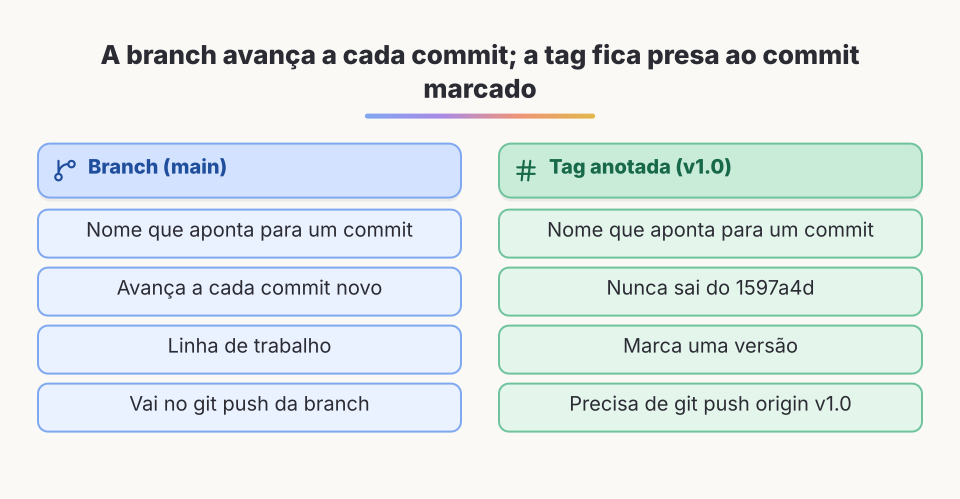

# 8. Repositórios remotos

## 📇 Parte 3 de 3: GitHub e trabalho em equipe


- [8. Repositórios remotos](08-repositorios-remotos.md)
- [9. Colaborando no GitHub](09-colaborando-no-github.md)
- [10. Projeto: currículo online](10-projeto-curriculo-online.md)

> 🗺️ **Neste capítulo:** criar uma segunda cópia do `receitas` para servir de ponto de encontro, enviar e receber commits com `push`, `fetch` e `pull`, entender as branches `origin/...`, publicar o projeto no GitHub e marcar versões com tags. O Bruno passa a trabalhar no projeto a partir do próprio clone. · ⏱️ ~60 min

> 🔥 **Aquecimento:**
>
> 1. (Capítulo 7) Por que não se faz rebase de commits que outras pessoas já copiaram?
> 2. (Capítulo 6) Depois de `git branch tortas`, o que existe dentro de `.git/refs/heads/tortas`?
>
> <details>
> <summary>Ver resposta</summary>
>
> 1. Porque o rebase cria commits novos, com outros hashes. Quem já tinha os antigos fica com duas versões do mesmo trabalho.
> 2. O hash do commit para onde a branch aponta.
>
> </details>

## De onde paramos

No capítulo 7 o histórico do `receitas` ficou em linha reta: bebidas, porções e quindim, todos integrados com rebase (último commit `254d2d2`, “Adiciona a receita de quindim”). Até agora tudo isso existe numa pasta só, no computador da Ana. Se o disco dela queimar, o projeto acaba; e o Bruno, que já contribuiu com o brigadeiro, não tem como trabalhar no dele sem ela.

## Bare repository: um remoto de treino

O Bruno precisa de uma cópia do projeto, e as duas cópias precisam trocar commits. Para isso, o Git usa um **repositório remoto**.

**Um repositório remoto é outra cópia do mesmo repositório, em outro lugar (uma pasta, um servidor, o GitHub), com a qual o seu repositório troca commits.** Ele não é especial: tem o mesmo tipo de histórico que o seu. Ele é “remoto” apenas porque não é o repositório em que você está trabalhando.

Antes de usar o GitHub, vale treinar com um remoto numa pasta do seu computador. Assim você vê cada passo sem depender de internet, conta ou senha. Esse remoto de treino é um **bare repository**.

**Um bare repository (repositório “nu”) é um repositório sem diretório de trabalho: só o conteúdo que normalmente fica dentro da pasta `.git`.** Ninguém edita arquivos nele; ele só recebe e entrega commits. Por isso é o formato usado por servidores, inclusive o GitHub. Por convenção, o nome termina em `.git`.

Na pasta que contém o `receitas` (um nível acima dele):

```bash
git init --bare receitas.git
ls receitas.git
```

```text
HEAD
config
description
hooks
info
objects
refs
```

O `git init --bare` responde `Initialized empty Git repository in` seguido do caminho completo da pasta. O `ls` mostra os mesmos itens que você viu dentro do `.git` no capítulo 3 (`HEAD`, `objects`, `refs`), mas nenhum `index.html` nem pasta `receitas`. “Bare” não quer dizer vazio de histórico: daqui a pouco esse repositório vai ter todos os commits do projeto. Quer dizer sem arquivos para editar.

Por que não usar um repositório normal como remoto? Porque o Git recusa enviar commits para a branch que está aberta num repositório com diretório de trabalho: os arquivos da pasta ficariam diferentes do último commit. Numa cópia de teste, o envio para um repositório normal termina assim (trecho):

```text
remote: error: refusing to update checked out branch: refs/heads/main
 ! [remote rejected] main -> main (branch is currently checked out)
```

> ⚠️ **Erro comum:** achar que “bare” significa “vazio”. Um bare repository pode guardar anos de histórico; ele só não tem uma cópia dos arquivos para você editar. Para trabalhar nos arquivos, você clona (próxima seção).

## Clone e push

### Ligar o repositório local ao remoto

O `receitas` ainda não sabe que o `receitas.git` existe. Os remotos de um repositório são cadastrados com um **apelido** e um **endereço**:

```bash
git remote -v
git remote add origin ../receitas.git
git remote -v
```

```text
origin	../receitas.git (fetch)
origin	../receitas.git (push)
```

O primeiro `git remote -v` não mostrou nada: nenhum remoto. O `git remote add` cadastrou o apelido `origin` para o endereço `../receitas.git` (um caminho de pasta, relativo ao `receitas`). `origin` é o nome que quase todo mundo usa para o remoto principal, mas não tem nada de especial: é um apelido como outro qualquer.

### Enviar commits: git push

**O `git push <remoto> <branch>` envia para o remoto os commits da branch que ele ainda não tem, e move a branch de mesmo nome lá.**

```bash
git push -u origin main
```

```text
To ../receitas.git
 * [new branch]      main -> main
branch 'main' set up to track 'origin/main'.
```

`[new branch] main -> main`: a `main` local criou uma `main` no remoto, com todos os commits. O `-u` (de *upstream*, forma longa `--set-upstream`) fez mais uma coisa: ligou a `main` local à `main` do remoto. Com essa ligação, nas próximas vezes basta `git push` e `git pull`, sem repetir remoto e branch. O `-u` só é necessário no primeiro push de cada branch.

### Copiar um repositório: git clone

Agora o Bruno. No computador dele (aqui, a pasta `bruno` ao lado), ele faz uma cópia:

```bash
git clone ../receitas.git
```

```text
Cloning into 'receitas'...
done.
```

**O `git clone <endereço>` cria uma cópia local completa de um repositório: todos os commits, todas as branches, e o remoto `origin` já cadastrado apontando para o endereço.** O clone é feito uma vez por projeto; depois, as novidades chegam por `fetch` e `pull`.

O clone gravou o endereço como caminho completo da pasta (algo como `C:/Users/<você>/.../receitas.git`). Para deixar as saídas deste livro legíveis, o Bruno troca para um caminho relativo com `git remote set-url`, o mesmo comando que você vai usar adiante para trocar HTTPS por SSH. Ele também se identifica **só neste repositório** (nível local, capítulo 2), porque o computador do exemplo é compartilhado:

```bash
# endereço relativo e identidade só neste repositório
cd receitas
git remote set-url origin ../../receitas.git
git config user.name "Bruno Lima"
git config user.email "bruno.lima@example.com"
git remote -v
git log --oneline -n 2
```

```text
origin	../../receitas.git (fetch)
origin	../../receitas.git (push)
254d2d2 Adiciona a receita de quindim
9c60b28 Informa o rendimento do pudim
```

Os mesmos hashes do repositório da Ana: é o mesmo histórico, commit por commit. O Bruno cria o pão de queijo (arquivo e link) e faz o commit “Adiciona a receita de pão de queijo”. Preveja: o que o `git status -sb` mostra antes do push?

```bash
git status -sb
git push
```

```text
## main...origin/main [ahead 1]
To ../../receitas.git
   254d2d2..38b2299  main -> main
```

O `-sb` é o `status` curto (capítulo 3) com uma linha a mais: a branch e a sua relação com o remoto. `[ahead 1]` quer dizer “um commit à frente da `origin/main`”, ou seja, um commit que o remoto ainda não tem. O push dele não precisou de `-u`: o clone já ligou a `main` à `origin/main`. A linha `254d2d2..38b2299` diz que a `main` do remoto andou de um commit para o outro.


> ⚠️ **Erro comum:** achar que o `git push` envia os arquivos como estão na pasta. Ele envia **commits**. Uma mudança que ainda não foi commitada (ou que está só na staging area) fica no seu computador. Se o colega “não vê” a sua alteração, confira primeiro o `git status` e o `git log`.

## Fetch × pull

### O seu repositório não sabe do commit do Bruno

De volta ao repositório da Ana. Preveja: o `git status -sb` dela já mostra que existe um commit novo no remoto?

```bash
git status -sb
```

```text
## main...origin/main
```

Não mostra. O Git não consulta o remoto sozinho: o `status` compara a `main` com a **última informação** que o repositório da Ana tem sobre o remoto. Para atualizar essa informação, ela usa o `fetch`.

**O `git fetch` baixa do remoto os commits que você ainda não tem e atualiza as branches `origin/...`, sem mexer nas suas branches nem nos seus arquivos.**

```bash
git fetch
git status -sb
```

```text
From ../receitas
   254d2d2..38b2299  main       -> origin/main
## main...origin/main [behind 1]
```

Agora sim: `[behind 1]`, um commit atrás. A `origin/main` andou para `38b2299`; a `main` da Ana continua em `254d2d2`, e a pasta dela não mudou. Como nada foi integrado ainda, dá para olhar antes de decidir:

```bash
git log --oneline main..origin/main
git diff --stat main origin/main
```

```text
38b2299 Adiciona a receita de pão de queijo
 index.html                | 1 +
 receitas/pao-de-queijo.md | 8 ++++++++
 2 files changed, 9 insertions(+)
```

`main..origin/main` quer dizer “commits que estão na `origin/main` e não estão na `main`”. Tudo certo, então a Ana integra com o merge do capítulo 6. Sem argumentos, o `git merge` usa a branch ligada pelo `-u`, a `origin/main`:

```bash
git merge
```

```text
Updating 254d2d2..38b2299
Fast-forward
 index.html                | 1 +
 receitas/pao-de-queijo.md | 8 ++++++++
 2 files changed, 9 insertions(+)
 create mode 100644 receitas/pao-de-queijo.md
```

**O `git pull` faz as duas coisas de uma vez: `git fetch` e, em seguida, a integração na branch atual (merge, por padrão, ou rebase).** É o comando do dia a dia; o `fetch` separado serve quando você quer ver antes de integrar.


### Quando os dois andaram

O Bruno envia mais um commit (explica a dica do chocolate no brigadeiro). Ao mesmo tempo, a Ana faz um commit no quindim (“Ensina a desenformar o quindim”) e tenta enviar:

```bash
git push
```

```text
To ../receitas.git
 ! [rejected]        main -> main (fetch first)
error: failed to push some refs to '../receitas.git'
hint: Updates were rejected because the remote contains work that you do not
hint: have locally. This is usually caused by another repository pushing to
hint: the same ref. If you want to integrate the remote changes, use
hint: 'git pull' before pushing again.
hint: See the 'Note about fast-forwards' in 'git push --help' for details.
```

O push foi **recusado**. O remoto tem um commit que a Ana não tem; aceitar o push da Ana apagaria o commit do Bruno. O Git só aceita um push que seja fast-forward no remoto (capítulo 6): a ponta do remoto precisa ser ancestral do que você está enviando. A dica sugere `git pull`:

```bash
git pull
```

```text
From ../receitas
   38b2299..b1518f8  main       -> origin/main
hint: You have divergent branches and need to specify how to reconcile them.
hint: You can do so by running one of the following commands sometime before
hint: your next pull:
hint:
hint:   git config pull.rebase false  # merge
hint:   git config pull.rebase true   # rebase
hint:   git config pull.ff only       # fast-forward only
hint:
hint: You can replace "git config" with "git config --global" to set a default
hint: preference for all repositories. You can also pass --rebase, --no-rebase,
hint: or --ff-only on the command line to override the configured default per
hint: invocation.
fatal: Need to specify how to reconcile divergent branches.
```

O `fetch` aconteceu (primeira linha), mas a integração não. As duas `main` divergiram, e o Git quer que você escolha entre merge e rebase. Aqui entra o capítulo 7: o commit do quindim **ainda não saiu do computador da Ana**, então reaplicá-lo em cima do commit do Bruno é seguro e deixa o histórico em linha reta:

```bash
git pull --rebase
git log --oneline --graph -n 4
git push
```

```text
Successfully rebased and updated refs/heads/main.
* 1597a4d Ensina a desenformar o quindim
* b1518f8 Explica a dica do chocolate no brigadeiro
* 38b2299 Adiciona a receita de pão de queijo
* 254d2d2 Adiciona a receita de quindim
To ../receitas.git
   b1518f8..1597a4d  main -> main
```

Agora o push é um fast-forward no remoto e é aceito. Para não precisar escolher a cada vez, configure o padrão uma vez, como a própria mensagem sugere: `git config --global pull.rebase true` (rebase) ou `false` (merge). Se o rebase do pull parar num conflito, o caminho é o do capítulo 7: editar, `git add`, `git rebase --continue`.

> ⚠️ **Erro comum:** resolver o push recusado com `git push --force`. O `--force` faz o remoto aceitar o seu histórico **no lugar** do que está lá, e o commit do Bruno some do remoto. A resposta certa a um `rejected (fetch first)` é sempre integrar primeiro (`git pull`) e enviar depois.

### Quando forçar é legítimo: --force-with-lease

Há um caso em que o push recusado é esperado: você reescreveu commits **seus**, que já tinha enviado para uma branch que só você usa. A Ana envia a branch `tortas` com o commit “torta frango”, percebe a mensagem ruim e corrige com `git commit --amend` (capítulo 5). O commit corrigido tem outro hash, e o remoto ainda tem o antigo:

```bash
git push
```

```text
To ../receitas.git
 ! [rejected]        tortas -> tortas (non-fast-forward)
error: failed to push some refs to '../receitas.git'
hint: Updates were rejected because the tip of your current branch is behind
hint: its remote counterpart. If you want to integrate the remote changes,
hint: use 'git pull' before pushing again.
hint: See the 'Note about fast-forwards' in 'git push --help' for details.
```

Aqui um `git pull` traria de volta o commit antigo, que ela quer descartar. A saída é forçar, mas com proteção:

```bash
git push --force-with-lease
```

```text
To ../receitas.git
 + 3a50c4e...21df1d3 tortas -> tortas (forced update)
```

O `+` e o `(forced update)` mostram que o remoto trocou `3a50c4e` por `21df1d3`. **O `--force-with-lease` só força se a branch no remoto ainda estiver onde a sua `origin/tortas` diz que ela está.** Se alguém tiver enviado um commit para a `tortas` depois do seu último `fetch`, ele recusa. Numa cópia de teste, com um commit do Bruno na `tortas` que a Ana ainda não tinha baixado:

```text
To ../receitas.git
 ! [rejected]        tortas -> tortas (stale info)
error: failed to push some refs to '../receitas.git'
```

`stale info` quer dizer “a sua informação sobre o remoto está velha”. Cuidado com a armadilha: se, nessa hora, você rodar `git fetch` e repetir o `--force-with-lease`, ele aceita, e o commit do Bruno some. Depois do `fetch`, olhe o que chegou (`git log tortas..origin/tortas`) e integre antes de forçar. O `--force` puro não faz verificação nenhuma: evite-o.

## Branches de rastreamento

Você já usou `origin/main` várias vezes. Ela merece um nome:

**Uma branch de rastreamento remoto (*remote-tracking branch*), como `origin/main`, é a lembrança local de onde a branch `main` do remoto `origin` estava no último contato (fetch, pull ou push).** Ela fica no seu repositório, só se move quando você fala com o remoto, e você não faz commits nela.

```bash
git branch -a
```

No clone do Bruno, logo depois de clonar:

```text
* main
  remotes/origin/HEAD -> origin/main
  remotes/origin/main
```

O `-a` (de *all*) lista as branches locais e as de rastreamento (`remotes/...`). A `origin/HEAD` indica qual é a branch principal do remoto.

A ligação criada pelo `-u` (ou pelo clone) entre uma branch local e a sua branch de rastreamento é chamada de **upstream**. O `git branch -vv` mostra essas ligações, e o `git status -sb` compara as duas pontas:

```bash
git branch -vv
```

```text
* main   1597a4d [origin/main] Ensina a desenformar o quindim
  tortas 21df1d3 [origin/tortas] Adiciona a receita de torta de frango
```

| No `git status -sb` | Quer dizer | O que fazer |
| --- | --- | --- |
| `## main...origin/main` | iguais, na última informação | `git fetch` para atualizar a informação |
| `[ahead 2]` | 2 commits seus que o remoto não tem | `git push` |
| `[behind 3]` | 3 commits do remoto que você não tem | `git pull` |
| `[ahead 1, behind 2]` | as duas andaram | `git pull` (merge ou rebase) e depois `git push` |

Uma branch que só existe no remoto vira local com `git switch <nome>`: se existe `origin/tortas` e não existe `tortas`, o Git cria a `tortas` local já ligada à `origin/tortas`.

> 💡 **Analogia:** no álbum de fotos do projeto, o remoto é o **álbum da família, que fica na casa da avó**; cada um tem a sua cópia em casa. A `origin/main` é um **bilhete na sua cópia**: “da última vez que fui à casa da avó, o álbum de lá ia até a foto `38b2299`”. O `fetch` é ir até lá e atualizar o bilhete, sem colar nada no seu álbum; o `merge` (ou o `pull`, que faz a visita e a colagem) cola as fotos novas no seu. O `push` é levar as suas fotos para o álbum da avó, e ela só aceita se as suas vierem **depois** da última foto que já está lá. A analogia quebra num ponto: o bilhete de papel tem data, e você sabe que ele pode estar velho; a `origin/main` não mostra quando foi atualizada, e o `status` a trata como se fosse o estado atual do remoto. Por isso ele pode dizer que está tudo igual quando não está.

> ⚠️ **Erro comum:** confiar no `git status` para saber se há novidades no remoto. Ele só compara com a última informação baixada. Antes de concluir que está tudo atualizado, rode `git fetch` (ou `git pull`).

## Criar o repositório no GitHub

O `receitas.git` serviu para treinar. No dia a dia, o remoto fica num serviço como o GitHub (capítulo 1), acessível de qualquer lugar, com as credenciais que você configurou no capítulo 2. Os comandos são os mesmos; muda o endereço.

> ⚠️ **Não executado neste livro:** os passos desta seção exigem a sua conta no GitHub e não foram rodados aqui. Os comandos de `git remote` foram executados numa cópia do `receitas`; o `git push` para o GitHub, não.

1. No GitHub, clique no **+** no canto superior direito e em **New repository**.
2. Em **Repository name**, digite `receitas`. Escolha a visibilidade (público ou privado).
3. **Não** marque a criação de README, `.gitignore` ou licença. O projeto já existe no seu computador; o repositório do GitHub precisa nascer vazio. Se ele já tiver um commit (o do README), o seu primeiro push é recusado como o da Ana, porque os dois históricos não têm nada em comum.
4. Clique em **Create repository**. O GitHub mostra o endereço do repositório, em HTTPS e em SSH.

No `receitas`, o apelido `origin` já pertence ao remoto de treino. Uma saída é renomeá-lo e cadastrar o GitHub como `origin` (troque `seu-usuario` pelo seu usuário do GitHub):

```bash
git remote rename origin treino
git remote add origin https://github.com/seu-usuario/receitas.git
git remote -v
```

```text
origin	https://github.com/seu-usuario/receitas.git (fetch)
origin	https://github.com/seu-usuario/receitas.git (push)
treino	../receitas.git (fetch)
treino	../receitas.git (push)
```

Um repositório pode ter quantos remotos quiser; cada um tem o seu apelido. O `rename` também atualiza as ligações: o `git branch -vv` passa a mostrar `[treino/main]`. Se você configurou SSH no capítulo 2, use o endereço SSH:

```bash
git remote set-url origin git@github.com:seu-usuario/receitas.git
```

Por fim, `git push -u origin main`. Com HTTPS, o Git Credential Manager abre o login do GitHub no navegador na primeira vez; com SSH, a chave é usada sem perguntar nada. Atualize a página do repositório no GitHub: os arquivos e o histórico aparecem lá.

| Comando | O que faz |
| --- | --- |
| `git remote -v` | lista os remotos e os endereços |
| `git remote add <nome> <url>` | cadastra um remoto |
| `git remote set-url <nome> <url>` | troca o endereço (por exemplo, de HTTPS para SSH) |
| `git remote rename <velho> <novo>` | troca o apelido |
| `git remote remove <nome>` | apaga o cadastro (não apaga nada no remoto) |

> ⚠️ **Erro comum:** colocar o token no endereço, como `https://<token>@github.com/...`. O endereço fica gravado em texto puro no `.git/config` e aparece no `git remote -v` de qualquer pessoa que olhar a sua tela. Use o endereço sem credencial e deixe o Git Credential Manager ou o SSH cuidarem do acesso (capítulo 2).

### 🔎 Para ir além: push.autoSetupRemote

Sem `-u`, o primeiro push de uma branch nova falha com `fatal: The current branch teste-x has no upstream branch.`, e o Git sugere `git push --set-upstream origin teste-x`. Com `git config --global push.autoSetupRemote true`, o `git push` sem argumentos já cria a branch no remoto e faz a ligação sozinho. Veja `push.autoSetupRemote` em `git help config`.

## Tags e releases

### Marcar uma versão

O site está pronto para ser divulgado. A Ana quer poder voltar, daqui a um ano, exatamente ao que foi publicado hoje, mesmo depois de muitos commits. Um hash serve, mas ninguém se lembra de `1597a4d`.

**Uma tag é um nome fixo para um commit, usado para marcar versões (`v1.0`, `v2.3.1`).** Como a branch, ela aponta para um commit; ao contrário da branch, **nunca anda**.

Há dois tipos:

| Tipo | Como criar | O que guarda |
| --- | --- | --- |
| Anotada | `git tag -a v1.0 -m "mensagem"` | um objeto próprio, com autor, data e mensagem |
| Leve | `git tag nome` | só o nome apontando para o commit |

```bash
# uma tag anotada para a versão e uma leve, só para comparar
git tag -a v1.0 -m "Primeira versão publicada do site"
git tag rascunho-capa
git tag
git cat-file -t v1.0
git cat-file -t rascunho-capa
```

```text
rascunho-capa
v1.0
tag
commit
```

O `git cat-file -t` (capítulo 3) mostra o tipo de objeto: a tag anotada é um objeto `tag` próprio; a leve aponta direto para um `commit`. O `git show` mostra a diferença:

```bash
git show v1.0 --stat
```

```text
tag v1.0
Tagger: Ana Ribeiro <ana.ribeiro@example.com>
Date:   Thu Nov 26 12:00:00 2026 -0300

Primeira versão publicada do site

commit 1597a4d226085b553bd3f97b84a4e5225f8b3139
Author: Ana Ribeiro <ana.ribeiro@example.com>
Date:   Thu Nov 26 10:30:00 2026 -0300

    Ensina a desenformar o quindim

 receitas/quindim.md | 2 ++
 1 file changed, 2 insertions(+)
```

Quem marcou a versão (`Tagger`), quando e por quê, e depois o commit marcado. Para versões, use tags anotadas; as leves servem para marcas pessoais e temporárias. A Ana apaga a leve com `git tag -d rascunho-capa`.



### Enviar tags

Preveja: o `git push` que a Ana já fez levou a `v1.0`? Não: **o push de uma branch não envia tags**. É preciso pedir:

```bash
git push origin v1.0
```

```text
To ../receitas.git
 * [new tag]         v1.0 -> v1.0
```

Para enviar todas as tags locais de uma vez, `git push origin --tags`. No clone do Bruno, a tag chega no próximo `fetch`, junto com o resto:

```bash
git fetch
git tag
```

```text
From ../../receitas
   b1518f8..1597a4d  main       -> origin/main
 * [new branch]      tortas     -> origin/tortas
 * [new tag]         v1.0       -> v1.0
v1.0
```

Para ver os arquivos da versão, `git switch --detach v1.0` (detached HEAD, capítulo 5):

```text
HEAD is now at 1597a4d Ensina a desenformar o quindim
```

Para corrigir uma versão antiga, crie uma branch a partir da tag: `git switch -c corrige-v1.0 v1.0`. Quando a correção estiver pronta, marque `v1.0.1` e leve-a também para a `main`.

Uma convenção comum para os números é o versionamento semântico, `MAIOR.MENOR.CORREÇÃO`: o primeiro número muda quando algo deixa de ser compatível, o segundo quando entra algo novo compatível, e o terceiro em correções.

### Releases no GitHub

No GitHub, uma **release** é uma página para uma versão do projeto, ligada a uma tag: título, notas sobre o que mudou e arquivos para baixar. O GitHub inclui sozinho links para baixar o código da tag em `.zip` e `.tar.gz`.

> ⚠️ **Não executado neste livro** (exige a sua conta): passos conforme a documentação do GitHub.

1. Na página do repositório, clique em **Releases**, à direita da lista de arquivos.
2. Clique em **Draft a new release**.
3. Em **Choose a tag**, escolha a `v1.0` que você enviou. (Dá também para digitar um nome novo e clicar em **Create new tag**: o GitHub cria a tag no commit da branch escolhida em **Target**.)
4. Preencha o título e a descrição (o botão **Generate release notes** monta uma lista a partir dos commits e pull requests).
5. Clique em **Publish release**.

> ⚠️ **Erro comum:** mover uma tag já publicada para outro commit (apagando e recriando com o mesmo nome). Quem já baixou a `v1.0` fica com a antiga; o Git não atualiza tags existentes no `fetch`. Se a versão tinha um erro, publique uma nova (`v1.0.1`).

## 🧪 Laboratório: o receitas ganha um remoto

Continue no `receitas` do capítulo 7 (último commit “Adiciona a receita de quindim”, só a `main`, `git status` limpo). Você vai precisar de duas pastas ao lado dele: `receitas.git` (o remoto) e `bruno` (o computador do Bruno). Confira cada passo com `git status -sb` e `git log --oneline --graph --all`.

1. Na pasta acima do `receitas`, crie o remoto com `git init --bare receitas.git` e confira com `ls receitas.git` (sem `index.html`).
2. No `receitas`, cadastre o remoto (`git remote add origin ../receitas.git`) e envie com `git push -u origin main`. Confira: `[new branch]` e `git branch -vv` com `[origin/main]`.
3. Crie a pasta `bruno` e, dentro dela, `git clone ../receitas.git`. No clone, troque o endereço com `git remote set-url origin ../../receitas.git` e configure `user.name` e `user.email` do Bruno **sem** `--global`.
4. No clone do Bruno, crie o pão de queijo (receita abaixo) e o link, faça o commit e confira `[ahead 1]` antes do `git push`.
5. No `receitas` da Ana, confira que o `git status -sb` não mostra nada de novo. Rode `git fetch` e confira o `[behind 1]`. Veja o commit com `git log --oneline main..origin/main` e integre com `git merge`.
6. Provoque a divergência: no Bruno, mude a dica do brigadeiro para `Dica: chocolate 50% cacau deixa o brigadeiro menos doce.`, commite e envie. Na Ana, acrescente uma linha em branco e `Desenforme ainda morno.` no fim do quindim e commite. Rode `git push` e confira o `rejected (fetch first)`.
7. Rode `git pull` e confira o `fatal: Need to specify how to reconcile divergent branches.`. Rode `git pull --rebase` e `git push`. Confira: `git log --oneline --graph -n 4` em linha reta, e `git status -sb` sem `ahead` nem `behind`.
8. Na Ana, crie a `tortas` com a torta de frango e a mensagem `torta frango`; envie com `git push -u origin tortas`. Corrija a mensagem com `git commit --amend`, confira a recusa do `git push` e envie com `git push --force-with-lease`.
9. Volte para a `main`, crie a tag anotada `v1.0`, confira `git cat-file -t v1.0` (`tag`) e envie com `git push origin v1.0`. No Bruno, rode `git fetch` (confira `[new tag]`) e `git pull`.
10. Se você tem conta no GitHub: crie o repositório `receitas` vazio, renomeie o remoto de treino para `treino`, cadastre o GitHub como `origin` e envie a `main` e a tag.

Pronto quando: na Ana, `git branch -vv` mostra `main` e `tortas`, cada uma com `[origin/...]` e sem `ahead` nem `behind`; `git ls-remote --tags origin` lista a `v1.0`; e o `git log --oneline -n 1` da Ana e o do Bruno mostram o mesmo commit.

A receita do Bruno, a da torta, o brigadeiro e o quindim no fim do capítulo:

<!-- project: receitas -->

**receitas/pao-de-queijo.md**

```markdown
# Pão de queijo

- 500 g de polvilho azedo
- 250 ml de leite
- 2 ovos
- 200 g de queijo meia cura ralado

Forno: 180 °C por 25 min.
```

**receitas/torta-de-frango.md**

```markdown
# Torta de frango

- 2 xícaras de frango desfiado
- 3 ovos
- 1 xícara de leite

Forno: 200 °C por 40 min.
```

**receitas/brigadeiro.md**

```markdown
# Brigadeiro

- 1 lata de leite condensado
- 1 colher de sopa de manteiga
- 3 colheres de sopa de chocolate em pó

Fogo baixo, mexendo sem parar, até soltar do fundo da panela.
Dica: chocolate 50% cacau deixa o brigadeiro menos doce.
```

**receitas/quindim.md**

```markdown
# Quindim

- 1 xícara de açúcar
- 6 gemas
- 50 g de coco ralado

Forno: 180 °C em banho-maria por 40 min.

Desenforme ainda morno.
```

O `index.html` ganha o link do pão de queijo logo abaixo do pudim:

**index.html**

```html
<!DOCTYPE html>
<html lang="pt-BR">
<head><meta charset="utf-8"><title>Receitas da Ana</title></head>
<body>
  <h1>Receitas da Ana</h1>
  <!-- cada receita nova ganha um item nesta lista -->
  <ul>
    <li><a href="receitas/bolo-de-cenoura.md">Bolo de cenoura</a></li>
    <li><a href="receitas/brigadeiro.md">Brigadeiro</a></li>
    <li><a href="receitas/pudim.md">Pudim</a></li>
    <li><a href="receitas/pao-de-queijo.md">Pão de queijo</a></li>
    <li><a href="receitas/quindim.md">Quindim</a></li>
    <li><a href="receitas/limonada-suica.md">Limonada suíça</a></li>
    <li><a href="receitas/suco-de-laranja.md">Suco de laranja</a></li>
    <li><a href="receitas/torta-de-limao.md">Torta de limão</a></li>
    <li><a href="receitas/mousse-de-maracuja.md">Mousse de maracujá</a></li>
  </ul>
</body>
</html>
```

## 🏋️ Pratique

**1. Exemplo resolvido.** A Ana volta de uma semana fora e roda `git fetch` e `git status -sb`. A resposta é `## main...origin/main [ahead 1, behind 3]`. O que aconteceu, e qual a sequência de comandos para enviar o commit dela?

1. `ahead 1`: ela tem um commit local que o remoto não tem (feito antes de viajar e nunca enviado).
2. `behind 3`: o remoto tem três commits que ela não tem (a equipe trabalhou na semana).
3. As duas `main` divergiram. Um `git push` agora seria recusado com `fetch first`.
4. O commit dela nunca saiu do computador, então rebase é seguro: `git pull --rebase`. Ele reaplica o commit dela em cima dos três.
5. Se houver conflito, resolve, `git add`, `git rebase --continue`.
6. `git push`. Confere: `git status -sb` mostra `## main...origin/main`, sem `ahead` nem `behind`.

Com `git pull` (merge), também funcionaria, com um commit de merge a mais no histórico.

**2. Complete.** A Ana criou a branch `salgados` e quer publicá-la pela primeira vez e, depois, marcar e publicar a versão `v1.1`:

```bash
git switch -c salgados
# commits...
git push __ origin salgados
git switch main
git merge salgados
git push
git tag __ v1.1 -m "Seção de salgados"
git push origin ____
```

<details>
<summary>Ver resposta</summary>

```bash
git switch -c salgados
# commits...
git push -u origin salgados
git switch main
git merge salgados
git push
git tag -a v1.1 -m "Seção de salgados"
git push origin v1.1
```

O `-u` liga a `salgados` à `origin/salgados` no primeiro push. O `-a` faz a tag anotada (sem ele, o `-m` também cria uma anotada, mas o `-a` deixa a intenção clara). O último comando é necessário porque o `git push` da `main` não leva tags; `git push origin --tags` também serviria.

</details>

**3. Sozinho.** No seu laboratório, faça o Bruno e a Ana mudarem **a mesma linha** do pudim (`Rende 8 porções.`): o Bruno para `Rende 10 porções pequenas.`, a Ana para `Rende 8 porções generosas.`. O Bruno envia primeiro. Faça a Ana integrar com `git pull --rebase`, resolver o conflito mantendo a versão dela e enviar.

<details>
<summary>Ver resposta</summary>

Na Ana: o `git push` é recusado (`fetch first`). O `git pull --rebase` para com `CONFLICT (content): Merge conflict in receitas/pudim.md`. No arquivo, entre `<<<<<<< HEAD` e `=======` está a linha do **Bruno** (a nova base, que veio do remoto), e depois do `=======`, a da Ana (o commit sendo reaplicado), como no capítulo 7.

Ela deixa só `Rende 8 porções generosas.`, roda `git diff --check` (sem saída), `git add receitas/pudim.md`, `git rebase --continue` e `git push`.

Confira:

- `git log --oneline -n 2` mostra o commit da Ana logo acima do commit do Bruno.
- No Bruno, `git pull` traz o commit da Ana como fast-forward.

Erro comum: escolher a linha errada por achar que `HEAD` é a versão da Ana. No rebase, `HEAD` é a base, que aqui é o trabalho do Bruno.

</details>

**4. Desafio.** Uma colega diz: “clonei o projeto ontem, rodei `git status` agora e ele diz `Your branch is up to date with 'origin/main'`. Então ninguém mexeu no remoto desde ontem.” O raciocínio está certo? Que comando ela deveria rodar, e o que cada um dos três resultados possíveis significaria?

<details>
<summary>Ver resposta</summary>

Não está certo. O `status` compara a `main` com a `origin/main`, que guarda apenas onde o remoto estava no último contato (o clone, ontem). Ela deve rodar `git fetch` e, depois, `git status` (ou `git status -sb`):

- Continua `up to date`: de fato, ninguém enviou nada.
- `behind n`: há `n` commits novos no remoto; `git pull` traz.
- `ahead n, behind m` (ou `diverged`, na versão longa): os dois lados andaram; `git pull` (merge ou rebase) e depois `git push`.

Confira sua resposta: ela explica que a `origin/main` não se atualiza sozinha e cita o `fetch` (ou o `pull`) como o passo que falta.

</details>

## 🧠 Revisão rápida

1. O que um bare repository não tem, e por que servidores usam esse formato?
2. Qual a diferença entre `git fetch` e `git pull`?
3. O que significa `[behind 2]` no `git status -sb`?
4. Por que o push foi recusado com `fetch first`, e como resolver?
5. O que o `--force-with-lease` verifica que o `--force` não verifica?
6. O `git push` de uma branch envia as tags?
7. (Capítulo 5) Em que estado fica o `HEAD` depois de `git switch --detach v1.0`?
8. (Capítulo 1) O GitHub é necessário para ter um repositório remoto?

<details>
<summary>Ver resposta</summary>

1. Diretório de trabalho (os arquivos para editar). Porque ninguém edita no servidor, e o Git recusa push para a branch aberta de um repositório com diretório de trabalho.
2. O `fetch` só baixa e atualiza as branches `origin/...`; o `pull` baixa e integra na branch atual.
3. O remoto tem 2 commits que a branch local não tem (pela última informação baixada).
4. O remoto tinha commits que você não tinha; aceitar apagaria esses commits. Resolva com `git pull` (merge ou rebase) e depois `git push`.
5. Se a branch no remoto ainda está onde a sua branch de rastreamento diz; se alguém enviou algo depois, ele recusa (`stale info`).
6. Não: `git push origin <tag>` ou `git push origin --tags`.
7. Detached HEAD: aponta direto para o commit `1597a4d`, sem branch.
8. Não. Qualquer outra cópia do repositório serve, até uma pasta no mesmo computador; o GitHub é um lugar conveniente para hospedar essa cópia.

</details>

## 🤖 Estude com um tutor de IA

```text
Faça de conta que é o meu terminal. Descreva uma situação entre o meu
repositório e o origin (quem fez commits e onde) e me mostre a saída do
git status -sb. Eu digo o próximo comando. Responda com a saída que o Git
daria, sem explicar, até eu deixar tudo sincronizado. No fim, comente os
meus passos.
```

```text
Esta é a mensagem de erro do meu git push: <mensagem>. Sem me dar o
comando pronto, faça perguntas que me levem a entender por que o push foi
recusado e qual é a forma segura de resolver.
```

> ➡️ **Próximo passo:** com o projeto num remoto, o trabalho em equipe ganha forma. O capítulo 9 mostra como o GitHub organiza essa colaboração: colaboradores, issues, fork e pull request, e os fluxos de trabalho que as equipes usam.

## 📌 Resumo

| Item | Em uma frase |
| --- | --- |
| Repositório remoto | Outra cópia do repositório, com a qual o seu troca commits. |
| Bare repository | Repositório sem diretório de trabalho, usado como remoto (`git init --bare`). |
| `git remote` | Cadastra (`add`), lista (`-v`), troca o endereço (`set-url`) e renomeia remotos. |
| `git clone` | Copia um repositório inteiro e cadastra o `origin`. |
| `git push -u origin main` | Envia os commits e liga a branch local à remota (upstream). |
| `git fetch` | Baixa e atualiza `origin/...`, sem mexer no seu trabalho. |
| `git pull` | `fetch` + integração na branch atual; `--rebase` para histórico linear. |
| Branch de rastreamento | `origin/main`: onde a `main` do remoto estava no último contato. |
| `--force-with-lease` | Força o push só se o remoto ainda estiver onde você viu por último. |
| Tag | Nome fixo para um commit; anotada com `-a`; enviada com `git push origin <tag>`. |
| Release | Página do GitHub para uma versão, ligada a uma tag. |

## 📚 Fontes

- [Pro Git, 2.5 — Working with Remotes](https://git-scm.com/book/en/v2/Git-Basics-Working-with-Remotes), [2.6 — Tagging](https://git-scm.com/book/en/v2/Git-Basics-Tagging), [3.5 — Remote Branches](https://git-scm.com/book/en/v2/Git-Branching-Remote-Branches) e [4.2 — Getting Git on a Server](https://git-scm.com/book/en/v2/Git-on-the-Server-Getting-Git-on-a-Server) (consultados em 21/11/2026)
- [git-init](https://git-scm.com/docs/git-init), [git-clone](https://git-scm.com/docs/git-clone), [git-remote](https://git-scm.com/docs/git-remote), [git-push](https://git-scm.com/docs/git-push), [git-fetch](https://git-scm.com/docs/git-fetch), [git-pull](https://git-scm.com/docs/git-pull), [git-tag](https://git-scm.com/docs/git-tag) e [git-config](https://git-scm.com/docs/git-config) (`pull.rebase`, `push.autoSetupRemote`) — Git Reference Manual (Git 2.56, consultados em 21/11/2026)
- GitHub Docs: [Creating a new repository](https://docs.github.com/en/repositories/creating-and-managing-repositories/creating-a-new-repository), [About releases](https://docs.github.com/en/repositories/releasing-projects-on-github/about-releases) e [Managing releases in a repository](https://docs.github.com/en/repositories/releasing-projects-on-github/managing-releases-in-a-repository) (consultados em 21/11/2026)
- Anotações do curso “Git e GitHub Essencial para o Desenvolvedor” (Geek University, Udemy): “Bare repository”, “Clone e push”, “Fetch e pull”, “Repositório remoto no GitHub”, “Usando clone e pull” e “Trabalhando com tags”: estrutura e tópicos.

> 🔁 **Revise hoje:** capítulos 1 (Git × GitHub, centralizado × distribuído), 5 (detached HEAD) e 7 (rebase e regra de ouro).
