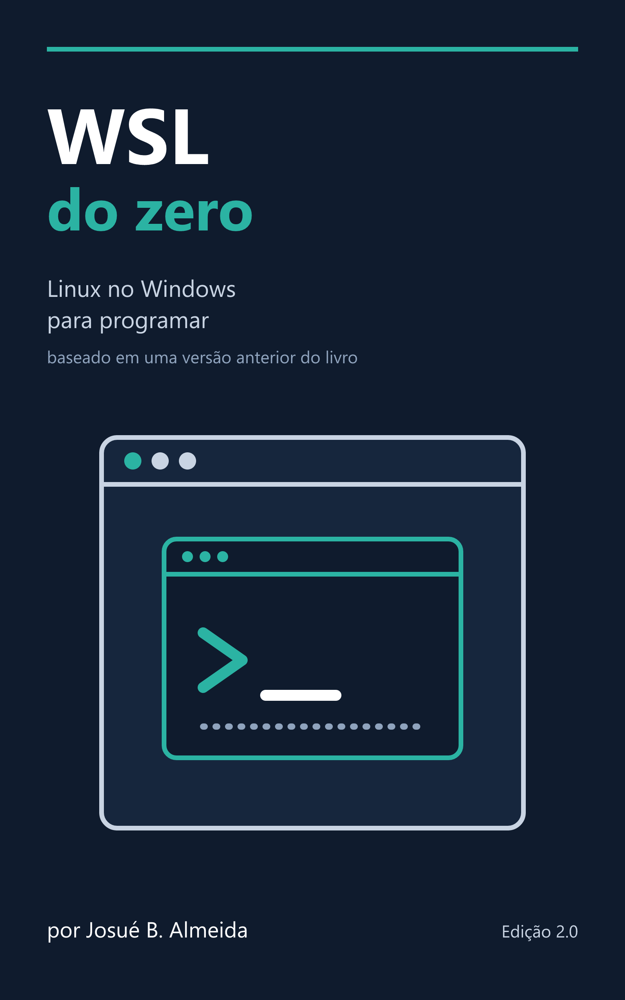

# WSL do zero

Linux no Windows para programar

Para quem usa Windows e quer um ambiente de desenvolvimento Linux, sem máquina virtual nem dual boot. Ao terminar, você vai ter montado, personalizado, protegido com backup e restaurado um ambiente completo no WSL, com o Claude Code e o Spec Kit, e vai ter provado que ele volta do zero. Referência: WSL 3.0.5 (kernel 6.18.58.1) com o Ubuntu 26.04.1 LTS.

## Comece aqui

- [Como estudar este livro](chapters/00-como-estudar-este-livro.md): organização, ritmos e hábitos de estudo.
- [Teste de nivelamento](chapters/00-como-estudar-este-livro.md#teste-de-nivelamento): descubra por qual capítulo começar, se você já usou o WSL.

## 📇 O livro numa página

![O livro numa página: 1. O que é o WSL: Linux de verdade dentro do Windows, WSL 2 = kernel Linux numa VM leve, WSL × VM × dual boot. 2. Instalação: wsl --install -d Ubuntu-26.04, virtualização ligada no firmware, wsl -l -v mostra VERSION 2. 3. Primeiros passos: prompt: $ comum, # root, apt update ≠ apt upgrade, sudo; não trabalhe como root. 4. Arquivos entre os lados: projeto mora no ext4 do Linux, /mnt/c e \\wsl$ atravessam, CRLF × LF: .gitattributes. 5. Terminal do seu jeito: janela e fonte no Windows, Starship e locale no Ubuntu, dotfiles no repositório. 6. Ferramentas de dev: PATH: o primeiro achado vale, nvm, SDKMAN e uv, bootstrap.sh recria tudo. 7. Gerenciar o WSL: .wslconfig: todas, --shutdown, wsl.conf: uma, --terminate, --unregister apaga tudo. 8. Backup e restauração: wsl --export e --import, [user] default= no wsl.conf, prove o backup num clone. 9. Claude Code no WSL: instale como usuário, sem sudo, modos: default a plan, plugins e MCPs: leia antes. 10. Projeto final: Spec Kit: specify, plan, tasks, app de tarefas com testes, restaurar tudo em distro nova.](img/c00-o-livro-numa-pagina.svg)

## Sobre este livro

> Escrito com IA (Claude) a partir das fontes citadas em cada capítulo. Conferido em 27/11/2026. Revisão humana: não. Edição 2.0.

Este livro aprimora uma versão anterior, escrita em Markdown. Só a estrutura, os temas e os objetivos dela foram aproveitados: o texto, os exemplos e as saídas foram refeitos do zero.

## Erratas

Nenhuma errata registrada até agora. Achou um erro? Anote o capítulo, o trecho e o que você esperava ver, e envie ao autor.

<!-- map:start -->
## 🗺️ Mapa do livro

- [0. Como estudar este livro](chapters/00-como-estudar-este-livro.md)
- [1. O que é o WSL e quando usar](chapters/01-o-que-e-o-wsl-e-quando-usar.md) · ⏱️ ~35 min
- [2. Instalação do WSL e do Ubuntu](chapters/02-instalacao-do-wsl-e-do-ubuntu.md) · ⏱️ ~45 min
- [3. Primeiros passos no Ubuntu](chapters/03-primeiros-passos-no-ubuntu.md) · ⏱️ ~50 min
- [4. Arquivos entre Linux e Windows](chapters/04-arquivos-entre-linux-e-windows.md) · ⏱️ ~45 min
- [5. O terminal do seu jeito](chapters/05-o-terminal-do-seu-jeito.md) · ⏱️ ~50 min
- [6. Ferramentas de desenvolvimento e programas com janela](chapters/06-ferramentas-de-desenvolvimento-e-programas.md) · ⏱️ ~60 min
- [7. Gerenciar o WSL](chapters/07-gerenciar-o-wsl.md) · ⏱️ ~50 min
- [8. Backup e restauração](chapters/08-backup-e-restauracao.md) · ⏱️ ~55 min
- [9. Claude Code no WSL](chapters/09-claude-code-no-wsl.md) · ⏱️ ~55 min
- [10. Projeto final: um app com Spec Kit](chapters/10-projeto-final-um-app-com-spec-kit.md) · ⏱️ ~70 min
- [11. Simulado final](chapters/11-simulado-final.md)
- [Glossário](chapters/glossario.md)
<!-- map:end -->

<!-- credit:start -->
📘 *Criado pela skill Claude Syllabook - Joshpcbrrj* · [github.com/Joshpcbrrj/syllabook](https://github.com/Joshpcbrrj/syllabook)
<!-- credit:end -->
