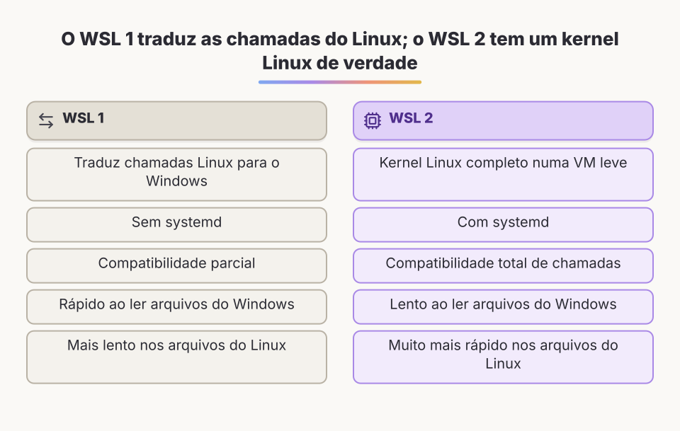
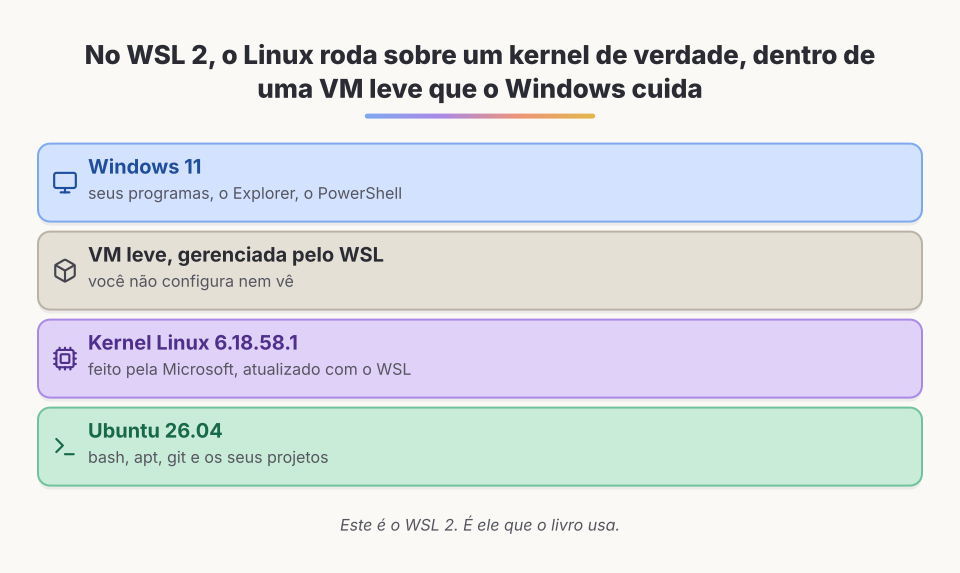
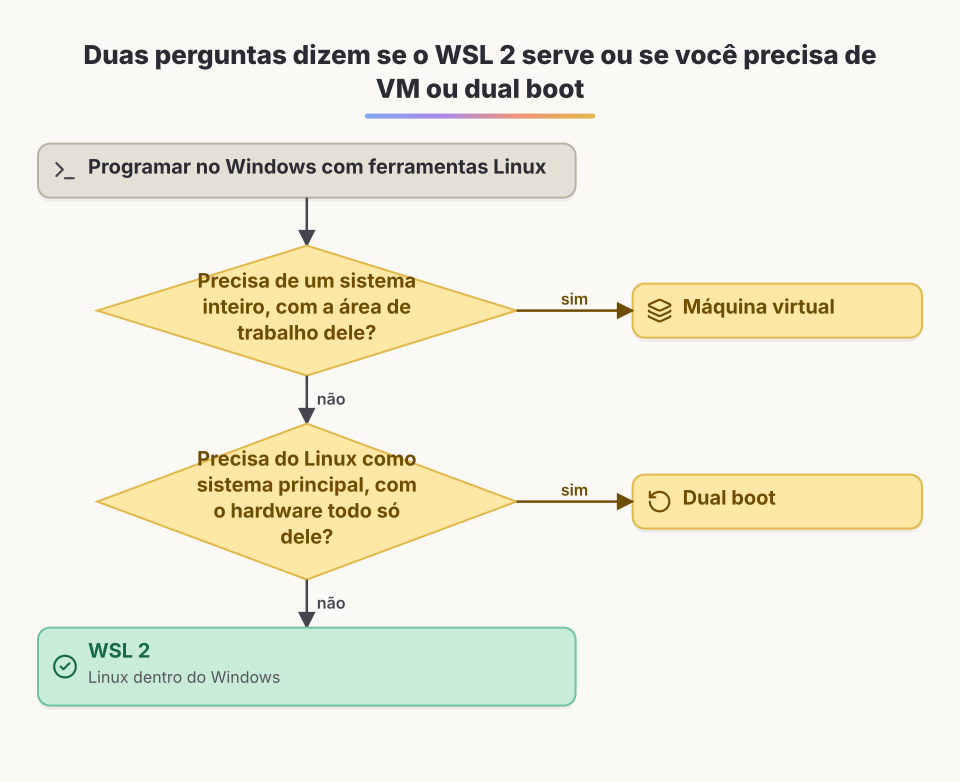

# 1. O que é o WSL e quando usar

> 🗺️ **Neste capítulo:** você entende o que é o WSL, qual a diferença entre o WSL 1 e o WSL 2, por que o kernel importa e quando um WSL serve melhor do que uma máquina virtual ou um dual boot. No fim, você cria o verificador do projeto **meu-ambiente** e confere se o seu PC está pronto. · ⏱️ ~35 min

## 📇 A parte 1 numa página

![Parte 1, capítulos 1 a 3. WSL 1 × WSL 2: WSL 1 traduz chamadas, WSL 2: kernel Linux numa VM, WSL 2 é o padrão e tem systemd. O kernel: uname -r termina em WSL2, versão do pacote ≠ arquitetura, vem com as atualizações do WSL. WSL × VM × dual boot: VM: sistema inteiro numa janela, dual boot: um sistema por vez, WSL: Linux sem reiniciar. Instalar: virtualização no firmware, wsl --install -d Ubuntu-26.04, reinicie na primeira vez. Usuário e conferência: conta própria no grupo sudo, wsl -l -v: VERSION 2, wsl --version mostra o kernel. Prompt e comandos: ana@PC:~$ mostra o contexto, pwd, ls, cd, mkdir, cp, mv, rm não tem lixeira. apt: update renova a lista, upgrade atualiza o instalado, sem sudo: erro de lock. sudo × root: sudo roda um comando como root, o que o root cria é dele, não trabalhe como root. systemd: PID 1 cuida dos serviços, [boot] systemd=true, mudou o wsl.conf: --terminate. meu-ambiente: repositório Git no ~, verificar.ps1 e verificar.sh, cresce a cada capítulo.](../img/c01-resumo-parte-1.svg)

- [Capítulo 1: O que é o WSL e quando usar](01-o-que-e-o-wsl-e-quando-usar.md)
- [Capítulo 2: Instalação do WSL e do Ubuntu](02-instalacao-do-wsl-e-do-ubuntu.md)
- [Capítulo 3: Primeiros passos no Ubuntu](03-primeiros-passos-no-ubuntu.md)

## Por que um Linux dentro do Windows

Você abre um tutorial de programação e o primeiro comando é `sudo apt install ...`. No Windows, esse comando não existe. Isso acontece o tempo todo: os servidores onde os sistemas rodam são quase todos Linux, e grande parte das ferramentas de desenvolvimento nasce nele. Quem programa só com as ferramentas do Windows acaba sempre um passo atrás do tutorial.

Existem três jeitos de ter um Linux à mão sem abandonar o Windows: instalar o Linux ao lado dele (*dual boot*), rodá-lo dentro de uma máquina virtual, ou usar o WSL. Este livro usa o terceiro.

**O WSL (*Windows Subsystem for Linux*, ou "Subsistema do Windows para Linux") é um recurso do Windows que executa um Linux de verdade, com terminal e ferramentas próprias, dentro do Windows. Você não monta máquina virtual e não reinicia o computador para trocar de sistema.**

No fim do livro você terá, no seu computador, um ambiente de desenvolvimento completo, que sabe montar, personalizar, salvar e restaurar. Tudo gira em torno de um projeto, o **meu-ambiente**, que cresce a cada capítulo. Neste, ele nasce como um verificador: um pequeno programa que diz "OK" ou "FALHA" para cada coisa que precisa estar certa.

> ⚠️ **Erro comum:** achar que o WSL é um "Linux de brinquedo" ou um emulador. O que você usa nele (bash, `apt`, `git`, compiladores) é o Linux de verdade; a diferença está só em como ele convive com o Windows.

## WSL 1 × WSL 2

O WSL tem duas arquiteturas, e a diferença define tudo o que vem depois.

No **WSL 1**, o Windows recebe os pedidos dos programas Linux e os **traduz** para o seu próprio jeito de trabalhar. É como um intérprete: quase tudo funciona, mas alguns pedidos não têm tradução.

No **WSL 2**, o Windows liga uma máquina virtual muito leve com um **kernel Linux de verdade** dentro, e os programas Linux conversam direto com esse kernel. Não há tradução.



A tabela da documentação da Microsoft ajuda a ver o que muda na prática:

| Característica | WSL 1 | WSL 2 |
| --- | --- | --- |
| Kernel Linux completo | não | sim |
| Todas as chamadas do sistema funcionam | não | sim |
| `systemd` (o gerenciador de serviços do Linux) | não | sim |
| Velocidade ao acessar arquivos do outro sistema | melhor | pior |
| Convive com versões atuais do VirtualBox e do VMware | sim | com restrições |

Segundo a própria Microsoft, nas primeiras versões o WSL 2 era até 20 vezes mais rápido que o WSL 1 ao descompactar um arquivo `.tar` e de 2 a 5 vezes mais rápido em `git clone` e `npm install`. O ponto fraco do WSL 2 é o acesso entre os dois lados, e o capítulo 4 mostra como evitar esse problema.

Para o que o livro faz (servidor, `systemd`, Docker, Claude Code), o WSL 2 é a escolha certa. Hoje ele já é o padrão de toda instalação nova.

> ⚠️ **Erro comum:** confundir a versão do **programa WSL** com a versão da **arquitetura**. No PC em que este livro foi escrito, `wsl --version` mostra `WSL version: 3.0.5.0`, mas `wsl -l -v` mostra `2` na coluna `VERSION` da distro. São duas numerações diferentes: a primeira é a versão do pacote do WSL, a segunda diz se aquela distro roda como WSL 1 ou WSL 2. Quando o livro disser "WSL 2", é a arquitetura.

## O kernel do WSL 2

Um **kernel** é o coração do sistema operacional: o programa que fala com o hardware, decide quem usa a memória e o processador e atende os pedidos de todos os outros programas. Distribuições como Ubuntu, Debian e Fedora diferem no que vem em volta do kernel (programas, instalador, regras de atualização), mas todas usam o Linux.

No WSL 2, esse kernel vem do próprio WSL. A Microsoft o compila a partir da ramificação estável do projeto Linux (kernel.org), com ajustes para rodar bem no Windows, e o entrega com as atualizações do WSL (`wsl --update`). O código é aberto, no repositório `microsoft/WSL2-Linux-Kernel`.

Dá para ver o nome dele de dentro do Linux. Preveja antes: o que você espera que `uname -r` imprima num Ubuntu do WSL 2, e que palavra deve aparecer no fim? Depois confira, numa distro de teste com o Ubuntu 26.04.1, preparada para escrever este livro:

```bash
# versão do kernel que está rodando
uname -r
# o /proc/version mostra a "certidão de nascimento" do kernel
cat /proc/version
```

Saída:

```text
6.18.58.1-microsoft-standard-WSL2
Linux version 6.18.58.1-microsoft-standard-WSL2 (root@6869314ecc53)
  (gcc (GCC) 13.2.0, GNU ld (GNU Binutils) 2.41)
  #1 SMP PREEMPT_DYNAMIC Tue Oct 27 00:24:11 UTC 2026
```

O nome termina em `microsoft-standard-WSL2`: é a assinatura do kernel do WSL 2, e é por ela que o verificador deste capítulo reconhece o ambiente. O número no começo (`6.18.58.1`) muda quando o WSL é atualizado, então o seu pode ser outro, mas o final do nome é sempre esse.



> 💡 **Analogia:** o Windows é um prédio, o WSL 2 é um apartamento mobiliado dentro dele, e o kernel é a cozinha e a instalação elétrica desse apartamento. Você mora lá (a distro) e usa tudo como numa casa normal, mas o prédio cuida da manutenção, liga e desliga a luz quando ninguém está e atualiza os encanamentos. A analogia quebra num ponto: o apartamento divide com o prédio a mesma conta de luz. Memória, processador e disco são os do seu PC, e é por isso que o capítulo 7 mostra como pôr um limite neles.

## WSL × máquina virtual × dual boot

As três opções entregam um Linux, mas de formas muito diferentes.

- **Máquina virtual (VM):** você instala um sistema inteiro dentro de um programa (VirtualBox, VMware, Hyper-V). Ele tem sua própria janela, sua área de trabalho e seus recursos reservados. Você cuida dele como cuidaria de um computador extra.
- **Dual boot:** você instala o Linux no disco, ao lado do Windows, e escolhe qual sistema liga ao iniciar o PC. Só roda um por vez.
- **WSL:** você usa o terminal do Linux dentro do Windows, em uma VM leve que o próprio Windows liga, desliga e atualiza.

| | WSL 2 | Máquina virtual | Dual boot |
| --- | --- | --- | --- |
| Tempo até o terminal Linux | segundos | você liga e espera o sistema | reiniciar o PC |
| Usa Linux e Windows ao mesmo tempo | sim | sim | não |
| Quem gerencia o Linux | o WSL | você | você |
| Área de trabalho completa do Linux | não é o foco (há o WSLg, capítulo 6) | sim | sim |
| Acesso total ao hardware | não | não | sim |
| Risco para o Windows na instalação | nenhum | nenhum | repartir o disco |



Para quem programa no Windows e quer as ferramentas do Linux, o WSL 2 costuma ganhar: abre em segundos e deixa seus programas do Windows ao lado, no mesmo teclado. Você só precisa de outra opção quando o trabalho exige o sistema completo, com a área de trabalho dele (VM), ou o hardware inteiro para o Linux (dual boot).

> ⚠️ **Erro comum:** escolher o dual boot "para ter o Linux de verdade". O Linux do WSL 2 é de verdade; o que o dual boot acrescenta é apenas o acesso exclusivo ao hardware, que a maioria das pessoas que programa não usa.

## 🧪 Laboratório: o seu PC está pronto para o WSL 2?

Aqui nasce o projeto **meu-ambiente**: um verificador em dois pedaços, um para cada lado. O pedaço do Windows você roda agora; o do Linux fica pronto para o capítulo 2, quando você tiver o Ubuntu.

**Passo 1. Criar a pasta do projeto.** Por enquanto ela fica no Windows. No capítulo 3 ela passa a morar no Linux, onde deve ficar. Abra o PowerShell (não precisa ser administrador) e rode:

```powershell
# cria a pasta do projeto e entra nela
mkdir $HOME\meu-ambiente
cd $HOME\meu-ambiente
```

**Passo 2. Criar o verificador do lado Windows.** Salve o arquivo abaixo na pasta, com o nome `verificar.ps1`. O texto do script está sem acentos de propósito: o Windows PowerShell 5.1 lê arquivos sem marcação como "ANSI", e um `ç` ou `ã` virariam letras estranhas na saída.

<!-- project: meu-ambiente -->

**verificar.ps1**

```powershell
# Confere, do lado Windows, se o PC esta pronto para o WSL 2.
$build = [System.Environment]::OSVersion.Version.Build
$cpu = Get-CimInstance Win32_Processor | Select-Object -First 1
$emUso = (Get-CimInstance Win32_ComputerSystem).HypervisorPresent
$wsl = Get-Command wsl.exe -ErrorAction SilentlyContinue

# mostra OK ou FALHA para cada teste
function Checa($texto, $ok) {
    if ($ok) { "OK    $texto" } else { "FALHA $texto" }
}

$versaoOk = $build -ge 19041
# com o hipervisor em uso, o campo do firmware aparece como False
$virtOk = $cpu.VirtualizationFirmwareEnabled -or $emUso

Checa "Windows 10 build 19041+ ou 11 (este: build $build)" $versaoOk
Checa "virtualizacao ligada no firmware ou em uso" $virtOk
Checa "wsl.exe encontrado" ($null -ne $wsl)
```

**Passo 3. Rodar.** O `-ExecutionPolicy Bypass` vale só para esta execução e evita que a política de scripts do Windows barre o arquivo, sem mudar nada no sistema:

```powershell
powershell -NoProfile -ExecutionPolicy Bypass -File .\verificar.ps1
```

Saída no PC em que o livro foi escrito (Windows 11, build 26300):

```text
OK    Windows 10 build 19041+ ou 11 (este: build 26300)
OK    virtualizacao ligada no firmware ou em uso
OK    wsl.exe encontrado
```

Se alguma linha mostrar `FALHA`: a primeira pede atualização do Windows (Windows Update); a segunda pede que você ligue a virtualização no firmware (BIOS/UEFI), numa opção que costuma ter o nome de *Intel VT-x*, *AMD-V* ou *SVM Mode*; a terceira indica um Windows que não traz o WSL, caso em que você instala pelo capítulo 2.

### 🔎 Para ir além: por que o verificador aceita "já em uso"?

Neste PC o campo `VirtualizationFirmwareEnabled` aparece como `False`, mesmo com o WSL 2 rodando. Quem explica é o `systeminfo`, que nas linhas de requisitos do Hyper-V responde: `A hypervisor has been detected. Features required for Hyper-V will not be displayed.` Quando o Windows já ligou o hipervisor, ele ocupou a virtualização, e o campo deixa de refletir o firmware. Por isso o teste olha o firmware **ou** o hipervisor em uso. Sem essa segunda metade, o verificador diria `FALHA` num PC em que tudo funciona. Pelo Gerenciador de Tarefas (**Ctrl + Shift + Esc** → aba **Desempenho** → **CPU**), a linha **Virtualização** serve para a mesma conferência quando o hipervisor ainda não está em uso. O livro não traz uma captura dessa tela: a documentação do WSL não tem uma com licença livre.

**Passo 4. Criar o verificador do lado Linux.** Este você só roda no capítulo 2, mas já deixe o arquivo pronto, no mesmo lugar, com o nome `verificar.sh`:

**verificar.sh**

```bash
#!/usr/bin/env bash
# Confere, do lado Linux, se este Ubuntu roda no WSL 2.
falhas=0

# mostra OK ou FALHA para cada teste e conta as falhas
checa() {
  if eval "$2" > /dev/null 2>&1; then
    echo "OK    $1"
  else
    echo "FALHA $1"
    falhas=$((falhas + 1))
  fi
}

# o nome do kernel do WSL 2 termina assim
assinatura='microsoft-standard-WSL2'

checa "distribuição é o Ubuntu" "grep -q '^ID=ubuntu' /etc/os-release"
checa "kernel do WSL 2" "uname -r | grep -q $assinatura"
checa "/proc/version cita microsoft" "grep -qi microsoft /proc/version"

echo "---"
if [ "$falhas" -eq 0 ]; then
  echo "Tudo certo: este Linux roda no WSL 2."
else
  echo "$falhas teste(s) falharam."
  exit 1
fi
```

Saída num Ubuntu 26.04.1 do WSL 2 (a distro de teste do livro):

```text
OK    distribuição é o Ubuntu
OK    kernel do WSL 2
OK    /proc/version cita microsoft
---
Tudo certo: este Linux roda no WSL 2.
```

O `checa` recebe um texto e um comando e roda o comando sem mostrar a saída. Se ele termina bem (`grep -q` acha o que procura), imprime `OK`; se não, `FALHA` e soma um às falhas. A última parte decide a mensagem final e o código de saída (`exit 1` avisa a quem chamou o script que algo falhou, o que será útil quando o verificador crescer).

**Arquivos do projeto ao fim do capítulo:** `verificar.ps1` e `verificar.sh`, na pasta `meu-ambiente`. **Comando que confere:** `powershell -NoProfile -ExecutionPolicy Bypass -File .\verificar.ps1` deve imprimir três linhas começando com `OK`.

## 🏋️ Pratique

**1. Exemplo resolvido.** Alguém conta que o WSL mostra `VERSION 1` ao lado da distro e pergunta se precisa instalar uma máquina virtual para ter o `systemd`. O que você responde?

<details>
<summary>Ver resposta</summary>

Não precisa de VM. `VERSION 1` quer dizer que aquela distro está na arquitetura WSL 1, que não tem `systemd` (veja a tabela). A mudança é converter a distro para WSL 2, no capítulo 2 você vê o comando (`wsl --set-version <distro> 2`). Quem escolhe "instalar uma VM" confunde o problema (a distro ficou na arquitetura antiga) com a solução (trocar de arquitetura, não de tecnologia).

</details>

**2. Complete.** Preencha as lacunas: "No WSL __ há um kernel Linux de verdade dentro de uma __ leve. O nome desse kernel termina em __."

<details>
<summary>Ver resposta</summary>

"No WSL **2** há um kernel Linux de verdade dentro de uma **máquina virtual** leve. O nome desse kernel termina em **`microsoft-standard-WSL2`**." Quem escreveu "WSL 1" na primeira lacuna confundiu quem traduz (WSL 1) com quem tem kernel próprio (WSL 2).

</details>

**3. Faça sozinho.** Para cada situação, diga se WSL 2, VM ou dual boot é a melhor escolha, e por quê: (a) você quer rodar `git`, `node` e `python` do Linux sem sair do Windows; (b) você precisa testar um programa que só funciona com a área de trabalho de outro sistema, em janela, sem mexer no seu PC; (c) você quer usar o Linux o dia todo e o Windows quase nunca, com o hardware inteiro do notebook.

<details>
<summary>Ver resposta</summary>

(a) **WSL 2**: é exatamente o caso de uso dele, e abre em segundos. (b) **VM**: você precisa do sistema inteiro, com a área de trabalho, isolado do resto. (c) **Dual boot**: o Linux é o sistema principal e aproveita todo o hardware. Erro comum em (b): escolher dual boot e arriscar mexer nas partições do PC sem necessidade.

</details>

**4. Desafio.** O verificador do Windows diz `FALHA` na segunda linha (virtualização) em um PC antigo em que você sabe que a virtualização está desligada. Escreva em duas frases o que fazer e por que o `wsl --install` não resolveria isso sozinho.

<details>
<summary>Ver resposta</summary>

Entre na BIOS/UEFI na hora de ligar o PC e ligue a opção de virtualização (VT-x, AMD-V ou SVM Mode). O `wsl --install` configura componentes do **Windows**, mas a virtualização do **processador** é um interruptor do firmware, que só você ou o fabricante do PC mexe. Critérios de acerto: (1) cita BIOS/UEFI; (2) diferencia Windows de firmware; (3) não propõe trocar de arquitetura WSL como solução.

</details>

## 🧠 Revisão rápida

1. Em uma frase, o que é o WSL?
2. Qual a diferença central entre o WSL 1 e o WSL 2?
3. Que trecho no fim do nome do kernel indica que ele é o do WSL 2?
4. Por que `wsl --version` pode mostrar 3.0.5.0 enquanto `wsl -l -v` mostra 2?
5. Para qual situação o dual boot ainda é melhor que o WSL 2?

<details>
<summary>Ver respostas</summary>

1. O recurso do Windows que roda um Linux de verdade, com terminal e ferramentas, dentro do Windows, sem VM manual nem dual boot.
2. O WSL 1 traduz as chamadas do Linux; o WSL 2 tem um kernel Linux completo numa VM leve.
3. `microsoft-standard-WSL2`.
4. A primeira é a versão do pacote do WSL; a segunda é a arquitetura (1 ou 2) da distro.
5. Quando o Linux é o sistema do dia a dia e você quer o hardware inteiro para ele.

</details>

## 🤖 Estude com um tutor de IA

- "Faça-me 5 perguntas sobre a diferença entre WSL 1, WSL 2, máquina virtual e dual boot, uma de cada vez. Espere a minha resposta antes de dar o retorno e não me dê as respostas antes."
- "Esta é a minha resposta ao exercício 3: [minha resposta]. Aponte onde errei sem me dar a solução."

> ➡️ **Próximo passo:** no capítulo 2 você instala o WSL e o Ubuntu 26.04 e roda o `verificar.sh` pela primeira vez.

## 📌 Resumo

| Item | Em uma frase |
| --- | --- |
| WSL | Linux de verdade dentro do Windows, sem VM manual nem reinício |
| WSL 1 | Traduz as chamadas do Linux; sem `systemd` |
| WSL 2 | Kernel Linux completo numa VM leve; com `systemd`; é o padrão |
| Kernel | O núcleo do sistema; no WSL 2 o nome termina em `microsoft-standard-WSL2` |
| VM × dual boot | VM: sistema inteiro numa janela; dual boot: dois sistemas no disco, um por vez |
| `verificar.ps1` | Lado Windows do verificador: build, virtualização e `wsl.exe` |
| `verificar.sh` | Lado Linux do verificador: distro Ubuntu e kernel do WSL 2 |

## 📚 Fontes

- [Instalar o WSL](https://learn.microsoft.com/windows/wsl/install) (conferido em 27/11/2026)
- [Comparando as versões do WSL](https://learn.microsoft.com/windows/wsl/compare-versions) (27/11/2026)
- [Releases do WSL no GitHub](https://github.com/microsoft/WSL/releases): WSL 3.0.5, de 03/11/2026 (27/11/2026)
- [Kernel do WSL 2, código aberto](https://github.com/microsoft/WSL2-Linux-Kernel) (27/11/2026)
- Execuções: PC do autor (Windows 11, build 26300; WSL 3.0.5.0) e distro de teste Ubuntu 26.04.1 no WSL 2, 27/11/2026.

<!-- nav:start -->
---

[◀ Capítulo anterior](00-como-estudar-este-livro.md) · [Mapa do livro](../README.md) · [Próximo capítulo ▶](02-instalacao-do-wsl-e-do-ubuntu.md)
<!-- nav:end -->
