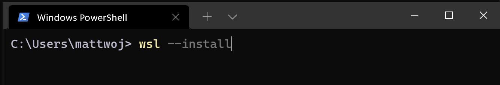
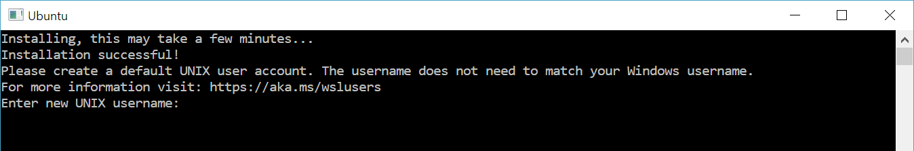
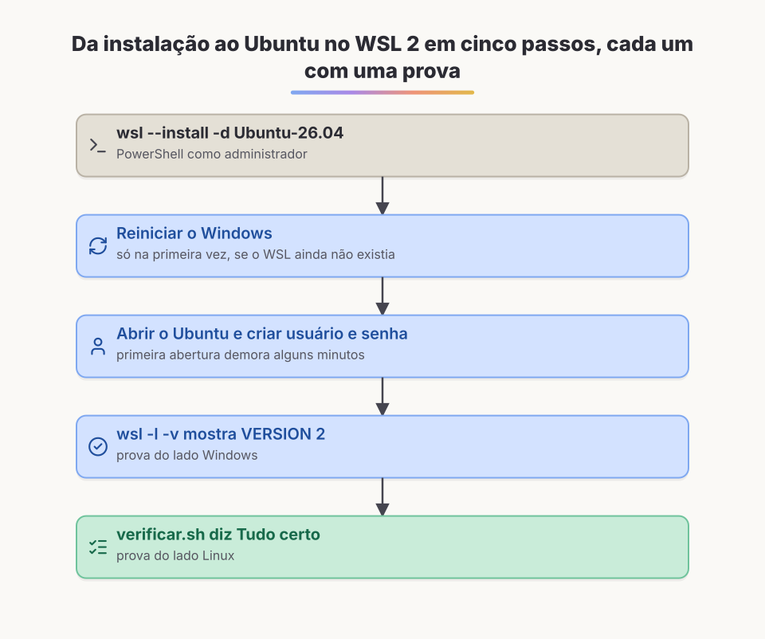

# 2. Instalação do WSL e do Ubuntu

> 🗺️ **Neste capítulo:** você confere os requisitos, instala o WSL com o Ubuntu 26.04, cria o seu usuário e prova, dos dois lados, que tudo roda no WSL 2. · ⏱️ ~45 min

> 🔥 **Aquecimento:** qual a diferença entre o WSL 1 e o WSL 2? E que trecho no fim do nome do kernel entrega que ele é o do WSL 2?
>
> <details>
> <summary>Ver resposta</summary>
>
> O WSL 1 traduz as chamadas do Linux para o Windows; o WSL 2 tem um kernel Linux completo numa VM leve. O nome do kernel termina em `microsoft-standard-WSL2` (capítulo 1).
>
> </details>

## De onde paramos

No capítulo 1 você criou, na pasta `meu-ambiente`, o `verificar.ps1` (que já mostrou `OK` no Windows) e o `verificar.sh`, que ainda não tinha onde rodar. Agora falta o Linux: neste capítulo você instala o Ubuntu e roda o `verificar.sh` pela primeira vez.

## Requisitos: Windows e virtualização

Para instalar com um comando só, você precisa do **Windows 11** ou do **Windows 10 versão 2004 ou mais nova (build 19041 ou maior)**. Em versões mais antigas, a Microsoft mantém um passo a passo manual; este livro não o segue.

O WSL 2 ainda pede que a **virtualização** esteja ligada: um recurso do processador que deixa o Windows criar a VM leve onde o kernel Linux roda. Quem liga é o **firmware** do computador (a BIOS ou UEFI), e só ele. Em geral já vem ligada; se não estiver, ou o `wsl --install` falha, ou o Ubuntu não abre.

Quem confirma isso é o `verificar.ps1` do capítulo 1, e você já sabe lê-lo. Se quiser rodar de novo antes de instalar:

```powershell
powershell -NoProfile -ExecutionPolicy Bypass -File .\verificar.ps1
```

> ⚠️ **Erro comum:** achar que `wsl --install` liga a virtualização. Ele ativa componentes do **Windows** (como a Plataforma de Máquina Virtual); a virtualização do **processador** é um interruptor da BIOS/UEFI.

## O comando `wsl --install`

Abra o **PowerShell como administrador** (clique com o botão direito no menu Iniciar → **Terminal (Admin)** e aceite o aviso do Controle de Conta de Usuário) e rode:

```powershell
wsl --install
```



*Imagem: MicrosoftDocs/WSL contributors, CC BY 4.0, via GitHub (MicrosoftDocs/WSL).*

Esse comando ativa o que o WSL precisa e instala o Ubuntu, a distribuição padrão. Se o WSL ainda não existia no PC, ele pede para **reiniciar o Windows**.

**Uma distribuição (*distro*) é um Linux completo montado em volta do kernel: o gerenciador de pacotes, os programas básicos e as regras de atualização.** Ubuntu, Debian, openSUSE e Kali são distros diferentes, e todas rodam sobre o mesmo tipo de kernel Linux.

> 💡 **Analogia:** continuando o apartamento do capítulo 1, a distro é a **mobília** que vem nele. O Ubuntu e o Debian equipam o apartamento de jeitos diferentes (cada um com seus móveis, seu jeito de repor o que falta), mas a instalação elétrica, o kernel, é do mesmo tipo. A analogia quebra em um ponto: dá para ter vários apartamentos ao mesmo tempo (várias distros), e no WSL 2 eles dividem o mesmo kernel.

Para escolher outra distro, ou a versão exata do Ubuntu, liste as disponíveis e instale pelo nome. A lista a seguir é um trecho do que o `wsl --list --online` mostrou em 27/11/2026; a sua pode ter mais ou menos linhas:

```powershell
wsl --list --online
```

```text
The following is a list of valid distributions that can be installed.
Install using 'wsl.exe --install <Distro>'.

NAME                            FRIENDLY NAME
Ubuntu                          Ubuntu
Ubuntu-26.04                    Ubuntu 26.04 LTS
Ubuntu-24.04                    Ubuntu 24.04 LTS
Ubuntu-22.04                    Ubuntu 22.04 LTS
openSUSE-Tumbleweed             openSUSE Tumbleweed
Debian                          Debian GNU/Linux
kali-linux                      Kali Linux Rolling
```

O livro usa o **Ubuntu 26.04**, versão de suporte longo (LTS, *Long Term Support*). O comando fica:

```powershell
wsl --install -d Ubuntu-26.04
```

Outras opções úteis, da documentação oficial: `--no-launch` instala sem abrir a distro em seguida; `--web-download` baixa de uma fonte online em vez de usar a Microsoft Store (a documentação recomenda se a instalação travar em 0.0%).

Se você digitar um nome que não existe, o WSL avisa e aponta a lista. Saída real, com um nome inventado (`Ubuntu-99.04`):

```text
Invalid distribution name: 'Ubuntu-99.04'.
To get a list of valid distributions, use 'wsl.exe --list --online'.
Error code: Wsl/InstallDistro/WSL_E_DISTRO_NOT_FOUND
```

> ⚠️ **Erro comum:** rodar `wsl --install` quando o WSL já está instalado. A documentação oficial avisa: nesse caso o comando só mostra a ajuda. Use `wsl --list --online` e depois `wsl --install -d <nome>`.

### A imagem `.wsl`: instalar sem a loja

A Microsoft também publica, para cada distro, um **arquivo `.wsl`**: a imagem do sistema pronta, que vale para instalar sem a Microsoft Store (por exemplo, num PC sem acesso a ela) e que o livro vai usar mais adiante para criar a distro de teste. Os endereços ficam no arquivo `DistributionInfo.json` do repositório `microsoft/WSL`, junto com o **hash SHA256** de cada imagem: uma "impressão digital" que prova que o arquivo baixado é o original.

Para o Ubuntu 26.04.1, o endereço é `https://releases.ubuntu.com/26.04.1/ubuntu-26.04.1-wsl-amd64.wsl` (cerca de 400 MiB). Depois de baixar, confira o hash no PowerShell e compare com o do catálogo:

```powershell
Get-FileHash .\ubuntu-26.04.1-wsl-amd64.wsl -Algorithm SHA256
```

```text
Algorithm : SHA256
Hash      : 48D56724B5C8E60F24893E83E73BBB58C60B3CA22FBA3DA977075420ACD54104
```

O hash do catálogo da Microsoft é `48d56724b5c8e60f24893e83e73bbb58c60b3ca22fba3da977075420acd54104`: igual (o PowerShell escreve em maiúsculas). Se não fosse, o arquivo estaria corrompido ou adulterado e não deveria ser usado.

## Usuário e senha do Linux

Na primeira abertura, o Ubuntu descompacta os arquivos (alguns minutos, só desta vez) e pede para você criar uma conta. É a conta que você usará no dia a dia dentro do Linux.



*Imagem: MicrosoftDocs/WSL contributors, CC BY 4.0, via GitHub (MicrosoftDocs/WSL). A captura mostra uma versão mais antiga do Ubuntu; as mensagens da 26.04 podem ter pequenas diferenças.*

Regras práticas:

- O **nome de usuário** vai em letras minúsculas, sem espaço, e **não precisa ser igual ao seu usuário do Windows**. Aqui usaremos `ana`.
- A **senha** é do Linux, independente da senha do Windows. Ao digitar, nada aparece na tela (nem asteriscos) na maioria dos casos: é normal, digite e dê Enter.
- Essa conta entra no grupo **`sudo`**, que a autoriza a rodar comandos de administrador pedindo a senha dela (capítulo 3).
- **Anote a senha.** Ela é pedida toda vez que você usar `sudo`, e perdê-la dá trabalho.

> ⚠️ **Erro comum:** usar a senha do Windows ou criar uma senha "para depois". O `sudo` não aceita a do Windows; é a do Linux, a que você cria agora.

## Conferir: `wsl -l -v` e `wsl --version`

Dois comandos do **lado Windows** provam o que está instalado. O primeiro lista as distros e diz em qual arquitetura cada uma roda:

```powershell
wsl -l -v
```

```text
  NAME              STATE           VERSION
* Ubuntu-26.04      Running         2
  docker-desktop    Running         2
  wz-teste          Stopped         2
```

Leia assim: o asterisco marca a distro padrão (a que abre com `wsl` sem opções), `STATE` diz se está rodando e `VERSION` é a **arquitetura**, 1 ou 2. No seu computador, no começo, só deve aparecer o `Ubuntu-26.04`. As outras duas linhas são de outros programas deste PC: `docker-desktop` é do Docker Desktop, e `wz-teste` é a distro de teste do livro (capítulo 8).

O segundo mostra as versões dos componentes:

```powershell
wsl --version
```

```text
WSL version: 3.0.5.0
Kernel version: 6.18.58.1-1
WSLg version: 1.0.79
MSRDC version: 1.2.7391
Direct3D version: 1.611.1-81528511
DXCore version: 10.0.26100.1-240331-1435.ge-release
Windows version: 10.0.26300.9974
```

Se a coluna `VERSION` mostrar `1`, a distro está na arquitetura antiga. O comando para converter é `wsl --set-version <distro> 2` (sem ele, o `systemd` do capítulo 3 não funciona). Se a distro já estiver no 2, o WSL avisa, como mostrou a distro de teste, e ainda imprime um código de erro estranho:

```text
The distribution is already the requested version.
Error code: Wsl/Service/WSL_E_VM_MODE_INVALID_STATE
```

Nesse caso a mensagem útil é a primeira linha: nada precisa ser feito.

Para escolher qual distro abre por padrão, use `wsl --set-default <distro>`; para trocar a arquitetura de todas as futuras, `wsl --set-default-version 2`.

## Erros de instalação mais comuns

| Sintoma | Causa mais provável | O que fazer |
| --- | --- | --- |
| `0x80370102` ou `0x80070003` | Virtualização desligada na BIOS/UEFI, ou a Plataforma de Máquina Virtual não está ativa | Ligar a virtualização no firmware e rodar o `verificar.ps1` |
| A instalação parece travada em 0.0% | Download pela loja não anda | `wsl --install --web-download -d Ubuntu-26.04` |
| `wsl --install` só mostra a ajuda | O WSL já estava instalado | `wsl --list --online` e `wsl --install -d <nome>` |
| `Invalid command line option: --version` ou erro em `--set-version` | Windows ou WSL antigos (build abaixo de 18362) | Atualizar o Windows; depois `wsl --update` |
| Processador sem a função SLAT | CPU antiga demais para o WSL 2 | Sem solução por software: o WSL 2 não roda nesse processador |

As causas e as soluções vêm da seção de instalação do guia de solução de problemas da Microsoft, listada nas fontes. Em qualquer erro, copie o **código** (`0x...`) e procure nessa página: ela está atualizada com o que a Microsoft recebe de relatos.

## 🧪 Laboratório: instalar e provar que é WSL 2

> ⚠️ **O que foi e o que não foi executado.** Os passos 1 a 3 (abrir o PowerShell como administrador, instalar e reiniciar) **não foram executados** na produção do livro: o computador do autor já tem o Ubuntu e o Docker Desktop, e a instalação alteraria o que existe. Eles seguem a documentação oficial ([Instalar o WSL](https://learn.microsoft.com/windows/wsl/install)). Os passos 4 a 6 **foram executados** numa distro de teste, o Ubuntu 26.04.1 importado da imagem `.wsl` oficial (o `hash` conferido), com o usuário criado por comando: o resultado é o mesmo que o assistente da primeira abertura entrega.

**Passo 1. Abrir o PowerShell como administrador.** *(Não executado.)* Menu Iniciar → clique direito → **Terminal (Admin)** → aceite o aviso.

**Passo 2. Instalar.** *(Não executado.)*

```powershell
wsl --list --online
wsl --install -d Ubuntu-26.04
```

Confira se `Ubuntu-26.04` aparece na lista antes de rodar a segunda linha.

**Passo 3. Reiniciar e criar o usuário.** *(Não executado.)* Reinicie o Windows. Na volta, o Ubuntu termina a instalação sozinho (se não abrir, procure "Ubuntu" no menu Iniciar), pede o usuário e a senha duas vezes. Ao final o prompt mostra algo como `ana@NOME-DO-PC:~$`: você está no bash do Ubuntu.



**Passo 4. Do lado Linux: quem sou eu.** *(Executado na distro de teste.)* No Ubuntu:

```bash
# o usuário atual e os grupos dele; "sudo" na lista
# é o que dá poder de administrador
whoami
id
```

Saída (o seu `ana` será o nome que você escolheu):

```text
ana
uid=1000(ana) gid=1000(ana) groups=1000(ana),27(sudo),100(users)
```

O `uid=1000` é o do primeiro usuário comum criado no Linux. No seu WSL, a lista de grupos pode ser maior, mas `sudo` precisa estar nela.

**Passo 5. Copiar o `verificar.sh` para dentro do Linux e rodá-lo.** O arquivo está na sua pasta `meu-ambiente`, do lado Windows. Dentro do Ubuntu, o disco `C:` aparece em `/mnt/c` (o capítulo 4 explica); por ora, copie e rode:

```bash
# troque SEU-USUARIO pelo nome da sua pasta em C:\Users
cp /mnt/c/Users/SEU-USUARIO/meu-ambiente/verificar.sh ~/
bash ~/verificar.sh
echo "código de saída: $?"
```

Saída na distro de teste (o caminho de origem era outro, em `/mnt/d`):

```text
OK    distribuição é o Ubuntu
OK    kernel do WSL 2
OK    /proc/version cita microsoft
---
Tudo certo: este Linux roda no WSL 2.
código de saída: 0
```

Código de saída `0` quer dizer "sem falhas". Num Linux fora do WSL, a segunda linha diria `FALHA`, e o código de saída seria `1`.

**Passo 6. Do lado Windows: a arquitetura.** *(Executado.)* Volte ao PowerShell (pode ser sem administrador):

```powershell
wsl -l -v
wsl --version
```

A linha da sua distro deve ter `2` na coluna `VERSION`; a primeira linha do `--version` mostra a versão do WSL (aqui, 3.0.5.0).

**Arquivos do projeto ao fim do capítulo:** os mesmos do capítulo 1 (`verificar.ps1`, `verificar.sh`), com o `verificar.sh` rodando dentro do Ubuntu. **Comando que confere:** `bash ~/verificar.sh` termina com "Tudo certo" e código de saída `0`.

## 🏋️ Pratique

**1. Exemplo resolvido.** O PowerShell mostrou isto depois da instalação. A distro está certa?

```text
  NAME            STATE           VERSION
* Ubuntu-26.04    Running         1
```

<details>
<summary>Ver resposta</summary>

Não. A distro está instalada, mas na arquitetura **WSL 1** (`VERSION 1`). O livro precisa do WSL 2 (kernel de verdade, `systemd`). A correção é `wsl --set-version Ubuntu-26.04 2`; depois, `wsl -l -v` deve mostrar `2`. Quem tentaria reinstalar tudo erra o alvo: o problema está na versão, não na instalação.

</details>

**2. Complete.** Para instalar o Debian em vez do Ubuntu, você roda primeiro `wsl --list ____` para ver os nomes, e depois `wsl ____ -d Debian`.

<details>
<summary>Ver resposta</summary>

`wsl --list --online` e `wsl --install -d Debian`. Quem escreveu só `wsl --list` viu apenas o que já está instalado, não o que a loja oferece.

</details>

**3. Faça sozinho.** Depois de instalar, `wsl -l -v` mostra `2` na coluna `VERSION`, mas o `verificar.sh` termina com `FALHA kernel do WSL 2`. Isso é possível? Que hipótese você testaria primeiro?

<details>
<summary>Ver resposta</summary>

É improvável, mas vale conferir o óbvio: você pode ter rodado o `verificar.sh` **no lugar errado**, por exemplo no Git Bash do Windows ou em outra distro, não no Ubuntu do WSL. Rode `uname -r` no mesmo terminal e veja se o nome termina em `microsoft-standard-WSL2`. Se terminar, o problema é o script (um erro de digitação ao copiar); se não, o terminal não é o do Ubuntu. Critérios de uma boa resposta: (1) desconfia primeiro do lugar onde rodou; (2) usa um comando que mostra o fato, `uname -r`, e não adivinha.

</details>

**4. Desafio.** Um colega diz que a instalação travou em 0.0% e que ele já reiniciou duas vezes. Escreva a mensagem que você mandaria, com o comando e o motivo.

<details>
<summary>Ver resposta</summary>

"Tente baixar a distro direto de uma fonte online, sem passar pela loja: `wsl --install --web-download -d Ubuntu-26.04`. A documentação da Microsoft recomenda isso quando o download trava em 0.0%. Antes, rode `wsl --list --online` para confirmar o nome da distro." Critérios: (1) cita `--web-download`; (2) mantém o `-d` com o nome da distro; (3) não manda reiniciar de novo, que não resolve.

</details>

## 🧠 Revisão rápida

1. O que a virtualização tem a ver com o WSL 2, e quem a liga?
2. Por que o `wsl --install` pede um PowerShell como administrador?
3. O que é uma distro?
4. O que a coluna `VERSION` do `wsl -l -v` diz? E o `wsl --version`?
5. (Capítulo 1) Qual o trecho do nome do kernel que identifica o WSL 2?

<details>
<summary>Ver respostas</summary>

1. É o recurso do processador que deixa o Windows criar a VM leve do WSL 2; quem liga é o firmware (BIOS/UEFI).
2. Porque ele ativa componentes do Windows, o que exige permissão de administrador.
3. Um Linux completo montado em volta do kernel: gerenciador de pacotes, programas básicos e regras de atualização.
4. `VERSION` diz a arquitetura da distro (1 ou 2); `wsl --version` mostra a versão do programa WSL e de seus componentes.
5. `microsoft-standard-WSL2`.

</details>

## 🤖 Estude com um tutor de IA

- "Faça-me 5 perguntas sobre a instalação do WSL e do Ubuntu (requisitos, `wsl --install`, `wsl -l -v`, erros comuns), uma de cada vez. Espere a minha resposta antes de dar o retorno e não me dê as respostas antes."
- "Esta é a minha resposta ao exercício 3: [minha resposta]. Aponte onde errei sem me dar a solução."

> ➡️ **Próximo passo:** no capítulo 3 você aprende o terminal do Ubuntu, atualiza os pacotes com o `apt`, entende o `sudo` e cria o repositório do projeto **meu-ambiente** no Linux.

## 📌 Resumo

| Item | Em uma frase |
| --- | --- |
| Requisitos | Windows 11, ou Windows 10 build 19041+, e virtualização ligada no firmware |
| `wsl --install -d Ubuntu-26.04` | Instala o WSL e a distro; pede reinício na primeira vez |
| Distro | Um Linux completo em volta do kernel (Ubuntu, Debian, openSUSE...) |
| Imagem `.wsl` | Arquivo da distro, com hash SHA256, para instalar sem a loja |
| Usuário e senha | A conta do dia a dia no Linux; entra no grupo `sudo`; senha própria |
| `wsl -l -v` | Lista as distros e a arquitetura (`VERSION` 2) |
| `wsl --version` | Mostra a versão do WSL, do kernel e dos componentes |

## 📚 Fontes

- [Instalar o WSL](https://learn.microsoft.com/windows/wsl/install) (conferido em 27/11/2026)
- [Comandos básicos do WSL](https://learn.microsoft.com/windows/wsl/basic-commands) (27/11/2026)
- [Solução de problemas do WSL: instalação](https://learn.microsoft.com/windows/wsl/troubleshooting#installation-issues) (27/11/2026)
- [DistributionInfo.json (microsoft/WSL)](https://github.com/microsoft/WSL/blob/master/distributions/DistributionInfo.json): endereço e SHA256 da imagem do Ubuntu 26.04.1 (27/11/2026)
- Imagens: [MicrosoftDocs/WSL](https://github.com/MicrosoftDocs/WSL), CC BY 4.0.
- Execuções: PC do autor (Windows 11, build 26300; WSL 3.0.5.0) e distro de teste Ubuntu 26.04.1, 27/11/2026.
