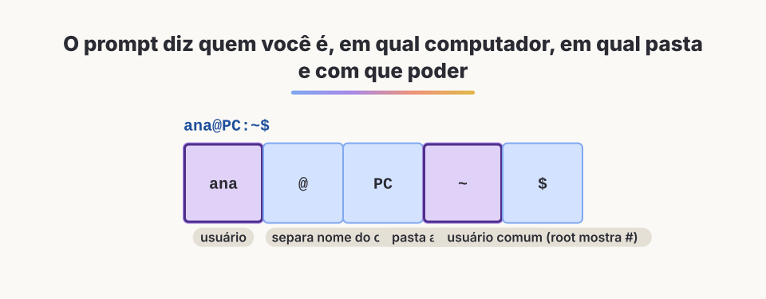
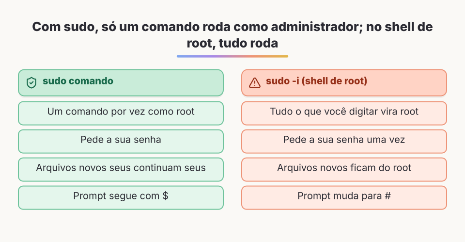

# 3. Primeiros passos no Ubuntu

> 🗺️ **Neste capítulo:** você aprende a ler o prompt e os comandos básicos do terminal, atualiza os pacotes com o `apt`, entende por que usa `sudo` em vez de trabalhar como root, confere o `systemd` e cria o repositório **meu-ambiente** no Linux. · ⏱️ ~50 min

> 🔥 **Aquecimento:** o que a coluna `VERSION` do `wsl -l -v` mostra? E em que arquivo do projeto, criado no capítulo 1, você roda o teste do lado Linux?
>
> <details>
> <summary>Ver resposta</summary>
>
> `VERSION` mostra a arquitetura da distro (1 ou 2). O teste do lado Linux é o `verificar.sh`.
>
> </details>

## De onde paramos

No capítulo 2 você instalou o Ubuntu 26.04, criou o seu usuário e viu o `verificar.sh` dizer "Tudo certo". Só que ele estava solto na sua pasta do Windows. Agora você aprende o básico do terminal do Ubuntu e leva o projeto **meu-ambiente** para o lugar dele: o sistema de arquivos do Linux.

## O terminal e o prompt

O **terminal** é a janela onde você digita comandos. Quem lê o que você digita e o executa é o **shell**, e o do Ubuntu é o **bash**. Quando o shell está pronto, ele mostra o **prompt** (*prompt*): uma linha que diz quem você é, onde está e com que poder.



No seu Ubuntu, o `PC` é o nome do seu computador. O `~` é um atalho para a sua **pasta pessoal** (*home*), que aqui é `/home/ana`. E o `$` mostra que você é um usuário comum: o administrador (*root*) vê `#`.

> ⚠️ **Erro comum:** copiar o prompt junto com o comando. Quando um livro ou tutorial mostra `$ ls`, o `$` é só o prompt; você digita `ls`.

## Comandos de sobrevivência

Com poucos comandos você se mexe pelo sistema. Todos abaixo rodam no Ubuntu, como `ana`, e a saída é a real da distro de teste:

```bash
# onde estou?
pwd
# cria uma pasta de treino e entra nela
mkdir treino
cd treino
# cria um arquivo com uma linha de texto
echo "primeira nota" > nota.txt
# lista o que há aqui; -l mostra dono, tamanho e data
ls
ls -l
# mostra o conteúdo do arquivo
cat nota.txt
```

Saída:

```text
/home/ana
nota.txt
total 4
-rw-r--r-- 1 ana ana 14 Nov 27 01:30 nota.txt
primeira nota
```

Leia o `ls -l` da esquerda para a direita: as permissões (`-rw-r--r--`), o dono (`ana`), o grupo (`ana`), o tamanho em bytes (14) e a data. O dono é a peça-chave da seção sobre o `sudo`, mais adiante.

| Comando | O que faz |
| --- | --- |
| `pwd` | mostra a pasta atual |
| `ls` / `ls -l` / `ls -a` | lista arquivos; com detalhes; incluindo os ocultos (que começam com `.`) |
| `cd pasta` / `cd ..` / `cd` | entra na pasta; sobe um nível; volta para a pasta pessoal |
| `mkdir nome` | cria uma pasta |
| `cp origem destino` | copia |
| `mv origem destino` | move ou renomeia |
| `rm arquivo` | apaga, **sem lixeira** |
| `cat arquivo` | mostra o conteúdo |
| `comando --help` | explica as opções do comando |

> ⚠️ **Erro comum:** achar que o `rm` manda para a lixeira. No terminal, apagou, sumiu. Antes de `rm` com `*` ou com `-r`, rode o `ls` do mesmo alvo para ver o que vai embora.

## `apt`: atualizar e instalar programas

No Linux, você não baixa instaladores de sites: pede o programa ao **gerenciador de pacotes**. No Ubuntu ele se chama **`apt`**, e cada programa é um **pacote** (*package*) guardado em servidores oficiais, os **repositórios**.

O `apt` trabalha em duas etapas, e confundi-las é a fonte da maioria dos erros:

| Comando | O que faz |
| --- | --- |
| `sudo apt update` | baixa a **lista** do que existe e de quais versões estão disponíveis; não instala nada |
| `apt list --upgradable` | mostra o que tem versão mais nova que a instalada |
| `sudo apt upgrade` | atualiza os pacotes instalados para as versões da lista |
| `sudo apt install nome` | instala um pacote |
| `sudo apt remove nome` | remove um pacote |

Preveja: o que o `apt update` faz com os programas já instalados? Depois confira, no Ubuntu 26.04 (`apt 3.2.0`):

```bash
sudo apt update
```

```text
Get:46 http://archive.ubuntu.com/ubuntu resolute-backports/restricted amd64 c-n-f Metadata [120 B]
Get:47 http://archive.ubuntu.com/ubuntu resolute-backports/multiverse amd64 Components [216 B]
Get:48 http://archive.ubuntu.com/ubuntu resolute-backports/multiverse amd64 c-n-f Metadata [120 B]
Fetched 33.0 MB in 7s (4411 kB/s)
Reading package lists...
Building dependency tree...
Reading state information...
163 packages can be upgraded. Run 'apt list --upgradable' to see them.
```

(Aparecem dezenas de linhas `Get:` e `Hit:`, uma por item baixado; este é o final.) O `apt update` só atualizou a **lista**: "163 pacotes podem ser atualizados" é o balanço do que ficou desatualizado. O número muda a cada dia e de computador para computador.

```bash
# as três primeiras linhas da lista de pacotes com versão nova
apt list --upgradable | head -4
```

```text
Listing...
apt/resolute-updates,resolute-security 3.2.1ubuntu0.1 amd64 [upgradable from: 3.2.0]
base-files/resolute-updates 14ubuntu6.3 amd64 [upgradable from: 14ubuntu6.2]
binutils-common/resolute-updates,resolute-security 2.46-3ubuntu2.1 amd64 [upgradable from: 2.46-3ubuntu2]
```

Cada linha mostra o pacote, a versão nova e, entre colchetes, a atual. Instalar, usar e remover um programa pequeno, o `tree` (que desenha pastas em árvore), mostra o ciclo completo:

```bash
sudo apt install -y tree
# desenha a pasta de treino
tree ~/treino
sudo apt remove -y tree
```

```text
Setting up tree (2.3.1-1) ...
/home/ana/treino
└── nota.txt

1 directory, 1 file
Removing tree (2.3.1-1) ...
```

(Do `install` e do `remove` mostrei só as linhas que importam; o `apt` imprime muito mais.) O `-y` responde "sim" à pergunta de confirmação, para o comando não parar.

E o que acontece se você esquecer o `sudo`? Erro real:

```bash
# falha de propósito: instalar sem sudo
apt install -y tree
```

```text
Error: Could not open lock file /var/lib/dpkg/lock-frontend - open (13: Permission denied)
Error: Unable to acquire the dpkg frontend lock (/var/lib/dpkg/lock-frontend), are you root?
```

O `apt` precisa mexer em arquivos do sistema, que só o administrador pode alterar. Isso nos leva ao `sudo`.

## `sudo` × `root`

Todo Linux tem um usuário todo-poderoso, o **root** (administrador): pode ler, mudar e apagar qualquer coisa do sistema, inclusive o que derruba o próprio Linux. Por isso a regra é **trabalhar como usuário comum e pedir poder emprestado só quando necessário**. O empréstimo é o **`sudo`** (*super user do*): ele roda **um comando** como root, depois de pedir a **sua** senha.

> 💡 **Analogia:** o root é o síndico, que tem a chave de todos os apartamentos. O `sudo` é você pedir a chave na portaria para **uma tarefa** (trocar a lâmpada do corredor), mostrando o seu documento (a sua senha), e devolver a chave logo depois. Quem anda o dia inteiro com a chave de todos os apartamentos pode, sem querer, entrar onde não devia. A analogia quebra num ponto: o "documento" é a sua própria senha, não a de outra pessoa, e a chave de root não tem senha própria (na distro de teste, `passwd -S root` mostra `L`, conta bloqueada).

Veja a senha sendo pedida. No Ubuntu 26.04, o `sudo` é a implementação `sudo-rs` (versão 0.2.13 na distro de teste):

```bash
whoami
# o sudo pede a sua senha; nada aparece ao digitar
sudo whoami
```

```text
ana
[sudo: authenticate] Password:
root
```

O primeiro `whoami` diz `ana`; o segundo, rodado com `sudo`, diz `root`: aquele comando específico rodou como administrador. Depois, o prompt volta a ser seu.

Por que não ficar sempre como root? Porque **o que o root cria, é do root**. Um exemplo real: crie um arquivo com `sudo` na sua pasta e tente editá-lo:

```bash
# cria o arquivo como root, dentro da sua pasta pessoal
sudo touch ~/rascunho.txt
ls -l ~/rascunho.txt
# tenta escrever nele como ana
echo oi >> ~/rascunho.txt
```

```text
-rw-r--r-- 1 root root 0 Nov 27 01:31 /home/ana/rascunho.txt
bash: line 1: /home/ana/rascunho.txt: Permission denied
```

Dentro da **sua** pasta, você não consegue mexer num arquivo seu, porque o dono virou `root`. Esse problema aparece depois com ferramentas instaladas com `sudo` que deixam arquivos do root na sua pasta pessoal; os capítulos 6 e 9 mostram como evitar.

Para limpar: `sudo rm ~/rascunho.txt`.



Também existe o shell de root, com `sudo -i`. Útil em manutenção, perigoso no dia a dia. Veja a diferença de lugar e de poder:

```bash
# abre um shell de root, roda três comandos e sai
sudo -i bash -c "whoami; pwd; id -u"
```

```text
root
/root
0
```

Você é `root`, está na pasta pessoal **dele** (`/root`) e o `id -u` (número do usuário) é `0`, o de root. Sua conta comum tem `1000`. Sem `sudo`, o `ls /root` fica sem acesso: `ls: cannot open directory '/root': Permission denied`.

> ⚠️ **Erro comum:** abrir um shell de root "para facilitar" e deixá-lo aberto. Uma digitação errada ali apaga o sistema. Regra do livro: `sudo` num comando, e só quando o `apt` ou a documentação pedir.

## `systemd` no WSL

O **`systemd`** é o programa que o Linux liga primeiro, com o número de processo 1 (PID 1), e que depois liga e cuida dos **serviços**: programas que ficam rodando em segundo plano (relógio de rede, agendador de tarefas, banco de dados, servidor web). Sem ele, no WSL, você precisaria iniciar cada serviço à mão a cada vez.

No Ubuntu 26.04 do WSL o `systemd` já vem ligado. Quem liga é o arquivo `/etc/wsl.conf`, e você pode conferir dos dois lados:

```bash
# a configuração desta distro
cat /etc/wsl.conf
# quem é o processo 1
ps -p 1 -o comm=
# estado geral do sistema
systemctl is-system-running
```

```text
[boot]
systemd=true
systemd
running
```

`[boot]` e `systemd=true` ligam o `systemd`; o processo 1 se chama `systemd`; e `running` diz que o sistema subiu sem falhas. Um olhar nos serviços que estão rodando:

```bash
systemctl list-units --type=service --state=running --no-pager | head -8
```

```text
  UNIT                        LOAD   ACTIVE SUB     DESCRIPTION
  chrony.service              loaded active running chrony, an NTP client/server
  cron.service                loaded active running Regular background program processing daemon
  dbus.service                loaded active running D-Bus System Message Bus
  getty@tty1.service          loaded active running Getty on tty1
  networkd-dispatcher.service loaded active running Dispatcher daemon for systemd-networkd
  packagekit.service          loaded active running PackageKit Daemon
  polkit.service              loaded active running Authorization Manager
```

Em outras distribuições, o `systemd` pode estar desligado; o modo de ligá-lo é pôr `[boot]` e `systemd=true` no `/etc/wsl.conf` e **reiniciar a distro**. Para ver o que muda, a distro de teste passou por um experimento: o arquivo ganhou `systemd=false`, a distro foi reiniciada **só ela** (`wsl --terminate wz-teste`, no PowerShell) e os mesmos comandos foram rodados de novo:

```text
[boot]
systemd=false
init(wz-teste)
offline
```

Sem o `systemd`, o processo 1 é um `init` simples do WSL e o `systemctl` responde `offline`. Com `systemd=true` de volta e outra reinicialização, o resultado voltou a `systemd` e `running`. As outras distros do computador seguiram rodando o tempo todo: `--terminate` mexe em uma distro só. O capítulo 7 explica a diferença para o `wsl --shutdown`, que derruba todas.

> ⚠️ **Erro comum:** editar o `/etc/wsl.conf` e achar que o efeito é imediato. O arquivo só é lido quando a distro **liga**. Sem reiniciá-la, nada muda.

## O repositório do projeto

Falta levar o **meu-ambiente** para dentro do Linux. Dois motivos: o lugar certo dos seus projetos é o sistema de arquivos do Linux (o capítulo 4 mostra o porquê) e um **repositório Git** guarda o histórico de cada mudança, o que vai servir para o backup e para refazer o ambiente.

O Ubuntu 26.04 já traz o `git` (versão 2.53.0 na distro de teste). Primeiro diga ao Git quem você é, uma vez:

```bash
# troque pelo seu nome e e-mail
git config --global user.name "Ana Souza"
git config --global user.email "ana@example.com"
git config --global init.defaultBranch main
```

Agora crie a pasta e traga os arquivos do capítulo 1. O caminho de origem é o da sua pasta no Windows:

```bash
mkdir -p ~/meu-ambiente
cd ~/meu-ambiente
# troque SEU-USUARIO pelo nome da sua pasta em C:\Users
cp /mnt/c/Users/SEU-USUARIO/meu-ambiente/verificar.* .
```

Crie também um `README.md`:

<!-- project: meu-ambiente -->

**README.md**

```markdown
# meu-ambiente

Verificador do meu ambiente de desenvolvimento no WSL.
```

Agora a nova versão do `verificar.sh`, que confere o usuário, o `sudo`, o `systemd` e o repositório. Salve-a por cima da que veio do Windows:

**verificar.sh**

```bash
#!/usr/bin/env bash
# Confere, do lado Linux, se o ambiente está montado.
falhas=0

# roda o teste que vem depois da descrição; mostra OK ou FALHA
checa() {
  descricao=$1
  shift
  if "$@" > /dev/null 2>&1; then
    echo "OK    $descricao"
  else
    echo "FALHA $descricao"
    falhas=$((falhas + 1))
  fi
}

# o nome do kernel do WSL 2 termina assim
assinatura='microsoft-standard-WSL2'

# cada teste é uma função que devolve sucesso ou falha
eh_ubuntu() { grep -q '^ID=ubuntu' /etc/os-release; }
kernel_wsl2() { uname -r | grep -q "$assinatura"; }
proc_microsoft() { grep -qi microsoft /proc/version; }
usuario_comum() { [ "$(id -u)" -ne 0 ]; }
no_grupo_sudo() { id -nG | grep -qw sudo; }
systemd_ativo() { [ "$(ps -p 1 -o comm=)" = systemd ]; }
repo_existe() { git -C ~/meu-ambiente rev-parse --is-inside-work-tree; }

checa "distribuição é o Ubuntu" eh_ubuntu
checa "kernel do WSL 2" kernel_wsl2
checa "/proc/version cita microsoft" proc_microsoft
checa "usuário comum, não root" usuario_comum
checa "usuário no grupo sudo" no_grupo_sudo
checa "systemd é o processo 1" systemd_ativo
checa "~/meu-ambiente é um repositório git" repo_existe

echo "---"
if [ "$falhas" -eq 0 ]; then
  echo "Tudo certo: este ambiente está montado."
else
  echo "$falhas teste(s) falharam."
  exit 1
fi
```

Esta versão reorganiza a do capítulo 1: cada teste virou uma função com nome, e o `checa` só a executa e mostra o resultado, o que facilita acrescentar testes nos próximos capítulos. Rode-a **antes** de iniciar o repositório: o último teste deve falhar (saída real da distro de teste):

```bash
bash verificar.sh
```

```text
OK    distribuição é o Ubuntu
OK    kernel do WSL 2
OK    /proc/version cita microsoft
OK    usuário comum, não root
OK    usuário no grupo sudo
OK    systemd é o processo 1
FALHA ~/meu-ambiente é um repositório git
---
1 teste(s) falharam.
```

Agora inicie o repositório e faça o primeiro commit:

```bash
# começa o histórico: o init cria o repositório, o add escolhe os arquivos
git init
git add .
git commit -m "Primeira versao: verificadores do Windows e do Linux"
git log --oneline
```

```text
Initialized empty Git repository in /home/ana/meu-ambiente/.git/
[main (root-commit) f111cf0] Primeira versao: verificadores do Windows e do Linux
 3 files changed, 64 insertions(+)
 create mode 100644 README.md
 create mode 100755 verificar.ps1
 create mode 100755 verificar.sh
f111cf0 Primeira versao: verificadores do Windows e do Linux
```

O código `f111cf0` será outro no seu computador. Repare em `100755`: os arquivos copiados do Windows chegam **executáveis**, mesmo sem precisar. É um efeito do disco do Windows visto pelo Linux, que o capítulo 4 explica. Rode o verificador de novo:

```bash
bash verificar.sh
```

```text
OK    distribuição é o Ubuntu
OK    kernel do WSL 2
OK    /proc/version cita microsoft
OK    usuário comum, não root
OK    usuário no grupo sudo
OK    systemd é o processo 1
OK    ~/meu-ambiente é um repositório git
---
Tudo certo: este ambiente está montado.
```

> 🔎 **Para ir além:** esse é só o mínimo do Git. O livro *Git e GitHub essencial*, da mesma trilha, ensina o resto: ramos, histórico, remotos e o GitHub.

## 🧪 Laboratório

> ⚠️ **Executado** na distro de teste (Ubuntu 26.04.1) como o usuário `ana`, com `HOME` e `git config` próprios dela, sem tocar no Ubuntu do autor. A senha de teste vem de um arquivo de laboratório, nunca de uma senha real. No seu computador, os comandos são os mesmos; só o nome do usuário, o nome do computador, o número de pacotes e os códigos mudam.

**Passo 1. Conferir quem você é.** Abra o Ubuntu: `whoami` e `pwd` devem mostrar o seu usuário e `/home/<usuário>`.

**Passo 2. Atualizar a lista e os pacotes.**

```bash
sudo apt update
apt list --upgradable | head -4
sudo apt upgrade -y
```

O `apt upgrade` pode levar alguns minutos (aqui foram 163 pacotes, e entre eles o `apt` e um conjunto de comandos básicos do sistema). Ao final, as últimas linhas (a lista exata depende do dia):

```text
Processing triggers for debianutils (5.23.2build1) ...
Processing triggers for install-info (7.2-5ubuntu2) ...
Processing triggers for hicolor-icon-theme (0.18-2build1) ...
Processing triggers for libc-bin (2.43-2ubuntu2.7) ...
Processing triggers for man-db (2.13.1-1build1) ...
Processing triggers for libselinux1:amd64 (3.9-4build1) ...
```

**Passo 3. Instalar, usar e remover o `tree`.**

```bash
sudo apt install -y tree
tree ~/treino
sudo apt remove -y tree
```

**Passo 4. Comparar usuário e root.** Rode o `sudo touch ~/rascunho.txt` e o `echo oi >> ~/rascunho.txt` da seção do `sudo`, veja o erro e remova o arquivo com `sudo rm`.

**Passo 5. Conferir o `systemd`.**

```bash
cat /etc/wsl.conf
ps -p 1 -o comm=
```

Procure `systemd=true` no arquivo e `systemd` na resposta. Se faltar, edite com `sudo nano /etc/wsl.conf`, salve (Ctrl+O, Enter, Ctrl+X) e, no PowerShell, reinicie só esta distro: `wsl --terminate <nome-da-distro>` (o capítulo 7 explica a diferença para o `--shutdown`). Reabra o Ubuntu e confira de novo.

**Passo 6. Criar o repositório e rodar o verificador novo.**

Siga a seção "O repositório do projeto" até o fim: pasta, `README.md`, o `verificar.sh` novo, o teste que falha, o commit e o teste que passa.

**Arquivos do projeto ao fim do capítulo:** em `~/meu-ambiente`, `README.md`, `verificar.sh` (agora com 7 testes) e `verificar.ps1`, num repositório com um commit. **Comando que confere:** `bash ~/meu-ambiente/verificar.sh` termina com "Tudo certo".

## 🏋️ Pratique

**1. Exemplo resolvido.** Você roda `apt install -y git` e recebe `Error: Could not open lock file /var/lib/dpkg/lock-frontend ... are you root?`. O que faltou?

<details>
<summary>Ver resposta</summary>

Faltou o `sudo`. O `apt install` altera arquivos do sistema, que só o root pode mudar, e o erro diz isso com a pergunta "are you root?". A correção é `sudo apt install -y git`. Quem tenta `sudo -i` e continua como root resolve, mas cria o risco do shell de root aberto; um `sudo` no comando basta.

</details>

**2. Complete.** Você quer saber quais pacotes têm versão nova, sem instalar nada. Primeiro rode `sudo apt ____` para renovar a lista; depois `apt list ____` para vê-la.

<details>
<summary>Ver resposta</summary>

`sudo apt update` e `apt list --upgradable`. Sem o `update`, a lista pode estar velha e a resposta, errada; sem o `list`, o `update` só atualiza a lista e não mostra o que mudou.

</details>

**3. Faça sozinho.** No Ubuntu, crie a pasta `~/praticas`, entre nela, crie um arquivo `eu.txt` com o seu nome, copie-o para `eu-copia.txt`, renomeie a cópia para `eu-2.txt` e liste a pasta com detalhes. Quantos arquivos aparecem?

<details>
<summary>Ver resposta</summary>

```bash
# o mv, sem sair da pasta, só renomeia a cópia
mkdir ~/praticas && cd ~/praticas
echo "Ana" > eu.txt
cp eu.txt eu-copia.txt
mv eu-copia.txt eu-2.txt
ls -l
```

Aparecem **dois** arquivos: `eu.txt` e `eu-2.txt` (o `mv` renomeou a cópia, não criou um terceiro). Critério: o `mv` foi usado para renomear, e a listagem tem `-l`.

</details>

**4. Desafio.** Um colega instalou uma ferramenta com `sudo` e agora não consegue editar um arquivo que a ferramenta criou na pasta pessoal dele. Explique em três frases o que aconteceu e como descobrir o dono do arquivo.

<details>
<summary>Ver resposta</summary>

O arquivo foi criado por um comando rodado como root, e o dono dele é o root, não o colega. Por isso o colega não tem permissão para escrever nele, mesmo estando na própria pasta pessoal. Para descobrir o dono, `ls -l arquivo` mostra o usuário e o grupo, como o `rascunho.txt` do capítulo. Critérios: (1) liga o problema ao dono do arquivo; (2) cita o `ls -l`; (3) não sugere "usar sempre sudo" como solução.

</details>

## 🧠 Revisão rápida

1. O que o `$` no fim do prompt indica? E o `#`?
2. Qual a diferença entre `apt update` e `apt upgrade`?
3. Por que o `sudo` pede a **sua** senha, e não a de root?
4. Como confirmar que o `systemd` está ligado?
5. (Capítulo 2) Que comando lista as distros e a arquitetura de cada uma?

<details>
<summary>Ver respostas</summary>

1. `$` é usuário comum; `#` é root.
2. `update` renova a lista de pacotes disponíveis; `upgrade` atualiza os pacotes instalados com base nessa lista.
3. Porque o `sudo` confere que é você mesmo quem está pedindo o poder emprestado; a conta de root, em geral, nem tem senha definida.
4. `ps -p 1 -o comm=` deve responder `systemd`; e `/etc/wsl.conf` deve ter `systemd=true`.
5. `wsl -l -v`.

</details>

## 🤖 Estude com um tutor de IA

- "Faça-me 5 perguntas sobre o `apt`, o `sudo` e a diferença entre usuário comum e root, uma de cada vez. Espere a minha resposta antes de dar o retorno e não me dê as respostas antes."
- "Esta é a minha resposta ao exercício 4: [minha resposta]. Aponte os meus erros sem me dar a solução."

> ➡️ **Próximo passo:** no capítulo 4 você entende os dois sistemas de arquivos, o do Linux e o do Windows, aprende por que o projeto deve morar no Linux e como evitar problemas de quebra de linha.

## 📌 Resumo

| Item | Em uma frase |
| --- | --- |
| Prompt | Mostra usuário, computador, pasta e o poder: `$` comum, `#` root |
| Comandos básicos | `pwd`, `ls`, `cd`, `mkdir`, `cp`, `mv`, `rm` (sem lixeira), `cat`, `--help` |
| `apt update` × `upgrade` | `update` renova a lista; `upgrade` atualiza o que está instalado |
| `sudo` | Roda um comando como root, pedindo a sua senha |
| root | O administrador; o que ele cria é dele, por isso não se trabalha como root |
| `systemd` | O processo 1, que cuida dos serviços; ligado por `[boot] systemd=true` |
| `meu-ambiente` | Repositório Git no `~` com README e os dois verificadores |

## 📚 Fontes

- [Usar o systemd para gerenciar serviços no WSL](https://learn.microsoft.com/windows/wsl/systemd) (conferido em 27/11/2026)
- [Configurar um ambiente de desenvolvimento no WSL](https://learn.microsoft.com/windows/wsl/setup/environment) (27/11/2026)
- [Configurações avançadas do WSL: wsl.conf](https://learn.microsoft.com/windows/wsl/wsl-config) (27/11/2026)
- [Comandos básicos do WSL](https://learn.microsoft.com/windows/wsl/basic-commands) (27/11/2026)
- Execuções: distro de teste Ubuntu 26.04.1 no WSL 2 (apt 3.2.0, sudo-rs 0.2.13, git 2.53.0), 27/11/2026.
