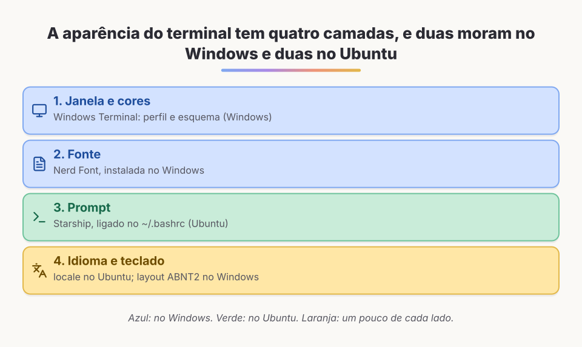
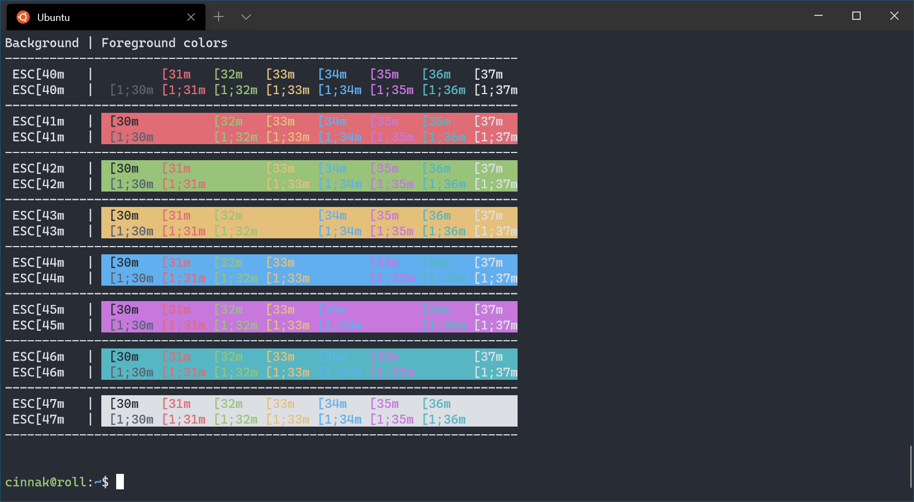

# 5. O terminal do seu jeito

> 🗺️ **Neste capítulo:** você deixa o terminal com a sua cara: perfil e cores no Windows Terminal, uma fonte com ícones (Nerd Font), um prompt que mostra o Git (Starship), o idioma do Ubuntu e o teclado, tudo com um jeito de voltar ao padrão. As configurações do Ubuntu vão para uma pasta `dotfiles/` do `meu-ambiente`. · ⏱️ ~50 min

> 🔥 **Aquecimento:** (1) Que comando mostra, no formato do Windows, o caminho da pasta atual do Ubuntu? (2) Qual arquivo, no repositório, fixa o fim de linha dos scripts `.sh` como LF?
>
> <details>
> <summary>Ver resposta</summary>
>
> (1) `wslpath -w .` (capítulo 4). (2) O `.gitattributes`, com a linha `*.sh text eol=lf`.
>
> </details>

## De onde paramos

No capítulo 4 você aprendeu a atravessar entre o Linux e o Windows e fixou o fim de linha do projeto. O `verificar.sh` está com 8 testes. Agora o foco é a janela onde você passa o dia: o terminal. Um terminal confortável não é luxo: com boa fonte, cores legíveis e um prompt que mostra em qual branch você está, você erra menos e cansa menos.

## As quatro camadas da aparência

A aparência do terminal não vem de um lugar só. São quatro camadas, e o erro mais comum é mexer numa delas no lado errado:



| Camada | O que controla | Onde se configura |
| --- | --- | --- |
| 1. Janela e cores | abas, perfis, esquema de cores, tamanho da letra | Windows Terminal, no Windows |
| 2. Fonte | o desenho das letras e dos ícones | instalada no Windows e escolhida no perfil |
| 3. Prompt | o que aparece antes do cursor | Ubuntu, no `~/.bashrc` |
| 4. Idioma e teclado | língua das mensagens; teclas | locale no Ubuntu; layout no Windows |

O **Windows Terminal** é o programa que desenha a janela; o Ubuntu só manda texto para ele. Por isso a fonte e as cores são sempre do lado Windows, e o prompt e o idioma, do lado Ubuntu.

## Windows Terminal: perfis e esquema de cores

Cada distro instalada ganha um **perfil** (*profile*) no Windows Terminal: um conjunto de opções (comando que abre, fonte, cores) com um nome na lista de abas. Você abre as configurações pelo menu de seta para baixo ao lado do `+` e escolhe **Configurações**. O botão de arquivo JSON dessa tela abre o `settings.json`, onde as opções avançadas moram.



*Windows Terminal com uma aba do Ubuntu e o esquema One Half Dark. Imagem: MicrosoftDocs/terminal contributors, CC BY 4.0, via GitHub.*

Um **esquema de cores** (*color scheme*) é um conjunto de 16 cores de texto mais o fundo e o texto padrão. Você pode trocar de um esquema pronto (o `colorScheme` do perfil) ou criar o seu na lista `schemes` do `settings.json`. O formato abaixo segue a documentação do Windows Terminal; todas as cores são `"#rrggbb"`:

```json
{
  "schemes": [
    {
      "name": "Meu esquema",
      "background": "#1B1D23",
      "foreground": "#D7DAE0",
      "cursorColor": "#FFFFFF",
      "selectionBackground": "#3E4452",
      "black": "#1B1D23", "brightBlack": "#5C6370",
      "red": "#E06C75", "brightRed": "#F28B94",
      "green": "#98C379", "brightGreen": "#B5E08F",
      "yellow": "#E5C07B", "brightYellow": "#F2D59A",
      "blue": "#61AFEF", "brightBlue": "#82C4FF",
      "purple": "#C678DD", "brightPurple": "#DD9BF0",
      "cyan": "#56B6C2", "brightCyan": "#7FD0DB",
      "white": "#ABB2BF", "brightWhite": "#FFFFFF"
    }
  ]
}
```

E para o perfil do Ubuntu usar esse esquema, acrescente `colorScheme` dentro dele (repare na vírgula na linha de cima):

```json
{
  "name": "Ubuntu-26.04",
  "colorScheme": "Meu esquema"
}
```

(O seu perfil tem outras chaves, como `guid` e `source`; deixe-as como estão e só acrescente a linha.)

> ⚠️ **Não executado:** o `settings.json` é do Windows Terminal do seu computador, e não há ninguém para clicar na distro de teste. Conferi apenas que os dois trechos são JSON válido e que as chaves (`schemes`, `colorScheme` e as 16 cores) são as da [documentação de esquemas de cores](https://learn.microsoft.com/windows/terminal/customize-settings/color-schemes). Antes de editar, copie o arquivo: o Windows Terminal recarrega ao salvar e, com uma vírgula fora do lugar, mostra um aviso de erro.

> ⚠️ **Erro comum:** colar o bloco `"schemes": [...]` *dentro* de um perfil. Esquemas ficam no primeiro nível do arquivo, ao lado de `profiles`; o perfil só cita o nome.

## Nerd Font: letras e ícones

Prompts modernos desenham ícones (o símbolo de branch do Git, pastas, linguagens). Esses ícones são caracteres de uma faixa reservada do Unicode, e as fontes comuns não têm desenho para eles: aparecem quadrados ou pontos de interrogação. Uma **Nerd Font** é uma fonte conhecida com milhares de ícones acrescentados.

A parte que confunde: a fonte é do **Windows**, porque é o Windows Terminal que desenha a letra. Instalar uma fonte dentro do Ubuntu não adianta nada para a janela.

Os passos, todos no Windows (não executados aqui; veja o aviso abaixo):

1. Baixe uma fonte em [nerdfonts.com/font-downloads](https://www.nerdfonts.com/font-downloads). A versão registrada na pesquisa deste livro é a 3.5.1; a *Caskaydia Cove* é uma versão da Cascadia Code, a fonte do próprio Windows Terminal.
2. Extraia o `.zip`, selecione os arquivos `.ttf`, clique com o botão direito e escolha **Instalar**.
3. No `settings.json`, em `profiles` → `defaults`, aponte o perfil para a fonte, usando o nome exato que o Windows mostrou (aqui, o exemplo da Caskaydia Cove):

```json
"defaults": {
  "font": { "face": "CaskaydiaCove Nerd Font", "size": 11 }
}
```

O objeto `font` vale a partir do Windows Terminal 1.10; versões antigas usam `fontFace` e `fontSize` soltos. Para testar se a fonte funciona, imprima o ícone de branch no Ubuntu:

```bash
# imprime o caractere U+E0A0, o ícone de branch do Git
printf '\n'
# mostra os bytes dele, para provar que o Ubuntu o enviou
printf '\n' | od -An -tx1
```

```text

 ee 82 a0 0a
```

Os bytes `ee 82 a0` são o caractere em UTF-8, e a linha do ícone aparece em branco aqui porque o texto do livro não tem a Nerd Font. No seu terminal, com a fonte certa, o primeiro comando desenha o ícone de branch; sem ela, um quadrado ou um espaço vazio.

> ⚠️ **Não executado:** instalar a fonte e escolhê-la no perfil depende do seu Windows (nesta máquina, a fonte ficou sem instalar). Fonte oficial: [Nerd Fonts](https://www.nerdfonts.com/font-downloads) e [aparência do perfil no Windows Terminal](https://learn.microsoft.com/windows/terminal/customize-settings/profile-appearance).

> ⚠️ **Erro comum:** instalar a Nerd Font só no Ubuntu (por `apt`) e ver os ícones continuarem quadrados. A fonte tem de estar no Windows e escolhida no perfil.

## Prompt com o Starship

O **Starship** é um programa pequeno que gera o seu prompt para vários shells. Ele lê uma configuração em `~/.config/starship.toml` e mostra só o que importa no momento: a pasta, a branch do Git, se há arquivos alterados. O shell o chama a cada comando por uma linha no `~/.bashrc`.

Como é um programa de terceiros baixado da internet, vale a regra do guia: **olhe o instalador antes de rodar**. O script oficial é um shell script de 554 linhas; baixe-o para um arquivo, leia o começo e só então execute. Instale na sua pasta (`~/.local/bin`), sem `sudo`:

```bash
# baixa o instalador oficial para um arquivo, sem executar
curl -sSL https://starship.rs/install.sh -o /tmp/starship-install.sh
wc -l /tmp/starship-install.sh
sed -n 1,3p /tmp/starship-install.sh
```

```text
554 /tmp/starship-install.sh
#!/usr/bin/env sh

set -eu
```

```bash
# -b escolhe a pasta de instalação; -y pula a pergunta de confirmação
mkdir -p ~/.local/bin
sh /tmp/starship-install.sh -y -b "$HOME/.local/bin"
~/.local/bin/starship --version | head -1
```

```text
> Bin directory: /home/ana/.local/bin
> Platform:      unknown-linux-musl
> Arch:          x86_64
> Tarball URL: https://github.com/starship/starship/releases/latest/download/starship-x86_64-unknown-linux-musl.tar.gz
! Bin directory /home/ana/.local/bin is not in your $PATH
> Installing Starship, please wait…
✓ Starship latest installed
starship 1.27.0
```

(Mostrei só as linhas que importam; o instalador imprime também a instrução de ativação.) O aviso "não está no seu `$PATH`" vale só para o shell já aberto: o `~/.profile` do Ubuntu acrescenta o `~/.local/bin` ao `PATH` quando a pasta existe, e isso vale ao abrir o Ubuntu de novo. O Starship ainda não aparece no seu prompt: falta ligá-lo e configurá-lo, e é aí que entram os *dotfiles*.

### Dotfiles no repositório

Os arquivos de configuração do Linux têm nomes que começam com ponto (`.bashrc`, `.gitconfig`) e por isso se chamam ***dotfiles***. Em vez de deixá-los soltos pelo `~`, guarde a sua versão no repositório e **ligue** o `~` a ela por um *link simbólico* (um atalho que o sistema segue como se fosse o arquivo). Assim, a configuração tem histórico no Git e você a recria em qualquer distro.

Crie a pasta `dotfiles/` no `~/meu-ambiente` com três arquivos. O primeiro é a configuração do prompt:

<!-- project: meu-ambiente -->

**dotfiles/starship.toml**

```toml
# prompt do meu-ambiente: pasta, branch do Git, estado e o símbolo final
add_newline = false
format = "$directory$git_branch$git_status$character"

[directory]
truncation_length = 2

[git_branch]
#  é o ícone de branch; só uma Nerd Font sabe desenhá-lo
symbol = " "
```

O `format` lista os módulos na ordem em que aparecem; `$character` é o símbolo final (`❯`), que fica verde quando o comando anterior deu certo e vermelho quando falhou. O segundo arquivo é o trecho que o `~/.bashrc` vai carregar:

**dotfiles/bashrc.meu**

```bash
# carregado pelo ~/.bashrc; só liga o que estiver instalado
if command -v starship > /dev/null; then
  eval "$(starship init bash)"
fi
```

O terceiro faz a ligação, e pode rodar quantas vezes quiser sem estragar nada (a isso se chama ser **idempotente**):

**dotfiles/instalar.sh**

```bash
#!/usr/bin/env bash
# Liga os arquivos de dotfiles/ aos lugares onde os programas os leem.
set -eu
aqui=$(cd "$(dirname "$0")" && pwd)
mkdir -p ~/.config

# guarda uma configuração que já existia, antes de trocá-la por um link
if [ -f ~/.config/starship.toml ] && [ ! -L ~/.config/starship.toml ]; then
  mv ~/.config/starship.toml ~/.config/starship.toml.bak
fi
# -s: link simbólico; -f: troca o link antigo; -n: trata link como arquivo
ln -sfn "$aqui/starship.toml" ~/.config/starship.toml

# acrescenta uma linha ao ~/.bashrc, só se ela ainda não estiver lá
carga='~/meu-ambiente/dotfiles/bashrc.meu'
linha="[ -f $carga ] && . $carga"
grep -qxF "$linha" ~/.bashrc || echo "$linha" >> ~/.bashrc
echo "dotfiles ligados"
```

Antes de rodar, guarde uma cópia do seu `.bashrc` e confira o resultado:

```bash
cd ~/meu-ambiente
chmod +x dotfiles/instalar.sh
cp ~/.bashrc ~/.bashrc.antes
bash dotfiles/instalar.sh
# rodar de novo não duplica nada
bash dotfiles/instalar.sh
ls -l ~/.config/starship.toml | awk '{print $9, $10, $11}'
grep -c 'bashrc.meu' ~/.bashrc
```

```text
dotfiles ligados
dotfiles ligados
/home/ana/.config/starship.toml -> /home/ana/meu-ambiente/dotfiles/starship.toml
1
```

As duas rodadas imprimiram a mesma mensagem, e o `.bashrc` tem **uma** linha do `bashrc.meu`, não duas. O prompt, visto sem as cores (o `starship prompt` imprime o que o shell usaria), muda conforme o lugar e o estado do repositório:

```bash
# tira os códigos de cor para o texto aparecer limpo no livro
limpa() { sed 's/\x1b\[[0-9;]*m//g; s/[\x01\x02]//g'; }
cd ~ && starship prompt | limpa; echo
cd ~/meu-ambiente && starship prompt | limpa; echo
# altera um arquivo: o prompt passa a mostrar [!]
echo "mexi" >> README.md && starship prompt | limpa; echo
git checkout README.md
```

```text
~ ❯
meu-ambiente on  main ❯
meu-ambiente on  main [!] ❯
```

Em `~`, só a pasta. No repositório limpo, a pasta e a branch (`main`, depois do ícone). Com um arquivo modificado, o `[!]` do `git_status`. Abra um terminal novo e o prompt já vem assim, porque o `~/.bashrc` carrega o `bashrc.meu`.

> ⚠️ **Erro comum:** editar o `~/.config/starship.toml` direto, achando que é um arquivo comum. Ele é um link para o arquivo do repositório: a edição vale (é o mesmo arquivo), mas a alteração aparece no `git status` do `meu-ambiente`, e é bom que apareça. Se o `.toml` tiver um erro, o Starship o diz com a linha e a coluna do problema, e o prompt continua funcionando sem a parte quebrada.

## Idioma do Ubuntu (locale)

O **locale** é o conjunto de regras de idioma e região do sistema: língua das mensagens, formato de data e de número, ordem alfabética. Ele é guardado em variáveis como `LANG`. A imagem do Ubuntu que usei vem com o locale `C.UTF-8`, que funciona em qualquer lugar, mas é neutro:

```bash
locale | head -3
locale -a
```

```text
LANG=C.UTF-8
LANGUAGE=
LC_CTYPE="C.UTF-8"
C
C.utf8
POSIX
```

Instalar o pacote de idioma gera o locale em português do Brasil. O `sudo` pede a sua senha; use o pacote `language-pack-pt`:

```bash
sudo apt install -y language-pack-pt
locale -a
```

```text
Setting up language-pack-pt (1:26.04+20260818) ...
Setting up language-pack-pt-base (1:26.04+20260818) ...
Generating locales (this might take a while)...
  pt_BR.UTF-8... done
  pt_PT.UTF-8... done
C
C.utf8
POSIX
pt_BR.utf8
pt_PT.utf8
```

(Só mostrei as linhas que importam do `apt`.) O locale existe, mas ainda não é o usado. Dá para experimentar só num comando, sem mudar nada no sistema, com a variável `LC_ALL` na frente:

```bash
LC_ALL=pt_BR.UTF-8 date '+%A, %d de %B de %Y'
LC_ALL=en_US.UTF-8 date '+%A, %d de %B de %Y'
```

```text
sexta-feira, 27 de novembro de 2026
Friday, 27 de November de 2026
```

Os dois comandos são iguais, só o locale muda: o nome do dia e do mês acompanham o idioma. (O `en_US.UTF-8` não foi gerado nesta distro, e o `date` caiu no inglês padrão.) Para tornar o idioma permanente, o Ubuntu tem o `update-locale`:

```bash
sudo update-locale LANG=pt_BR.UTF-8
cat /etc/default/locale
```

```text
LANG=pt_BR.UTF-8
```

Vale a partir do próximo shell: feche e reabra o Ubuntu. Uma ressalva: nem todo programa tem tradução. No teste, a mensagem de erro do `ls` continuou em inglês mesmo com `LC_ALL=pt_BR.UTF-8`; o que muda de forma certa é o que depende só do locale, como datas e ordenação.

> ⚠️ **Erro comum:** achar que mudar o idioma do Ubuntu muda o do Windows, ou o contrário. São independentes: o locale vale apenas para o Linux.

## Teclado ABNT2

O Ubuntu no WSL não tem configuração de teclado própria: as teclas chegam do Windows já interpretadas. Quem decide se a tecla do `ç` e a do `/` funcionam é o **layout** do teclado nas configurações do Windows (em *Hora e idioma → Idioma e região → Teclado*; para um teclado brasileiro, **Português (Brasil ABNT2)**).

Para conferir, digite no Ubuntu este comando (o `ç`, o `~`, o `^` e o `´` são as teclas que costumam falhar):

```bash
echo "ação ~ ^ ´ ç"
```

```text
ação ~ ^ ´ ç
```

> ⚠️ **Não executado:** trocar o layout do teclado é uma configuração do Windows e não foi feita nesta máquina. O comando acima foi executado na distro de teste, mas com texto enviado por script, e não digitado nas teclas. Se o `ç` sair errado no seu teclado, o problema está no layout do Windows; confira em *Configurações do Windows*.

## Voltar ao padrão

Toda a personalização é reversível, camada a camada. Isso é parte do ponto: você pode experimentar sem medo.

| Camada | Como desfazer |
| --- | --- |
| Cores | tirar `colorScheme` do perfil (e apagar o esquema de `schemes`, se quiser) |
| Fonte | apagar o bloco `font` do perfil; a fonte instalada pode ficar |
| Prompt | apagar a linha do `bashrc.meu` do `~/.bashrc`; o `.toml` pode ficar |
| Idioma | `sudo update-locale LANG=C.UTF-8` |

Teste o caminho do prompt, desfazendo o que o `instalar.sh` fez:

```bash
# tira só a linha do bashrc.meu e compara com a cópia de antes
sed -i '/bashrc.meu/d' ~/.bashrc
diff ~/.bashrc.antes ~/.bashrc && echo "bashrc igual ao original"
# apaga o link (o arquivo do repositório continua lá)
rm ~/.config/starship.toml
bash verificar.sh | grep FALHA
# religa tudo
bash dotfiles/instalar.sh
```

```text
bashrc igual ao original
FALHA dotfiles ligados (starship e .bashrc)
dotfiles ligados
```

O `diff` sem diferenças e o "bashrc igual ao original" confirmam que a única alteração do `instalar.sh` no `.bashrc` era a linha acrescentada. E o `verificar.sh` (agora com o nono teste, abaixo) falhou no teste de dotfiles quando os links sumiram, e passou depois da religação.

## O projeto: `verificar.sh` com 9 testes

O `meu-ambiente` ganha a pasta `dotfiles/` e um nono teste. A função nova `dotfiles_ligados` confere que o link do Starship aponta para o repositório e que o `.bashrc` carrega o `bashrc.meu`. Eis o arquivo inteiro, com as mudanças em relação ao do capítulo 4: a função e a linha do `checa`.

**verificar.sh**

```bash
#!/usr/bin/env bash
# Confere, do lado Linux, se o ambiente está montado.
falhas=0

# roda o teste que vem depois da descrição; mostra OK ou FALHA
checa() {
  descricao=$1
  shift
  if "$@" > /dev/null 2>&1; then
    echo "OK    $descricao"
  else
    echo "FALHA $descricao"
    falhas=$((falhas + 1))
  fi
}

# o nome do kernel do WSL 2 termina assim
assinatura='microsoft-standard-WSL2'

# cada teste é uma função que devolve sucesso ou falha
eh_ubuntu() { grep -q '^ID=ubuntu' /etc/os-release; }
kernel_wsl2() { uname -r | grep -q "$assinatura"; }
proc_microsoft() { grep -qi microsoft /proc/version; }
usuario_comum() { [ "$(id -u)" -ne 0 ]; }
no_grupo_sudo() { id -nG | grep -qw sudo; }
systemd_ativo() { [ "$(ps -p 1 -o comm=)" = systemd ]; }
repo_existe() { git -C ~/meu-ambiente rev-parse --is-inside-work-tree; }
# o .gitattributes existe e este script não tem CRLF (o bash não o leria)
lf_fixo() {
  [ -f ~/meu-ambiente/.gitattributes ] && ! grep -q "$(printf '\r')" "$0"
}
# o link do Starship aponta para o repositório e o .bashrc carrega o bashrc.meu
dotfiles_ligados() {
  alvo=~/meu-ambiente/dotfiles/starship.toml
  [ "$(readlink ~/.config/starship.toml)" = "$alvo" ] &&
    grep -q 'dotfiles/bashrc.meu' ~/.bashrc
}

checa "distribuição é o Ubuntu" eh_ubuntu
checa "kernel do WSL 2" kernel_wsl2
checa "/proc/version cita microsoft" proc_microsoft
checa "usuário comum, não root" usuario_comum
checa "usuário no grupo sudo" no_grupo_sudo
checa "systemd é o processo 1" systemd_ativo
checa "~/meu-ambiente é um repositório git" repo_existe
checa ".gitattributes presente e scripts com LF" lf_fixo
checa "dotfiles ligados (starship e .bashrc)" dotfiles_ligados

echo "---"
if [ "$falhas" -eq 0 ]; then
  echo "Tudo certo: este ambiente está montado."
else
  echo "$falhas teste(s) falharam."
  exit 1
fi
```

```bash
bash verificar.sh | tail -4
git add -A
git commit -qm "dotfiles: starship e bashrc.meu"
```

```text
OK    .gitattributes presente e scripts com LF
OK    dotfiles ligados (starship e .bashrc)
---
Tudo certo: este ambiente está montado.
```

> ⚠️ **Executado** na distro de teste (Ubuntu 26.04.1, `wz-teste`) como o usuário `ana`, com a instalação do Starship 1.27.0 na pasta dela. Não executado: tudo o que é do lado Windows (esquema de cores, fonte, perfil, layout do teclado); nesses passos o texto cita a fonte oficial.

## 🏋️ Pratique

**1. Exemplo resolvido.** Você instalou o Starship e o prompt mostra quadrados no lugar do ícone da branch. A fonte foi instalada pelo `apt` no Ubuntu. Qual é o erro e como corrigir?

<details>
<summary>Ver resposta</summary>

A fonte precisa estar no **Windows** e ser escolhida no perfil do Windows Terminal, porque é ele que desenha as letras; o Ubuntu só envia os caracteres. Correção: instalar a Nerd Font no Windows e pôr `"font": { "face": "<nome exato>" }` no perfil (`defaults` ou o do Ubuntu). Teste: `printf '\n'` deve desenhar o ícone.

</details>

**2. Complete.** No `starship.toml`, a linha de `format` mostra a pasta, a branch e o símbolo final. Escreva a linha para mostrar também a hora, sabendo que o módulo se chama `$time` e que ele precisa estar ligado com `[time]` e `disabled = false`.

<details>
<summary>Ver resposta</summary>

```toml
format = "$directory$git_branch$git_status$time$character"

# o módulo time vem desligado; sem esta chave, nada aparece
[time]
disabled = false
```

Dois erros comuns: pôr `$time` no `format` e esquecer o `disabled = false` (o módulo vem desligado, e nada aparece), ou ligar o módulo e esquecê-lo no `format` (que lista exatamente o que aparece). Teste com `starship prompt`.

</details>

**3. Faça sozinho.** Rode o `bash dotfiles/instalar.sh` três vezes seguidas e conte as linhas do `.bashrc` com `bashrc.meu`. Depois explique por que o resultado é o mesmo de uma rodada só.

<details>
<summary>Ver resposta</summary>

`grep -c 'bashrc.meu' ~/.bashrc` devolve `1`. O `ln -sfn` troca o link por outro igual, e o `grep -qxF "$linha" ~/.bashrc || echo ...` só acrescenta a linha se ela ainda não existe: o `||` executa o `echo` apenas quando o `grep` falha. Critérios: (1) o resultado é 1; (2) a explicação cita o teste antes de acrescentar.

</details>

**4. Desafio.** Você formatou o computador e instalou o WSL de novo. Descreva, em quatro passos, como recuperar o prompt e o idioma usando o repositório, e diga o que o repositório **não** guarda.

<details>
<summary>Ver resposta</summary>

(1) Clonar ou copiar o `meu-ambiente` para `~`. (2) Instalar o Starship (o instalador oficial, na `~/.local/bin`). (3) Rodar `bash ~/meu-ambiente/dotfiles/instalar.sh`. (4) `sudo apt install language-pack-pt` e `sudo update-locale LANG=pt_BR.UTF-8`. O repositório **não** guarda o que mora no Windows: a Nerd Font, o `settings.json` do Windows Terminal (perfil e esquema) e o layout do teclado; essas partes são refeitas à mão. Critérios: (1) usa o `instalar.sh`; (2) lembra que o Starship é um programa, não um arquivo de configuração; (3) separa o que é do Windows.

</details>

**Arquivos do projeto ao fim do capítulo:** em `~/meu-ambiente`, `README.md`, `.gitattributes`, `verificar.sh` (9 testes), `verificar.ps1` e a pasta `dotfiles/` com `starship.toml`, `bashrc.meu` e `instalar.sh`. **Comando que confere:** `bash ~/meu-ambiente/verificar.sh` termina com "Tudo certo".

## 🧠 Revisão rápida

1. Por que a Nerd Font tem de ser instalada no Windows?
2. O que o link simbólico `~/.config/starship.toml` ganha em relação a copiar o arquivo?
3. Para que serve `LC_ALL=pt_BR.UTF-8` na frente de um comando?
4. Como você desfaz o prompt do Starship sem apagar nada do repositório?
5. (Capítulo 4) Por que o `meu-ambiente` mora em `~` e não em `/mnt/c`?

<details>
<summary>Ver respostas</summary>

1. Porque o Windows Terminal é quem desenha as letras; o Ubuntu só envia os caracteres.
2. O arquivo real fica no repositório, com histórico no Git; qualquer edição vale para os dois lugares.
3. Testar um locale só naquele comando, sem alterar o sistema.
4. Apagando a linha do `bashrc.meu` do `~/.bashrc` (e, se quiser, o link).
5. Porque muitos arquivos pequenos são muito mais rápidos no disco do Linux, e as permissões e o fim de linha funcionam como o Linux espera.

</details>

## 🤖 Estude com um tutor de IA

- "Faça-me 5 perguntas sobre Windows Terminal, Nerd Font, Starship e locale, uma de cada vez. Espere a minha resposta antes de dar o retorno e não me dê as respostas antes."
- "Esta é a minha resposta ao exercício 4: [minha resposta]. Aponte os meus erros sem me dar a solução."

> ➡️ **Próximo passo:** no capítulo 6 você monta o ambiente de desenvolvimento: git, Node, Java e Python no Ubuntu, programas com janela pelo WSLg, e um `bootstrap.sh` que recria tudo com um comando.

## 📌 Resumo

| Item | Em uma frase |
| --- | --- |
| Quatro camadas | Janela e cores e fonte são do Windows; prompt e idioma são do Ubuntu |
| Perfil e esquema | O perfil escolhe o `colorScheme`; o esquema fica em `schemes` no `settings.json` |
| Nerd Font | Fonte com ícones; instala-se no Windows e se escolhe no perfil |
| Starship | Gera o prompt; ligado por uma linha no `~/.bashrc` |
| Dotfiles | Configurações no repositório, ligadas ao `~` por link simbólico |
| locale | Idioma e formatos do Linux; `language-pack-pt` e `update-locale` |
| Teclado | O layout vem do Windows; o Ubuntu não configura teclas |
| Voltar ao padrão | Cada camada se desfaz sozinha |

## 📚 Fontes

- [Esquemas de cores no Windows Terminal](https://learn.microsoft.com/windows/terminal/customize-settings/color-schemes) (conferido em 27/11/2026)
- [Aparência do perfil no Windows Terminal](https://learn.microsoft.com/windows/terminal/customize-settings/profile-appearance) (27/11/2026)
- [Windows Terminal: versões](https://github.com/microsoft/terminal/releases) (27/11/2026)
- [Nerd Fonts](https://www.nerdfonts.com/font-downloads) (27/11/2026)
- [Starship](https://starship.rs) (27/11/2026)
- Execuções: distro de teste Ubuntu 26.04.1 no WSL 2 (Starship 1.27.0), 27/11/2026.

> 🔁 **Revise hoje:** 2, 4
