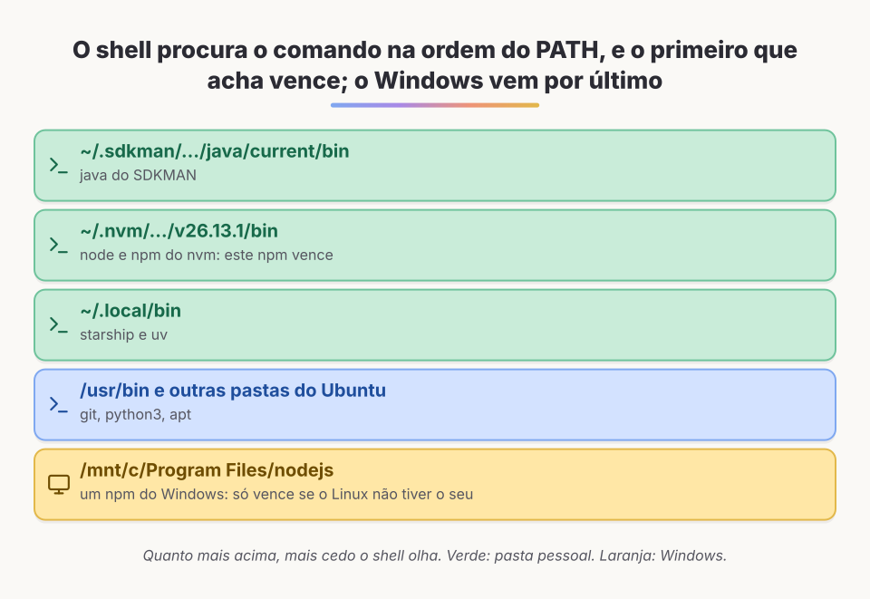
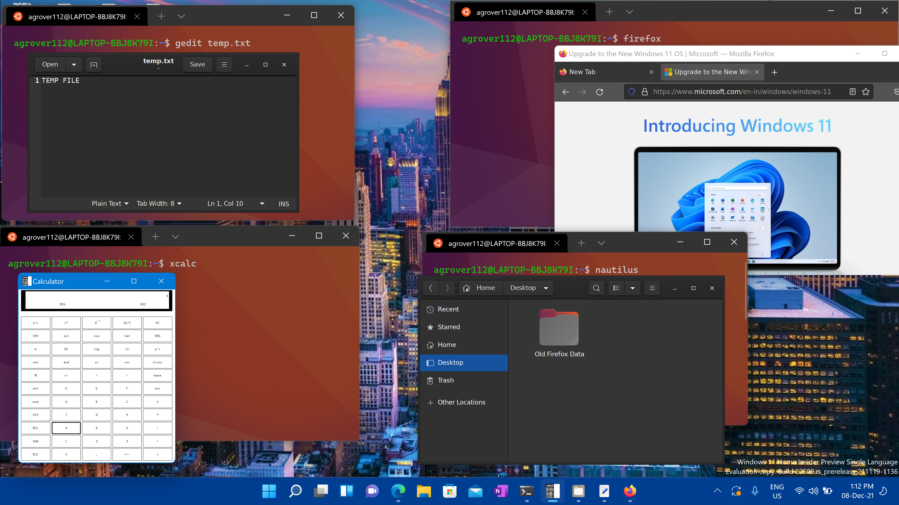

# 6. Ferramentas de desenvolvimento e programas com janela

> 🗺️ **Neste capítulo:** você instala o git, o Node.js (nvm), o Java (SDKMAN) e o Python (uv) no Ubuntu, entende a ordem do `PATH` e por que o `npm` do Windows às vezes aparece, vê como os programas com janela abrem pelo WSLg e escreve o `bootstrap.sh`, que recria tudo com um comando. · ⏱️ ~60 min

> 🔥 **Aquecimento:** (1) Qual arquivo do repositório liga o Starship ao `~/.bashrc`? (2) Por que um projeto com milhares de arquivos pequenos fica mais lento em `/mnt/c`?
>
> <details>
> <summary>Ver resposta</summary>
>
> (1) O `dotfiles/bashrc.meu`, carregado por uma linha que o `instalar.sh` acrescenta ao `~/.bashrc` (capítulo 5). (2) Porque cada arquivo atravessa a ponte 9p entre os dois sistemas de arquivos (capítulo 4).
>
> </details>

## De onde paramos

No capítulo 5 você personalizou o terminal e guardou os `dotfiles/` no `meu-ambiente`. Agora ele precisa de ferramentas de trabalho. O objetivo não é apenas instalar: é instalar de um jeito que você consiga **repetir**, num Ubuntu novo, sem lembrar de nada de cabeça. Por isso o capítulo termina num script.

## Pacotes básicos e git

O Ubuntu do WSL vem enxuto. O que vem pronto, na imagem de teste (Ubuntu 26.04.1):

```bash
# command -v mostra onde o comando está, ou nada se não existir
for c in git curl unzip zip python3 node java; do
  printf '%s: ' $c; command -v $c || echo "(não tem)"
done
git --version
python3 --version
```

```text
git: /usr/bin/git
curl: /usr/bin/curl
unzip: (não tem)
zip: (não tem)
python3: /usr/bin/python3
node: (não tem)
java: (não tem)
git version 2.53.0
Python 3.14.4
```

O `git`, o `curl` e o Python do sistema já estão ali. Faltam o `unzip` e o `zip`, que o SDKMAN usa, e o Node e o Java, que você instala em seguida. Os pacotes do sistema vêm do `apt`, que você já conhece:

```bash
sudo apt install -y unzip zip
```

```text
Setting up unzip (6.0-29ubuntu1) ...
Setting up zip (3.0-15ubuntu3) ...
```

> 💡 **Uma regra para o resto do capítulo:** o `apt` serve para o que é do sistema (git, curl, zip). Para linguagens como Node, Java e Python, use um **gerenciador de versões**: ele instala na sua pasta pessoal, sem `sudo`, e deixa você ter várias versões lado a lado. O `apt` costuma oferecer uma versão só, e quase sempre mais velha.

## O PATH: quem o shell encontra primeiro

Quando você digita `node`, o shell não procura o programa no computador inteiro. Ele olha, em ordem, as pastas listadas na variável **`PATH`** (separadas por `:`), e usa o **primeiro** arquivo com aquele nome que achar. Ver a lista:

```bash
echo "$PATH" | tr ':' '\n' | cat -n | sed -n '1,9p'
echo "entradas: $(echo "$PATH" | tr ':' '\n' | wc -l)"
echo "do Windows: $(echo "$PATH" | tr ':' '\n' | grep -c '^/mnt/')"
```

```text
     1	/usr/local/sbin
     2	/usr/local/bin
     3	/usr/sbin
     4	/usr/bin
     5	/sbin
     6	/bin
     7	/usr/games
     8	/usr/local/games
     9	/usr/lib/wsl/lib
entradas: 51
do Windows: 42
```

(Cortei a lista no nono item, para não mostrar pastas pessoais da máquina de teste.) Repare no último número: **42 das 51 pastas são do Windows**. O WSL, por padrão, acrescenta o `PATH` do Windows ao do Linux. É isso que deixa você chamar `explorer.exe` (capítulo 4), e é também a origem de uma confusão clássica.



Veja a confusão acontecer. Neste PC existe um Node.js instalado no Windows, e o Ubuntu ainda não tem o seu. O comando `npm` do Windows é um script sem extensão, e por isso o Linux o encontra e **tenta** usá-lo:

```bash
# which -a mostra TODOS os programas com esse nome, na ordem do PATH
which -a npm
npm --version
```

```text
/mnt/c/Program Files/nodejs/npm
11.19.0
```

O `npm` respondeu, mas é o do Windows, mexendo em arquivos do Windows. Você acha que está usando o Node do Linux e não está. Depois de instalar o nvm (próxima seção), a mesma pergunta dá outra resposta:

```text
/home/ana/.nvm/versions/node/v26.13.1/bin/node
/home/ana/.nvm/versions/node/v26.13.1/bin/npm
/mnt/c/Program Files/nodejs/npm
```

Agora há dois `npm` no `PATH`, e vence o primeiro: o do Linux. O do Windows continua lá, escondido atrás. A regra para o dia a dia: quando um comando se comportar de um jeito estranho, rode `which -a comando` e confira **qual** deles está respondendo.

> ⚠️ **Erro comum:** achar que `node --version` funcionando prova que o Node do Linux está instalado. Confirme sempre o caminho com `which`: se começar com `/mnt/c`, é o do Windows. (Dá para tirar o `PATH` do Windows do Ubuntu com `appendWindowsPath` no `wsl.conf`; o capítulo 7 explica o arquivo e os efeitos colaterais.)

## nvm: Node.js em várias versões

O **nvm** (*Node Version Manager*) instala o Node.js na sua pasta pessoal e troca de versão por comando. Como com qualquer instalador que baixa e executa um script da internet, o hábito certo é **baixar para um arquivo, ler o começo e só então rodar**, com a versão fixada na URL (aqui, `v0.41.0`):

```bash
# baixa para um arquivo, sem executar, e olha o começo dele
curl -sSL https://raw.githubusercontent.com/nvm-sh/nvm/v0.41.0/install.sh \
  -o /tmp/nvm-install.sh
wc -l /tmp/nvm-install.sh
sed -n 1,2p /tmp/nvm-install.sh
```

```text
587 /tmp/nvm-install.sh
#!/usr/bin/env bash

```

O instalador, por padrão, acrescenta linhas ao `~/.bashrc`. Como o `bashrc.meu` do repositório já cuida disso, peça para ele **não** mexer, com `PROFILE=/dev/null`:

```bash
PROFILE=/dev/null NVM_DIR="$HOME/.nvm" bash /tmp/nvm-install.sh
# carrega o nvm neste shell e instala a versão LTS do Node
export NVM_DIR="$HOME/.nvm"
. "$NVM_DIR/nvm.sh"
nvm --version
nvm install --lts
node --version
npm --version
```

```text
Computing checksum with sha256sum
Checksums matched!
Now using node v26.13.1 (npm v11.20.0)
Creating default alias: default -> lts/* (-> v26.13.1 *)
0.41.0
v26.13.1
11.20.0
```

(Mostrei só o fim da instalação; o nvm baixa o Node, confere o checksum e o ativa.) O **LTS** (*long-term support*) é a versão de suporte longo, a indicada para o dia a dia. Para ver o que está instalado: `nvm ls`.

## SDKMAN: Java (e outros)

O **SDKMAN** faz para o Java o que o nvm faz para o Node, e serve também para Maven, Gradle, Kotlin e outros. Ele precisa do `unzip` e do `zip` (por isso eles vieram antes). O mesmo cuidado: baixar o instalador, olhar o que ele é, e pedir que não edite o `~/.bashrc` (`?rcupdate=false`):

```bash
# rcupdate=false: o instalador não edita o ~/.bashrc
curl -s "https://get.sdkman.io?rcupdate=false" -o /tmp/sdkman-install.sh
wc -l /tmp/sdkman-install.sh
head -2 /tmp/sdkman-install.sh
bash /tmp/sdkman-install.sh
```

```text
520 /tmp/sdkman-install.sh
#!/bin/bash
#
```

(A instalação imprime uma barra de progresso e termina com `All done!`.) Carregue o SDKMAN e instale o Java. A configuração `sdkman_auto_answer=true` faz o `sdk` responder "sim" sozinho à pergunta "usar como padrão?", útil num script:

```bash
# carrega o SDKMAN neste shell e liga as respostas automáticas
export SDKMAN_DIR="$HOME/.sdkman"
. "$SDKMAN_DIR/bin/sdkman-init.sh"
sed -i 's/sdkman_auto_answer=false/sdkman_auto_answer=true/' \
  "$SDKMAN_DIR/etc/config"
sdk install java
sdk current java
```

```text
Installing: java 25.0.5.1+2-tem
Done installing!

Setting java 25.0.5.1+2-tem as default.
25.0.5.1+2-tem
```

O sufixo `-tem` indica a distribuição **Temurin** (do projeto Eclipse Adoptium), a escolhida por padrão. Num shell que já estava aberto, o `java` ainda aparece como "command not found": o SDKMAN só coloca o Java no `PATH` ao ser carregado, e a pasta não existia no momento em que foi carregado. Abra um shell novo (ou carregue de novo o `sdkman-init.sh`) e funciona:

```bash
java -version
```

```text
openjdk version "25.0.5.1" 2026-11-17 LTS
```

> ⚠️ **Erro comum:** o Windows já ter Java não significa que o Ubuntu tenha. O Java do Windows é um `java.exe`: o Linux não o chama de `java`. Cada lado instala o seu.

## uv: Python e projetos Python

O Ubuntu já traz um Python (o `python3` do sistema, 3.14.4 aqui), mas ele pertence ao sistema: instalar pacotes nele pode quebrar ferramentas do próprio Ubuntu. O **uv** é um gerenciador de projetos e de versões do Python, escrito em Rust e muito rápido. Instala-se do mesmo jeito (olhar antes), com `UV_NO_MODIFY_PATH=1` para não editar arquivos de shell:

```bash
# baixa o instalador, confere o tamanho e roda sem editar arquivos de shell
curl -LsSf https://astral.sh/uv/install.sh -o /tmp/uv-install.sh
wc -l /tmp/uv-install.sh
UV_NO_MODIFY_PATH=1 sh /tmp/uv-install.sh
~/.local/bin/uv --version
```

```text
2191 /tmp/uv-install.sh
downloading uv 0.13.10 x86_64-unknown-linux-gnu
installing to /home/ana/.local/bin
  uv
  uvx
everything's installed!
uv 0.13.10 (x86_64-unknown-linux-gnu)
```

Para ver o `uv` em ação, crie um projeto de teste e rode o Python dele (o `uv` cria o ambiente isolado sozinho):

```bash
cd /tmp && uv init demo-uv && cd demo-uv
uv run python --version
```

```text
Initialized project `demo-uv` at `/tmp/demo-uv`
Python 3.14.4
```

(O resto do seu estudo de Python, com `uv add` e ambientes virtuais, está fora do escopo deste livro; a documentação do uv cobre.)

## Programas com janela: o WSLg

Até aqui tudo foi texto. O **WSLg** (*WSL GUI*) é a parte do WSL que permite abrir programas Linux **com janela** (editor de texto, navegador, calculadora) e vê-los no desktop do Windows, com ícone na barra de tarefas, lado a lado com os programas do Windows. Ele já vem instalado com o WSL atual; o do PC de teste é o 1.0.79. Como saber se está funcionando, pelo lado do Ubuntu:

```bash
echo "DISPLAY=$DISPLAY"
ls /tmp/.X11-unix
head -1 /mnt/wslg/versions.txt
```

```text
DISPLAY=:0
X0
WSLg: 1.0.79
```

A variável `DISPLAY` aponta para o servidor gráfico do WSLg, e o `X0` é o seu soquete. Para ter o que abrir, a documentação oficial instala programas pelo `apt`. O menor deles é o `x11-apps`, uma coleção de miniprogramas do sistema X11 (`xclock`, `xcalc`, `xeyes`):

```bash
sudo apt install -y x11-apps
command -v xeyes xclock
```

```text
Setting up x11-apps (7.7+11build4) ...
/usr/bin/xeyes
/usr/bin/xclock
```



*Programas Linux (gedit, Firefox, xcalc e Nautilus) abertos a partir de terminais do Ubuntu, no desktop do Windows. Imagem: MicrosoftDocs/WSL contributors, CC BY 4.0, via GitHub.*

> ⚠️ **Não executado:** abrir a janela (`xclock &`, `xeyes &` ou o editor `gnome-text-editor`, que a documentação oficial usa) é um passo visual, e não há ninguém olhando o desktop desta máquina. Conferi que o `DISPLAY` está definido, que o soquete existe e que os programas instalam. Na sua máquina, rode `xeyes &` (o `&` devolve o prompt) e uma janela deve abrir no Windows. Fontes: [Executar aplicativos GUI do Linux no WSL](https://learn.microsoft.com/windows/wsl/tutorials/gui-apps) e o guia de diagnóstico "cannot open display" do [WSLg](https://github.com/microsoft/wslg/wiki/Diagnosing-%22cannot-open-display%22-type-issues-with-WSLg), que a própria documentação indica.

O WSLg **não** é um desktop Linux completo: ele integra programas isolados ao desktop do Windows. Programas pesados e que dependem de um ambiente de desktop inteiro podem não funcionar.

> ⚠️ **Erro comum:** esperar a janela do programa com o terminal travado. Um programa com janela ocupa o terminal enquanto roda; coloque um `&` no fim do comando (`xeyes &`) para devolver o prompt.

## O script `bootstrap.sh`

Você instalou quatro coisas à mão. Agora imagine fazer isso de novo, daqui a seis meses, num Ubuntu novo. Um **bootstrap** é um script que leva um sistema do zero ao seu ambiente. A qualidade dele se mede por uma propriedade: ser **idempotente**, ou seja, poder rodar duas vezes sem estragar nada, pulando o que já está pronto. Cada bloco do script abaixo faz a mesma pergunta antes de agir: "isso já existe?".

Primeiro, o `bashrc.meu` cresce para carregar o `nvm` e o SDKMAN e para pôr a pasta `~/.local/bin` no `PATH` (onde moram o Starship e o uv):

<!-- project: meu-ambiente -->

**dotfiles/bashrc.meu**

```bash
# carregado pelo ~/.bashrc; só liga o que estiver instalado

# programas instalados na pasta pessoal (starship, uv) ficam em ~/.local/bin
case ":$PATH:" in
  *":$HOME/.local/bin:"*) ;;
  *) PATH="$HOME/.local/bin:$PATH" ;;
esac

if command -v starship > /dev/null; then
  eval "$(starship init bash)"
fi

# nvm: o Node.js da pasta pessoal, antes do npm do Windows no PATH
export NVM_DIR="$HOME/.nvm"
[ -s "$NVM_DIR/nvm.sh" ] && . "$NVM_DIR/nvm.sh"

# SDKMAN: o Java (e outros) da pasta pessoal
export SDKMAN_DIR="$HOME/.sdkman"
[ -s "$SDKMAN_DIR/bin/sdkman-init.sh" ] && . "$SDKMAN_DIR/bin/sdkman-init.sh"
```

E o script em si:

**bootstrap.sh**

```bash
#!/usr/bin/env bash
# Prepara um Ubuntu novo para o meu-ambiente. Pode rodar de novo: pula o que
# já está instalado.
set -eu
aqui=$(cd "$(dirname "$0")" && pwd)

passo() { echo "==> $1"; }

passo "pacotes do apt"
sudo apt-get update -qq
sudo apt-get install -y -qq git curl unzip zip

passo "nvm e Node.js (versão LTS)"
export NVM_DIR="$HOME/.nvm"
if [ ! -s "$NVM_DIR/nvm.sh" ]; then
  # baixa para um arquivo e roda; PROFILE=/dev/null: não mexe no ~/.bashrc
  curl -fsSL -o /tmp/nvm-install.sh \
    https://raw.githubusercontent.com/nvm-sh/nvm/v0.41.0/install.sh
  PROFILE=/dev/null bash /tmp/nvm-install.sh > /dev/null
fi
. "$NVM_DIR/nvm.sh"
nvm install --lts > /dev/null 2>&1
echo "node $(node --version)"

passo "SDKMAN e Java"
export SDKMAN_DIR="$HOME/.sdkman"
if [ ! -s "$SDKMAN_DIR/bin/sdkman-init.sh" ]; then
  # ?rcupdate=false: o instalador não edita o ~/.bashrc
  curl -fsSL "https://get.sdkman.io?rcupdate=false" -o /tmp/sdkman-install.sh
  bash /tmp/sdkman-install.sh > /dev/null 2>&1
  # responde "sim" sozinho às perguntas do sdk
  sed -i 's/sdkman_auto_answer=false/sdkman_auto_answer=true/' \
    "$SDKMAN_DIR/etc/config"
fi
# o init do SDKMAN usa variáveis que podem não existir: sai do modo -u
set +u
. "$SDKMAN_DIR/bin/sdkman-init.sh"
if [ ! -d "$SDKMAN_DIR/candidates/java/current" ]; then
  sdk install java > /dev/null 2>&1
fi
echo "java $(sdk current java | sed 's/.*: //')"
set -u

passo "uv (Python)"
if [ ! -x "$HOME/.local/bin/uv" ]; then
  curl -LsSf https://astral.sh/uv/install.sh -o /tmp/uv-install.sh
  UV_NO_MODIFY_PATH=1 sh /tmp/uv-install.sh > /dev/null 2>&1
fi
echo "$("$HOME/.local/bin/uv" --version)"

passo "dotfiles"
bash "$aqui/dotfiles/instalar.sh"
echo "bootstrap concluído"
```

Para provar que ele recria o ambiente **do zero**, criei na distro de teste um segundo usuário, `bia`, com a pasta pessoal vazia, copiei o `meu-ambiente` para ela e rodei o script. (Na distro de teste, deixei o `sudo` sem senha só para o script rodar sem ninguém digitando; no seu computador, o `sudo apt-get` do começo pede a sua senha.)

```bash
cd ~/meu-ambiente
time bash bootstrap.sh
```

```text
==> pacotes do apt
==> nvm e Node.js (versão LTS)
Cloning into '/home/bia/.nvm'...
node v26.13.1
==> SDKMAN e Java
java 25.0.5.1+2-tem
==> uv (Python)
uv 0.13.10 (x86_64-unknown-linux-gnu)
==> dotfiles
dotfiles ligados
bootstrap concluído

real	0m50.510s
user	0m25.568s
sys	0m5.477s
```

Do zero, em cerca de 50 segundos (a internet de cada um muda isso). E rodando **de novo**, tudo já instalado:

```text
==> pacotes do apt
==> nvm e Node.js (versão LTS)
node v26.13.1
==> SDKMAN e Java
java 25.0.5.1+2-tem
==> uv (Python)
uv 0.13.10 (x86_64-unknown-linux-gnu)
==> dotfiles
dotfiles ligados
bootstrap concluído

real	0m3.741s
user	0m0.452s
sys	0m0.289s
```

(Essa segunda rodada é a anterior, repetida pelo mesmo usuário: levou 3,7 s e não baixou nada.)

Falta um teste no verificador. A função `ferramentas_ok` abre um shell **interativo** novo, que carrega o `bashrc.meu`, e pergunta a versão de cada ferramenta. O arquivo inteiro, com o que mudou desde o capítulo 5 (a função e a linha do `checa`):

**verificar.sh**

```bash
#!/usr/bin/env bash
# Confere, do lado Linux, se o ambiente está montado.
falhas=0

# roda o teste que vem depois da descrição; mostra OK ou FALHA
checa() {
  descricao=$1
  shift
  if "$@" > /dev/null 2>&1; then
    echo "OK    $descricao"
  else
    echo "FALHA $descricao"
    falhas=$((falhas + 1))
  fi
}

# o nome do kernel do WSL 2 termina assim
assinatura='microsoft-standard-WSL2'

# cada teste é uma função que devolve sucesso ou falha
eh_ubuntu() { grep -q '^ID=ubuntu' /etc/os-release; }
kernel_wsl2() { uname -r | grep -q "$assinatura"; }
proc_microsoft() { grep -qi microsoft /proc/version; }
usuario_comum() { [ "$(id -u)" -ne 0 ]; }
no_grupo_sudo() { id -nG | grep -qw sudo; }
systemd_ativo() { [ "$(ps -p 1 -o comm=)" = systemd ]; }
repo_existe() { git -C ~/meu-ambiente rev-parse --is-inside-work-tree; }
# o .gitattributes existe e este script não tem CRLF (o bash não o leria)
lf_fixo() {
  [ -f ~/meu-ambiente/.gitattributes ] && ! grep -q "$(printf '\r')" "$0"
}
# o link do Starship aponta para o repositório e o .bashrc carrega o bashrc.meu
dotfiles_ligados() {
  alvo=~/meu-ambiente/dotfiles/starship.toml
  [ "$(readlink ~/.config/starship.toml)" = "$alvo" ] &&
    grep -q 'dotfiles/bashrc.meu' ~/.bashrc
}
# um shell interativo novo carrega o bashrc.meu, que liga o nvm e o SDKMAN
ferramentas_ok() {
  bash -ic 'node --version && java -version && uv --version'
}

checa "distribuição é o Ubuntu" eh_ubuntu
checa "kernel do WSL 2" kernel_wsl2
checa "/proc/version cita microsoft" proc_microsoft
checa "usuário comum, não root" usuario_comum
checa "usuário no grupo sudo" no_grupo_sudo
checa "systemd é o processo 1" systemd_ativo
checa "~/meu-ambiente é um repositório git" repo_existe
checa ".gitattributes presente e scripts com LF" lf_fixo
checa "dotfiles ligados (starship e .bashrc)" dotfiles_ligados
checa "node, java e uv respondem num shell novo" ferramentas_ok

echo "---"
if [ "$falhas" -eq 0 ]; then
  echo "Tudo certo: este ambiente está montado."
else
  echo "$falhas teste(s) falharam."
  exit 1
fi
```

```bash
bash verificar.sh | tail -4
git add -A
git commit -qm "bootstrap.sh e ferramentas"
```

```text
OK    dotfiles ligados (starship e .bashrc)
OK    node, java e uv respondem num shell novo
---
Tudo certo: este ambiente está montado.
```

> ⚠️ **Executado** na distro de teste (Ubuntu 26.04.1, `wz-teste`) como `ana` e, para o teste do zero, como `bia`: git 2.53.0, Python 3.14.4, nvm 0.41.0 com Node v26.13.1 (npm 11.20.0), SDKMAN com Java 25.0.5.1 (Temurin), uv 0.13.10, WSLg 1.0.79. Versões mudam com o tempo; use as suas.

## 🏋️ Pratique

**1. Exemplo resolvido.** Você instalou o Node pelo nvm, mas `which npm` mostra `/mnt/c/Program Files/nodejs/npm`. Por quê, e como corrigir?

<details>
<summary>Ver resposta</summary>

Se `which npm` aponta para `/mnt/c`, o shell está achando o `npm` do Windows antes de qualquer outro, então o nvm não foi carregado neste shell (o `~/.nvm/nvm.sh` não foi lido). Corrija carregando o nvm (`. ~/.nvm/nvm.sh`, ou abrindo um shell novo se o `bashrc.meu` já tem a linha) e confira de novo com `which -a node`: o primeiro resultado de `which -a npm` deve estar em `~/.nvm`.

</details>

**2. Complete.** Complete o bloco do `bootstrap.sh` para instalar o `tree` só se ainda não existir:

```bash
if ! command -v ___ > /dev/null; then
  sudo apt-get install -y ___
fi
```

<details>
<summary>Ver resposta</summary>

`tree` nas duas lacunas: `command -v tree` falha quando o programa não existe, e aí o `apt-get` roda. Erro comum: escrever `if command -v tree` sem o `!`, o que instala justamente quando já existe.

</details>

**3. Faça sozinho.** No Ubuntu, rode `which -a` para `python3`, `git` e `npm`, e diga quais têm mais de um resultado e por quê.

<details>
<summary>Ver resposta</summary>

Na distro de teste, antes do nvm: `python3` e `git` aparecem em `/usr/bin` e em `/bin` (o mesmo programa, porque `/bin` é um atalho para `/usr/bin` no Ubuntu moderno), e o `npm` aparece só em `/mnt/c/Program Files/nodejs/npm`, o do Windows. O seu resultado pode variar: o que importa é você saber ler a ordem e dizer de que lado vem cada um. Critérios: (1) identificou `/mnt/c` como Windows; (2) sabe que o primeiro vence.

</details>

**4. Desafio.** Um colega quer rodar o `bootstrap.sh` num Ubuntu novo, mas o terminal fecha no meio da instalação do Java. Descreva como ele pode rodar o script de novo sem reinstalar o Node, e explique a regra do script que permite isso.

<details>
<summary>Ver resposta</summary>

Basta rodar `bash bootstrap.sh` outra vez. O script é idempotente: cada bloco verifica se o resultado existe (`[ ! -s "$NVM_DIR/nvm.sh" ]`, `[ -d ".../java/current" ] ||`, `[ ! -x ".../uv" ]`) e pula o que já está pronto. Cuidado com um detalhe: se o Java caiu pela metade, a pasta `~/.sdkman/candidates/java/current` pode não existir, e o script tenta de novo. Critérios: (1) manda rodar de novo; (2) explica a verificação "já existe?" de cada bloco.

</details>

**Arquivos do projeto ao fim do capítulo:** em `~/meu-ambiente`, `README.md`, `.gitattributes`, `verificar.sh` (10 testes), `verificar.ps1`, `bootstrap.sh` e `dotfiles/` (`starship.toml`, `bashrc.meu`, `instalar.sh`). **Comando que confere:** `bash ~/meu-ambiente/verificar.sh` termina com "Tudo certo".

## 🧠 Revisão rápida

1. Em que ordem o shell procura um comando, e quem vence quando há dois com o mesmo nome?
2. Por que o `npm` do Windows pode responder no Ubuntu?
3. Para que serve `PROFILE=/dev/null` ao instalar o nvm?
4. O que significa o `bootstrap.sh` ser idempotente?
5. (Capítulo 3) Qual a diferença entre `apt update` e `apt upgrade`?

<details>
<summary>Ver respostas</summary>

1. Pela ordem das pastas do `PATH`; vence o primeiro encontrado.
2. O WSL junta o `PATH` do Windows ao do Linux, e o `npm` do Windows é um script sem `.exe`.
3. Para o instalador não editar o `~/.bashrc`: quem carrega o nvm é o `bashrc.meu`.
4. Pode rodar de novo sem estragar nada, porque cada bloco pula o que já existe.
5. `update` atualiza a lista de pacotes; `upgrade` atualiza os pacotes instalados.

</details>

## 🤖 Estude com um tutor de IA

- "Faça-me 5 perguntas sobre `PATH`, nvm, SDKMAN, uv e scripts idempotentes, uma de cada vez. Espere a minha resposta antes de dar o retorno e não me dê as respostas antes."
- "Esta é a minha resposta ao exercício 4: [minha resposta]. Aponte os meus erros sem me dar a solução."

> ➡️ **Próximo passo:** no capítulo 7 você aprende a gerenciar o próprio WSL: parar uma distro sem derrubar as outras, os arquivos `wsl.conf` e `.wslconfig`, e o que fazer quando algo dá errado.

## 📌 Resumo

| Item | Em uma frase |
| --- | --- |
| `apt` × gerenciador de versões | `apt` para o sistema; nvm, SDKMAN e uv para as linguagens |
| `PATH` | Lista de pastas; o shell usa o primeiro programa que achar |
| `which -a` | Mostra todos os programas com o mesmo nome, na ordem |
| nvm | Node.js em várias versões, na pasta pessoal |
| SDKMAN | Java e outros kits, com `sdk install` |
| uv | Gerencia projetos e versões do Python |
| WSLg | Programas Linux com janela no desktop do Windows, via `DISPLAY` |
| `bootstrap.sh` | Script idempotente que recria o ambiente do zero |

## 📚 Fontes

- [nvm](https://github.com/nvm-sh/nvm) (conferido em 27/11/2026)
- [SDKMAN! install](https://sdkman.io/install) (27/11/2026)
- [uv: instalação](https://docs.astral.sh/uv/getting-started/installation/) (27/11/2026)
- [Executar aplicativos GUI do Linux no WSL](https://learn.microsoft.com/windows/wsl/tutorials/gui-apps) (27/11/2026)
- [Configurações avançadas do WSL: wsl.conf](https://learn.microsoft.com/windows/wsl/wsl-config) (27/11/2026)
- Execuções: distro de teste Ubuntu 26.04.1 no WSL 2, 27/11/2026.

> 🔁 **Revise hoje:** 3, 5
