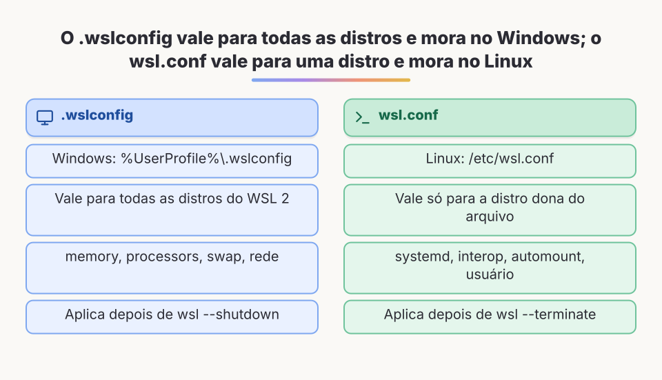
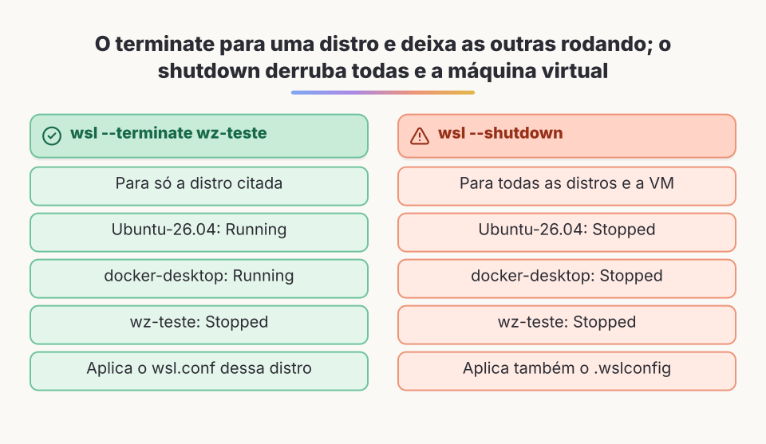

# 7. Gerenciar o WSL

> 🗺️ **Neste capítulo:** você aprende a limitar a memória e o processador do WSL (`.wslconfig`), a ajustar uma distro (`wsl.conf`), a parar uma distro sem derrubar as outras (`--terminate` × `--shutdown`), a exportar e trocar de distro e a resolver os problemas mais comuns. · ⏱️ ~50 min

> 🔥 **Aquecimento:** (1) Que comando mostra **todos** os programas com o mesmo nome no `PATH`, na ordem em que o shell os acha? (2) Por que o `bootstrap.sh` pode rodar duas vezes sem estragar nada?
>
> <details>
> <summary>Ver resposta</summary>
>
> (1) `which -a nome`. (2) Porque é idempotente: cada bloco verifica se o resultado já existe e pula o que está pronto (capítulo 6).
>
> </details>

## 📇 A parte 3 numa página

![Parte 3, capítulos 7 a 10. .wslconfig × wsl.conf: Windows × cada distro, vale após --shutdown × --terminate, memory, processors, swap. --terminate × --shutdown: um apartamento × o prédio, shutdown derruba todas, o trabalho na memória se perde. Diagnóstico: wsl -l -v e wsl --status, comando simples na distro, --unregister só com backup. Exportar e importar: --export grava um .tar, --import cria outra distro, [user] default= no wsl.conf. Provar o backup: SHA-256 confere a cópia, clone teste- numa distro à parte, backup.ps1 -Testar. Claude Code: instale como usuário, claude doctor só lê, confie só em pastas de projeto. Modos de permissão: default, acceptEdits, plan, auto, Shift+Tab alterna, defaultMode no settings.json. Plugins e MCPs: plugin vem de um marketplace, MCP: programa com ferramentas, leia o que trazem antes. Spec-Driven Development: o quê, depois o como, specify, plan, tasks, implement, uma fase por vez, um commit. Restaurar do zero: distro nova e usuário, git clone e bootstrap.sh, verificar.sh prova o ambiente.](../img/c07-resumo-parte-3.svg)

- [Capítulo 7: Gerenciar o WSL](07-gerenciar-o-wsl.md)
- [Capítulo 8: Backup e restauração](08-backup-e-restauracao.md)
- [Capítulo 9: Claude Code no WSL](09-claude-code-no-wsl.md)
- [Capítulo 10: Projeto final: um app com Spec Kit](10-projeto-final-um-app-com-spec-kit.md)

## De onde paramos

No capítulo 6 você montou as ferramentas e o `bootstrap.sh`. Você também viu duas promessas pendentes: que o `appendWindowsPath` do `wsl.conf` tira o `PATH` do Windows do Ubuntu, e que `wsl --terminate` é diferente de `wsl --shutdown`. Este capítulo cumpre as duas e ensina o resto do gerenciamento: limites de recursos, trocar e mover distros, e o que fazer quando algo não funciona.

## `.wslconfig` × `wsl.conf`

O WSL tem **dois** arquivos de configuração com nomes quase iguais, e confundi-los é o erro número um deste assunto.



| | `.wslconfig` | `wsl.conf` |
| --- | --- | --- |
| Onde fica | Windows: `%UserProfile%\.wslconfig` | Linux: `/etc/wsl.conf`, dentro de cada distro |
| Vale para | todas as distros do WSL 2 (a VM inteira) | só a distro dona do arquivo |
| Controla | memória, processadores, *swap*, rede | `systemd`, `interop`, montagem dos discos, usuário padrão |
| Só vale depois de | `wsl --shutdown` | `wsl --terminate nome-da-distro` |

O `.wslconfig` não existe até você criá-lo. Ele tem a seção `[wsl2]`. As chaves mais usadas, com o padrão de cada uma segundo a [documentação oficial](https://learn.microsoft.com/windows/wsl/wsl-config):

| Chave | O que faz | Padrão |
| --- | --- | --- |
| `memory` | limite de memória da VM | 50% da RAM do Windows |
| `processors` | núcleos que a VM pode usar | todos |
| `swap` | tamanho do arquivo de troca (`0` desliga) | 25% da memória |
| `vmIdleTimeout` | milissegundos sem uso até a VM desligar sozinha | 60000 |
| `networkingMode` | modo de rede: `NAT`, `mirrored` ou `none` | `NAT` |

Veja o que o Linux enxerga hoje, na máquina de teste, para saber a quanto o limite padrão chega:

```bash
free -h | sed -n 1,3p
nproc
```

```text
               total        used        free      shared  buff/cache   available
Mem:            15Gi       1.6Gi       4.4Gi        80Mi       9.8Gi        13Gi
Swap:          4.0Gi       2.8Mi       4.0Gi
6
```

Nesta máquina o Ubuntu vê 15 GB de memória, 4 GB de *swap* e 6 processadores. Os números do seu computador serão outros, e se já existir um `.wslconfig` no seu usuário, eles refletem as chaves dele. O motivo de mexer é o oposto do que parece: o WSL costuma **usar** memória como cache (`buff/cache` acima) e, se você roda muita coisa, ele disputa RAM com o Windows. Um limite protege o resto do computador.

### O modelo do `.wslconfig`, sem aplicar

Antes de mexer num arquivo que afeta todas as suas distros, escreva o modelo em outro lugar e **confira**. O repositório ganha uma pasta `windows/` com o modelo e um pequeno conferidor em PowerShell, que apenas lê o arquivo e responde:

<!-- project: meu-ambiente -->

**windows/wslconfig.modelo**

```ini
# Modelo do .wslconfig (lado Windows). Este arquivo NAO vale nada sozinho:
# so tem efeito se copiado para %UserProfile%\.wslconfig e se o WSL for
# reiniciado depois (wsl --shutdown, que derruba todas as distros).
[wsl2]
# limite de memoria da VM (padrao: metade da RAM do Windows)
memory=8GB
# nucleos de processador que a VM pode usar (padrao: todos)
processors=4
# arquivo de troca (padrao: 25% da memoria); 0 desliga
swap=2GB
# ms sem uso ate a VM desligar sozinha (padrao: 60000)
vmIdleTimeout=60000
```

(Os textos estão sem acentos de propósito, como no `verificar.ps1` do capítulo 1: o PowerShell 5.1 lê arquivos sem marcação como "ANSI".) Escolha `memory` e `processors` pela sua máquina: algo entre metade e três quartos da RAM costuma servir.

**windows/conferir-wslconfig.ps1**

```powershell
# Confere um arquivo .wslconfig sem aplica-lo: so le o arquivo e responde.
param([string]$Caminho = "$PSScriptRoot\wslconfig.modelo")

$conhecidas = 'memory', 'processors', 'swap', 'vmIdleTimeout',
    'networkingMode', 'defaultVhdSize', 'guiApplications',
    'nestedVirtualization'
$falhas = 0

# mostra OK ou FALHA para cada linha que olha
function Checa($texto, $ok) {
    if ($ok) { "OK    $texto" } else { "FALHA $texto"; $script:falhas++ }
}

foreach ($linha in Get-Content $Caminho) {
    $l = $linha.Trim()
    # pula comentarios, linhas em branco e cabecalhos de secao
    if ($l -eq '' -or $l.StartsWith('#') -or $l.StartsWith('[')) { continue }
    $chave, $valor = $l -split '=', 2
    $chave = $chave.Trim(); $valor = "$valor".Trim()
    Checa "chave conhecida: $chave" ($conhecidas -contains $chave)
    if ($chave -in 'memory', 'swap', 'defaultVhdSize') {
        Checa "$chave tem numero e unidade (ex.: 8GB)" `
            ($valor -match '^\d+\s?(MB|GB|TB)$' -or $valor -eq '0')
    }
    if ($chave -in 'processors', 'vmIdleTimeout') {
        Checa "$chave e um numero inteiro" ($valor -match '^\d+$')
    }
}
"---"
if ($falhas -eq 0) { "Arquivo conferido: nada de estranho." }
else { "$falhas problema(s) encontrados."; exit 1 }
```

Para testar sem tocar no seu arquivo de verdade, copie o modelo para uma **pasta temporária** com o nome `.wslconfig` e rode o conferidor nela. Veja também um arquivo errado de propósito, com a unidade esquecida em `memory` e uma chave escrita errada:

```powershell
# modelo copiado para uma pasta temporaria, com o nome do arquivo real
powershell -NoProfile -ExecutionPolicy Bypass `
  -File .\windows\conferir-wslconfig.ps1 -Caminho C:\temp\wsl-teste\.wslconfig
# arquivo com defeitos, de proposito
powershell -NoProfile -ExecutionPolicy Bypass `
  -File .\windows\conferir-wslconfig.ps1 `
  -Caminho C:\temp\wsl-teste\.wslconfig.ruim
```

```text
OK    chave conhecida: memory
OK    memory tem numero e unidade (ex.: 8GB)
OK    chave conhecida: processors
OK    processors e um numero inteiro
OK    chave conhecida: swap
OK    swap tem numero e unidade (ex.: 8GB)
OK    chave conhecida: vmIdleTimeout
OK    vmIdleTimeout e um numero inteiro
---
Arquivo conferido: nada de estranho.
OK    chave conhecida: memory
FALHA memory tem numero e unidade (ex.: 8GB)
FALHA chave conhecida: processadores
OK    chave conhecida: swap
OK    swap tem numero e unidade (ex.: 8GB)
---
2 problema(s) encontrados.
```

(Nos meus testes a pasta temporária era a do `scratch` da sessão; o `C:\temp\wsl-teste` acima é um exemplo.)

> ⚠️ **Não executado:** **aplicar** o modelo. Copiar o modelo para o `%UserProfile%\.wslconfig` e rodar `wsl --shutdown` derruba todas as distros do computador, e eu não fiz isso na máquina de testes (há distros em uso, entre elas o Docker Desktop). Para você, o caminho seguro é: (1) feche o que roda nas distros e salve o trabalho; (2) se já existir um `.wslconfig`, copie-o para `.wslconfig.bak`; (3) copie o modelo, sem os comentários se preferir; (4) rode `wsl --shutdown`; (5) abra o Ubuntu e confira com `free -h` e `nproc`. Fonte: [Configurações avançadas do WSL](https://learn.microsoft.com/windows/wsl/wsl-config).

> ⚠️ **Erro comum:** editar o `.wslconfig` e achar que o efeito é imediato. O arquivo só é lido quando a VM do WSL 2 **liga**. Enquanto qualquer distro estiver rodando, a VM continua com os limites antigos.

## `wsl.conf`: ajustar uma distro

O `wsl.conf` é dividido em seções. As que você mais vai usar:

| Seção | Chaves comuns | Para que serve |
| --- | --- | --- |
| `[boot]` | `systemd`, `command` | ligar o `systemd` (capítulo 3); rodar um comando ao ligar a distro |
| `[user]` | `default` | o usuário com que a distro abre |
| `[interop]` | `enabled`, `appendWindowsPath` | rodar programas do Windows e juntar o `PATH` do Windows |
| `[automount]` | `enabled`, `root`, `options`, `mountFsTab` | como `/mnt/c` e `/mnt/d` são montados |
| `[network]` | `generateHosts`, `generateResolvConf` | quem gera o `/etc/hosts` e o `/etc/resolv.conf` |

Cumpra a promessa do capítulo 6 com um experimento na distro de teste. Primeiro, o estado de partida: o Ubuntu mistura o `PATH` do Windows e enxerga `cmd.exe`.

```bash
echo "PATH: $(echo "$PATH" | tr ':' '\n' | wc -l) entradas, \
$(echo "$PATH" | tr ':' '\n' | grep -c '^/mnt/') do Windows"
command -v cmd.exe
```

```text
PATH: 51 entradas, 42 do Windows
/mnt/c/WINDOWS/system32/cmd.exe
```

Agora acrescente a seção ao `/etc/wsl.conf`. Antes de editar, guarde uma cópia do original, como sempre:

```bash
# cópia do original, para voltar atrás
sudo cp /etc/wsl.conf ~/wsl.conf.original
# acrescenta a seção [interop] sem apagar o que já existe
printf '\n[interop]\nappendWindowsPath=false\n' |
  sudo tee -a /etc/wsl.conf > /dev/null
cat /etc/wsl.conf
```

```text
[boot]
systemd=true
[user]
default=ana

[interop]
appendWindowsPath=false
```

Nada mudou ainda: o arquivo só é lido quando a distro liga. No PowerShell, reinicie **só ela**, e confira o resultado (o Ubuntu abre de novo sozinho no primeiro comando):

```powershell
wsl --terminate wz-teste
```

```text
The operation completed successfully.
```

Abra o Ubuntu de novo (ele liga na hora) e repita a conferência:

```bash
echo "PATH: $(echo "$PATH" | tr ':' '\n' | wc -l) entradas, \
$(echo "$PATH" | tr ':' '\n' | grep -c '^/mnt/') do Windows"
command -v cmd.exe || echo "cmd.exe: command not found"
```

```text
PATH: 9 entradas, 0 do Windows
cmd.exe: command not found
```

O `PATH` voltou a ter só as 9 pastas do Linux, e `cmd.exe` (e `explorer.exe`, e o `npm` do Windows) sumiram. O `/mnt/c` continua montado: o `appendWindowsPath` mexe apenas no `PATH`, não nos discos. É esse o efeito colateral a conhecer: com ele desligado, o `explorer.exe .` do capítulo 4 deixa de funcionar pelo nome simples; você teria de chamar `/mnt/c/Windows/explorer.exe` por inteiro.

Desfaça o experimento e reinicie de novo:

```bash
# devolve o arquivo ao que era
sudo cp ~/wsl.conf.original /etc/wsl.conf
cat /etc/wsl.conf
```

```text
[boot]
systemd=true
[user]
default=ana
```

Depois do `wsl --terminate wz-teste` e de reabrir a distro, o `PATH` voltou a ter **51 entradas, 42 do Windows**, e o `cmd.exe`, a ser encontrado.

(Nos testes, o `sudo` rodou como root direto pelo `wsl -u root`, o que dá o mesmo resultado; os comandos acima são os que você usaria.)

> ⚠️ **Erro comum:** achar que `appendWindowsPath=false` "conserta" o `npm` errado do capítulo 6. Ele funciona, mas tira também o `code`, o `explorer.exe` e tudo o que você usa do Windows. Em geral é melhor carregar o nvm primeiro, como o `bashrc.meu` faz, e deixar o Windows no fim do `PATH`.

## `--terminate` × `--shutdown`

Os dois comandos *parecem* iguais, e a diferença pode custar trabalho perdido. Eis o estado real da máquina de testes antes e depois do primeiro:

```powershell
wsl -l -v
wsl --terminate wz-teste
wsl -l -v
```

```text
  NAME              STATE           VERSION
* Ubuntu-26.04      Running         2
  docker-desktop    Running         2
  wz-teste          Running         2
The operation completed successfully.
  NAME              STATE           VERSION
* Ubuntu-26.04      Running         2
  docker-desktop    Running         2
  wz-teste          Stopped         2
```

Só a `wz-teste` parou. As outras duas distros (uma delas é a que o Docker Desktop usa) seguiram rodando, com os seus programas e arquivos abertos.



> 💡 **Analogia:** as distros são apartamentos, e a VM do WSL 2 é o prédio. `wsl --terminate` é desligar a luz de **um** apartamento: os vizinhos nem percebem. `wsl --shutdown` é cortar a energia do **prédio inteiro**: todos os apartamentos, a bomba d'água e o elevador (a VM) caem junto. A analogia falha num ponto: um apartamento "desligado" não perde o que estava na geladeira, e uma distro desligada perde o que estava só na memória (um processo rodando, um arquivo não salvo).

Por isso a regra do livro é **`--terminate` primeiro**. O `--shutdown` só é necessário quando o `.wslconfig` mudou, ou quando o WSL está travado de verdade, e antes dele você salva tudo e avisa quem usa o computador. O `--shutdown` tem ainda a opção `--force`, que derruba a VM mesmo com uma operação em andamento e **pode causar perda de dados**: é o último recurso.

> ⚠️ **Não executado:** `wsl --shutdown`. Na máquina de testes ele pararia as distros do autor. Para ver o efeito, a documentação oficial descreve o comportamento: [comandos básicos do WSL](https://learn.microsoft.com/windows/wsl/basic-commands).

Se, em vez de derrubar, você só quer saber quem está ligado: `wsl -l --running`.

## Comandos de gerenciamento

Tudo isto roda no **PowerShell**, não no Ubuntu. A tabela vem do `wsl --help` desta versão (WSL 3.0.5):

| Comando | O que faz | Cuidado |
| --- | --- | --- |
| `wsl -l -v` | lista as distros, o estado e a versão | só lê |
| `wsl --status` | distro padrão e versão padrão | só lê |
| `wsl --version` | versões do WSL, kernel e WSLg | só lê |
| `wsl -d nome` / `wsl -d nome -u usuario` | abre a distro (como outro usuário) | `-u root` entra como administrador |
| `wsl --terminate nome` | para uma distro | perde o que não está salvo nela |
| `wsl --set-default nome` | muda a distro que abre sem `-d` | muda o comportamento do `wsl` puro |
| `wsl --set-version nome 2` | converte a distro entre WSL 1 e 2 | demorada; faça backup antes |
| `wsl --update` | atualiza o WSL | afeta todas as distros |
| `wsl --export nome arquivo` | salva a distro num arquivo | só lê |
| `wsl --unregister nome` | **apaga** a distro e o disco virtual dela | irreversível |

Executei os de leitura na máquina de testes:

```powershell
wsl --version
wsl --status
```

```text
WSL version: 3.0.5.0
Kernel version: 6.18.58.1-1
WSLg version: 1.0.79
MSRDC version: 1.2.7391
Direct3D version: 1.611.1-81528511
DXCore version: 10.0.26100.1-240331-1435.ge-release
Windows version: 10.0.26300.9974
Default Distribution: Ubuntu-26.04
Default Version: 2
```

(O `--status` imprime só as duas últimas linhas; juntei as saídas dos dois comandos.) A distro padrão é a que abre quando você digita só `wsl`; use `-d nome` sempre que houver mais de uma, para não depender dela.

> ⚠️ **Não executado:** `--set-default`, `--set-version`, `--update` e `--unregister` mudam a instalação do computador do autor, que não é a distro de teste. O `--unregister` apaga o disco virtual e tudo o que está nele: **só use com backup** (próxima seção), e sempre com o nome certo da distro.

## Exportar, mover e trocar de distro

Para guardar uma distro inteira, ou levá-la para outro disco, o WSL tem `--export`. Ele grava um arquivo `.tar` com tudo (sistema, usuários, arquivos). Na distro de teste, que tem Node, Java e o repositório:

```powershell
# grava a distro inteira, com tudo o que há nela, num arquivo .tar
wsl --export wz-teste D:\wz-temp\wz-teste.tar
```

```text
The operation completed successfully.
```

O arquivo saiu com **3,16 GB** e levou **1 minuto e 24 segundos**. O tamanho vem do que está dentro (as ferramentas do capítulo 6 pesam centenas de megabytes), e por isso o backup do capítulo 8 vai olhar o que vale guardar.

A volta é o `--import`, que cria uma distro **nova** a partir do arquivo, no disco e na pasta que você escolher:

```powershell
# nome novo, pasta de instalação, arquivo; --version 2 pede o WSL 2
wsl --import wz-teste D:\wz-temp\wz-teste D:\wz-temp\dl\u.wsl --version 2
```

(Foi este o comando que criou a `wz-teste`, a distro de teste, a partir da imagem oficial do Ubuntu em vez de um `.tar` meu; a sintaxe é a mesma.) Trocar uma distro de pasta é, portanto, exportar, **desregistrar a antiga** e importar na pasta nova. Cada passo é seguro sozinho; o `--unregister` é o que não tem volta, então só o faça depois de importar e **testar** a cópia.

O WSL novo tem um atalho mais curto, o `--manage ... --move`. Eu tentei:

```powershell
wsl --manage wz-teste --move D:\wz-temp\wz-movida
```

```text
The operation could not be completed because the VHD is currently in use.
To force WSL to stop use: wsl.exe --shutdown
Error code: Wsl/Service/MoveDistro/WSL_E_DISTRO_NOT_STOPPED
```

(Quebrei a primeira linha da mensagem em duas, só para caber na página.) Mesmo com a `wz-teste` parada, o disco virtual continuava em uso; o mais provável é que a VM compartilhada o mantenha aberto enquanto outras distros rodam (a mensagem não diz o motivo). O WSL pede o `--shutdown`, e como não posso rodá-lo nesta máquina, **o `--move` ficou sem executar**. Para você, é o caminho certo se você puder parar tudo: salve o trabalho, rode o `--shutdown` e então o `--move`. Se não puder, use o exportar-e-importar.

Há ainda outros ajustes de disco em `wsl --manage nome`: `--resize` (tamanho do disco), `--set-sparse` (devolve espaço ao Windows) e `--compact`, que a documentação descreve no `wsl --help`; não executei nenhum deles.

## Problemas comuns

A [seção de solução de problemas](https://learn.microsoft.com/windows/wsl/troubleshooting) da documentação é longa. Estes são os casos que mais aparecem para quem acabou de instalar, com o diagnóstico em ordem:

| Sintoma | Causa provável | O que fazer |
| --- | --- | --- |
| `notepad.exe: command not found` no Ubuntu | não há pastas do Windows no `PATH` | `echo $PATH` e procure `/mnt/c`; veja `appendWindowsPath` e se o seu `/etc/profile` não sobrescreve o `PATH` |
| `\\wsl$` não abre no Explorer | o servidor de arquivos (9p) da distro não subiu | abra a distro uma vez, tente `\\wsl.localhost\nome`, e use `dmesg` para ver erros de 9p (veja a documentação) |
| sem internet dentro do WSL | firewall ou antivírus bloqueando a VM | a documentação cita alguns (Kaspersky, AVG, Avast, Symantec); teste desativar para confirmar |
| o terminal "travou" | um processo preso | `wsl --terminate nome` primeiro; só depois, e com tudo salvo, `--shutdown` |
| erro ao rodar `apt upgrade` | pacote do sistema em estado ruim | leia a mensagem; a seção "Apt-get upgrade errors" da documentação descreve os casos |
| `Error: 0x80370102` ao iniciar | um recurso de virtualização necessário não está ativo | confira a virtualização no firmware e os recursos do Windows (capítulo 2) e a seção do erro na documentação |

Uma regra de diagnóstico serve para quase todos: **de que lado está o problema?** Rode `wsl -l -v` (a distro está `Running`?), depois `wsl --status` (a versão padrão é a 2?) e então um comando simples dentro da distro. Se o simples falha, o problema é do WSL; se só o seu programa falha, é da distro.

> ⚠️ **Não executado:** nenhum destes problemas foi reproduzido: eles vêm da documentação oficial e dependem de firewall, firmware e versão do Windows do leitor. Só o primeiro foi reproduzido, e numa variante: com o `appendWindowsPath=false` da seção anterior, o `cmd.exe` deixou de ser encontrado.

## O projeto: o `meu-ambiente` do lado Windows

O `verificar.ps1` ganha um quarto teste, que roda o conferidor sobre o modelo da pasta `windows/`. Eis o arquivo inteiro (o texto continua sem acentos, pelo motivo do capítulo 1):

**verificar.ps1**

```powershell
# Confere, do lado Windows, se o PC esta pronto para o WSL 2.
$build = [System.Environment]::OSVersion.Version.Build
$cpu = Get-CimInstance Win32_Processor | Select-Object -First 1
$emUso = (Get-CimInstance Win32_ComputerSystem).HypervisorPresent
$wsl = Get-Command wsl.exe -ErrorAction SilentlyContinue

# mostra OK ou FALHA para cada teste
function Checa($texto, $ok) {
    if ($ok) { "OK    $texto" } else { "FALHA $texto" }
}

$versaoOk = $build -ge 19041
# com o hipervisor em uso, o campo do firmware aparece como False
$virtOk = $cpu.VirtualizationFirmwareEnabled -or $emUso

Checa "Windows 10 build 19041+ ou 11 (este: build $build)" $versaoOk
Checa "virtualizacao ligada no firmware ou em uso" $virtOk
Checa "wsl.exe encontrado" ($null -ne $wsl)

# o modelo do .wslconfig (windows/) passa no conferidor, sem ser aplicado
$modelo = Join-Path $PSScriptRoot 'windows\wslconfig.modelo'
$conferidor = Join-Path $PSScriptRoot 'windows\conferir-wslconfig.ps1'
$modeloOk = (Test-Path $modelo) -and (Test-Path $conferidor) -and
    -not (& $conferidor -Caminho $modelo | Select-String 'FALHA')
Checa "modelo do .wslconfig confere (windows/)" $modeloOk
```

```powershell
# no PowerShell, dentro da pasta do projeto
powershell -NoProfile -ExecutionPolicy Bypass -File .\verificar.ps1
```

```text
OK    Windows 10 build 19041+ ou 11 (este: build 26300)
OK    virtualizacao ligada no firmware ou em uso
OK    wsl.exe encontrado
OK    modelo do .wslconfig confere (windows/)
```

O `verificar.sh` do Ubuntu não muda neste capítulo. Faça o commit no Ubuntu, dentro de `~/meu-ambiente`: `git add -A` e `git commit -m "windows: modelo do .wslconfig e conferidor"`.

> ⚠️ **Executado** na distro de teste (Ubuntu 26.04.1, `wz-teste`) e, para os comandos do Windows, no PowerShell da máquina de testes, **só com comandos de leitura** nas distros do autor (`wsl -l -v`, `--version`, `--status`). O `%UserProfile%\.wslconfig` do autor não foi tocado nem lido. Não executados: `wsl --shutdown`, `--set-default`, `--update`, `--unregister` e o `--manage --move` (que falhou como mostrado).

## 🏋️ Pratique

**1. Exemplo resolvido.** Você escreveu `memory=4GB` no `.wslconfig`, salvou, abriu o Ubuntu e o `free -h` ainda mostra 15 GB. O que faltou?

<details>
<summary>Ver resposta</summary>

O `.wslconfig` só é lido quando a VM do WSL 2 liga, e ela estava ligada com os limites antigos. Faltou parar a VM (`wsl --shutdown`, depois de salvar o trabalho nas distros) e abrir o Ubuntu de novo. Dois erros comuns: usar `--terminate`, que só reinicia a distro, e escrever o arquivo no lugar errado (o `.wslconfig` fica em `%UserProfile%`, não dentro do Ubuntu).

</details>

**2. Complete.** Escreva, no `/etc/wsl.conf`, as linhas que fazem o Ubuntu abrir sempre com o usuário `ana`, e diga o comando de PowerShell que aplica a mudança sem derrubar as outras distros.

```ini
[___]
___=ana
```

<details>
<summary>Ver resposta</summary>

```ini
[user]
default=ana
```

E no PowerShell: `wsl --terminate nome-da-distro`. O `wsl.conf` é lido quando a distro liga, e o `--terminate` reinicia só ela.

</details>

**3. Faça sozinho.** Crie uma pasta temporária, escreva nela um `.wslconfig` com `memory=6GB` e `processors=2`, e rode o `conferir-wslconfig.ps1` sobre ele. Depois troque `6GB` por `6` e rode de novo. O que muda na saída?

<details>
<summary>Ver resposta</summary>

Na primeira vez, todas as linhas dão `OK` e termina em "Arquivo conferido: nada de estranho.". Na segunda, aparece `FALHA memory tem numero e unidade (ex.: 8GB)` e o final diz "1 problema(s) encontrados.". O `memory` sem unidade é ambíguo (seis bytes?), e o conferidor pega isso. Critérios: (1) usou uma pasta temporária, não o `%UserProfile%`; (2) previu a falha antes de rodar.

</details>

**4. Desafio.** O Docker Desktop do seu colega parou de responder, e ele quer rodar `wsl --shutdown` "para resolver". Explique o que isso derruba, o que ele deve fazer antes e que alternativa existe.

<details>
<summary>Ver resposta</summary>

O `--shutdown` para **todas** as distros e a VM, inclusive a que o Docker Desktop usa (`docker-desktop`) e os contêineres que rodam nela; qualquer coisa não salva em memória se perde. Antes: salvar o trabalho nas distros e avisar quem usa o computador. Alternativa: `wsl --terminate nome-da-distro` na distro que travou, e reiniciar o Docker Desktop, mantendo as outras distros de pé. Critérios: (1) diz que derruba todas; (2) manda salvar antes; (3) propõe o `--terminate` como primeira tentativa.

</details>

**Arquivos do projeto ao fim do capítulo:** em `~/meu-ambiente`, tudo do capítulo 6 mais a pasta `windows/` com `wslconfig.modelo` e `conferir-wslconfig.ps1`, e o `verificar.ps1` com 4 testes. **Comando que confere:** no PowerShell, `powershell -NoProfile -ExecutionPolicy Bypass -File .\verificar.ps1` imprime quatro linhas `OK`.

## 🧠 Revisão rápida

1. Qual dos dois arquivos, `.wslconfig` ou `wsl.conf`, vale para todas as distros? Onde ele mora?
2. Que comando reinicia só uma distro? E qual derruba tudo?
3. Para que serve guardar uma cópia antes de editar o `wsl.conf`?
4. Por que o `--unregister` exige backup?
5. (Capítulo 6) O que `which -a npm` mostrou quando o nvm ainda não estava carregado?

<details>
<summary>Ver respostas</summary>

1. O `.wslconfig`; mora no Windows, em `%UserProfile%\.wslconfig`.
2. `wsl --terminate nome` reinicia só uma; `wsl --shutdown` derruba todas e a VM.
3. Para voltar atrás se a edição quebrar a distro ou o efeito não for o esperado.
4. Porque ele apaga a distro e o disco virtual dela, sem lixeira.
5. Só o `npm` do Windows, em `/mnt/c/Program Files/nodejs/npm`.

</details>

## 🤖 Estude com um tutor de IA

- "Faça-me 5 perguntas sobre `.wslconfig`, `wsl.conf`, `--terminate`, `--shutdown` e exportar/importar distros, uma de cada vez. Espere a minha resposta antes de dar o retorno e não me dê as respostas antes."
- "Esta é a minha resposta ao exercício 4: [minha resposta]. Aponte os meus erros sem me dar a solução."

> ➡️ **Próximo passo:** no capítulo 8 você protege o que importa: o que entra num backup (e o que não entra), o `backup.ps1` do projeto e como provar que a restauração funciona antes de precisar dela.

## 📌 Resumo

| Item | Em uma frase |
| --- | --- |
| `.wslconfig` | Arquivo do Windows, vale para todas as distros; exige `wsl --shutdown` |
| `wsl.conf` | Arquivo de cada distro, em `/etc`; vale depois de `wsl --terminate` |
| `memory`, `processors`, `swap` | Limites da VM; por padrão, metade da RAM, todos os núcleos e 25% de swap |
| `appendWindowsPath=false` | Tira o `PATH` do Windows do Ubuntu; `cmd.exe` e `explorer.exe` deixam de ser achados |
| `--terminate` × `--shutdown` | Um para uma distro; o outro para todas e a VM |
| `--export` / `--import` | Salva a distro num `.tar` e cria uma distro nova a partir dele |
| `--unregister` | Apaga a distro e o disco; só com backup |
| Diagnóstico | `wsl -l -v`, `wsl --status`, comando simples dentro da distro |

## 📚 Fontes

- [Configurações avançadas do WSL: wsl.conf e .wslconfig](https://learn.microsoft.com/windows/wsl/wsl-config) (conferido em 27/11/2026)
- [Comandos básicos do WSL](https://learn.microsoft.com/windows/wsl/basic-commands) (27/11/2026)
- [Solução de problemas do WSL](https://learn.microsoft.com/windows/wsl/troubleshooting) (27/11/2026)
- Execuções: WSL 3.0.5.0 (kernel 6.18.58.1-1, WSLg 1.0.79) com a distro de teste Ubuntu 26.04.1, 27/11/2026.

> 🔁 **Revise hoje:** 4, 6

<!-- nav:start -->
---

[◀ Capítulo anterior](06-ferramentas-de-desenvolvimento-e-programas.md) · [Mapa do livro](../README.md) · [Próximo capítulo ▶](08-backup-e-restauracao.md)
<!-- nav:end -->
