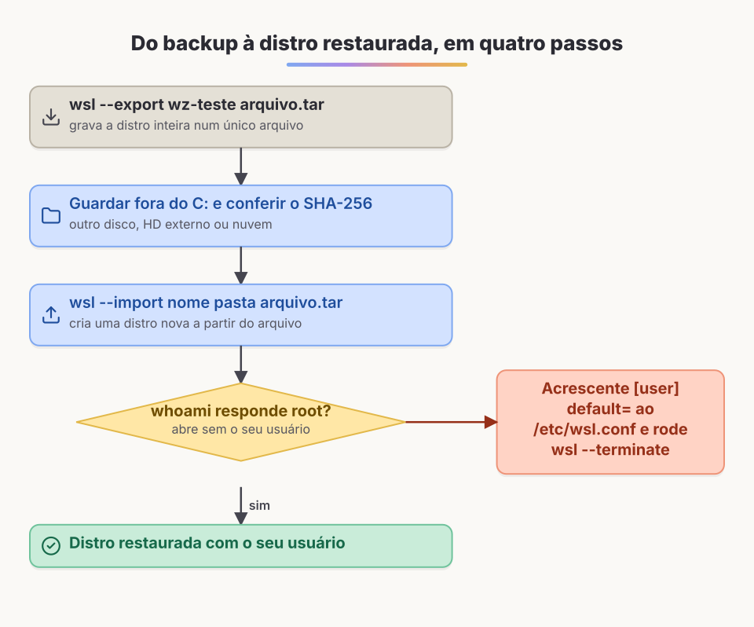
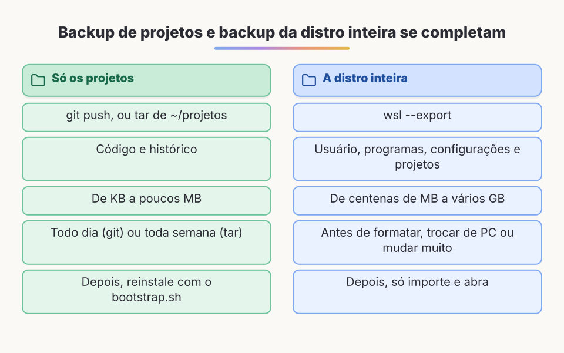

# 8. Backup e restauração

> 🗺️ **Neste capítulo:** você exporta uma distro inteira para um arquivo (`wsl --export`), a restaura com o seu usuário (`wsl --import` e o `[user]` do `wsl.conf`), prova o backup numa distro de teste e escolhe o que guardar: só os projetos ou a distro inteira. O projeto ganha o `backup.ps1`. · ⏱️ ~55 min

> 🔥 **Aquecimento:** (1) Que comando reinicia **só uma** distro, sem derrubar as outras? (2) Quando um ajuste do `wsl.conf` passa a valer?
>
> <details>
> <summary>Ver resposta</summary>
>
> (1) `wsl --terminate nome-da-distro`. (2) Na próxima vez que a distro liga, ou seja, depois do `--terminate` (capítulo 7).
>
> </details>

## De onde paramos

No capítulo 7 você viu que `wsl --unregister` apaga a distro e o disco virtual dela, sem lixeira, e que formatar o Windows tem o mesmo efeito. Também viu que o export da distro com as ferramentas do capítulo 6 pesou 3,16 GB. Seu ambiente já tem horas de trabalho. Este capítulo o protege, e decide o que vale guardar em cada situação.

## `wsl --export`: a distro inteira num arquivo

Reinstalar tudo do zero leva uma tarde: Ubuntu, git, nvm, uv, Starship, chaves SSH. O `bootstrap.sh` do capítulo 6 refaz as ferramentas, mas não traz de volta o que **só existe** na sua distro. O `wsl --export` empacota tudo.

**O `wsl --export` grava uma cópia completa de uma distro (sistema, programas, usuários, configurações e a sua pasta pessoal) num único arquivo, por padrão no formato `.tar`.**

O `.tar` (de *tape archive*) junta muitos arquivos e pastas num só, preservando nomes, permissões e donos. Roda no **PowerShell**:

```powershell
# nome da distro (veja com wsl -l -v), arquivo de destino
wsl --export wz-teste D:\wz-temp\bkp\wz-teste.tar
```

Guarde o arquivo em **outro disco que não o C:**: um backup no mesmo disco que será formatado não protege nada. (Na máquina de testes o C: também tem pouco espaço, então tudo foi para o D:.)

O comando não imprime nada além de `The operation completed successfully.`. A prova é o arquivo: a distro de teste, que só tem o Ubuntu 26.04.1 mais os projetos pequenos deste capítulo, gerou **1.237,7 MB** (cerca de 1,2 GB). A mesma distro com Node, Java e as outras ferramentas do capítulo 6 gerou 3,16 GB. O que pesa é a **soma de tudo** que está dentro, e `node_modules` e caches pesam mais que código.

> ⚠️ **Antes de exportar:** pare a distro com `wsl --terminate nome` (nunca `--shutdown` só para isso, que derruba as outras). Na minha execução exportei com a distro ligada e funcionou, mas nada impede que um programa grave um arquivo no meio da cópia. Parada, a cópia é consistente.

### Outros formatos

O WSL 2 guarda cada distro num disco virtual (`ext4.vhdx`). A opção `--vhd` exporta esse disco em vez do `.tar`, e o `wsl --import-in-place nome disco.vhdx` registra um disco assim sem copiá-lo. A [documentação](https://learn.microsoft.com/windows/wsl/basic-commands) traz os dois. Eu **não executei** nenhum dos dois. Para quem está começando, fique com o `.tar`: é o que o resto do capítulo usa.

> ⚠️ **Erro comum:** copiar o `ext4.vhdx` direto da pasta do WSL com o Explorador, para "fazer backup". Isso mexe no disco de uma distro que o WSL pode estar usando, e pode corrompê-la. Use sempre o `wsl --export`.

## `wsl --import`: criar uma distro a partir do arquivo

O `.tar` só serve depois de importado. A importação cria uma distro **nova**, com o nome e a pasta que você escolher.

**O `wsl --import <nome> <pasta> <arquivo>` registra uma distro chamada `<nome>`, guarda o disco dela em `<pasta>` e preenche esse disco com o conteúdo do `<arquivo>`.**



Importe o backup com **outro nome**, para a original ficar intacta. No PowerShell:

```powershell
# nome novo, pasta onde o disco vai morar, arquivo do backup
wsl --import teste-clone D:\wz-temp\tc `
  D:\wz-temp\bkp\wz-teste-2026-11-27.tar --version 2
```

```text
The operation completed successfully.
```

Como o nome é livre, o mesmo arquivo vira, ao mesmo tempo, **backup** (para voltar atrás) e **clone** (uma cópia independente para testar um upgrade arriscado ou um tutorial que você não conhece). As duas distros dividem a mesma VM e o mesmo limite do `.wslconfig`, mas cada uma tem o próprio disco.

> 💡 **Analogia:** é como trocar de celular restaurando o backup da nuvem. O backup traz de volta apps, fotos e ajustes, e o celular novo (a pasta do `--import`) pode ser até de outro modelo. A analogia falha num ponto: o celular novo pede o seu login; a distro importada **não pede nada**, e abre com o usuário que o `/etc/wsl.conf` mandar.

> ⚠️ **Erro comum:** usar o `--unregister` com o nome errado. Ele apaga a distro indicada sem perguntar. Rode `wsl -l -v` antes e copie o nome exato do clone.

## Usuário padrão: voltar a entrar como você

Veja a distro restaurada ao lado de uma distro importada direto da imagem oficial do Ubuntu (a mesma que criou a `wz-teste`):

```bash
echo "whoami: $(whoami)"; echo "HOME: $HOME"; cat /etc/wsl.conf
```

```text
# distro importada da imagem oficial (teste-nova)
whoami: root
HOME: /root
[boot]
systemd=true

# distro restaurada do backup (teste-clone)
whoami: ana
HOME: /home/ana
[boot]
systemd=true
[user]
default=ana
```

A diferença está no `/etc/wsl.conf`. Uma distro importada **não tem o lançador** que a loja instala (o `ubuntu.exe`, que sabe qual é o seu usuário), então o WSL abre como **root** a menos que o `wsl.conf` diga outra coisa. O backup da `wz-teste` abriu como `ana` porque a seção `[user]` já estava no arquivo, e ela **viaja dentro do `.tar`**. Já a imagem crua não tem usuário comum nenhum, e é por isso que a primeira abre como root.

Se a sua restaurada abrir como root (backup de uma distro sem `[user]`, ou imagem crua), o **usuário e a pasta pessoal continuam lá dentro**: só falta dizer ao WSL quem deve entrar. Como root:

```bash
# acrescenta a seção no fim, sem apagar o [boot]
printf '\n[user]\ndefault=ana\n' >> /etc/wsl.conf
```

E, no PowerShell, reinicie a distro: `wsl --terminate nome-da-distro`.

Tentei isso na imagem crua, e o resultado ensina a armadilha:

```text
<3>WSL (331 - Relay) ERROR: CreateProcessParseCommon:1075:
  getpwnam(ana) failed 0
root
```

O `[user] default=ana` **só funciona se o usuário `ana` existir** na distro. A imagem crua não tinha, o WSL reclamou (`getpwnam(ana) failed`) e abriu como root do mesmo jeito. O caminho completo, na imagem crua, é criar o usuário antes:

```bash
# como root: cria o usuário, define a senha, dá acesso ao sudo
adduser --disabled-password --gecos '' ana
echo 'ana:ana123' | chpasswd
usermod -aG sudo ana
printf '\n[user]\ndefault=ana\n' >> /etc/wsl.conf
```

(Essa foi a sequência que montou a `wz-teste`; depois do `--terminate`, `whoami` respondeu `ana`. A senha `ana123` vale apenas no laboratório: **na sua distro use uma senha de verdade**, escolhida por você com `passwd`, e nunca a coloque num script que vá para o GitHub.)

> ⚠️ **Erro comum:** não perceber que está como root e continuar trabalhando. O que você criar vai para `/root` e os arquivos ficam com dono root, o que depois causa `Permission denied` para o seu usuário (capítulo 3). Rode `whoami` logo depois de importar. E o comando `ubuntu config --default-user`, citado em tutoriais antigos, serve para distros instaladas pela loja, não para as importadas: o caminho é o `wsl.conf`.

## Distro de teste: provar o backup antes de precisar dele

Um backup que nunca foi restaurado não passa de uma esperança. Você acabou de ver o teste inteiro, e ele cabe em três passos:

1. **Importar** o `.tar` com outro nome (`teste-clone`).
2. **Conferir**: `whoami`, `ls ~/projetos` e o conteúdo.
3. **Apagar só o clone** com `wsl --unregister teste-clone`.

Eis o passo 2 e a prova de que o clone é independente da original:

```bash
# dentro do teste-clone
ls ~/projetos
touch ~/so-no-clone.txt
ls ~ | tr '\n' ' '; echo
```

```text
api
site
backups meu-ambiente projetos so-no-clone.txt 
```

E, de volta na distro original, o arquivo **não existe**:

```text
backups meu-ambiente projetos 
```

Os projetos e o `meu-ambiente` vieram, e o que se faz no clone não afeta a original. O clone existe para ser jogado fora:

```powershell
# o nome exato do CLONE, nunca o da distro de verdade
wsl --unregister teste-clone
wsl -l -v
```

```text
The operation completed successfully.
  NAME              STATE           VERSION
* Ubuntu-26.04      Running         2
  wz-teste          Stopped         2
  docker-desktop    Running         2
```

> 🎯 **O `backup.ps1` do projeto faz esse teste sozinho**, e apaga o clone dele de forma segura (veja mais adiante).

### O SHA-256: a impressão digital do arquivo

Um `.tar` de 1,2 GB copiado para um HD externo pode se corromper. O **SHA-256** é um código (*hash*) calculado sobre todos os bytes do arquivo; se um único byte mudar, o código muda. O PowerShell calcula com `Get-FileHash`, e o Ubuntu confere o mesmo código com `sha256sum -c`. Veja o do backup da `wz-teste`, conferido pelo Linux (que lê o arquivo do Windows em `/mnt/d`, capítulo 4):

```bash
cd /mnt/d/wz-temp/bkp
cat wz-teste-2026-11-27.tar.sha256
sha256sum -c wz-teste-2026-11-27.tar.sha256
```

```text
7ea998f8b67d32c53ebc37f5c38b80eea62301f51720661e699369b0bc8b4e3d
  wz-teste-2026-11-27.tar
wz-teste-2026-11-27.tar: OK
```

Isso mostra que o `Get-FileHash` do PowerShell e o `sha256sum` do Linux concordam. (O código do seu arquivo será outro.)

## Projetos × distro inteira

Exportar a distro gera um arquivo de gigabytes. Para o dia a dia, isso é pesado demais. Existem **dois níveis** de backup, e eles se completam.



| | Só os projetos | Distro inteira |
| --- | --- | --- |
| Como | `git push` ou `tar` de `~/projetos` | `wsl --export` |
| O que leva | Código e histórico do git | Tudo: usuário, programas, configurações e projetos |
| Tamanho | KB a poucos MB | de centenas de MB a vários GB |
| Quando | Todo dia (git) ou toda semana (tar) | Antes de formatar, trocar de PC ou mudar muito |
| Depois de perder | Reinstale com o `bootstrap.sh` e restaure | `wsl --import` e abra |

> 💡 **Analogia:** o backup de projetos é o caderno de receitas: leve, cabe na bolsa, e com ele você refaz qualquer prato, mas vai ter de cozinhar tudo de novo. O backup da distro é a refeição congelada: ocupa o freezer, basta esquentar. A analogia falha porque o caderno **melhora com o tempo** (você o atualiza todo dia) e a refeição congelada fica velha: um backup de distro de seis meses traz ferramentas e pacotes de seis meses atrás.

Uma regra prática:

- **Sempre:** projetos no git, com repositório remoto (GitHub). Cada `git push` já é um backup.
- **Toda semana:** um `tar` de `~/projetos` pega o que o git não pega (`.env`, rascunhos, projetos sem repositório).
- **Antes de formatar o Windows ou trocar de computador:** `wsl --export`, obrigatoriamente.
- **Antes de mudanças grandes** (subir a versão do Ubuntu, mexer em muitos pacotes do sistema, rodar `--unregister` em qualquer distro): `wsl --export`.

### Backup dos projetos com `tar`

O `tar` do Linux faz o pacote leve. O repositório ganha o `backup-projetos.sh`, que exclui o que se reinstala (`node_modules`, `.venv`, `__pycache__`) e grava o SHA-256 ao lado:

<!-- project: meu-ambiente -->

**backup-projetos.sh**

```bash
#!/usr/bin/env bash
# Backup leve dos projetos: um .tar.gz sem as pastas que se reinstalam,
# mais o SHA-256. Uso: ./backup-projetos.sh [pasta-de-projetos] [destino]
set -eu
origem=${1:-$HOME/projetos}
destino=${2:-$HOME/backups}
[ -d "$origem" ] || { echo "Nao achei a pasta $origem" >&2; exit 1; }

mkdir -p "$destino"
arquivo="$destino/projetos-$(date +%F).tar.gz"
# -C entra na pasta de cima: os caminhos no pacote ficam relativos
tar -czf "$arquivo" \
  --exclude=node_modules --exclude=.venv --exclude=__pycache__ \
  -C "$(dirname "$origem")" "$(basename "$origem")"
nome=$(basename "$arquivo")
# o hash e gravado na mesma pasta, com o nome do arquivo (sem caminho)
(cd "$destino" && sha256sum "$nome" > "$nome.sha256")
echo "Criado: $arquivo ($(du -h "$arquivo" | cut -f1))"
(cd "$destino" && sha256sum -c "$nome.sha256")
```

Na distro de teste, com dois projetos de exemplo e uma pasta `node_modules` de 5 MB (dados aleatórios, que o `tar` não consegue comprimir):

```bash
du -sh ~/projetos
~/meu-ambiente/backup-projetos.sh
```

```text
5.0M	projetos
Criado: /home/ana/backups/projetos-2026-11-27.tar.gz (12K)
projetos-2026-11-27.tar.gz: OK
```

De 5,0 MB para 12 KB: quase todo o peso era `node_modules`, que o `npm install` refaz. Confira o conteúdo **sem extrair** (`tar -t`) e **restaure numa pasta temporária** (a prova de que o backup volta):

```bash
# lista o pacote (-t), esconde o miolo do .git e restaura em /tmp
cd ~/backups
tar -tzf projetos-*.tar.gz | grep -v '\.git/.'
mkdir /tmp/restauro && tar -xzf projetos-*.tar.gz -C /tmp/restauro
ls /tmp/restauro/projetos/site
git -C /tmp/restauro/projetos/site log --oneline
```

```text
projetos/
projetos/site/
projetos/site/README.md
projetos/site/.git/
projetos/site/src/
projetos/site/src/app.js
projetos/api/
projetos/api/main.py
README.md
src
2cde161 primeiro commit
```

O `.git` está no pacote (o histórico vai junto) e o `node_modules` não. E o `sha256sum -c` **pega** uma cópia estragada. Acrescentei um caractere ao fim de uma cópia do arquivo:

```text
sha256sum: WARNING: 1 computed checksum did NOT match
copia.tar.gz: FAILED
codigo de saida: 1
```

Se isso acontecer depois de copiar para o pen drive ou baixar da nuvem, **não confie na cópia**: copie de novo do original até aparecer `OK`.

> ⚠️ **Erro comum:** guardar o backup só em `/mnt/c/...` ou na Área de Trabalho e formatar o Windows em seguida. Confira que o arquivo está no destino certo, **e que abre**, antes de apagar qualquer coisa.

## O `backup.ps1`: exportar, conferir e testar

O `backup.ps1` junta tudo o que o capítulo ensinou numa chamada: confere que a distro existe, exporta para um arquivo com a data no nome (e não sobrescreve), grava o SHA-256 e, com `-Testar`, importa o backup num clone `teste-...`, confere o usuário e apaga **só** o clone.

**backup.ps1**

```powershell
# Backup de uma distro do WSL: exporta para um .tar com a data no nome,
# grava o SHA-256 ao lado e, com -Testar, prova que o arquivo restaura.
# Uso: .\backup.ps1 -Distro Ubuntu-26.04 -Destino E:\backups [-Testar]
param(
    [Parameter(Mandatory)][string]$Distro,
    [Parameter(Mandatory)][string]$Destino,
    [switch]$Testar
)
$ErrorActionPreference = 'Stop'

# o wsl.exe escreve a lista de distros em UTF-16; sem isto, sai com espacos
function Lista-Distros {
    $antes = [Console]::OutputEncoding
    [Console]::OutputEncoding = [System.Text.Encoding]::Unicode
    $nomes = wsl.exe -l -q | Where-Object { $_.Trim() -ne '' } |
        ForEach-Object { $_.Trim() }
    [Console]::OutputEncoding = $antes
    return $nomes
}

if ((Lista-Distros) -notcontains $Distro) {
    throw "A distro '$Distro' nao existe. Veja os nomes com: wsl -l -v"
}
New-Item -ItemType Directory -Force $Destino | Out-Null
$data = Get-Date -Format 'yyyy-MM-dd'
$arquivo = Join-Path $Destino "$Distro-$data.tar"
if (Test-Path $arquivo) { throw "Ja existe: $arquivo (nao vou sobrescrever)" }

"Exportando $Distro para $arquivo ..."
wsl.exe --export $Distro $arquivo
if ($LASTEXITCODE -ne 0) { throw "O wsl --export falhou ($LASTEXITCODE)" }

# impressao digital: muda se um unico byte do arquivo mudar
$hash = (Get-FileHash $arquivo -Algorithm SHA256).Hash.ToLower()
"$hash  $(Split-Path $arquivo -Leaf)" | Set-Content "$arquivo.sha256"
$mb = [math]::Round((Get-Item $arquivo).Length / 1MB, 1)
"Pronto: $mb MB, sha256 $hash"

if ($Testar) {
    # restaura numa distro com nome "teste-..." e apaga so ela no fim
    $clone = "teste-$Distro"
    if ((Lista-Distros) -contains $clone) {
        throw "Ja existe a distro '$clone'; apague-a ou renomeie antes."
    }
    $pasta = Join-Path $Destino "restauro-$clone"
    "Restaurando como '$clone' para provar o backup ..."
    wsl.exe --import $clone $pasta $arquivo --version 2
    if ($LASTEXITCODE -ne 0) { throw "O wsl --import falhou" }
    try {
        $quem = (wsl.exe -d $clone -- whoami).Trim()
        "Usuario que abre na restaurada: $quem"
        if ($quem -eq 'root') {
            "AVISO: abriu como root; falta [user] default= no /etc/wsl.conf."
        }
        else { "OK    a restauracao abre com um usuario comum." }
    }
    finally {
        # o nome comeca com 'teste-': nunca apaga a distro de verdade
        wsl.exe --unregister $clone | Out-Null
        Remove-Item $pasta -Recurse -Force -ErrorAction SilentlyContinue
        "Clone '$clone' removido."
    }
}
```

Três cuidados no script merecem nota:

- **O nome do clone é sempre `teste-` + a distro.** Assim o `--unregister` do `finally` nunca aponta para a distro de verdade, nem que você digite o nome errado. E ele para antes de começar se já existir uma distro com esse nome.
- **`Lista-Distros` troca a codificação do console.** O `wsl -l -q` escreve em UTF-16, e sem a troca o PowerShell 5.1 devolve os nomes com um espaço entre as letras. (Mesmo motivo de o texto estar sem acentos: no PowerShell 5.1, arquivo sem marcação é lido como "ANSI".)
- **Não sobrescreve nem apaga nada seu.** O arquivo leva a data no nome e, se já existir, o script para.

Rodei na distro de teste, só nela (as outras duas distros da máquina nem foram citadas):

```powershell
powershell -NoProfile -ExecutionPolicy Bypass -File .\backup.ps1 `
  -Distro wz-teste -Destino D:\wz-temp\bkp -Testar
```

```text
Exportando wz-teste para D:\wz-temp\bkp\wz-teste-2026-11-27.tar ...
The operation completed successfully.
Pronto: 1237.7 MB,
  sha256 7ea998f8b67d32c53ebc37f5c38b80eea62301f51720661e699369b0bc8b4e3d
Restaurando como 'teste-wz-teste' para provar o backup ...
The operation completed successfully.
Usuario que abre na restaurada: ana
OK    a restauracao abre com um usuario comum.
Clone 'teste-wz-teste' removido.
```

Para o seu computador, o uso é o mesmo, com o **nome da sua distro** (`wsl -l -v`) e uma pasta em outro disco:

```powershell
.\backup.ps1 -Distro Ubuntu-26.04 -Destino E:\backups -Testar
```

Agora o `verificar.ps1` ganha o quinto teste, que confere se o `backup.ps1` existe e **não tem erro de sintaxe** (sem rodá-lo, porque rodar exporta uma distro). Eis o arquivo inteiro (o último bloco é o novo):

**verificar.ps1**

```powershell
# Confere, do lado Windows, se o PC esta pronto para o WSL 2.
$build = [System.Environment]::OSVersion.Version.Build
$cpu = Get-CimInstance Win32_Processor | Select-Object -First 1
$emUso = (Get-CimInstance Win32_ComputerSystem).HypervisorPresent
$wsl = Get-Command wsl.exe -ErrorAction SilentlyContinue

# mostra OK ou FALHA para cada teste
function Checa($texto, $ok) {
    if ($ok) { "OK    $texto" } else { "FALHA $texto" }
}

$versaoOk = $build -ge 19041
# com o hipervisor em uso, o campo do firmware aparece como False
$virtOk = $cpu.VirtualizationFirmwareEnabled -or $emUso

Checa "Windows 10 build 19041+ ou 11 (este: build $build)" $versaoOk
Checa "virtualizacao ligada no firmware ou em uso" $virtOk
Checa "wsl.exe encontrado" ($null -ne $wsl)

# o modelo do .wslconfig (windows/) passa no conferidor, sem ser aplicado
$modelo = Join-Path $PSScriptRoot 'windows\wslconfig.modelo'
$conferidor = Join-Path $PSScriptRoot 'windows\conferir-wslconfig.ps1'
$modeloOk = (Test-Path $modelo) -and (Test-Path $conferidor) -and
    -not (& $conferidor -Caminho $modelo | Select-String 'FALHA')
Checa "modelo do .wslconfig confere (windows/)" $modeloOk

# o backup.ps1 existe e a sintaxe dele esta correta (sem roda-lo)
$bkp = Join-Path $PSScriptRoot 'backup.ps1'
$erros = $null
if (Test-Path $bkp) {
    [void][System.Management.Automation.Language.Parser]::ParseFile(
        $bkp, [ref]$null, [ref]$erros)
}
Checa "backup.ps1 presente e sem erro de sintaxe" `
    ((Test-Path $bkp) -and $erros.Count -eq 0)
```

```powershell
powershell -NoProfile -ExecutionPolicy Bypass -File .\verificar.ps1
```

```text
OK    Windows 10 build 19041+ ou 11 (este: build 26300)
OK    virtualizacao ligada no firmware ou em uso
OK    wsl.exe encontrado
OK    modelo do .wslconfig confere (windows/)
OK    backup.ps1 presente e sem erro de sintaxe
```

Faça o commit no Ubuntu, dentro de `~/meu-ambiente`: `git add -A` e `git commit -m "backup: backup.ps1 e backup-projetos.sh"`.

> ⚠️ **Executado** na distro de teste `wz-teste` (Ubuntu 26.04.1) e em dois clones temporários dela (`teste-clone`, `teste-nova`) e um terceiro do `backup.ps1` (`teste-wz-teste`), todos apagados. As distros `Ubuntu-26.04` e `docker-desktop` da máquina só apareceram em `wsl -l -v`. **Não executado:** `--export --vhd`, `--import-in-place` e a restauração num computador recém-formatado (precisaria formatar o Windows).

## 🏋️ Pratique

**1. Exemplo resolvido.** Você vai formatar o Windows amanhã. Escreva, na ordem, os comandos do PowerShell para salvar o Ubuntu num HD externo (letra `E:`) e, depois de reinstalar o WSL, restaurá-lo em `C:\WSL\Linux`.

<details>
<summary>Ver resposta</summary>

Antes de formatar:

```powershell
wsl --terminate Ubuntu-26.04
wsl --export Ubuntu-26.04 E:\wsl-backup.tar
```

Depois de reinstalar o WSL:

```powershell
wsl --import Ubuntu-26.04 C:\WSL\Linux E:\wsl-backup.tar --version 2
wsl -d Ubuntu-26.04 -- whoami
```

Se o `whoami` responder `root`, acrescente `[user] default=<seu usuário>` ao `/etc/wsl.conf`, rode `wsl --terminate Ubuntu-26.04` e abra de novo. Antes de formatar, confira o SHA-256 e **abra** o backup num clone.

</details>

**2. Complete.** Importe `backup.tar` como um clone chamado `teste-1`, na pasta `D:\WSL\teste-1`, e apague-o em seguida.

```powershell
wsl --___ teste-1 ___ backup.tar --version 2
wsl ___ teste-1
```

<details>
<summary>Ver resposta</summary>

```powershell
wsl --import teste-1 D:\WSL\teste-1 backup.tar --version 2
wsl --unregister teste-1
```

Ordem do `--import`: nome, pasta, arquivo. Confira o nome com `wsl -l -v` antes do `--unregister`.

</details>

**3. Faça sozinho.** Você copiou `projetos-2026-11-27.tar.gz` e o `.sha256` para um pen drive e, ao conferir, viu `projetos-2026-11-27.tar.gz: FAILED`. O que aconteceu e o que fazer?

<details>
<summary>Ver resposta</summary>

A cópia **não é idêntica** ao original: algum byte mudou (cópia interrompida ou pen drive com defeito). Não use essa cópia: copie de novo a partir do original e confira até aparecer `OK`. Critérios: (1) diz que a cópia está corrompida; (2) manda copiar de novo, não "restaurar assim mesmo".

</details>

**4. Desafio.** Para cada situação, diga se basta o backup de projetos ou se é preciso exportar a distro: (a) terminar o dia de trabalho; (b) trocar de notebook; (c) testar um script que altera arquivos em `/etc`.

<details>
<summary>Ver resposta</summary>

(a) Projetos: `git push`, ou o `backup-projetos.sh` da semana. (b) Distro inteira: `wsl --export` no velho e `wsl --import` no novo (ou o `bootstrap.sh` e os projetos, se preferir recomeçar limpo). (c) Nenhum dos dois sozinho: importe um **clone**, rode o script nele e apague o clone; a original nem é tocada. Critérios: (1) justifica pelo que se perde; (2) usa o clone para o (c).

</details>

**Arquivos do projeto ao fim do capítulo:** em `~/meu-ambiente`, tudo do capítulo 7 mais `backup-projetos.sh` e, no Windows, o `backup.ps1`. **Comando que confere:** no PowerShell, `.\verificar.ps1` imprime cinco linhas `OK`.

## 🧠 Revisão rápida

1. Que arquivo de configuração faz a distro importada abrir com o seu usuário? Que condição o usuário precisa cumprir?
2. Por que importar o backup com outro nome é útil?
3. Qual comando confere que uma cópia do backup está íntegra?
4. Para que serve o prefixo `teste-` no `backup.ps1`?
5. (Capítulo 7) Que comando reinicia só uma distro?

<details>
<summary>Ver respostas</summary>

1. O `/etc/wsl.conf`, seção `[user]` com `default=`; o usuário precisa **existir** na distro.
2. Cria um clone independente: serve para provar o backup ou testar algo arriscado sem tocar na original.
3. `sha256sum -c arquivo.sha256` no Linux, ou comparar com `Get-FileHash` no PowerShell.
4. O `--unregister` do script só pode apagar uma distro com esse prefixo, nunca a de verdade.
5. `wsl --terminate nome-da-distro`.

</details>

## 🤖 Estude com um tutor de IA

- "Faça-me 5 perguntas sobre `wsl --export`, `wsl --import`, o usuário padrão e o SHA-256, uma de cada vez. Espere a minha resposta antes de dar o retorno e não me dê as respostas antes."
- "Esta é a minha resposta ao exercício 4: [minha resposta]. Aponte os meus erros sem me dar a solução."

> ➡️ **Próximo passo:** com o ambiente protegido por backup, é hora de pôr um assistente de programação para trabalhar nele. O capítulo 9 instala o Claude Code no WSL e mostra os modos de permissão, plugins e MCPs.

## 📌 Resumo

| Item | Em uma frase |
| --- | --- |
| `wsl --export nome arquivo.tar` | Grava a distro inteira num `.tar`; pare a distro antes com `--terminate` |
| `wsl --import nome pasta arquivo.tar` | Cria uma distro nova a partir do `.tar`, com o nome e a pasta escolhidos |
| `[user] default=` | No `/etc/wsl.conf`, faz a importada abrir com o seu usuário, que precisa existir |
| Clone `teste-...` | O mesmo backup com outro nome: prova o backup e serve para testes; apague só ele |
| `sha256sum -c` | Confere que a cópia está íntegra |
| Projetos × distro | `git push` e `tar` dos projetos sempre; `--export` antes de formatar ou mudar muito |
| `backup.ps1` | Exporta com data, grava o SHA-256 e, com `-Testar`, restaura num clone e o apaga |
| `--unregister` | Apaga a distro e o disco; só com backup conferido e o nome exato |

## 📚 Fontes

- [Comandos básicos do WSL: export, import e unregister](https://learn.microsoft.com/windows/wsl/basic-commands) (conferido em 27/11/2026)
- [Configurações avançadas do WSL: `wsl.conf`](https://learn.microsoft.com/windows/wsl/wsl-config) (27/11/2026)
- [GNU tar manual](https://www.gnu.org/software/tar/manual/)
- Execuções: WSL 3.0.5.0 com a distro de teste Ubuntu 26.04.1, 27/11/2026.

> 🔁 **Revise hoje:** 1, 5, 7
