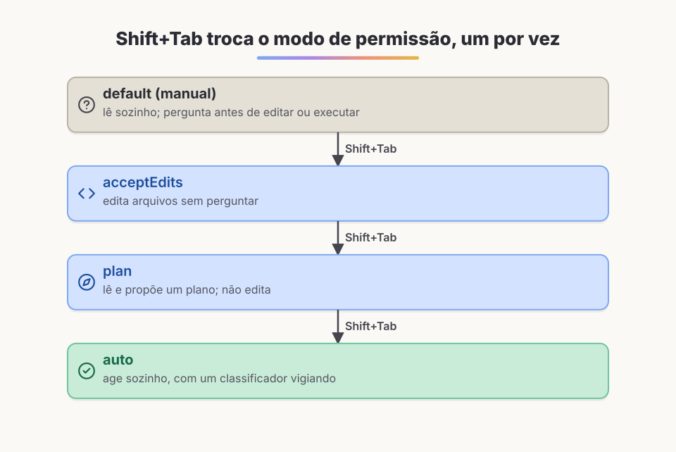
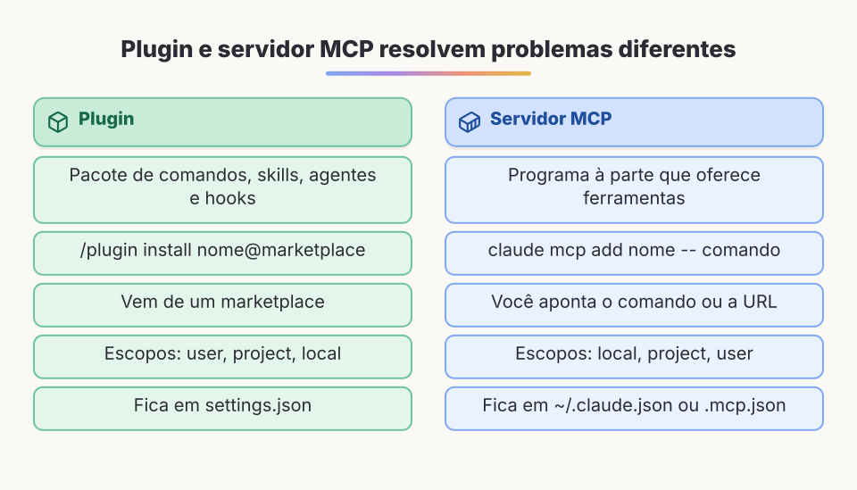

# 9. Claude Code no WSL

> 🗺️ **Neste capítulo:** você instala o Claude Code no Ubuntu do WSL **com o seu usuário** (nunca como root), conhece os comandos e atalhos de todo dia, os modos de permissão, os plugins e os MCPs, e deixa fixos o modo inicial e o idioma das respostas no `~/.claude/settings.json`. O `meu-ambiente` ganha um `CLAUDE.md` e um exemplo de configuração. · ⏱️ ~55 min

> 🔥 **Aquecimento:** (1) Por que o `backup.ps1` importa o clone com um nome que começa com `teste-`? (2) Uma distro importada abre como `root`. Qual arquivo e qual seção corrigem isso?
>
> <details>
> <summary>Ver resposta</summary>
>
> (1) Para o `--unregister` do script só poder apagar uma distro com esse prefixo, nunca a de verdade. (2) O `/etc/wsl.conf`, seção `[user]` com `default=`, e o usuário precisa existir (capítulo 8).
>
> </details>

## De onde paramos

No capítulo 8, você protegeu o ambiente com backup e provou que a restauração funciona. Agora vamos colocar um assistente de programação para trabalhar nele. O Claude Code trabalha no terminal: abre e altera os arquivos do projeto e executa comandos. Por isso, a forma de instalá-lo e as permissões que você concede pesam tanto quanto o próprio programa.

> ⚠️ **O que foi e o que não foi executado.** Instalei o Claude Code **de verdade** na distro de teste `wz-teste`, como usuário comum, e as saídas desta seção vêm dela (versão **2.1.332**). **Não executei** o que depende da sua conta: o login, a tela de confiança e tudo o que acontece **dentro** de uma sessão (`/mcp`, `/plugin`, o Shift+Tab). Para eles, o texto segue a documentação oficial e diz o que você deve ver.

## WSL ou Windows

Há versões do Claude Code para Windows e para Linux, e é possível ter **duas instalações** no mesmo computador: uma no Windows e outra dentro do Ubuntu.

**As duas instalações não se misturam: cada uma guarda o próprio login, as próprias configurações, os próprios MCPs e o próprio histórico.**

| | Claude Code no WSL | Claude Code no Windows |
| --- | --- | --- |
| Instalação | No Ubuntu, com `curl ... install.sh` | No Windows, com o instalador do Windows |
| Projetos | Em `~/projetos`, no disco do Linux | Em pastas do Windows (`C:\...`) |
| Ferramentas usadas | As do Linux: bash, git, nvm, uv | As do Windows |
| Sandbox | Disponível no WSL 2 | Indisponível |
| Indicado para | Projetos Linux, web, Python e Node | Aplicativos e instaladores do Windows |

A [documentação oficial](https://code.claude.com/docs/en/setup) diz que o *sandbox* (uma área isolada, de onde os comandos não alcançam o resto do sistema) funciona no WSL 2 e não no WSL 1, e que a instalação no WSL acontece **dentro do terminal do WSL**, e não pelo PowerShell. O livro adota a instalação do WSL, no Ubuntu que você montou.

**Pré-requisitos.** O Claude Code pede uma conta paga (Pro, Max, Ultra, Team, Enterprise ou Console; o plano gratuito do claude.ai não o inclui) e, no Linux, o Ubuntu 20.04 ou mais recente. O instalador nativo **dispensa o Node.js**: você só vai usar o Node (nvm, capítulo 6) e o `uv` em certos MCPs, mais adiante.

> ⚠️ **Erro comum:** entrar na conta e configurar MCPs e plugins no Windows esperando vê-los no Ubuntu. Eles não aparecem, porque cada instalação tem a sua configuração, e o que você ajusta numa não vale na outra.

## Instalar com o seu usuário

**A instalação nativa é um script que coloca o Claude Code na sua pasta pessoal (`~/.local/share/claude`) e cria o comando `claude` em `~/.local/bin`. Depois disso, ele se atualiza sozinho, em segundo plano.**

Tudo fica na sua pasta pessoal, então a instalação pertence ao **seu usuário** e dispensa `sudo`. O livro já recomendou ler um script antes de executá-lo com `curl | bash`, e vale aqui também: baixe, veja o que ele faz com `grep` e só então rode. No Ubuntu, com o prompt terminando em `$`:

```bash
# confirme que você NÃO é root (o prompt termina em $)
whoami
# baixa o script sem executá-lo, e mostra o que ele faz com rede e pastas
curl -fsSL https://claude.ai/install.sh -o ~/install.sh
grep -nE 'DOWNLOAD_BASE_URL=|DOWNLOAD_DIR=|sha256sum' ~/install.sh | head
```

```text
ana
38:DOWNLOAD_BASE_URL="https://downloads.claude.ai/claude-code-releases"
39:DOWNLOAD_DIR="$HOME/.claude/downloads"
181:        actual=$(sha256sum "$1" | cut -d' ' -f1)
```

O script baixa de `downloads.claude.ai`, guarda em pastas do seu `$HOME` e **confere o SHA-256** do que baixou contra o manifesto (a mesma ideia do capítulo 8). Se você preferir o atalho oficial, `curl -fsSL https://claude.ai/install.sh | bash` faz tudo numa linha. Agora execute o script baixado:

```bash
bash ~/install.sh
```

```text
  Version: 2.1.332

  Location: ~/.local/bin/claude

  Next: Run claude --help to get started

⚠ Setup notes:
  ● Native installation exists but ~/.local/bin is not in your PATH. Run:

    echo 'export PATH="$HOME/.local/bin:$PATH"' >> ~/.bashrc && source ~/.bashrc

✅ Installation complete!
```

(Mostrei só o final da saída, e o seu número de versão será outro.) O comando é um atalho para a versão real:

```bash
ls -l ~/.local/bin
du -sh ~/.local/share/claude
```

```text
lrwxrwxrwx 1 ana ana 46 Nov 27 02:46 claude ->
  /home/ana/.local/share/claude/versions/2.1.332
384M	/home/ana/.local/share/claude
```

São 384 MB na pasta do seu usuário, de modo que o `--export` do capítulo 8 também os leva.

### Se o `claude` não for encontrado: o `PATH`

O instalador avisou que `~/.local/bin` não estava no `PATH` (capítulo 6: a lista de pastas onde o bash procura comandos). Veja o que acontece de verdade, num shell comum e num shell de **login**. Quando você digita só `wsl` (ou abre o Ubuntu no Windows Terminal), o shell que abre é de login, e dá para conferir:

```bash
bash -c 'command -v claude || echo "claude: command not found"'
bash -lc 'command -v claude || echo "claude: command not found"'
```

```text
claude: command not found
/home/ana/.local/bin/claude
```

```bash
echo 'shopt -q login_shell && echo "shell de login"' | wsl -d wz-teste
```

```text
shell de login
```

O shell de login funcionou porque o `~/.profile` do Ubuntu acrescenta `~/.local/bin` ao `PATH` **quando a pasta existe**:

```text
24-# set PATH so it includes user's private bin if it exists
25:if [ -d "$HOME/.local/bin" ] ; then
26:    PATH="$HOME/.local/bin:$PATH"
27-fi
```

Por isso, no uso normal, basta **fechar e abrir o terminal** depois de instalar. Se mesmo assim der `command not found`, aplique a correção que o instalador sugeriu:

```bash
# acrescenta ~/.local/bin ao PATH de todo terminal novo
echo 'export PATH="$HOME/.local/bin:$PATH"' >> ~/.bashrc
source ~/.bashrc
claude --version
```

```text
2.1.332 (Claude Code)
```

O `claude doctor` faz um diagnóstico **só de leitura**, sem abrir sessão. Na distro de teste, sem login:

```bash
claude doctor
```

```text
Claude Code doctor

Running: native (2.1.332)
Platform: linux-x64
Config install method: native
Auto-updates: enabled
Auto-update channel: latest

API connectivity
- API (api.anthropic.com): answered HTTP 200 in 169 ms
- Sign-in (platform.claude.com): answered HTTP 200 in 177 ms

No installation issues found.
```

(Resumi a saída: ela traz mais linhas sobre login, que no teste não existia.) Ele também testa a conexão com os servidores da Anthropic, e aqui ela respondeu.

### Instalei como root por engano

O instalador **se protege**. Rodei-o com `sudo` como o usuário comum, e ele recusou:

```text
Error: do not run this installer with sudo.

Claude Code installs into your home directory and does not need root access.
With sudo, the installation would go into root's home directory instead of
yours, and the 'claude' command would not work from your own shell.

Please re-run the same command without sudo, e.g.:
    curl -fsSL https://claude.ai/install.sh | bash
```

Ou seja, o erro "instalei com `sudo`" não chega a acontecer com o script atual. O que ainda pode ocorrer é você estar **logado como root** (a distro importada do capítulo 8 abre assim) e instalar sem perceber: o programa vai para `/root/.local`, e o seu usuário não o enxerga. Confira o prompt: `#` é root. Para desfazer, como root, apague os mesmos caminhos da desinstalação oficial, mas dentro de `/root`, e instale de novo como o seu usuário:

```bash
# como root: remove o comando e as versões (só os dois caminhos do Claude)
rm -f /root/.local/bin/claude
rm -rf /root/.local/share/claude
exit
```

> ⚠️ **Erro comum:** usar `sudo` "para garantir". O instalador não precisa de privilégios. E, se você insistir com a variável que ele cita (`CLAUDE_INSTALL_ALLOW_SUDO=1`), o Claude Code fica no root, com permissão sobre o sistema inteiro.

## Login e a tela de confiança

> ⚠️ **Não executado:** o login depende da sua conta, e eu não coloquei credenciais na máquina de testes. **Nunca cole tokens ou senhas num chat, num script ou num repositório.** O que segue é o que a documentação diz.

Na primeira execução do `claude`, uma página de login se abre no navegador. No WSL, caso ela não apareça, copie o endereço mostrado no terminal e cole no navegador do Windows. Depois vem a **tela de confiança** (*"Is this a project you trust?"*), em que o Claude Code quer saber se pode ler, editar e executar arquivos na pasta atual.

- Dentro de uma **pasta de projeto** sua: responda **Yes, I trust this folder**.
- Na **pasta pessoal** (`/home/ana`) ou numa pasta desconhecida: responda **No, exit**.

Por esse motivo, abra o Claude Code **sempre numa pasta de projeto**, no disco do Linux (capítulo 4). Neste livro, ela é o `~/meu-ambiente`:

```bash
cd ~/meu-ambiente
claude
```

> ⚠️ **Erro comum:** iniciar o `claude` na pasta pessoal ou em `/mnt/c/...`. Na pasta pessoal, ele passa a enxergar tudo o que é seu (chaves SSH, backups, configurações); em `/mnt/c`, o trabalho fica lento e os problemas de permissão e de fim de linha voltam (capítulo 4).

## Comandos e atalhos

Na sessão, os comandos começam com `/`. Basta digitar `/` para listá-los. Estes são os principais, conferidos na [lista oficial](https://code.claude.com/docs/en/commands):

| Comando | Para que serve |
| --- | --- |
| `/init` | Gera um `CLAUDE.md` com o contexto do projeto |
| `/memory` | Abre os `CLAUDE.md` e a memória automática para edição |
| `/model` | Escolhe o modelo e o grava como padrão |
| `/plan` | Liga o modo de planejamento |
| `/context` | Exibe o que está ocupando a janela de contexto |
| `/compact` | Resume a conversa para abrir espaço no contexto |
| `/clear` | Abre uma conversa nova, de contexto vazio |
| `/resume` | Volta a uma conversa anterior |
| `/rewind` | Recua o código e a conversa até um ponto anterior |
| `/mcp` | Gerencia os servidores MCP |
| `/plugin` | Gerencia os plugins |
| `/permissions` | Regras do que ele pode fazer sem perguntar |
| `/config` | Abre as configurações |
| `/usage` | Uso do limite do seu plano |
| `/doctor` | Checa a instalação |
| `/exit` | Sai da sessão |

E os atalhos, da [página do modo interativo](https://code.claude.com/docs/en/interactive-mode):

| Tecla | Função |
| --- | --- |
| **Shift+Tab** | Alterna o modo de permissão (próxima seção) |
| **Esc** | Interrompe a resposta em andamento; o que já foi feito permanece |
| **Esc Esc** | Com a caixa vazia, abre o menu do `/rewind`; com texto, apaga o rascunho |
| **@** | Menciona um arquivo: `explique @verificar.sh` |
| **!** no início | Roda um comando do terminal e mostra a saída à sessão: `! git status` |

Fora da sessão, no bash, os comandos mais úteis são `claude -c` (retoma a última conversa da pasta), `claude doctor`, `claude mcp list` e `claude plugin list`.

> ⚠️ **Erro comum:** achar que o `/clear` só "limpa a tela". Na verdade, ele abre uma conversa **nova**, sem contexto; para ganhar espaço sem perder o fio da conversa, use o `/compact`.

### O `CLAUDE.md` do projeto

O `/init` cria um `CLAUDE.md`, arquivo que o Claude lê no começo de cada sessão para saber como o projeto funciona. Como o `/init` precisa de login, **não o executei**: escrevi à mão o `CLAUDE.md` que o `meu-ambiente` deve ter, curto e com o que o Claude não adivinharia (os comandos, as regras e as proibições):

<!-- project: meu-ambiente -->

**CLAUDE.md**

```markdown
# meu-ambiente

Repositório que monta e confere o meu ambiente de desenvolvimento no WSL.

## Comandos

- `./verificar.sh`: confere o lado Linux (um OK ou FALHA por teste)
- `./bootstrap.sh`: instala as ferramentas; pode rodar de novo
- `./backup-projetos.sh`: backup leve de `~/projetos` em `~/backups`
- No Windows: `verificar.ps1` e `backup.ps1` (PowerShell)

## Regras

- Os scripts devem continuar idempotentes: rodar duas vezes não estraga nada.
- Os `.sh` usam fim de linha LF (veja o `.gitattributes`).
- Os `.ps1` ficam sem acentos (o PowerShell 5.1 lê sem marcação como ANSI).
- Nunca guardar senhas, tokens ou chaves neste repositório.
- Nunca rodar `wsl --shutdown` nem `wsl --unregister` sem eu pedir.
```

A última regra importa: instruções no `CLAUDE.md` orientam o Claude, mas **não são uma barreira**. Quem barra ações são os modos de permissão, a seguir.

## Os modos de permissão

Um assistente que edita arquivos e executa comandos precisa de regras claras: quando age por conta própria e quando para para perguntar.

**O modo de permissão determina quais ações o Claude Code executa sem pedir a sua aprovação. O modo em vigor aparece no indicador logo abaixo da caixa de texto.**

Os valores, segundo a [documentação](https://code.claude.com/docs/en/permission-modes):

| Modo | Valor | Em resumo |
| --- | --- | --- |
| Manual | `default` | Lê sozinho; pergunta antes de editar ou executar |
| Aceitar edições | `acceptEdits` | Edita arquivos sem perguntar |
| Planejar | `plan` | Lê e propõe um plano; não edita |
| Automático | `auto` | Age sozinho, com um classificador vigiando as ações |
| Não perguntar | `dontAsk` | Modo sem perguntas, que nunca entra no Shift+Tab |
| Pular verificações | `bypassPermissions` | Sem nenhuma verificação |

No modo automático, um segundo modelo (o classificador) avalia cada ação e barra o que parece arriscado. Desde o Claude Code 2.1.283, no terminal, a sessão **já abre no automático**, se o modelo e a sua organização o permitirem; antes, ele só existia em alguns planos. Olhe o indicador ao abrir a sessão, em vez de presumir o modo.



A ordem do ciclo, segundo a documentação: se a sessão está no `auto`, o primeiro Shift+Tab leva ao `default`, e daí em diante `default` → `acceptEdits` → `plan` → (de volta ao `auto`). O `bypassPermissions` só entra no ciclo se a sessão foi aberta com ele.

> 💡 **Analogia:** imagine a autoescola. No modo manual, o instrutor libera cada manobra antes de você executá-la. Em aceitar edições, você passa as marchas e faz as curvas sozinho, mas consulta antes de entrar na avenida. Em planejar, os dois desenham o trajeto no mapa antes de ligar o carro. No automático, você conduz sozinho, mas o instrutor fica ao seu lado, com o pé no freio duplo (o classificador). A analogia tem um limite: esse freio duplo é um **modelo de IA**, que também erra; ele diminui o risco, mas não o elimina.

### Abrir num modo e fixar o modo inicial

Para abrir uma sessão já num modo, use a opção da linha de comando (o `--help` desta versão lista `--permission-mode <mode>`):

```bash
# abre no modo planejar
claude --permission-mode plan
```

Para que **toda** sessão abra num certo modo, use a chave `permissions.defaultMode` no arquivo de configurações do seu usuário, o `~/.claude/settings.json`. Segundo a documentação, a precedência é: opção da linha de comando, depois o `settings.json`, depois o padrão. O repositório guarda um modelo, que parte do modo manual e já está em português:

**claude/settings.exemplo.json**

```json
{
  "language": "portuguese",
  "permissions": {
    "defaultMode": "default"
  }
}
```

Para começar no automático, troque por `"auto"`; para planejar, `"plan"`. Mas há uma regra de segurança: `auto` e `bypassPermissions` **só valem no arquivo do usuário** (`~/.claude/settings.json`). Num `.claude/settings.json` de projeto, são ignorados, para que um repositório baixado da internet não possa ligar sozinho o modo que age sem perguntar.

**O modo que dispensa tudo.** O `bypassPermissions` executa sem nenhuma verificação. A documentação o reserva para ambientes isolados (contêineres ou máquinas virtuais sem internet) e informa que o Claude Code não abre assim como root. No Ubuntu do seu dia a dia, **não use**. Nem esse modo ignora tudo: as regras de negação (*deny*) continuam valendo.

> ⚠️ **Erro comum:** retomar uma conversa antiga (`claude -c` ou `/resume`) e não olhar o indicador do modo. Confira antes de pedir algo que mexe em muitos arquivos.

## O idioma das respostas

Em geral, o Claude responde no idioma em que você escreve. Para fixar o português, use a chave `language` do mesmo arquivo (a do modelo acima). De acordo com a documentação, o valor chega ao Claude **como uma instrução, sem validação**: qualquer nome de idioma é aceito, e um erro de digitação não gera aviso, só é entregue ao Claude do jeito que foi escrito. A chave não altera o idioma do Ubuntu (capítulo 5).

Na distro de teste, escrevi o arquivo com `defaultMode` em `plan` e conferi se o JSON está certo. O `settings.json` é **JSON estrito**: uma vírgula sobrando o estraga. Veja o `python3 -m json.tool` (que vem no Ubuntu) com um arquivo certo e um com defeito:

```bash
python3 -m json.tool ~/.claude/settings.json
echo '{ "language": "portuguese", }' > /tmp/ruim.json
python3 -m json.tool /tmp/ruim.json 2>&1 | tail -1
```

```text
{
    "language": "portuguese",
    "permissions": {
        "defaultMode": "plan"
    }
}
Illegal trailing comma before end of object: line 1 column 27 (char 26)
```

> ⚠️ **Erro comum:** deixar uma vírgula sobrando ou um comentário `//` no arquivo. Rode o `json.tool` depois de editar.

## Plugins

Os plugins levam ao Claude Code conjuntos prontos de comandos, skills (instruções especializadas), agentes, hooks e até MCPs. Eles chegam por **marketplaces**, catálogos que você cadastra uma única vez.

**Um plugin é um conjunto de extensões vindo de um marketplace. O escopo que você escolhe ao instalar define onde ele passa a valer.**

Os escopos, segundo a [documentação](https://code.claude.com/docs/en/discover-plugins):

| Escopo | Vale para | Fica em |
| --- | --- | --- |
| `user` (padrão) | todos os projetos deste Ubuntu | `~/.claude/settings.json` |
| `project` | todos que usam o repositório | `.claude/settings.json` (vai para o git) |
| `local` | só você, só neste repositório | `.claude/settings.local.json` |

Na sessão, `/plugin install commit-commands@claude-plugins-official` abre a tela de detalhes e deixa escolher o escopo. Fora da sessão, o `claude plugin ...` faz o mesmo, e foi o que eu pude testar. O marketplace oficial é adicionado sozinho na primeira sessão **interativa**; como não abri nenhuma, ele não existia, e a primeira tentativa falhou:

```bash
claude plugin install commit-commands@claude-plugins-official
```

```text
✘ Failed to install plugin "commit-commands@claude-plugins-official":
  Plugin "commit-commands" not found in marketplace
  "claude-plugins-official". Your local copy may be out of date —
  try `claude plugin marketplace update claude-plugins-official`.
```

O caminho manual, que a documentação também traz, é adicionar o marketplace e instalar:

```bash
claude plugin marketplace add anthropics/claude-plugins-official
claude plugin install commit-commands@claude-plugins-official
claude plugin list
```

```text
✔ Successfully added marketplace: claude-plugins-official
  (declared in user settings)
✔ Successfully installed plugin: commit-commands@claude-plugins-official
  (scope: user)
  ❯ commit-commands@claude-plugins-official
    Version: 1.0.1
    Scope: user
    Status: ✔ enabled
```

(Cortei as linhas de progresso e os plugins embutidos.) Repare no `~/.claude/settings.json` depois disso, que ficou assim:

```json
{
  "permissions": { "defaultMode": "plan" },
  "extraKnownMarketplaces": {
    "claude-plugins-official": {
      "source": {
        "source": "github",
        "repo": "anthropics/claude-plugins-official"
      }
    }
  },
  "language": "portuguese",
  "enabledPlugins": { "commit-commands@claude-plugins-official": true }
}
```

O escopo `user` realmente mora no `settings.json`, e o que os plugins fazem é lido de lá. **Leia o que um plugin traz antes de ligá-lo**: ele pode ter hooks (comandos que rodam sozinhos) e MCPs. O `commit-commands` traz só três comandos em Markdown, e eu os listei na pasta do plugin, sem hooks nem `.mcp.json`:

```bash
ls ~/.claude/plugins/cache/claude-plugins-official/commit-commands/*/commands
```

```text
clean_gone.md  commit-push-pr.md  commit.md
```

Para outros marketplaces, adicione-o antes (`/plugin marketplace add dono/repositorio`). Para ver, desligar ou remover: `/plugin`, aba **Installed**. Os plugins que você ativou no claude.ai também podem chegar ao WSL quando você entra com a mesma conta; eles aparecem com o sufixo `@synced` (não pude conferir, sem login).

> ⚠️ **Erro comum:** deixar ativos plugins que você não usa. Cada plugin ocupa espaço de contexto. Desligue os que não usa.

## MCPs

Os plugins entregam instruções prontas. Às vezes, porém, o Claude precisa de uma **ferramenta nova** de fato, como abrir um PDF ou se comunicar com um serviço externo.

**Um servidor MCP (*Model Context Protocol*) é um programa independente que dá ferramentas novas ao Claude Code. O cadastro é feito com `claude mcp add`, no bash, fora da sessão.**



O formato, para um servidor que roda como programa local, é `claude mcp add [opções] <nome> -- <comando> [argumentos]`. Tudo depois do `--` é o comando que inicia o servidor, passado sem mudanças. Para um servidor remoto: `claude mcp add --transport http <nome> <url>`. Os escopos (`--scope`):

- **local** (o padrão): só no projeto atual, em `~/.claude.json`;
- **project**: no projeto, para a equipe, num `.mcp.json` na raiz do repositório;
- **user**: em todos os seus projetos, em `~/.claude.json`.

Exemplo: o **Docling**, que converte PDF, DOCX e imagens para o Claude ler. Ele roda com o `uvx` (do `uv`, capítulo 6). Na distro de teste **não tenho o `uv`**, e isso virou a lição:

```bash
claude mcp add --scope user docling -- \
  uvx --python 3.12 --from docling-mcp docling-mcp-server
claude mcp get docling
```

```text
Added stdio MCP server docling with command:
  uvx --python 3.12 --from docling-mcp docling-mcp-server
  to user config
File modified: /home/ana/.claude.json

docling:
  Scope: User config (available in all your projects)
  Status: ✘ Failed to connect
  Issue: ENOENT: Executable not found in $PATH: "uvx"
  Type: stdio
  Command: uvx
```

O **registro foi feito**, e a **conexão falhou**: o comando `uvx` não existe nesta distro. O campo `Issue` diz o motivo, e é o primeiro lugar onde olhar. Quem fez o capítulo 6 tem o `uv`; instale-o e rode `claude mcp get docling` de novo (a primeira conexão baixa o pacote e demora). Depois do teste, desfiz o registro:

```bash
claude mcp remove docling -s user
```

```text
Removed MCP server docling from user config
```

> 💡 **Analogia:** o plugin é uma maleta de ferramentas preparada por outra pessoa e vendida numa loja (o marketplace), com manuais e, às vezes, uma máquina junto. O MCP é uma máquina separada, como uma serra de bancada ligada na tomada, que o pedreiro usa quando precisa. O escopo diz onde a maleta ou a máquina fica guardada: `user` é a sua maleta pessoal, `project` é o armário da obra e `local` é a sua gaveta, só naquela obra. A analogia falha porque a "tomada" do MCP também traz risco: **um servidor MCP executa um programa no seu computador** (stdio) ou conversa com um serviço externo (http), e um servidor que traz conteúdo da internet pode carregar instruções escondidas (*prompt injection*). Cadastre apenas servidores em que você confia.

> ⚠️ **Erro comum:** cadastrar um MCP cujo comando não existe no Linux. O cadastro dá certo e a conexão falha, como no exemplo acima. Verifique com `claude mcp get <nome>`.

## O projeto: o `meu-ambiente` com o Claude

O projeto ganha três coisas neste capítulo: o `CLAUDE.md` (acima), o modelo `claude/settings.exemplo.json` (acima) e um teste novo no `verificar.sh`, que confere se o Claude Code está instalado **como usuário**.

Eis o `verificar.sh` inteiro (o novo é o teste `claude_ok`, que usa o caminho do instalador, e a linha `checa` dele no fim):

**verificar.sh**

```bash
#!/usr/bin/env bash
# Confere, do lado Linux, se o ambiente está montado.
falhas=0

# roda o teste que vem depois da descrição; mostra OK ou FALHA
checa() {
  descricao=$1
  shift
  if "$@" > /dev/null 2>&1; then
    echo "OK    $descricao"
  else
    echo "FALHA $descricao"
    falhas=$((falhas + 1))
  fi
}

# o nome do kernel do WSL 2 termina assim
assinatura='microsoft-standard-WSL2'

# cada teste é uma função que devolve sucesso ou falha
eh_ubuntu() { grep -q '^ID=ubuntu' /etc/os-release; }
kernel_wsl2() { uname -r | grep -q "$assinatura"; }
proc_microsoft() { grep -qi microsoft /proc/version; }
usuario_comum() { [ "$(id -u)" -ne 0 ]; }
no_grupo_sudo() { id -nG | grep -qw sudo; }
systemd_ativo() { [ "$(ps -p 1 -o comm=)" = systemd ]; }
repo_existe() { git -C ~/meu-ambiente rev-parse --is-inside-work-tree; }
# o .gitattributes existe e este script não tem CRLF (o bash não o leria)
lf_fixo() {
  [ -f ~/meu-ambiente/.gitattributes ] && ! grep -q "$(printf '\r')" "$0"
}
# o link do Starship aponta para o repositório e o .bashrc carrega o bashrc.meu
dotfiles_ligados() {
  alvo=~/meu-ambiente/dotfiles/starship.toml
  [ "$(readlink ~/.config/starship.toml)" = "$alvo" ] &&
    grep -q 'dotfiles/bashrc.meu' ~/.bashrc
}
# um shell interativo novo carrega o bashrc.meu, que liga o nvm e o SDKMAN
ferramentas_ok() {
  bash -ic 'node --version && java -version && uv --version'
}
# o instalador nativo põe o comando em ~/.local/bin, sem sudo
claude_ok() { "$HOME/.local/bin/claude" --version; }

checa "distribuição é o Ubuntu" eh_ubuntu
checa "kernel do WSL 2" kernel_wsl2
checa "/proc/version cita microsoft" proc_microsoft
checa "usuário comum, não root" usuario_comum
checa "usuário no grupo sudo" no_grupo_sudo
checa "systemd é o processo 1" systemd_ativo
checa "~/meu-ambiente é um repositório git" repo_existe
checa ".gitattributes presente e scripts com LF" lf_fixo
checa "dotfiles ligados (starship e .bashrc)" dotfiles_ligados
checa "node, java e uv respondem num shell novo" ferramentas_ok
checa "Claude Code instalado como usuário" claude_ok

echo "---"
if [ "$falhas" -eq 0 ]; then
  echo "Tudo certo: este ambiente está montado."
else
  echo "$falhas teste(s) falharam."
  exit 1
fi
```

Rodei o `verificar.sh` na distro de teste. Ela é **enxuta de propósito** (não tem as ferramentas do capítulo 6, nem o repositório e os dotfiles montados), então alguns testes dos capítulos 3 a 6 falham. Abaixo estão só as seis últimas linhas de teste, e a que importa é a nova:

```text
OK    systemd é o processo 1
FALHA ~/meu-ambiente é um repositório git
OK    .gitattributes presente e scripts com LF
FALHA dotfiles ligados (starship e .bashrc)
FALHA node, java e uv respondem num shell novo
OK    Claude Code instalado como usuário
---
3 teste(s) falharam.
```

No **seu** Ubuntu, com o ambiente completo, os onze testes devem dar `OK`. Faça o commit em `~/meu-ambiente`: `git add -A` e `git commit -m "claude: CLAUDE.md, modelo de settings e teste de instalação"`.

> ⚠️ **Executado** na distro de teste `wz-teste` (Ubuntu 26.04.1, Claude Code 2.1.332): instalação, `doctor`, a recusa do `sudo`, `settings.json`, marketplace e plugin, MCP. **Não executado:** login, tela de confiança, `/init`, qualquer comando dentro da sessão (`/mcp`, `/plugin`) e o Shift+Tab, porque dependem da sua conta. Para eles, valem as páginas oficiais citadas.

## 🏋️ Pratique

**1. Exemplo resolvido.** O `claude` dá `command not found` logo depois de instalar. Em que ordem você investiga?

<details>
<summary>Ver resposta</summary>

(1) Feche e abra o terminal: o `~/.profile` acrescenta `~/.local/bin` ao `PATH` quando a pasta existe. (2) Se ainda falhar, `ls ~/.local/bin/claude`: se o arquivo existe, o problema é o `PATH`; aplique a linha do `~/.bashrc` e rode `source ~/.bashrc`. (3) Se o arquivo **não** existe, confira o prompt: se era `#` (root), a instalação foi para `/root/.local`.

</details>

**2. Complete.** Escreva um `~/.claude/settings.json` que abre toda sessão no modo **planejar** e responde em português.

```json
{
  "___": "portuguese",
  "permissions": {
    "___": "plan"
  }
}
```

<details>
<summary>Ver resposta</summary>

```json
{
  "language": "portuguese",
  "permissions": {
    "defaultMode": "plan"
  }
}
```

Teste: `python3 -m json.tool ~/.claude/settings.json` imprime o JSON formatado, sem erro. Se você pusesse `"defaultMode": "auto"` num `.claude/settings.json` de **projeto**, o valor seria ignorado: só vale no arquivo do usuário.

</details>

**3. Faça sozinho.** Você quer o Docling apenas no projeto `~/projetos/relatorios`, e não em todos. Que comando usar, de que pasta, e onde ele fica guardado? Como verificar?

<details>
<summary>Ver resposta</summary>

Se você omite o `--scope`, vale o `local`, restrito ao projeto atual. Entre na pasta e rode `claude mcp add docling -- uvx --python 3.12 --from docling-mcp docling-mcp-server`. O registro vai para o `~/.claude.json`, preso a esse projeto. Verifique com `claude mcp get docling` na pasta; em outra pasta, o `claude mcp list` não o mostra. Critérios: (1) rodou de dentro da pasta; (2) não usou `--scope user`.

</details>

**4. Desafio.** Um repositório que você baixou traz um `.claude/settings.json` com `"defaultMode": "bypassPermissions"` e um `.mcp.json` com um servidor que você não conhece. O que você faz antes de abrir o `claude` nele?

<details>
<summary>Ver resposta</summary>

O `bypassPermissions` do projeto é ignorado (só vale no arquivo do usuário), mas o aviso fica: o repositório **tenta** abrir sem verificação. O `.mcp.json` é o risco real: leia o comando e a URL, pesquise o servidor e só aprove se confiar. Responda **No** à tela de confiança se não conhece o projeto, e abra em modo manual (`claude --permission-mode default`). Critérios: (1) lê os arquivos antes; (2) não confia por padrão; (3) usa o modo manual.

</details>

**Arquivos do projeto ao fim do capítulo:** em `~/meu-ambiente`, tudo do capítulo 8 mais `CLAUDE.md` e `claude/settings.exemplo.json`; o `verificar.sh` passa a ter 11 testes. **Comando que confere:** `./verificar.sh` termina com "Tudo certo".

## 🧠 Revisão rápida

1. Por que o Claude Code do Windows e o do WSL não compartilham login nem MCPs?
2. Como o instalador reage a `sudo`, e por que isso é bom?
3. Que valor de `defaultMode` corresponde ao modo manual?
4. Onde ficam um plugin de escopo `user` e um MCP de escopo `user`?
5. (Capítulo 8) Que arquivo faz uma distro importada abrir com o seu usuário?

<details>
<summary>Ver respostas</summary>

1. Porque são duas instalações independentes, cada uma com a sua pasta de configuração.
2. Ele recusa e explica que, com `sudo`, tudo iria para a pasta do root. É bom porque o Claude Code no root teria permissão sobre o sistema inteiro.
3. `default` (e `manual` só como apelido na linha de comando).
4. O plugin em `~/.claude/settings.json`; o MCP em `~/.claude.json`.
5. O `/etc/wsl.conf`, seção `[user]` com `default=`.

</details>

## 🤖 Estude com um tutor de IA

- "Faça-me 5 perguntas sobre instalar o Claude Code no WSL, modos de permissão, plugins e MCPs, uma de cada vez. Espere a minha resposta antes de dar o retorno e não me dê as respostas antes."
- "Esta é a minha resposta ao exercício 4: [minha resposta]. Aponte os meus erros sem me dar a solução."

> ➡️ **Próximo passo:** com o Claude Code instalado e sob controle, resta usá-lo num projeto de verdade, do início ao fim. O capítulo 10 constrói um app com o fluxo do Spec Kit e encerra o livro restaurando tudo num ambiente novo.

## 📌 Resumo

| Item | Em uma frase |
| --- | --- |
| WSL × Windows | Duas instalações separadas; use a do WSL nos projetos Linux |
| `install.sh` | Instala com o seu usuário em `~/.local`; recusa `sudo` e confere o SHA-256 |
| `PATH` | Terminal novo basta; senão, `~/.local/bin` no `~/.bashrc` |
| `claude doctor` | Diagnóstico só de leitura, sem abrir sessão |
| Tela de confiança | Confie só em pastas de projeto |
| `CLAUDE.md` | Contexto e regras do projeto; orienta, mas não é barreira |
| Modos | `default`, `acceptEdits`, `plan`, `auto`; Shift+Tab alterna |
| `permissions.defaultMode` | Fixa o modo inicial; `auto` e `bypassPermissions` só no arquivo do usuário |
| `language` | Fixa o idioma das respostas; é apenas uma instrução |
| Plugin | Pacote de um marketplace; escopo `user`, `project` ou `local` |
| MCP | Programa à parte com ferramentas; `claude mcp add`; veja o campo `Issue` |

## 📚 Fontes

- [Configuração avançada: requisitos, WSL e instalação](https://code.claude.com/docs/en/setup) (conferido em 27/11/2026)
- [Modos de permissão](https://code.claude.com/docs/en/permission-modes) (27/11/2026)
- [Comandos](https://code.claude.com/docs/en/commands) e [modo interativo](https://code.claude.com/docs/en/interactive-mode) (27/11/2026)
- [Referência de configurações](https://code.claude.com/docs/en/settings-reference) (27/11/2026)
- [Plugins](https://code.claude.com/docs/en/discover-plugins) (27/11/2026)
- [MCP](https://code.claude.com/docs/en/mcp) (27/11/2026)
- Execuções: Claude Code 2.1.332 na distro de teste Ubuntu 26.04.1, 27/11/2026.

> 🔁 **Revise hoje:** 4, 6, 8

<!-- nav:start -->
---

[◀ Capítulo anterior](08-backup-e-restauracao.md) · [Mapa do livro](../README.md) · [Próximo capítulo ▶](10-projeto-final-um-app-com-spec-kit.md)
<!-- nav:end -->
