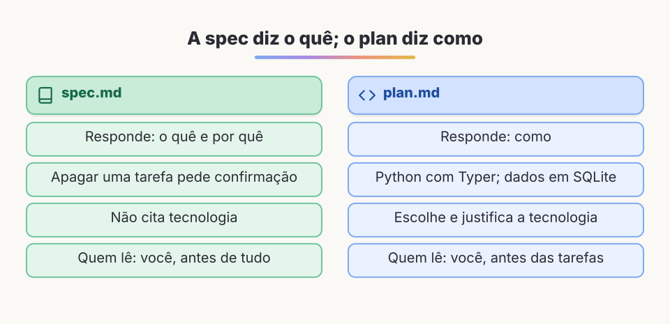
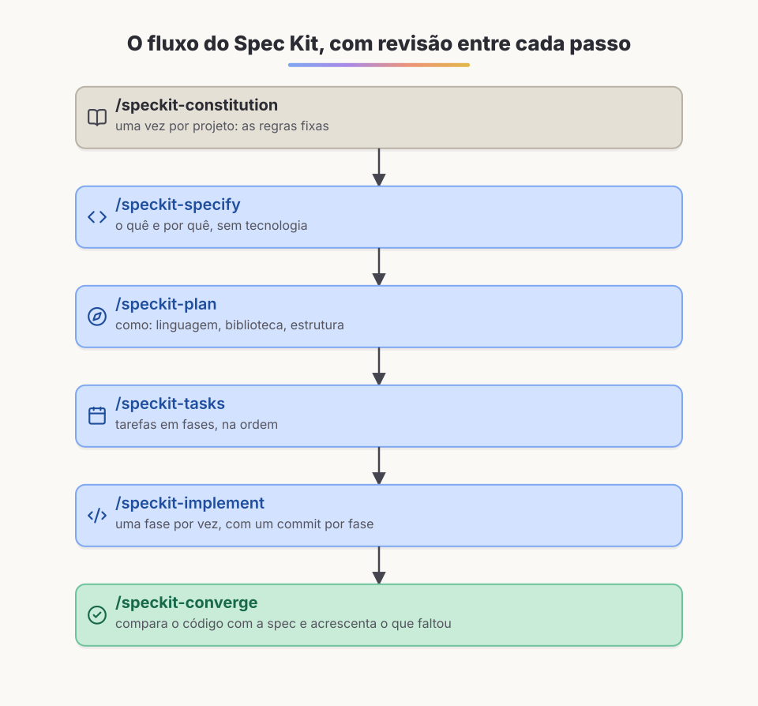
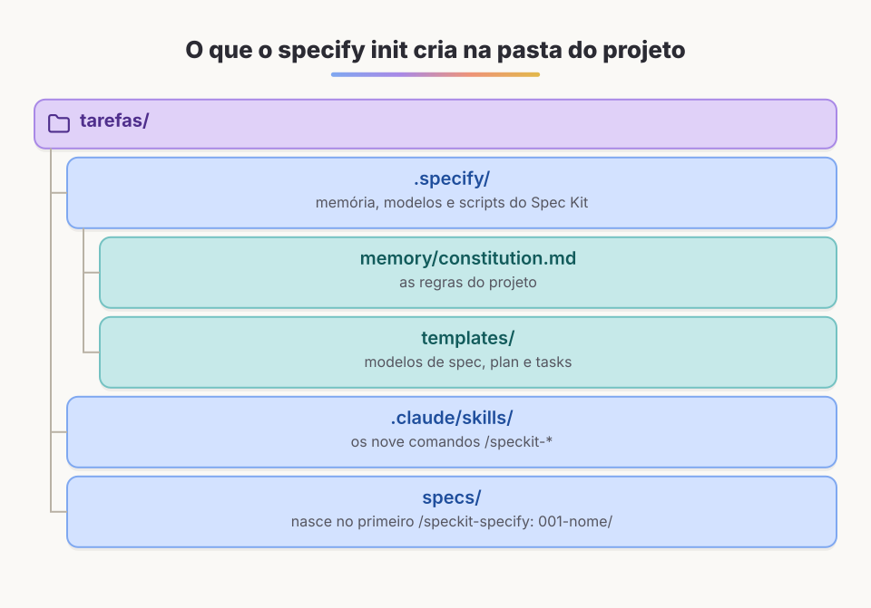

# 10. Projeto final: um app com Spec Kit

> 🗺️ **Neste capítulo:** é o projeto final. Você instala o Spec Kit, monta com o Claude Code um app de lista de tarefas para o terminal (especificar, planejar, dividir em tarefas, implementar e convergir) e **prova o ambiente todo** ao restaurá-lo do zero a partir do repositório `meu-ambiente`. · ⏱️ ~70 min

> 🔥 **Aquecimento:** (1) Onde fica o `permissions.defaultMode` que faz toda sessão abrir no modo planejar? (2) Por que o instalador do Claude Code recusa o `sudo`?
>
> <details>
> <summary>Ver resposta</summary>
>
> (1) No `~/.claude/settings.json` do seu usuário. (2) Porque, com `sudo`, tudo iria para a pasta do root, e o Claude Code no root teria permissão sobre o sistema inteiro (capítulo 9).
>
> </details>

## De onde paramos

No capítulo 9, você instalou o Claude Code com o seu usuário e viu como controlar o que ele faz por conta própria. Falta aplicá-lo a um projeto de verdade. Se você pede "faça um app de tarefas" numa só frase, o resultado costuma sair sem revisão e sem que ninguém consiga explicá-lo. Aqui você vê uma forma organizada de trabalhar com o assistente, e o livro termina com a prova de que o ambiente que você montou pode ser refeito do zero.

> ⚠️ **O que foi e o que não foi executado.** Instalei o Spec Kit **de verdade** na distro de teste (versão **1.4.5**) e rodei o `specify init`, de modo que a árvore de arquivos e os nomes dos comandos vêm da execução real. **Não executei** os comandos `/speckit-*`: eles rodam **dentro** do Claude Code e exigem o login na sua conta. Por isso, a implementação do app que mostro é uma **implementação de referência, escrita por mim** e testada; ela **não** foi gerada pelo Claude. O que o Claude gera na sua sessão será diferente, e você pode usar os testes da referência como critério de aceitação.

## Spec-Driven Development e o Spec Kit

Ao pedir código direto a um assistente, você o obriga a adivinhar o que você quer, qual tecnologia usar e em que ordem agir. Cada palpite errado só vira problema quando o código já existe, e aí consertar sai caro.

**Spec-Driven Development (SDD, desenvolvimento guiado por especificação) é começar escrevendo o que o programa deve fazer, depois o modo de fazer, depois a lista de tarefas, e só no fim o código. O Spec Kit, do GitHub, reúne as ferramentas que viram isso em comandos para o assistente.**

A regra de ouro é manter duas perguntas separadas:



Toda etapa produz um arquivo Markdown no projeto. Você o lê, corrige e só depois avança. Se o Claude errar na especificação, o conserto é uma frase, e não cem linhas de código.



> 💡 **Analogia:** pense numa agência de viagens. Suas regras permanentes ("sem voo de madrugada, com seguro-viagem sempre") formam a constitution. O pedido ("dez dias de praia em julho, levando as crianças") é a spec: ela diz o que você deseja, sem escolher a companhia aérea. A agência responde com o roteiro de voos e hotéis (o plan), depois com a lista de reservas, na ordem (as tasks), e então reserva tudo (o implement). Ao final, alguém compara as passagens com o pedido original (o converge). A analogia tem um limite: numa agência de verdade, há uma pessoa responsável; aqui o responsável pelo resultado **é você**, que lê cada arquivo antes de seguir.

> ⚠️ **Erro comum:** escrever tecnologia na especificação ("um app em Python que..."). Assim as duas perguntas se confundem e o plan perde a chance de discutir a escolha. Na spec, conte o comportamento; deixe Python, Typer e SQLite para o plan.

## Instalar o Specify CLI

O Spec Kit se divide em duas partes: o **Specify CLI**, um programa de terminal (`specify`) que organiza a pasta do projeto, e os **comandos** `/speckit-*`, que o CLI coloca dentro do projeto para você usar no Claude Code.

Quase tudo de que você precisa já veio do livro: **Python 3.11 ou superior** e o **uv** (capítulo 6), o **git** (capítulo 6) e o **Claude Code** (capítulo 9). Verifique:

```bash
python3 --version
uv --version
git --version
```

```text
Python 3.14.4
uv 0.13.10 (x86_64-unknown-linux-gnu)
git version 2.53.0
```

**O `uv tool install` coloca um programa Python num ambiente só dele e cria o comando em `~/.local/bin`, sem alterar o Python do sistema e sem `sudo`.**

```bash
uv tool install specify-cli
specify version
```

```text
Installed 1 executable: specify
...
CLI Version    1.4.5
Python         3.14.4
Platform       Linux
```

(Cortei as linhas de instalação das dependências e o desenho de boas-vindas.) O `specify check` procura os agentes instalados, e o Claude Code, que você instalou no capítulo 9, aparece:

```bash
specify check
```

```text
Check Available Tools
├── ● Antigravity (not found)
...
├── ● Claude Code (available)
├── ○ Cline (no CLI required)
```

(A lista é longa; deixei só as linhas relevantes.) Para **fixar** uma versão, a documentação oficial indica instalar a partir do repositório, com a tag da versão (`uv tool install specify-cli --from git+https://github.com/github/spec-kit.git@v1.4.5`). Eu **não executei** essa forma. Como o Spec Kit publica versões quase toda semana, consulte a lista em [github.com/github/spec-kit/releases](https://github.com/github/spec-kit/releases) antes de escolher uma.

> ⚠️ **Erro comum:** rodar `uv tool install specify-cli` de novo esperando atualizar. Para atualizar, use `specify self upgrade` (seção "Extensões e atualização").

## `specify init`: criar o projeto

**O `specify init` monta numa pasta a estrutura do Spec Kit, com regras, modelos, scripts e os comandos do agente que você escolher em `--integration`.**

```bash
cd ~/projetos
specify init tarefas --integration claude
cd tarefas
```

```text
Next Steps
1. Go to the project folder: cd tarefas
2. Start Claude in this project directory; spec-kit skills were installed
   to .claude/skills
3. Start using skills with your coding agent:
   3.1 /speckit-constitution - Establish project principles
   3.2 /speckit-specify - Create baseline specification
   3.3 /speckit-plan - Create implementation plan
   3.4 /speckit-tasks - Generate actionable tasks
   3.5 /speckit-implement - Execute implementation
   3.6 /speckit-converge - Assess the codebase and append remaining
       work as tasks
```

(Mostrei o quadro "Next Steps", que vem logo depois das mensagens de progresso.) Se a pasta já existe, `specify init --here --integration claude` usa a pasta atual; se ela já tiver arquivos, o init avisa e pede confirmação (`--force` pula a pergunta). Sem o `--integration`, o init pergunta qual agente usar.

> ⚠️ **Erro comum:** executar `specify init --here --force` numa pasta com trabalho sem salvar. Ele mistura os arquivos dele com os seus; faça um commit antes, para enxergar depois o que mudou com `git diff`. Além disso, tutoriais antigos usam `--ai claude`: prefira `--integration claude`, que é a forma dos exemplos desta versão.

### O que é criado



A árvore real, até dois níveis de profundidade:

```text
.claude/skills/speckit-{analyze,checklist,clarify,constitution,converge,
                        implement,plan,specify,tasks}/
.specify/.gitignore
.specify/init-options.json
.specify/integration.json
.specify/memory/constitution.md
.specify/scripts/bash/
.specify/templates/{checklist,constitution,plan,spec,tasks}-template.md
.specify/workflows/
```

(Resumi a lista com chaves, que é notação do shell, e não nomes de arquivo.) Cada pasta `speckit-*` guarda um `SKILL.md`, o roteiro que o Claude lê quando você digita o comando. O cabeçalho do `speckit-specify`:

```text
---
name: "speckit-specify"
description: "Create or update the feature specification from a natural
  language feature description."
argument-hint: "Describe the feature you want to specify"
```

O `constitution.md` nasce como **modelo**, cheio de marcadores como `[PROJECT_NAME]` e `[PRINCIPLE_1_NAME]`: é o `/speckit-constitution` que os preenche. E o `init-options.json` registra a escolha, incluindo `"integration": "claude"`, `"script": "sh"` (bash, no Linux) e `"speckit_version": "1.4.5"`.

> 💡 **Analogia:** imagine um fichário escolar novo. A folha de rosto, com o regulamento da escola, é o `constitution.md`. As folhas pautadas do fundo são os `templates/`. As abas coloridas que marcam cada seção são os comandos em `.claude/skills/`. Já as divisórias de cada matéria (`specs/001-...`, `specs/002-...`) só surgem quando você começa a estudar a primeira. A analogia falha porque um fichário não se atualiza e o Spec Kit sim (`specify integration upgrade`); por isso, olhe o que mudou com `git diff`.

### O `init` não cria o repositório git

Conferi: logo depois do `specify init`, o `git status` na pasta responde `fatal: not a git repository`. Guarde o ponto de partida **antes** de o Claude escrever código:

```bash
git init -b main
git add -A
git commit -m "Spec Kit inicial"
```

O `.specify/.gitignore` já deixa de fora o que pertence só à sua máquina (como o `feature.json`, que aponta a funcionalidade ativa).

## Os comandos `/speckit-*`

Os comandos do Spec Kit não rodam no terminal comum: são **skills** do Claude Code. Digite-os **na sessão do `claude`**; o que vem depois do comando é a instrução que você passa ao assistente.

**No Claude Code, os comandos têm o formato `/speckit-<etapa>`, com hífen; a versão com ponto (`/speckit.specify`) aparece em páginas de referência e em outros agentes.** A saída do `init` acima confirma os nomes com hífen, e o `specify integration list` mostra a integração pronta:

```text
Key     Name         Status      CLI Required  Safe
claude  Claude Code  installed   yes           yes
Default integration: claude
Installed integrations: claude
```

| Comando | Quando usar | Produz |
| --- | --- | --- |
| `/speckit-constitution` | Uma vez por projeto: regras fixas (testes, idioma, limites) | `constitution.md` |
| `/speckit-specify` | O que fazer e por quê, sem tecnologia | `spec.md` |
| `/speckit-clarify` | Resolver dúvidas antes do plano (opcional) | `spec.md` atualizado |
| `/speckit-plan` | Como: linguagem, bibliotecas, banco, estrutura | `plan.md` e arquivos de apoio |
| `/speckit-checklist` | Checar a qualidade dos requisitos (opcional) | `checklists/` |
| `/speckit-tasks` | Dividir o plano em tarefas, em ordem e por fases | `tasks.md` |
| `/speckit-analyze` | Verificar se spec, plan e tasks combinam (opcional) | Relatório |
| `/speckit-implement` | Executar as tarefas do `tasks.md` | Código |
| `/speckit-converge` | Comparar o código com a spec e acrescentar o que faltou como tarefas | `tasks.md` atualizado |

Quais são opcionais, e onde entram, vem do quadro "Enhancement Skills" que o próprio `init` imprimiu: `clarify` antes do `plan`, `checklist` depois do `plan`, `analyze` depois do `tasks` e antes do `implement`.

O **fluxo curto** serve a funcionalidades pequenas: `specify` → `plan` → `tasks` → `implement` → `converge`. O **fluxo completo** é para o que tem peso, com a `constitution` uma vez e mais três verificações (`clarify`, `checklist`, `analyze`). Repita `implement` e `converge` até o converge informar que convergiu.

> ⚠️ **Erro comum:** digitar `/speckit-specify` no bash, que responde que o comando não existe. Os `/speckit-*` vão na caixa de texto do Claude Code; no terminal comum, só rodam os comandos `specify ...`.

## O projeto guiado: tarefas no terminal

Vamos ao projeto, passo a passo: um app de lista de tarefas para a linha de comando, escrito em Python com **Typer** (uma biblioteca que cria comandos de terminal), **SQLite** (um banco de dados que vive num arquivo) e **pytest** (testes). Os passos 2 a 8 ocorrem dentro do Claude Code, com a sua conta, e **não foram executados** por mim. Os pedidos a seguir são os que você deve digitar.

**1. Criar o projeto e o repositório** (no bash): rode o `specify init`, o `git init` e o primeiro commit, como mostrado antes. Depois, abra o `claude` em `~/projetos/tarefas` e confie na pasta (capítulo 9). Ao digitar `/speckit`, a lista deve trazer os nove comandos.

**2. Constitution (uma vez):**

```text
/speckit-constitution App de linha de comando simples e offline.
Princípios: código legível, testes obrigatórios para cada funcionalidade,
sem dependências desnecessárias, mensagens ao usuário em português,
código em inglês.
```

Abra o `.specify/memory/constitution.md` e veja se as regras refletem o que você quer: todas as etapas seguintes serão julgadas por elas.

**3. Specify: o que fazer, sem tecnologia:**

```text
/speckit-specify O usuário pode adicionar, listar, concluir e apagar
tarefas pelo terminal. Cada tarefa tem título, data de criação e
prioridade (alta, média, baixa). A lista pode ser filtrada por
prioridade e por status. Os dados ficam salvos entre execuções.
Critérios: apagar pede confirmação; título vazio é recusado com
uma mensagem clara.
```

O comando cria `specs/001-<nome-curto>/` com o `spec.md`. Leia as histórias e os requisitos. Os trechos marcados como dúvida são perguntas que ele preferiu não adivinhar.

**4. Clarify (opcional):** o `/speckit-clarify` faz perguntas para esclarecer pontos ambíguos (por exemplo, se uma tarefa concluída pode voltar para pendente) e anota as respostas na spec.

**5. Plan: como:**

```text
/speckit-plan Python 3.11 ou mais novo, com Typer para a linha de
comando, SQLite (biblioteca padrão) para salvar os dados e pytest
para os testes. Projeto gerenciado com uv. Estrutura em src/ e tests/.
```

Revise o `plan.md`. É aqui que se discute tecnologia.

**6. Checklist, tasks e analyze:** `/speckit-checklist`, `/speckit-tasks` e `/speckit-analyze`. O `tasks` produz o `tasks.md`, dividido em fases. O `analyze` apenas lê e aponta conflitos; se achar algum, volte à etapa responsável (specify, plan ou tasks) e corrija nela. **Leia o `tasks.md` por inteiro antes de continuar**: ele é o roteiro exato que o Claude vai seguir.

**7. Implement por fases, com um commit em cada uma:**

```text
/speckit-implement Execute apenas a primeira fase e pare.
```

Quando ele parar, revise e salve a fase no terminal (o `!` no começo permite rodar o comando sem sair do Claude Code):

```bash
# os testes do projeto passam?
uv run pytest
# guarda a fase: se a próxima der errado, você volta a este ponto
git add -A
git commit -m "Fase 1: setup"
```

Continue fase após fase, sempre testando e commitando ao terminar.

**8. Converge:** o `/speckit-converge` confronta o código com a spec, o plan e as tasks. Se algo ficou faltando, ele acrescenta tarefas ao `tasks.md` (sem tocar no código); rode o `/speckit-implement` outra vez e repita até o converge informar que convergiu.

**9. A próxima funcionalidade** (por exemplo, uma data de vencimento) volta ao passo 3, com um novo `/speckit-specify`: a constitution continua valendo.

> ⚠️ **Erro comum:** disparar o `/speckit-implement` sem limites em um projeto grande. O Claude tenta resolver tudo de uma só vez, o contexto transborda e a revisão fica difícil. Implemente uma fase de cada vez.

### A implementação de referência

Como eu não pude pôr o Claude para trabalhar, escrevi à mão o app que **esse** pedido descreve, para ter um padrão conhecido: se o seu resultado se comportar como este, está no caminho. Ele fica em `exemplos/tarefas/` do `meu-ambiente`. São três arquivos de código e um de testes.

<!-- project: meu-ambiente -->

**exemplos/tarefas/pyproject.toml**

```toml
# O comando "tarefas" nasce de [project.scripts]; o uv instala e roda
[project]
name = "tarefas"
version = "0.1.0"
description = "Lista de tarefas no terminal"
requires-python = ">=3.11"
dependencies = ["typer>=0.12"]

[project.scripts]
tarefas = "tarefas.cli:app"

[dependency-groups]
dev = ["pytest>=8"]

[build-system]
requires = ["hatchling"]
build-backend = "hatchling.build"

[tool.hatch.build.targets.wheel]
packages = ["src/tarefas"]
```

**`exemplos/tarefas/src/tarefas/__init__.py`**

```python
"""Lista de tarefas no terminal."""
```

**exemplos/tarefas/src/tarefas/db.py**

```python
"""Storage for the tasks: one SQLite file, standard library only."""
import sqlite3  # vem com o Python: nenhuma dependência extra
from datetime import date

PRIORITIES = ("alta", "media", "baixa")


def connect(path):
    conn = sqlite3.connect(path)
    conn.row_factory = sqlite3.Row
    conn.execute(
        "CREATE TABLE IF NOT EXISTS tasks ("
        " id INTEGER PRIMARY KEY AUTOINCREMENT,"
        " title TEXT NOT NULL,"
        " priority TEXT NOT NULL,"
        " created TEXT NOT NULL,"
        " done INTEGER NOT NULL DEFAULT 0)"
    )
    return conn


def add_task(conn, title, priority="media"):
    title = title.strip()
    if not title:
        raise ValueError("O título não pode ser vazio.")
    if priority not in PRIORITIES:
        raise ValueError(f"Prioridade inválida: {priority}.")
    cur = conn.execute(
        "INSERT INTO tasks (title, priority, created) VALUES (?, ?, ?)",
        (title, priority, date.today().isoformat()),
    )
    conn.commit()
    return cur.lastrowid


def list_tasks(conn, priority=None, done=None):
    sql, args = "SELECT * FROM tasks WHERE 1=1", []
    if priority:
        sql += " AND priority = ?"
        args.append(priority)
    if done is not None:
        sql += " AND done = ?"
        args.append(int(done))
    return conn.execute(sql + " ORDER BY id", args).fetchall()


def complete_task(conn, task_id):
    cur = conn.execute("UPDATE tasks SET done = 1 WHERE id = ?", (task_id,))
    conn.commit()
    return cur.rowcount == 1


def delete_task(conn, task_id):
    cur = conn.execute("DELETE FROM tasks WHERE id = ?", (task_id,))
    conn.commit()
    return cur.rowcount == 1
```

Note os `?` nas consultas: os valores nunca são colados no texto do SQL, e isso evita a injeção de SQL.

**exemplos/tarefas/src/tarefas/cli.py**

```python
"""Command line: tarefas adicionar | listar | concluir | apagar."""
import os
from pathlib import Path
from typing import Optional

import typer

from tarefas import db

app = typer.Typer(help="Lista de tarefas no terminal.")


def _conn():
    # TAREFAS_DB deixa os testes usarem um arquivo temporário
    path = os.environ.get("TAREFAS_DB", Path.home() / ".tarefas.db")
    return db.connect(path)


@app.command("adicionar")
def add(titulo: str, prioridade: str = "media"):
    """Adiciona uma tarefa."""
    try:
        task_id = db.add_task(_conn(), titulo, prioridade)
    except ValueError as erro:
        typer.echo(f"Erro: {erro}", err=True)
        raise typer.Exit(1)
    typer.echo(f"Tarefa {task_id} adicionada.")


@app.command("listar")
def list_(
    prioridade: Optional[str] = None,
    pendentes: bool = False,
    concluidas: bool = False,
):
    """Lista as tarefas, com filtros por prioridade e por status."""
    done = False if pendentes else True if concluidas else None
    for t in db.list_tasks(_conn(), prioridade, done):
        mark = "x" if t["done"] else " "
        typer.echo(f"{t['id']:>3} [{mark}] {t['priority']:<5} {t['title']}")


@app.command("concluir")
def complete(task_id: int):
    """Marca uma tarefa como concluída."""
    if not db.complete_task(_conn(), task_id):
        typer.echo(f"Erro: não existe a tarefa {task_id}.", err=True)
        raise typer.Exit(1)
    typer.echo(f"Tarefa {task_id} concluída.")


@app.command("apagar")
def delete(task_id: int, sim: bool = False):
    """Apaga uma tarefa, pedindo confirmação (use --sim para pular)."""
    if not sim:
        typer.confirm(f"Apagar a tarefa {task_id}?", abort=True)
    if not db.delete_task(_conn(), task_id):
        typer.echo(f"Erro: não existe a tarefa {task_id}.", err=True)
        raise typer.Exit(1)
    typer.echo(f"Tarefa {task_id} apagada.")
```

**exemplos/tarefas/tests/test_tarefas.py**

```python
# Cada teste usa um banco temporário: o seu ~/.tarefas.db não é tocado
import pytest
from typer.testing import CliRunner

from tarefas import db
from tarefas.cli import app

runner = CliRunner()


@pytest.fixture
def conn(tmp_path):
    return db.connect(tmp_path / "t.db")


@pytest.fixture(autouse=True)
def banco_temporario(tmp_path, monkeypatch):
    monkeypatch.setenv("TAREFAS_DB", str(tmp_path / "cli.db"))


def test_empty_title_is_refused(conn):
    with pytest.raises(ValueError):
        db.add_task(conn, "   ")


def test_filter_by_priority_and_status(conn):
    a = db.add_task(conn, "a", "alta")
    db.add_task(conn, "b", "baixa")
    db.complete_task(conn, a)
    assert [t["title"] for t in db.list_tasks(conn, "alta")] == ["a"]
    assert [t["title"] for t in db.list_tasks(conn, done=False)] == ["b"]


def test_data_survives_between_runs(tmp_path):
    path = tmp_path / "x.db"
    db.add_task(db.connect(path), "fica salva")
    assert len(db.list_tasks(db.connect(path))) == 1


def test_cli_add_and_list():
    assert runner.invoke(app, ["adicionar", "estudar WSL"]).exit_code == 0
    saida = runner.invoke(app, ["listar"]).output
    assert "estudar WSL" in saida


def test_cli_empty_title_message():
    r = runner.invoke(app, ["adicionar", ""])
    assert r.exit_code == 1


def test_cli_delete_asks_confirmation():
    runner.invoke(app, ["adicionar", "x"])
    assert runner.invoke(app, ["apagar", "1"], input="n\n").exit_code != 0
    assert "x" in runner.invoke(app, ["listar"]).output
    assert runner.invoke(app, ["apagar", "1"], input="y\n").exit_code == 0
    assert runner.invoke(app, ["listar"]).output.strip() == ""
```

Rodei os testes na distro de teste, na pasta do app:

```bash
cd ~/projetos/tarefas-ref
uv run pytest -v
```

```text
tests/test_tarefas.py::test_empty_title_is_refused PASSED                [ 16%]
tests/test_tarefas.py::test_filter_by_priority_and_status PASSED         [ 33%]
tests/test_tarefas.py::test_data_survives_between_runs PASSED            [ 50%]
tests/test_tarefas.py::test_cli_add_and_list PASSED                      [ 66%]
tests/test_tarefas.py::test_cli_empty_title_message PASSED               [ 83%]
tests/test_tarefas.py::test_cli_delete_asks_confirmation PASSED          [100%]
============================== 6 passed in 1.44s ===============================
```

Na **primeira** execução, o último teste **falhou**, e a falha foi minha: eu tinha escrito `input="s\n"` (de "sim") para confirmar a exclusão, mas o `typer.confirm` pergunta `[y/N]` e só aceita `y`. Era um erro do **teste**, não do app, e o `assert 1 == 0` apontava a linha exata. É o valor de ter testes: o erro apareceu antes de o app chegar às suas mãos. Agora o app em uso, com um banco temporário:

```bash
# um banco de demonstração, fora do seu ~/.tarefas.db
export TAREFAS_DB=/tmp/demo.db
uv run tarefas adicionar "estudar o capítulo 10" --prioridade alta
uv run tarefas adicionar "fazer o backup"
uv run tarefas adicionar ""
uv run tarefas concluir 2
uv run tarefas listar
uv run tarefas listar --pendentes
echo n | uv run tarefas apagar 1
uv run tarefas apagar 1 --sim
uv run tarefas concluir 9
```

```text
Tarefa 1 adicionada.
Tarefa 2 adicionada.
Erro: O título não pode ser vazio.
Tarefa 2 concluída.
  1 [ ] alta  estudar o capítulo 10
  2 [x] media fazer o backup
  1 [ ] alta  estudar o capítulo 10
Apagar a tarefa 1? [y/N]: Aborted.
Tarefa 1 apagada.
Erro: não existe a tarefa 9.
```

Tudo como a spec pede: título vazio recusado com mensagem clara (código de saída 1), exclusão que pergunta antes, filtro por status e dados que ficam salvos entre execuções (o teste `test_data_survives_between_runs`). O pedido não fixa um tempo de resposta, porque eu não o mediria. Repare também que a prioridade "média" é digitada sem acento (`media`), para ninguém depender do acento no terminal.

## Boas práticas

- **A spec fala do quê; o plan, do como.** Sem tecnologia no `/speckit-specify`.
- **Releia cada arquivo antes de avançar.** Um erro na spec se transforma em erro no código.
- **Jamais rode o implement sem ter lido o `tasks.md`.**
- **Uma fase de cada vez, com um commit por fase.** O git funciona como o seu botão de desfazer.
- **Uma funcionalidade de cada vez.** Cada uma recebe a sua própria pasta em `specs/`.
- **Use o `/clear` entre etapas longas** (capítulo 9): o progresso fica registrado nos arquivos de `specs/`.
- **Modo de permissão:** no implement, o modo de aceitar edições permite acompanhar sem aprovar arquivo por arquivo; nas etapas só de texto, o modo manual é suficiente (capítulo 9).
- **Teste, não confie.** Rode o `uv run pytest` você mesmo depois de cada fase, como o passo 7.

## Extensões e atualização

O Spec Kit é modular. A ajuda do CLI desta versão lista, entre outros, os grupos `self`, `integration` e `extension`:

```bash
specify self check
specify extension --help
```

```text
Up to date: 1.4.5
add  disable  enable  info  list  remove  search  set-priority  update  catalog
```

(Do `extension --help` mostrei só os nomes dos subcomandos.) Em resumo:

- `specify self check` só consulta se há versão nova (executei: `Up to date: 1.4.5`); `specify self upgrade` atualiza o CLI.
- `specify integration upgrade claude` reinstala os comandos do agente, preservando o que você modificou (o `--help` descreve "diff-aware").
- `specify extension add <nome>` instala uma extensão, e `specify extension search` procura no catálogo. **Extensões da comunidade não são auditadas por mim nem pelo livro: leia o código antes de instalar**, pelo mesmo motivo dos plugins e MCPs do capítulo 9.

Não instalei nenhuma extensão nem rodei os `upgrade`.

## Encerramento: o ambiente completo

Você partiu de um Windows sem Linux e chegou a um projeto especificado, testado e versionado. O que mostra que o **ambiente** é seu (e não apenas o app) é a restauração: refazê-lo do zero, a partir de um repositório, numa distro nova.

### Restaurar do zero, de verdade

Fiz isto na máquina de testes, e é o teste final do livro. Importei uma distro **nova** da imagem oficial (a que entra como root, capítulo 8), criei o usuário (capítulo 8), clonei o repositório `meu-ambiente` e rodei o `bootstrap.sh`. Como não há GitHub nesta máquina, o "clone" veio de um arquivo `.bundle` do git; no seu caso é um `git clone https://github.com/seu-usuario/meu-ambiente`.

No Ubuntu novo, são três comandos:

```bash
git clone -b main <endereço-do-seu-repositório> ~/meu-ambiente
cd ~/meu-ambiente
./bootstrap.sh
```

O `bootstrap.sh` do capítulo 6 refez o `apt`, o Node, o Java e o `uv`, e ligou os dotfiles. O tempo da primeira vez, medido com `time`, foi de **1 minuto e 17 segundos**, e o final da saída foi:

```text
==> nvm e Node.js (versão LTS)
node v26.13.1
==> SDKMAN e Java
java 25.0.5.1+2-tem
==> uv (Python)
uv 0.13.10 (x86_64-unknown-linux-gnu)
==> dotfiles
dotfiles ligados
bootstrap concluído
```

Aí veio o teste: o `./verificar.sh`, que você montou desde o capítulo 1. O resultado **não foi** de aprovação total:

```text
OK    ~/meu-ambiente é um repositório git
OK    .gitattributes presente e scripts com LF
OK    dotfiles ligados (starship e .bashrc)
OK    node, java e uv respondem num shell novo
FALHA Claude Code instalado como usuário
---
1 teste(s) falharam.
```

(Cortei as seis primeiras linhas, todas `OK`.) O verificador achou uma **lacuna real**: o `bootstrap.sh` do capítulo 6 nasceu antes do Claude Code e não o instala, então um ambiente restaurado só pelo repositório ficaria sem ele. É exatamente para isso que o verificador existe. A correção é um passo novo no `bootstrap.sh`, que segue a regra do capítulo 9 (instalador oficial, como o seu usuário, sem `sudo`) e só copia o modelo de configurações se você ainda não tem as suas. Eis o arquivo inteiro, com o passo novo antes dos dotfiles:

<!-- project: meu-ambiente -->

**bootstrap.sh**

```bash
#!/usr/bin/env bash
# Prepara um Ubuntu novo para o meu-ambiente. Pode rodar de novo: pula o que
# já está instalado.
set -eu
aqui=$(cd "$(dirname "$0")" && pwd)

passo() { echo "==> $1"; }

passo "pacotes do apt"
sudo apt-get update -qq
sudo apt-get install -y -qq git curl unzip zip

passo "nvm e Node.js (versão LTS)"
export NVM_DIR="$HOME/.nvm"
if [ ! -s "$NVM_DIR/nvm.sh" ]; then
  # baixa para um arquivo e roda; PROFILE=/dev/null: não mexe no ~/.bashrc
  curl -fsSL -o /tmp/nvm-install.sh \
    https://raw.githubusercontent.com/nvm-sh/nvm/v0.41.0/install.sh
  PROFILE=/dev/null bash /tmp/nvm-install.sh > /dev/null
fi
. "$NVM_DIR/nvm.sh"
nvm install --lts > /dev/null 2>&1
echo "node $(node --version)"

passo "SDKMAN e Java"
export SDKMAN_DIR="$HOME/.sdkman"
if [ ! -s "$SDKMAN_DIR/bin/sdkman-init.sh" ]; then
  # ?rcupdate=false: o instalador não edita o ~/.bashrc
  curl -fsSL "https://get.sdkman.io?rcupdate=false" -o /tmp/sdkman-install.sh
  bash /tmp/sdkman-install.sh > /dev/null 2>&1
  # responde "sim" sozinho às perguntas do sdk
  sed -i 's/sdkman_auto_answer=false/sdkman_auto_answer=true/' \
    "$SDKMAN_DIR/etc/config"
fi
# o init do SDKMAN usa variáveis que podem não existir: sai do modo -u
set +u
. "$SDKMAN_DIR/bin/sdkman-init.sh"
if [ ! -d "$SDKMAN_DIR/candidates/java/current" ]; then
  sdk install java > /dev/null 2>&1
fi
echo "java $(sdk current java | sed 's/.*: //')"
set -u

passo "uv (Python)"
if [ ! -x "$HOME/.local/bin/uv" ]; then
  curl -LsSf https://astral.sh/uv/install.sh -o /tmp/uv-install.sh
  UV_NO_MODIFY_PATH=1 sh /tmp/uv-install.sh > /dev/null 2>&1
fi
echo "$("$HOME/.local/bin/uv" --version)"

passo "Claude Code (instalador oficial, como o seu usuário)"
if [ ! -x "$HOME/.local/bin/claude" ]; then
  curl -fsSL https://claude.ai/install.sh -o /tmp/claude-install.sh
  bash /tmp/claude-install.sh > /dev/null 2>&1
fi
echo "claude $("$HOME/.local/bin/claude" --version)"
# configurações iniciais, só se você ainda não tem as suas
mkdir -p ~/.claude
[ -f ~/.claude/settings.json ] ||
  cp "$aqui/claude/settings.exemplo.json" ~/.claude/settings.json

passo "dotfiles"
bash "$aqui/dotfiles/instalar.sh"
echo "bootstrap concluído"
```

Rodei o `bootstrap.sh` de novo, na **mesma** distro: como o script é idempotente (capítulo 6), ele pulou o que já existia, instalou só o Claude Code e levou **49 segundos**, a maior parte dela na consulta do `apt`. O verificador, então:

```text
OK    ~/meu-ambiente é um repositório git
OK    .gitattributes presente e scripts com LF
OK    dotfiles ligados (starship e .bashrc)
OK    node, java e uv respondem num shell novo
OK    Claude Code instalado como usuário
---
Tudo certo: este ambiente está montado.
```

Onze testes `OK`: o ambiente se refaz do zero com um repositório e um script. O que o repositório **não** traz é o que está fora dele (suas chaves, o login do Claude, os `.env`): para isso servem o `backup.ps1` e o seu próprio cuidado.

> ⚠️ **Não executado:** a parte do **Windows** da restauração (a fonte e o perfil do Windows Terminal do capítulo 5, e o `.wslconfig` do capítulo 7) não entra no `bootstrap.sh`, porque é do lado do Windows e depende das suas escolhas. O texto desses capítulos continua valendo.

> 💡 **Analogia:** pense em completar um álbum de figurinhas. Cada página foi preenchida aos poucos. Quem coleciona com cuidado digitaliza cada página e guarda o arquivo em outro lugar: se o álbum molhar, não é preciso recomeçar. O `bootstrap.sh` é a **lista** das figurinhas que o álbum exige, e o backup é o escaneamento. A analogia falha porque o escaneamento não vence; o backup do WSL envelhece, e o repositório não.

### Checklist do ambiente

- `wsl --version` e `wsl -l -v` exibem o WSL e o Ubuntu na versão 2 (caps. 1 e 2)
- A distro abre já com o seu usuário e o `sudo apt update` roda (cap. 3)
- Os projetos ficam em `~/projetos`, no disco do Linux, e não em `/mnt/c` (cap. 4)
- O terminal tem tema, Nerd Font, Starship e idioma ajustados (cap. 5)
- `git`, `node`, `java` e `uv` respondem (cap. 6); o `./verificar.sh` termina sem nenhuma `FALHA`
- `.wslconfig` com limites de memória e CPU, se você precisou (cap. 7)
- Backup da distro com `backup.ps1 -Testar`, num disco que não o C: (cap. 8)
- `claude --version` responde e o `~/.claude/settings.json` é JSON válido (cap. 9)
- `specify check` encontra o Claude Code, e o app `tarefas` passa no `uv run pytest` (cap. 10)

### O `README.md` do projeto

O repositório fecha o livro com um `README.md` que explica, em quatro passos, como refazer o ambiente (os mesmos que você acabou de executar):

<!-- project: meu-ambiente -->

**README.md**

```markdown
# meu-ambiente

Verificador e montador do meu ambiente de desenvolvimento no WSL.

## Do zero a um ambiente pronto

1. Instale o WSL e o Ubuntu (PowerShell): `wsl --install`
2. No Ubuntu: `git clone <endereço do repositório> ~/meu-ambiente`
3. `cd ~/meu-ambiente && ./bootstrap.sh` (pode rodar de novo)
4. Abra um terminal novo e rode `./verificar.sh`

## O que tem aqui

| Arquivo | Para quê |
| --- | --- |
| `verificar.sh` | Confere o lado Linux (11 testes) |
| `verificar.ps1` | Confere o lado Windows (5 testes) |
| `bootstrap.sh` | Instala as ferramentas; idempotente |
| `dotfiles/` | Starship e `bashrc.meu`, ligados por `instalar.sh` |
| `windows/` | Modelo do `.wslconfig` e o conferidor dele |
| `backup.ps1` | Exporta uma distro, grava o SHA-256 e testa a restauração |
| `backup-projetos.sh` | Backup leve de `~/projetos` |
| `claude/` | Modelo do `~/.claude/settings.json` |
| `CLAUDE.md` | Contexto e regras para o Claude Code |
| `exemplos/tarefas/` | App de referência (Typer, SQLite e pytest) |
```

### Backup final

Com tudo marcado, faça o backup do ambiente inteiro, do mesmo modo que no capítulo 8. No PowerShell, use a **sua** distro (o `wsl -l -v` mostra o nome), uma pasta em outro disco e o teste de restauração:

```powershell
.\backup.ps1 -Distro Ubuntu-26.04 -Destino E:\backups -Testar
```

Eu **não** rodei esse comando na distro `Ubuntu-26.04` desta máquina, que é do autor e tem projetos em uso. Rodei o mesmo script na distro restaurada de teste (`teste-final`), e a saída foi:

```text
Exportando teste-final para D:\wz-temp\bkp\teste-final-2026-11-27.tar ...
The operation completed successfully.
Pronto: 2605.1 MB,
  sha256 d3b93a64c4568f58e6e64e48360d2c587b05208476abb8f3f6073a9d6190e27d
Restaurando como 'teste-teste-final' para provar o backup ...
The operation completed successfully.
Usuario que abre na restaurada: ana
OK    a restauracao abre com um usuario comum.
Clone 'teste-teste-final' removido.
```

O arquivo tem **2,6 GB**, com o Node, o Java e o Claude Code (o do capítulo 8, mais enxuto, tinha 1,2 GB). O app também passou no ambiente refeito: em `~/meu-ambiente/exemplos/tarefas`, o `uv run pytest -q` respondeu `6 passed in 3.20s`. Continue com o `git push` dos projetos em dia, que é o backup da rotina.

> ⚠️ **Erro comum:** adiar o backup da distro para "quando der". O ambiente exigiu dez capítulos de trabalho; o export leva minutos. Faça já e repita antes de cada mudança grande.

## 🏋️ Pratique

**1. Exemplo resolvido.** Para cada pedido, diga se ele pertence à **spec** ou ao **plan**: (a) "apagar uma tarefa pede confirmação"; (b) "guardar os dados em SQLite"; (c) "título vazio é recusado com uma mensagem clara"; (d) "usar o Typer para os comandos".

<details>
<summary>Ver resposta</summary>

(a) e (c) são **spec**: descrevem comportamento que o usuário percebe. (b) e (d) são **plan**: escolhem tecnologia. Teste para decidir: se der para trocar a tecnologia sem mudar o que o usuário vê, é plan.

</details>

**2. Complete.** Você quer um commit por fase. Complete a sequência depois que o Claude terminar a primeira fase:

```bash
uv run ___
git ___ -A
git ___ -m "Fase 1: setup"
```

<details>
<summary>Ver resposta</summary>

```bash
uv run pytest
git add -A
git commit -m "Fase 1: setup"
```

Primeiro os testes, para só guardar uma fase que funciona.

</details>

**3. Faça sozinho.** Acrescente ao app de referência o comando `tarefas editar ID NOVO-TITULO`. Escreva **antes** um teste que falhe, depois a função em `db.py` e o comando em `cli.py`, até o `uv run pytest` passar.

<details>
<summary>Ver resposta</summary>

Um caminho: em `db.py`, `rename_task(conn, task_id, title)` com `UPDATE tasks SET title = ? WHERE id = ?`, recusando título vazio como o `add_task`; em `cli.py`, o comando `editar` chamando-a e saindo com código 1 se a tarefa não existir. Critérios: (1) o teste foi escrito antes e falhou; (2) título vazio é recusado; (3) os seis testes antigos continuam passando.

</details>

**4. Desafio.** Você formatou o Windows e perdeu a distro, mas tem o `.tar` do `backup.ps1` num disco externo **e** o repositório `meu-ambiente` no GitHub. Qual dos dois você usa, e quando o outro é melhor?

<details>
<summary>Ver resposta</summary>

O `.tar` (`wsl --import`) devolve **tudo** como estava, inclusive o que não está no git (chaves, `.env`, projetos sem repositório), e é o mais rápido, mas fica velho e pesa gigabytes. O repositório + `bootstrap.sh` refaz um Ubuntu **limpo e atual** em minutos, mas só traz o que está versionado. O ideal é ter os dois: o repositório para o ambiente, o `git push` para os projetos e o `.tar` para o que ficou de fora. Critérios: (1) cita o que cada um traz; (2) lembra do que fica de fora do git.

</details>

**Arquivos do projeto ao fim do livro:** em `~/meu-ambiente`, tudo do capítulo 9 mais `exemplos/tarefas/` e o `README.md` completo. **Comando que confere:** `./verificar.sh` termina com "Tudo certo".

## 🧠 Revisão rápida

1. Qual a diferença entre `spec.md` e `plan.md`?
2. Que comando cria a estrutura do Spec Kit, e que opção escolhe o Claude Code?
3. Por que implementar uma fase por vez, com um commit por fase?
4. O `specify init` cria o repositório git?
5. (Capítulo 8) Por que o `backup.ps1 -Testar` importa um clone com prefixo `teste-`?

<details>
<summary>Ver respostas</summary>

1. A spec diz o quê e por quê, sem tecnologia; o plan diz como, com as tecnologias.
2. `specify init <pasta> --integration claude`.
3. Para revisar em pedaços pequenos, e porque o commit é o botão de desfazer.
4. Não: na execução, o `git status` logo depois respondeu "not a git repository"; você faz o `git init`.
5. Para o `--unregister` do script só poder apagar uma distro com esse prefixo, nunca a de verdade.

</details>

## 🤖 Estude com um tutor de IA

- "Faça-me 5 perguntas sobre Spec-Driven Development, os comandos `/speckit-*` e a diferença entre spec e plan, uma de cada vez. Espere a minha resposta antes de dar o retorno e não me dê as respostas antes."
- "Esta é a minha resposta ao exercício 4: [minha resposta]. Aponte os meus erros sem me dar a solução."

> ➡️ **Próximo passo:** você tem um Linux no Windows, um terminal seu, ferramentas, backup e um assistente de programação. O que a maioria faz em seguida é aprender o **Git e o GitHub** com calma: é o livro seguinte da trilha *ferramentas do dev*. O `meu-ambiente` que você montou é o primeiro repositório para publicar lá.

## 📌 Resumo

| Item | Em uma frase |
| --- | --- |
| SDD | Escrever primeiro o quê, depois o como, depois as tarefas, e só no fim o código |
| `uv tool install specify-cli` | Instala o `specify` isolado, em `~/.local/bin`, sem `sudo` |
| `specify init <pasta> --integration claude` | Cria `.specify/` e os nove comandos em `.claude/skills/`; não cria o git |
| `/speckit-*` | Comandos que vão dentro do Claude Code, com hífen |
| Spec × plan | Spec: o quê e por quê, sem tecnologia; plan: como |
| Fases | Uma por vez, `uv run pytest` e um commit ao fim de cada uma |
| `/speckit-converge` | Compara o código com a spec e acrescenta o que faltou |
| `specify self check` | Consulta se há versão nova do CLI |
| Restauração | Distro nova + usuário + `git clone` + `bootstrap.sh` + `verificar.sh` |
| `backup.ps1 -Testar` | Exporta, grava o SHA-256 e prova a restauração num clone `teste-` |

## 📚 Fontes

- [Spec Kit (github/spec-kit)](https://github.com/github/spec-kit) (conferido em 27/11/2026)
- [Documentação do Spec Kit: CLI](https://github.github.io/spec-kit/integrations/cli.html) (27/11/2026)
- [Instalação do uv](https://docs.astral.sh/uv/getting-started/installation/) (27/11/2026)
- [Typer](https://typer.tiangolo.com/) e [pytest](https://docs.pytest.org/)
- [Comandos básicos do WSL](https://learn.microsoft.com/windows/wsl/basic-commands) (27/11/2026)
- Execuções: Spec Kit 1.4.5, uv 0.13.10, Python 3.14.4, na distro de teste Ubuntu 26.04.1, 27/11/2026.

> 🔁 **Revise hoje:** 5, 8, 9

<!-- next-steps:start -->
## 🧭 Próximos caminhos

- **VS Code com WSL**: Para editar no Windows o código que mora no Linux (Remote - WSL · extensões no lado Linux)
- **[Contêineres no WSL](../../docker-do-zero/README.md)**: Para rodar Docker sobre o WSL 2 (Docker Desktop · Docker Engine no Ubuntu)
- **GPU no WSL**: Para usar CUDA e IA local (drivers · CUDA no WSL)
- **Engenharia reversa com Ghidra**: Era o próximo livro planejado na trilha (Ghidra · REA)
<!-- next-steps:end -->

<!-- nav:start -->
---

[◀ Capítulo anterior](09-claude-code-no-wsl.md) · [Mapa do livro](../README.md) · [Próximo capítulo ▶](11-simulado-final.md)
<!-- nav:end -->
