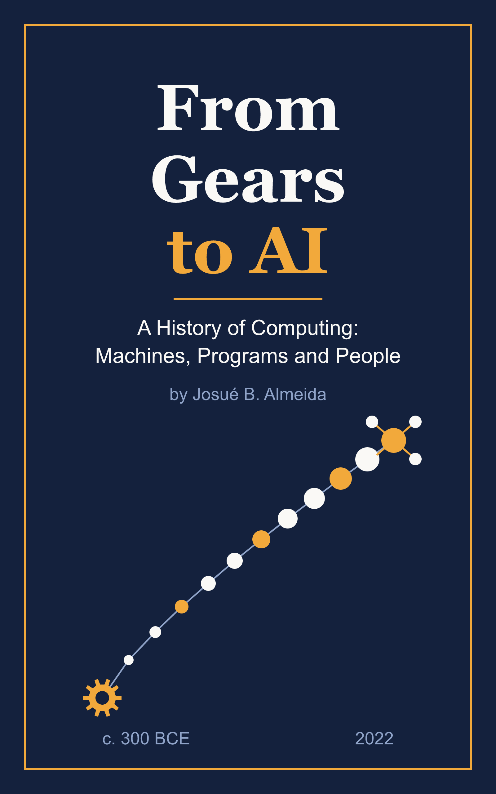

# From Gears to AI

*A History of Computing: Machines, Programs and People*

By Josué B. Almeida. For curious people with no background in computing who want to understand where computers and today's AI came from. When you finish, you can tell the history of computing from mechanical calculators to generative AI, with the right dates and names, explain the cause of each turning point and separate fact from legend.

## Start here

- [How to study this book and placement test](chapters/00-how-to-study-this-book.md)
- [Chapter 1: Counting before computing](chapters/01-counting-before-computing-from-the-abacus.md)

## 📇 The book on one page

![The book on one page, in 12 cards: 1. Counting and computing (calculating vs. computing; Pascaline and arithmometer; the card swaps the pattern). 2. Babbage and Lovelace (Difference: only adds; Analytical: Store and Mill; Note G is fact, the rest isn't). 3. Cards and the census (Hollerith and the 1890 census; human computers; analog vs. digital). 4. Boole, Turing, Shannon (AND, OR, NOT with 0 and 1; tape, head and states; bit: a choice between two). 5. War and vacuum tubes (relay vs. vacuum tube; Z3, ABC, Colossus, ENIAC; first depends on the definition). 6. Stored program (program in memory; Baby 1948, EDSAC 1949; UNIVAC, IBM, Zezinho). 7. Transistor to chip (transistor 1947; chip and Moore's law; Intel 4004, Patinho Feio). 8. Software is born (a compiler translates; FORTRAN and COBOL; the moth didn't create the bug). 9. A PC on every desk (Altair and Apple II; IBM PC and Macintosh; Law 7,232 and the reserve). 10. Everything connected (packets and ARPANET; internet vs. web; AlterNex and CGI.br). 11. Machines that learn (Dartmouth and winters; Deep Blue and AlphaGo; Transformer and ChatGPT). 12. Your museum (15 milestones with causes; check one legend; 2+ beyond the US and UK).](img/c00-the-book-on-one-page.svg)

<!-- map:start -->
## 🗺️ Book map

- [0. How to study this book](chapters/00-how-to-study-this-book.md)
- [1. Counting before computing: from the abacus to mechanical calculators](chapters/01-counting-before-computing-from-the-abacus.md) · ⏱️ ~40 min
- [2. Babbage and Lovelace: the machine that was never finished](chapters/02-babbage-and-lovelace-the-machine-that-was-never.md) · ⏱️ ~45 min
- [3. Cards, censuses and flesh-and-blood computers](chapters/03-cards-censuses-and-flesh-and-blood-computers.md) · ⏱️ ~45 min
- [4. The idea of a universal machine: Boole, Turing and Shannon](chapters/04-the-idea-of-a-universal-machine-boole-turing.md) · ⏱️ ~50 min
- [5. War and vacuum tubes: Zuse, Colossus and ENIAC](chapters/05-war-and-vacuum-tubes-zuse-colossus-and-eniac.md) · ⏱️ ~50 min
- [6. The program moves into memory: von Neumann and the first computers for sale](chapters/06-the-program-moves-into-memory-von-neumann.md) · ⏱️ ~45 min
- [7. From the transistor to the chip](chapters/07-from-the-transistor-to-the-chip.md) · ⏱️ ~50 min
- [8. Teaching the machine to understand people: the birth of software](chapters/08-teaching-the-machine-to-understand-people.md) · ⏱️ ~50 min
- [9. A computer on every desk](chapters/09-a-computer-on-every-desk.md) · ⏱️ ~45 min
- [10. Everything connected: ARPANET, the web and the phone](chapters/10-everything-connected-arpanet-the-web.md) · ⏱️ ~50 min
- [11. Machines that learn: the long road of artificial intelligence](chapters/11-machines-that-learn-the-long-road-of-artificial.md) · ⏱️ ~55 min
- [12. Final project: your computing museum](chapters/12-final-project-your-computing-museum.md) · ⏱️ ~60 min
- [13. Final mock exam](chapters/13-final-mock-exam.md)
- [14. Glossary](chapters/14-glossary.md)
<!-- map:end -->

## About this book

> Written with AI (Claude) from the sources cited in each chapter. Checked on November 28, 2026. Human review: no. Edition 1.0.

This is the English version of *Das engrenagens à IA*, by the same author, adapted for English-speaking readers: Brazilian milestones are kept, with the context a foreign reader needs. Original sources are kept; Portuguese ones are marked "(in Portuguese)" and quoted in our own translation.

## Errata

Found a mistake? Use the repository's "Report an error" form.

## Also available in

- [Português (original): Das engrenagens à IA](../../created-books/historia-da-computacao/README.md)

<!-- credit:start -->
📘 *Created by the Claude skill Syllabook - Joshpcbrrj* · [github.com/Joshpcbrrj/syllabook](https://github.com/Joshpcbrrj/syllabook)
<!-- credit:end -->
