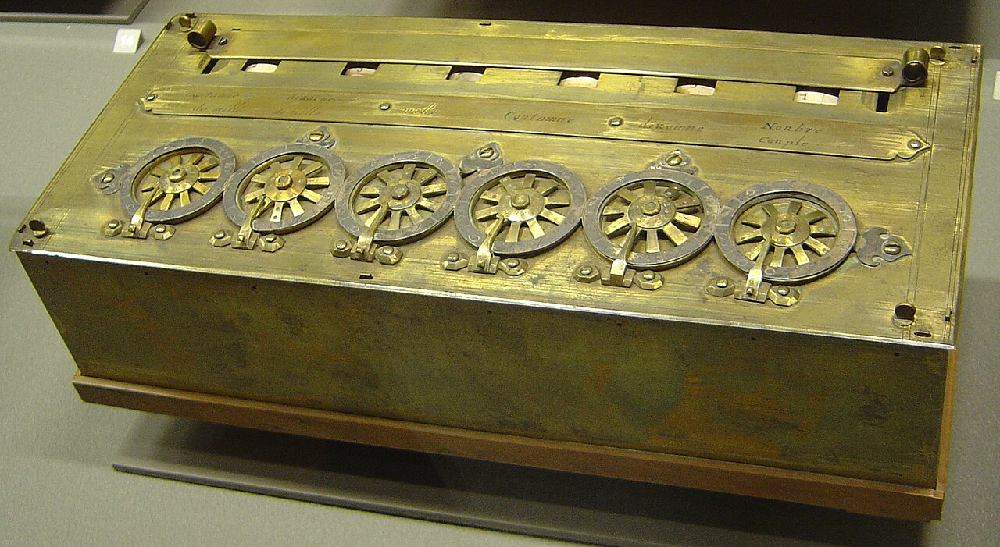
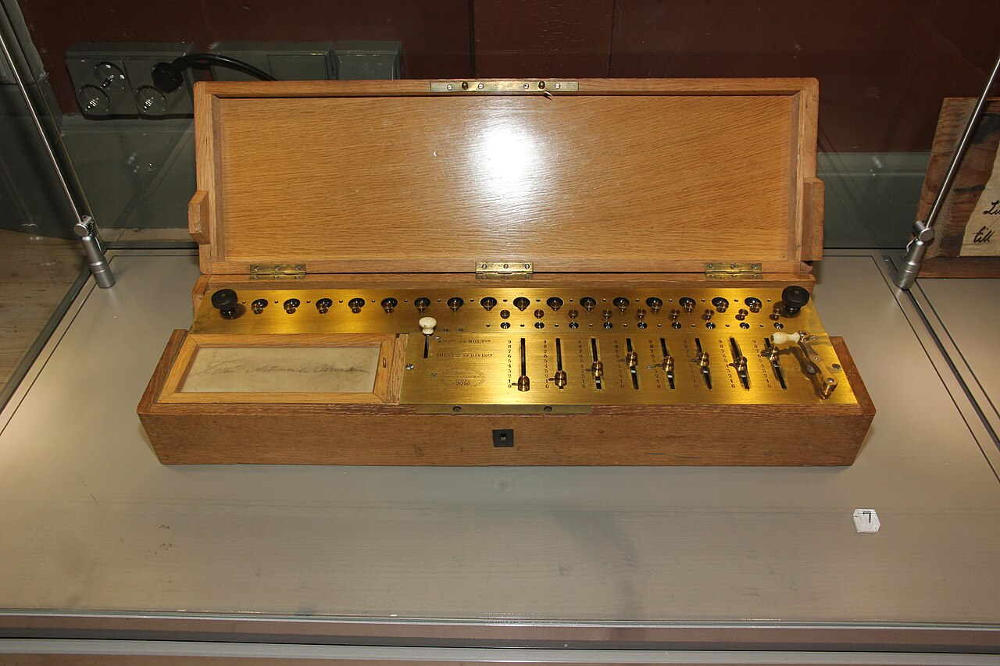
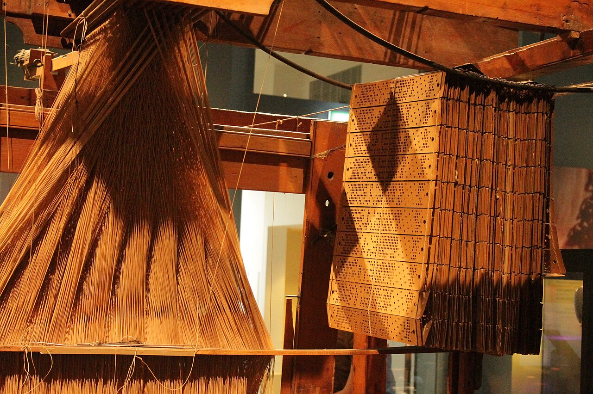
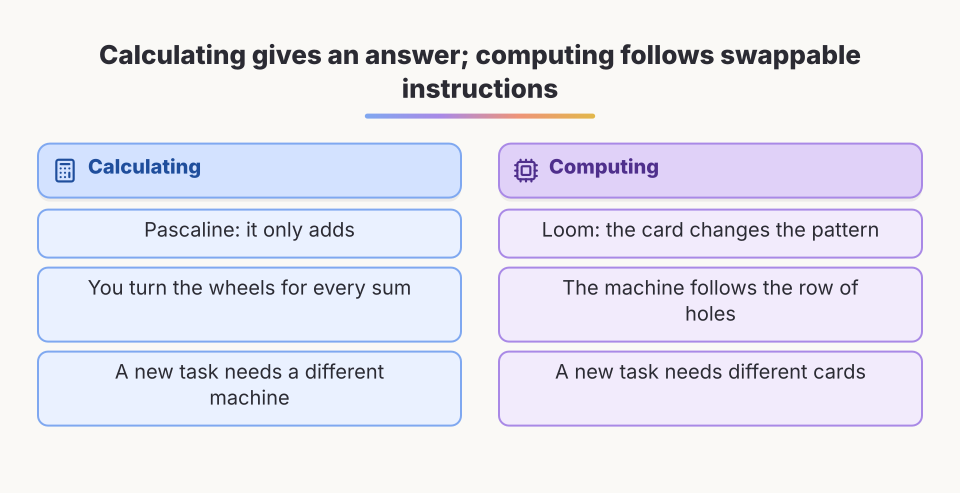
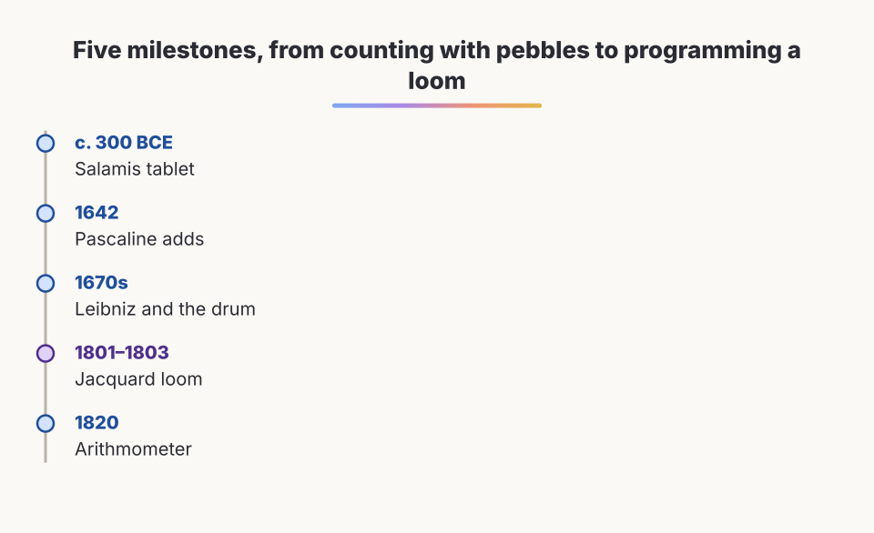

# 1. Counting before computing: from the abacus to mechanical calculators

> 🗺️ **In this chapter:** you build a timeline of five milestones, from the abacus to the Jacquard loom, and learn the difference between *calculating* and *computing*. · ⏱️ ~40 min

### 📇 Summary sheet: part 1

![Summary sheet for part 1: Abacus and Salamis (c. 300 BCE, marble, holds the numbers of a sum, the person does the calculating); Pascaline and Leibniz (Pascaline 1642, adds, ~50 built, ~15 sold, Leibniz drum multiplies); Jacquard loom (punched card, 1801, swap the card, swap the pattern, swappable instructions); Difference Engine (polynomials with only additions, No. 1 never finished, No. 2 built in 2002); Analytical Engine (Store and Mill, cards, 1834, never completed); Lovelace's Notes (published in 1843, Note G: Bernoulli, fact vs. interpretation vs. legend); 1890 census (63 million people, Hollerith wins the contest, the card holds data); Human computers (calculated by hand, Langley: a team of women, a profession before the machine); Bush's analyzer (analog, MIT, 1928, shafts and gears, analog vs. digital).](../img/c00-part-1-from-sums-to-the-universal-machine.svg)

- [1. Counting before computing: from the abacus to mechanical calculators](01-counting-before-computing-from-the-abacus.md)
- [2. Babbage and Lovelace: the machine that was never finished](02-babbage-and-lovelace-the-machine-that-was-never.md)
- [3. Cards, censuses and flesh-and-blood computers](03-cards-censuses-and-flesh-and-blood-computers.md)

Every history needs a starting point, and this one starts with a question: **why would anyone build a machine to do sums?** The answer is always much the same. Someone had too many sums to do, and a mistake was costly: a tax collected wrongly, a table with one number swapped, a column that would not add up.

By the end of this chapter you will be able to:

- put five milestones between the abacus and the Jacquard loom in order and say what problem each one solved;
- explain in your own words the difference between calculating and computing;
- separate what the sources state from what legend has added.

## The abacus and counting boards

Before any gears, people counted by moving things: pebbles, beads, markers. This solves a real problem. Short-term human memory is small, and a sum with many numbers does not fit in your head.

**An abacus (or counting board) is a surface on which movable markers, each in a given position, hold the numbers of a sum while it is being worked out.**

The word comes from the Greek *abax* or *abakon*, "table" or "board", and perhaps from a Semitic root meaning "sand" (source: Toronto Metropolitan University, see *Sources*).

The oldest example that has come down to us is the **Salamis tablet**: a slab of white marble about 150 × 75 × 4.5 cm (roughly 59 × 30 × 1.8 inches), from around 300 BCE, found on the island of Salamis, in Greece, in 1846. Researchers first took it for a game board, but it carries five groups of markings, and today it is understood to have been used for counting.

> ⚖️ **Fact vs. interpretation.** The date (c. 300 BCE), the material, the size and the place where it was found all come from the Toronto university page. *How* the tablet was used for counting is interpretation, and there is disagreement about who used it: the Toronto page speaks of Babylonians; Wikipedia, which serves here only as a map and not as a source, describes it as a Greek counting board, with pebbles (*calculi*, in Latin) moved over the lines, and now kept in the Epigraphic Museum in Athens. This book takes no side: what is known is the date, the size and the find.

The bead-and-rod abacus you may know is a younger relative. The Chinese *suan-pan* appears in the records around 1200, and the Japanese *soroban* adopted the "1/5" model (one bead on the upper deck and five below) around 1600, according to the same Toronto source.

**Common mistake:** calling the abacus "the first calculator". The person does the calculating; the abacus only holds the numbers while they think. Keep that difference in mind: it returns in the last section.

## Pascal and Leibniz: the machine does the sum

In 1623, the German Wilhelm Schickard is said to have built two calculators with toothed wheels. All that is left of them is a letter to the astronomer Kepler, and that letter is the only surviving record, according to the Computer History Museum (CHM). So Schickard's machine stays as an honest footnote: it existed, but little is known about it.

The one who really enters the story is **Blaise Pascal**. In the 1640s he made an adding machine to help his father, a tax collector who spent days adding up columns. The first one was finished in 1642, according to the Whipple Museum. The CHM calls it "the first adding machine produced in even modest quantity": Pascal built about 50 and sold about 15.

*A Pascaline at the Musée des Arts et Métiers, in Paris. Each wheel on the lid holds one digit. Photo: David.Monniaux, CC BY-SA 3.0, via Wikimedia Commons.*

**The Pascaline is a mechanical calculator that adds numbers by means of toothed wheels, one wheel per digit.**

In simple terms, here is how it worked. To enter a number, you put a stylus in the hole for the digit you want and turn the wheel until it stops. The hard part was the "carry". When a wheel goes from 9 to 0, the neighboring wheel has to advance one place. Pascal's machine did this with falling weights, and the CHM describes this mechanism as "complicated and unreliable".

Here is the carry in a real sum, the way the machine had to handle it. Add 478 + 356, from right to left:

| Column | Sum | Digit written | Carry |
| --- | --- | --- | --- |
| ones | 8 + 6 = 14 | 4 | 1 |
| tens | 7 + 5 + 1 = 13 | 3 | 1 |
| hundreds | 4 + 3 + 1 = 8 | 8 | 0 |

Result: **834**. Each row depends on the one before it through a single number, the carry. That is exactly what Pascal's wheels passed along.

Pascal's machine only added. **Gottfried Wilhelm Leibniz** wanted more: addition, subtraction, multiplication, division and square roots. He began work on it in the 1670s (Whipple Museum). His most famous idea is the **stepped drum**: a cylinder with rows of teeth of different lengths. A wheel slides along an axle and meshes with more or fewer teeth, and so chooses which digit (from 0 to 9) is added. To multiply by 7, instead of adding seven times by hand, you turn the crank seven times.

> 💡 **Analogy:** the stepped drum is like a staircase of plates of different sizes. Each step (a tooth length) is worth one digit; the sliding wheel is the person choosing which step to stand on. **Where the analogy breaks:** on a staircase you step once; on the drum, every turn of the crank repeats the same choice, and that repetition is what does the multiplication.

> ⚖️ **Careful with "first".** The Whipple Museum says Leibniz *wanted* to do division and square roots, but it does not claim that the machine could. Do not repeat that Leibniz's machine "did the four operations": the source only guarantees the intention.

**Common mistake:** "Pascal invented the first computer". The Pascaline added; it stored no instructions and decided nothing. It was a calculator.

## The arithmometer: the calculator becomes a product

Pascal sold 15 machines. Almost two centuries later, a mechanical calculator finally became a commodity. In 1820, the Frenchman **Charles Xavier Thomas de Colmar** began producing the **arithmometer**, which used Leibniz's stepped drum and did the four operations. Thomas owned insurance companies (he founded three, starting in 1819), that is, businesses that lived on sums. The CHM records that almost 2,000 arithmometers were sold and that the machine stayed in production into the twentieth century.

*An arithmometer from about 1860. The numbers go in through the sliding levers, and the crank (on the right) carries out the sum. Photo: MKFI, public domain, via Wikimedia Commons.*

To use it, you set the sliding levers (one per digit) and gave the crank a turn; in the first models, instead of a crank, you pulled a silk ribbon (CHM).

**The arithmometer was a mechanical calculator manufactured in series and sold to businesses and government offices** (the CHM treats it as a "mass-produced" calculator in the nineteenth-century sense: thousands, not millions).

> ⚖️ **Fact vs. interpretation.** "First sold at scale" depends on the definition. For the CHM, the Pascaline was the first adding machine produced *in even modest quantity*, and the arithmometer appears in the section on mass-produced calculators. Anyone who reads "first commercial calculator" elsewhere may be using another criterion. Manufacturing dates vary from one source to another; here we use 1820, the CHM's date.

**Common mistake:** thinking that, because there were thousands of arithmometers, it already "computed". It was still a single-task machine: arithmetic sums, one at a time, with a person entering the numbers.

## The Jacquard loom: instructions on a card

Now a turning point, and it comes not from a calculator but from the world of textiles. Weaving a fabric with a pattern means lifting some threads and leaving others, row after row. Doing that by hand, at every row, was slow.

In 1801, in Paris, **Joseph Marie Jacquard** showed an improved loom; around 1803 the "Jacquard attachment" appeared; and in 1806 the city of Lyon bought the patent (The Henry Ford). The idea: a **continuous chain of punched cards**. Each hook on the loom corresponds to a position on the card, and the hole (or its absence) decides whether the hook lifts the thread or not.

*A Jacquard loom at the National Museum of Scotland. On the right, the punched cards; on the left, the threads they control. Photo: Stephencdickson, CC BY-SA 4.0, via Wikimedia Commons.*

**The Jacquard loom is a loom controlled by punched cards: changing the cards changes the pattern, without changing the machine.**

Notice what changed. In the Pascaline, the "task" was in the machine itself: it could only add. In the loom, the task is in the **cards**, which are data and instructions at the same time, and can be swapped. Whoever wrote the cards "programmed" the pattern. This separation between a fixed machine and swappable instructions is the idea that runs through the rest of the book.

> 💡 **Analogy: the recipe.** The kitchen is the machine, the recipes are the cards. With the same kitchen you can make a cake or a stew by swapping the recipe. Each hole is like a line of the recipe: "lift this thread" or "leave this thread". **Where the analogy breaks:** a recipe allows "to taste" and the cook interprets; the loom interprets nothing, it only obeys the holes.

This idea caught the attention of **Charles Babbage**: The Henry Ford tells us that the cards inspired him, and that in 1837 he designed the Analytical Engine applying that same model. The story of that machine is the subject of the next chapter.

**Common mistake:** saying that the Jacquard loom was "a computer". It calculated nothing: it only repeated a pattern. What it showed was *how to store instructions on a physical medium*.

## Calculating vs. computing

Now it is time to name the difference that has run through the chapter. These are working definitions for this book; there is no single consensus on where to draw the line.

| | Calculating | Computing |
| --- | --- | --- |
| What it does | one arithmetic operation at a time | follows a sequence of instructions |
| Who decides the task | the person, at every sum | the instructions (cards, program) |
| Switching tasks | needs a different machine | needs different instructions |
| Examples in this chapter | abacus, Pascaline, arithmometer | Jacquard loom (only the *idea* of instructions) |

A timeline of the five milestones, to fix the order:

Notice that the loom (1801–1803) comes *before* the arithmometer (1820): the ideas of instructions and of commercial calculators ran in parallel, neither one a consequence of the other. The two ideas, the machine that calculates and the machine that follows instructions, only meet in chapter 2.

## 🏋️ Practice

**1. Worked example.** Add 689 + 457, the way the Pascaline would, column by column.

- Ones: 9 + 7 = 16 → write 6, carry 1.
- Tens: 8 + 5 + 1 = 14 → write 4, carry 1.
- Hundreds: 6 + 4 + 1 = 11 → write 1, carry 1 into the thousands place.
- Result: **1,146**. Notice that the last carry created a new digit.

**2. Complete it.** Add 275 + 168. Fill in:
ones 5 + 8 = ___ → write ___, carry ___; tens 7 + 6 + ___ = ___ → write ___, carry ___; hundreds 2 + 1 + ___ = ___.

See answer

Ones: 5 + 8 = 13 → write 3, carry 1. Tens: 7 + 6 + 1 = 14 → write 4, carry 1. Hundreds: 2 + 1 + 1 = 4. Result: **443**. Common mistake: forgetting to add the carry from the previous column in the next column (which gives 433).

**3. On your own.** Put these in order from oldest to most recent: arithmometer, Salamis tablet, Jacquard loom, Pascaline. In one sentence each, say what problem each one solved.

See answer

Order: Salamis tablet (c. 300 BCE) → Pascaline (1642) → Jacquard loom (1801–1803) → arithmometer (1820). Problems: the tablet held the numbers of a sum; the Pascaline added for someone who collected taxes; the loom stored the pattern on cards so that it did not depend on the weaver's skill; the arithmometer offered mechanical sums to businesses such as insurance companies.

Common mistake: putting the arithmometer before the loom because it seems that "calculators come before cards". See the note below the timeline, in the last section.

**4. Challenge (transfer the idea).** Think of a task in your day that you do by following a list of steps (a recipe, a board game, a bus route). Write 3 or 4 lines: (a) what would be the "machine" and what would be the "cards"; (b) whether swapping the card changes the task; (c) where the person still has to decide something alone.

See answer

Open answer. Check it against this rubric: (1) you separated what is fixed (the kitchen, the board, the bus) from what is swappable (the recipe, the rules, the route); (2) you showed that changing the swappable part changes the task without changing the fixed part; (3) you pointed to at least one place where judgment is still needed (like "to taste"), which is still not "computing" in the loom's sense; (4) you used concrete examples, not only general terms.

## 🧠 Quick review

1. Why is the abacus not considered a mechanical calculator?
2. What was the weakest point of the Pascaline, and why?
3. What did Leibniz's stepped drum make possible for multiplication?
4. What sets the Jacquard loom apart from a calculator like the arithmometer?
5. What does the source guarantee about Leibniz's machine, and what does it *not* guarantee?

See answers

1. Because the person does the sum; the abacus only holds the numbers. 2. The carry, handled by falling weights and described by the CHM as complicated and unreliable. 3. Multiplying by turning the crank the right number of times, instead of adding by hand. 4. The loom follows swappable instructions (the cards); the arithmometer does one sum at a time, with the numbers supplied by the person. 5. It guarantees that Leibniz wanted addition, subtraction, multiplication, division and roots; it does not guarantee that the machine could do division and roots.

## 🤖 Study with an AI tutor

- "Ask me 5 questions, one at a time, about the milestones from the abacus to the Jacquard loom. Wait for my answer before commenting and do not give me the answers beforehand."
- "Here is my answer to exercise [exercise number]: [my answer]. Point out my mistakes without giving me the solution."

> ➡️ **Next:** the Jacquard loom gave Charles Babbage the idea of a machine that would follow instructions on cards. In chapter 2 you meet the machine he designed, the one that was never finished, and the woman who wrote about it: Ada Lovelace.

## 📌 Summary

| Item | In one sentence |
| --- | --- |
| Salamis tablet | A marble slab from c. 300 BCE, found in 1846, used for counting. |
| Pascaline | An adding machine with toothed wheels made in the 1640s (the first in 1642); about 50 built, 15 sold. |
| Stepped drum | Leibniz's part (1670s) that lets you multiply by turning the crank. |
| Arithmometer | A four-operation calculator produced from 1820; almost 2,000 sold. |
| Jacquard loom | A loom run by punched cards (1801–1803): swap the card, swap the pattern. |
| Calculating vs. computing | One sum at a time vs. following swappable instructions. |

## 📚 Sources

- Computer History Museum, [Schickard's Calculator and The Pascaline](https://www.computerhistory.org/revolution/calculators/1/47), checked on November 27, 2026.
- Computer History Museum, [Mass-Produced Calculators](https://www.computerhistory.org/revolution/calculators/1/52), checked on November 27, 2026.
- Whipple Museum (University of Cambridge), [Mechanical Calculation](https://www.whipplemuseum.cam.ac.uk/node/158), checked on November 27, 2026.
- The Henry Ford, [Sparking Innovation: The Jacquard Loom](https://www.thehenryford.org/explore/blog/sparking-innovation-the-jacquard-loom), checked on November 27, 2026.
- Toronto Metropolitan University, [The Abacus: A Brief History](https://www.ee.torontomu.ca/~elf/abacus/history.html), checked on November 27, 2026.

> 🔁 **Review today:** this is the first chapter; come back to it tomorrow and redo the timeline from memory.

<!-- nav:start -->
---

[◀ Previous chapter](00-how-to-study-this-book.md) · [Book map](../README.md) · [Next chapter ▶](02-babbage-and-lovelace-the-machine-that-was-never.md)
<!-- nav:end -->
