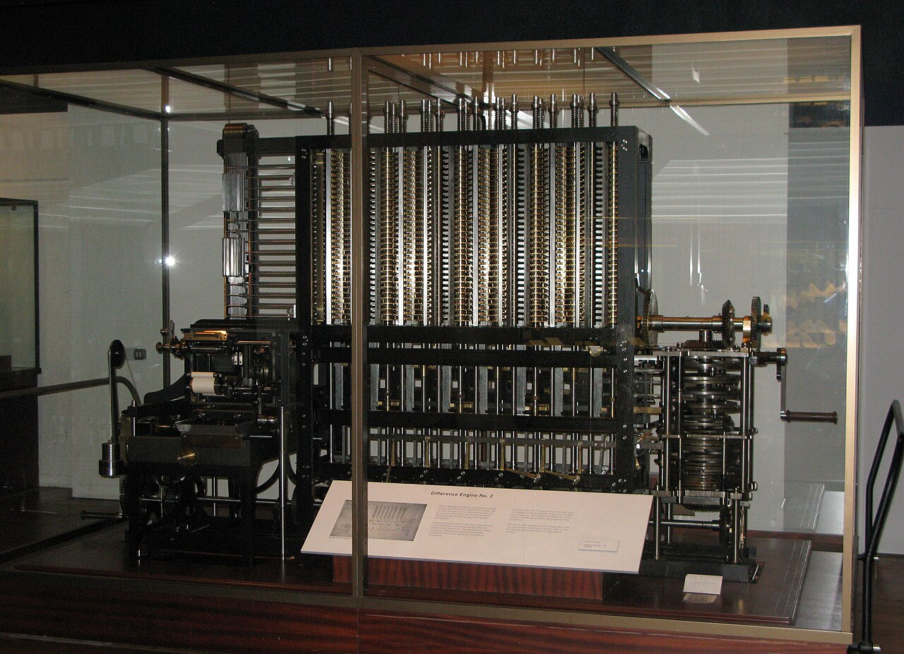
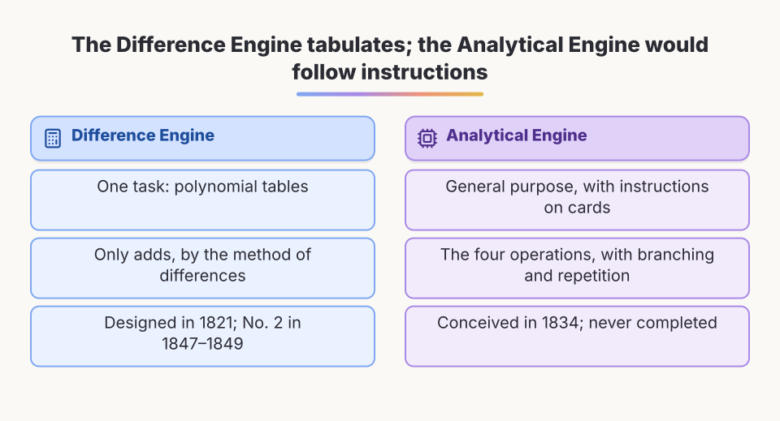
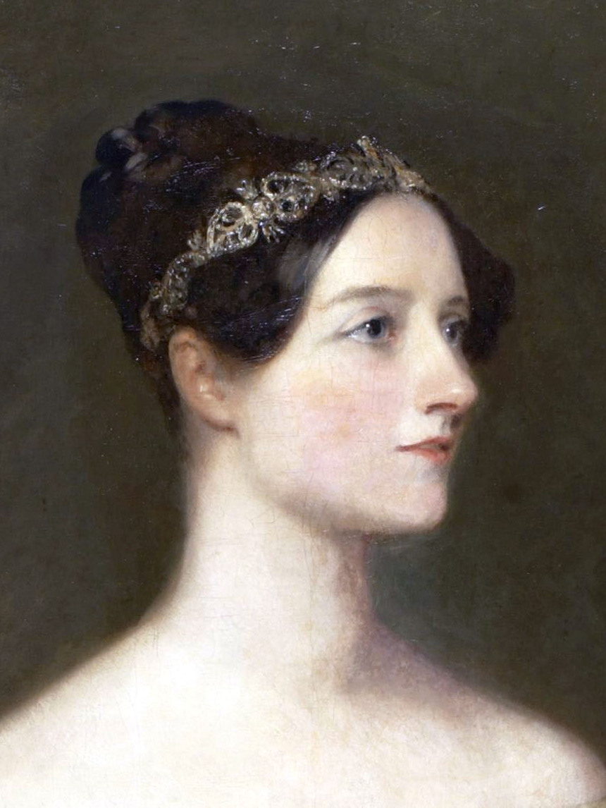
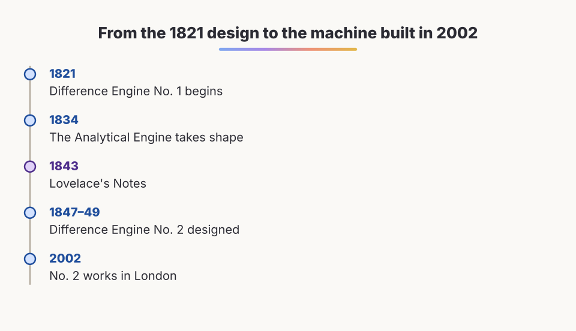

# 2. Babbage and Lovelace: the machine that was never finished

> 🗺️ **In this chapter:** you compare Charles Babbage's two machines, one that calculated tables and one that would follow instructions, and use sources to assess Ada Lovelace's title of "first programmer". · ⏱️ ~45 min

> 🔥 **Warm-up:** (1) What did the Jacquard loom store on its punched cards? (2) What is the difference between calculating and computing?
>
> <details>
> <summary>See answers</summary>
>
> (1) The instructions for the pattern: each hole, or the lack of one, decided whether a thread was lifted. (2) Calculating is doing one sum at a time, with the person supplying the numbers; computing is following instructions that can be swapped.
>
> </details>

## Where we left off

In chapter 1 you saw two ideas moving separately: calculators with toothed wheels, and a loom that obeyed cards. In this chapter they meet in the mind of an Englishman, Charles Babbage. **The guiding question is: what did Babbage design, why was none of it finished, and what did Ada Lovelace actually add?**

## The Difference Engine: tables without errors

In the early nineteenth century, anyone who needed ready-made results depended on printed **tables**, and the sums behind them were done by people (chapter 3 shows who they were). A wrong number at any stage was passed on to everyone who used the table. Babbage wanted a machine that would calculate the table *and print it*, with no human hands in between. According to one of the articles we cite, the government funded the project hoping it would turn out cheaper than paying human computers (Prospect, see *Sources*).

In 1821 he began **Difference Engine No. 1**.

**The Difference Engine is a mechanical calculator that produces tables of polynomials using only additions, by the method of finite differences.**

The method is simpler than its name. See it with the function f(x) = x² + x + 41. Work out the values from x = 0 to 6 without multiplying anything:

1. Start from f(0) = 41.
2. At each step, add the "first difference" to the current value; it starts at 2.
3. After each step, add 2 to the first difference (the "second difference", which for this polynomial is always 2).

In Python, the same recipe looks like this. The code is mine, written for this book:

```python
# Table of f(x) = x*x + x + 41 using only additions, like the Difference Engine
# f(0), first difference and second difference (constant)
value, d1, d2 = 41, 2, 2
for x in range(0, 7):
    print(x, value)
    value += d1   # each step adds the first difference to the value
    d1 += d2      # and updates the first difference with the second
```

Real output, run while writing the chapter:

```text
0 41
1 43
2 47
3 53
4 61
5 71
6 83
```

To check, I calculated x² + x + 41 directly for x from 0 to 6 and got 41, 43, 47, 53, 61, 71 and 83: the same numbers. The trick is that the machine never multiplies, and multiplying was the hard part to do with gears. The Computer History Museum (CHM) sums it up: difference engines "are strictly calculators", repeating additions.

> 💡 **Analogy: the recipe.** Think of the Difference Engine as a kitchen that knows how to make only one recipe: polynomial cake. The ingredients are the starting values (41, 2, 2); the method is "add, update, add again"; the cook is the set of gears. **Where the analogy breaks:** the Difference Engine's recipe is *built into* the gears; you do not change recipes, you only change the ingredients.

The numbers for the 1830 design of No. 1, according to the CHM: 16 digits, six orders of difference, about 25,000 parts, some four tons and eight feet in height (about 2.4 m), had it ever been built. In 1832 the work stopped because of a dispute with the engineer Joseph Clement, and in 1842 the government cut off the funding. What Babbage did assemble was one-seventh of the machine, with about 2,000 parts, and that piece still works today.



*Difference Engine No. 2, built from Babbage's drawings. The columns of toothed wheels hold the digits; the printer is on the left. Photo: User:geni, CC BY-SA 4.0, via Wikimedia Commons.*

Between 1847 and 1849 Babbage designed an improved version, **No. 2**, with 31-digit numbers and polynomials up to the seventh order, using only about a third of the parts of the first. Nobody built it in his lifetime. It was only finished in London in 2002, 153 years after the design, with 8,000 parts and five tons, and it worked. This shows that the design worked as Babbage drew it.

**Common mistake:** thinking that, because it was not finished, the machine "did not work". Babbage's design worked when it was faithfully built.

## The Analytical Engine: the idea of the computer

With the Difference Engine stalled, Babbage did something bold: instead of finishing a single-task machine, he imagined one that could do *any* sum that someone knew how to describe. The CHM dates the conception of the **Analytical Engine** to 1834; The Henry Ford speaks of a design from 1837 (the dates vary depending on whether you count the idea or the detailed design).

**The Analytical Engine was the design of a general-purpose machine, programmed by punched cards, with memory and calculating unit kept separate.**

The point that matters for you comes from chapter 1: the cards came from the Jacquard loom. The machine would have had two parts that resemble a computer today:

- the **"Store"**, where numbers and intermediate results are kept, equivalent to memory;
- the **"Mill"**, where the arithmetic happens, equivalent to the processor.

According to the CHM, it would do the four operations, and it would have what we now call conditional branching ("if this, do that") and repetition (doing the same step several times). Babbage did not use those names, which are modern. The machine would also be **decimal**, not binary: each digit from 0 to 9 on a toothed wheel.



> 💡 **Analogy: the recipe, again.** In the Analytical Engine, the kitchen (Store and Mill) is fixed, and the recipes come on cards: swap the cards and the same machine does a different sum. It is the analogy from chapter 1 put to real use, and here it hardly breaks. **Where it breaks:** a machine that was never built cooked nothing; everything we know comes from drawings and from a small piece assembled before Babbage's death, in 1871.

**Common mistake:** saying that Babbage "invented the computer". The CHM itself says he "invented computers but failed to build them". According to one of the authors we cite, he also had little direct impact on the electronic computers that followed, and his fame as "father of computing" only began in 1971, when Maurice Wilkes acclaimed him as a pioneer (Prospect).

## Lovelace's Notes: what she wrote

In 1843, **Ada Lovelace** (1815–1852), daughter of the poet Lord Byron, published an English translation of an article about the Analytical Engine by the Italian engineer Luigi Menabrea. She had known Babbage since 1833, when she was 17 and saw a small working piece of the Difference Engine. The translation came out with **notes** signed by her, and the notes were so extensive that, according to Prospect, they ran to twice the length of the original text.



*Ada Lovelace, portrait by Margaret Sarah Carpenter. Public domain, via Wikimedia Commons.*

According to the CHM, what the notes say has two parts:

1. The notes contain, in the CHM's words, "the first published description of a stepwise sequence of operations" for solving certain mathematical problems. The most famous is **Note G**, a table for calculating the Bernoulli numbers, an important mathematical sequence (Prospect is the source that describes it).
2. An idea that is striking when seen from today: the Engine "might act upon other things besides number", and Lovelace even imagines that it would compose music. For her, the Analytical Engine "weaves algebraic patterns just as the Jacquard loom weaves flowers and leaves". The CHM sees in this the passage from *calculating* to *computing*, an idea that chapter 1 had already introduced.

> 🔎 **Going deeper: what "programming" means.** A **program** is a sequence of instructions that a machine can follow on its own. Note G is a table that shows the steps of a calculation on a machine that, as we know, never existed. A common criticism, which you will weigh below, is that showing the steps on paper is not the same as writing a program that *runs*.

**Common mistake:** thinking the notes are only a "translation". They are original commentary, longer than the translated article: a step-by-step description and a vision of what machines like this could represent.

## Legend vs. record: was Ada the "first programmer"?

The phrase "Ada Lovelace, the world's first programmer" is popular. Let us separate what we know into three layers, as this book's method asks:

| Layer | What to say |
| --- | --- |
| **Fact** | In 1843, Lovelace published notes that describe a stepwise sequence of operations (CHM), among them a table for calculating Bernoulli numbers, Note G (Prospect), for a machine that was never built. |
| **Interpretation** | The CHM says she is "often referred to as 'the first programmer'" and that biographers debate the extent and originality of her contribution. Prospect calls the title misleading: "the chart is not a program, but shows the stages that would occur in a pre-programmed machine if one existed". |
| **Legend** | "She wrote the first computer program and invented programming on her own." Neither source supports this: the exact authorship is uncertain, and Prospect points out that Babbage may have had an input, "impossible to know how much". |

Two things complete the picture. First, her modern fame grew after the US Department of Defense named a programming language ADA in her honor in the late 1970s (Prospect). Second, the astronomer John Herschel, a contemporary of hers, wrote that he felt at a loss reading the notes, which shows that today's admiration was not unanimous among her contemporaries.

> ⚖️ **Analyzing a source.** The two texts we use have different purposes. The CHM is a computer museum: it tends to favor the idea that Ada "saw further" than Babbage. Prospect is a magazine of ideas, and the article is an opinion piece by a historian of science who wants to dismantle myths of "lone heroes". Both use facts, but they choose what to stress. And the same Prospect article states that the term *debugging* was coined after Grace Hopper took a moth out of a computer. That is wrong: chapter 8 shows that the word *bug* is older, citing another source. A source can be right on one point and wrong on another, and that is why this book checks every claim.

**What to conclude?** The honest answer is: according to the CHM, Ada Lovelace published the first description of a stepwise sequence of operations for a machine like this, and she was the first to express that it could act on more than numbers. Whether that makes her "the first programmer" depends on what you call a program, and that is why a good history book says "it depends" and shows why.



## 🏋️ Practice

**1. Worked example.** Complete the table of f(x) = x² + x + 41 up to x = 8 using only additions, like the Difference Engine.

- Starting from f(6) = 83, the first difference at that point is 14 (it started at 2 and rose by 2 per step: 2, 4, 6, 8, 10, 12, 14).
- f(7) = 83 + 14 = 97. Now the difference rises to 16.
- f(8) = 97 + 16 = 113.
- Direct check: 8² + 8 + 41 = 64 + 8 + 41 = 113. ✔

**2. Complete it.** Tabulate g(x) = x² + 5, for x from 0 to 4, using only additions. Fill in: g(0) = ___; initial first difference = g(1) − g(0) = ___; second difference = ___. Then: g(1) = ___, g(2) = ___, g(3) = ___, g(4) = ___.

<details>
<summary>See answer</summary>

g(0) = 5; g(1) = 6, so the initial first difference is 1; g(2) = 9, so the next first difference is 3, and the second difference is 3 − 1 = 2. Table: g(0) = 5, g(1) = 6, g(2) = 9, g(3) = 14, g(4) = 21. Notice that the differences are 1, 3, 5, 7, and the second difference is always 2. Common mistake: forgetting to update the first difference at each step, which gives a sequence of differences that are all equal.

</details>

**3. On your own.** Fill in the table with the difference between the two machines:

| Question | Difference Engine | Analytical Engine |
| --- | --- | --- |
| One task or several? | | |
| How does it receive instructions? | | |
| Was it finished? | | |

<details>
<summary>See answer</summary>

Difference Engine: one task (polynomial tables, with only additions); the recipe is in the gears; No. 2 was built in 2002, No. 1 only in part. Analytical Engine: general purpose, with instructions on punched cards (an idea from the Jacquard loom), memory (Store) separate from the calculating unit (Mill); it was never finished, only a small experimental piece. Common mistake: saying that the Analytical Engine "only added" or that the Difference Engine used cards.

</details>

**4. Challenge (analyze a source).** Reread the fact vs. interpretation vs. legend table. Write 4 or 5 lines answering: (a) which of the two sources you agree with more in the case of Ada Lovelace, and why; (b) what information you would still like to see in a third source.

<details>
<summary>See answer</summary>

Open answer. Check it against this rubric: (1) you separated what the two sources state in the same way (the 1843 notes and Note G) from what they interpret differently; (2) you justified your choice with a criterion (the source's purpose, the type of text, what each one stresses), not only by preference; (3) you pointed to a concrete piece of missing information (for example, the original manuscript, or an analysis of the division of labor between Babbage and Lovelace); (4) you did not repeat the legend ("she wrote the first program on her own") as if it were fact.

</details>

## 🧠 Quick review

1. Why does the Difference Engine only need to add?
2. Which idea from the Jacquard loom did Babbage use in the Analytical Engine?
3. What do the "Store" and the "Mill" do, and which parts of a computer today do they correspond to?
4. Why can't we say that Babbage built a computer?
5. (From chapter 1) Why is the Jacquard loom not considered a computer?

<details>
<summary>See answers</summary>

1. Because the method of finite differences turns a polynomial table into a sequence of additions, and multiplication was the hardest part to build. 2. Punched cards as a way of storing instructions. 3. The Store holds numbers and results (memory); the Mill does the arithmetic (processor). 4. The Analytical Engine was never completed; only drawings and a small experimental piece remained. 5. Because it only repeated a pattern and calculated nothing.

</details>

## 🤖 Study with an AI tutor

- "Ask me 5 questions, one at a time, about Babbage's machines and Ada Lovelace's notes. Wait for my answer before commenting and do not give me the answers beforehand."
- "Here is my answer to exercise [exercise number]: [my answer]. Point out my mistakes without giving me the solution."

> ➡️ **Next:** Babbage's machines depended on people making tables by hand, and it was a flood of data that drove the next turning point. In chapter 3 you see how punched cards sped up the 1890 United States census and meet the flesh-and-blood "computers".

## 📌 Summary

| Item | In one sentence |
| --- | --- |
| Difference Engine | A calculator of polynomial tables that uses only additions; No. 1 began in 1821, No. 2 was designed in 1847–1849 and built in 2002. |
| Analytical Engine | A general-purpose design with cards, memory (Store) and processor (Mill); conceived in 1834 and never completed. |
| Lovelace's Notes | Published in 1843, they contain Note G (Bernoulli numbers) and the idea that the machine could act on more than numbers. |
| "First programmer" | A debated title: the fact is Note G; the rest is interpretation or legend. |
| Fact vs. interpretation vs. legend | Three layers you separate before repeating an origin story. |

## 📚 Sources

- Computer History Museum, [The Babbage Engine: Engines](https://www.computerhistory.org/babbage/engines/), checked on November 27, 2026.
- Computer History Museum, [The Babbage Engine](https://www.computerhistory.org/babbage/), checked on November 27, 2026.
- Computer History Museum, [Ada Lovelace](https://www.computerhistory.org/babbage/adalovelace/), checked on November 27, 2026.
- Patricia Fara, Prospect, [Debugging the mythology: was Ada Lovelace really the first computer programmer?](https://prospectmagazine.co.uk/ideas/technology/38160/debugging-the-mythology-was-ada-lovelace-really-the-first-computer-programmer), November 22, 2021, checked on November 27, 2026.
- The Henry Ford, [Sparking Innovation: The Jacquard Loom](https://www.thehenryford.org/explore/blog/sparking-innovation-the-jacquard-loom), checked on November 27, 2026.

> 🔁 **Review today:** chapter 1

<!-- nav:start -->
---

[◀ Previous chapter](01-counting-before-computing-from-the-abacus.md) · [Book map](../README.md) · [Next chapter ▶](03-cards-censuses-and-flesh-and-blood-computers.md)
<!-- nav:end -->
