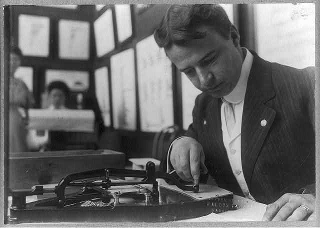
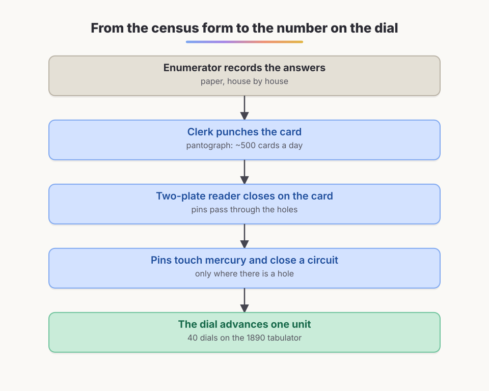
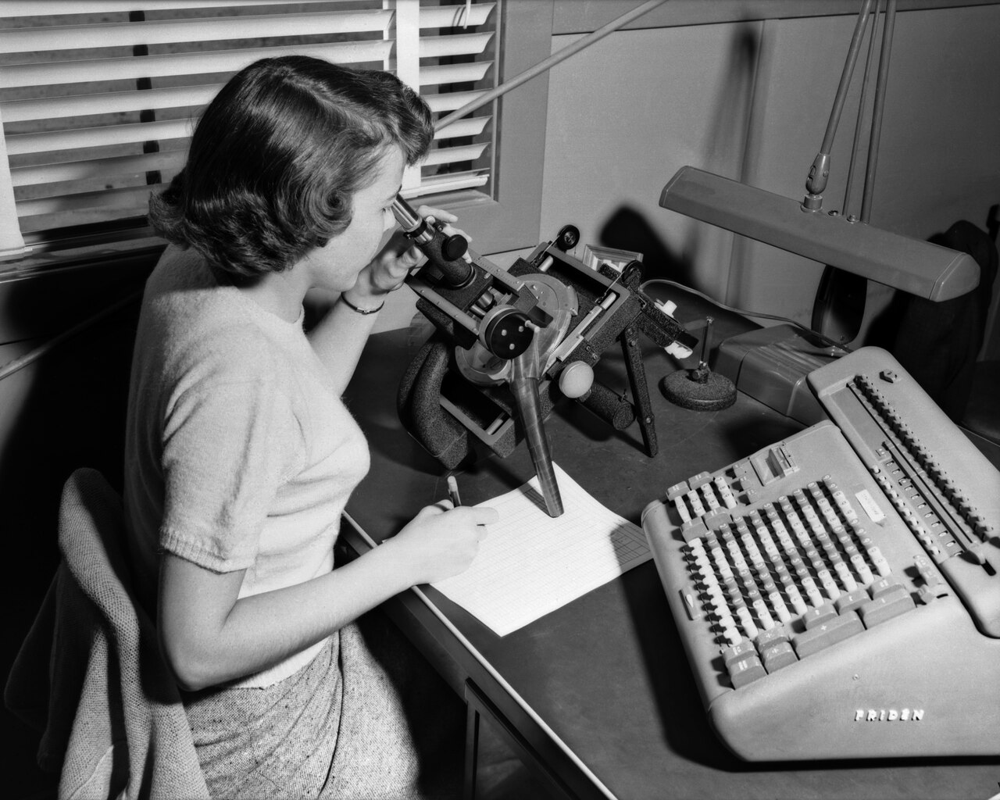
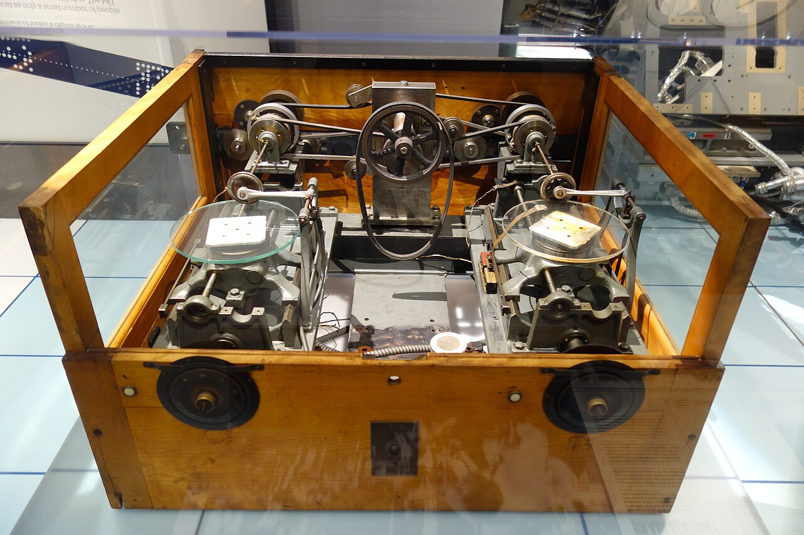
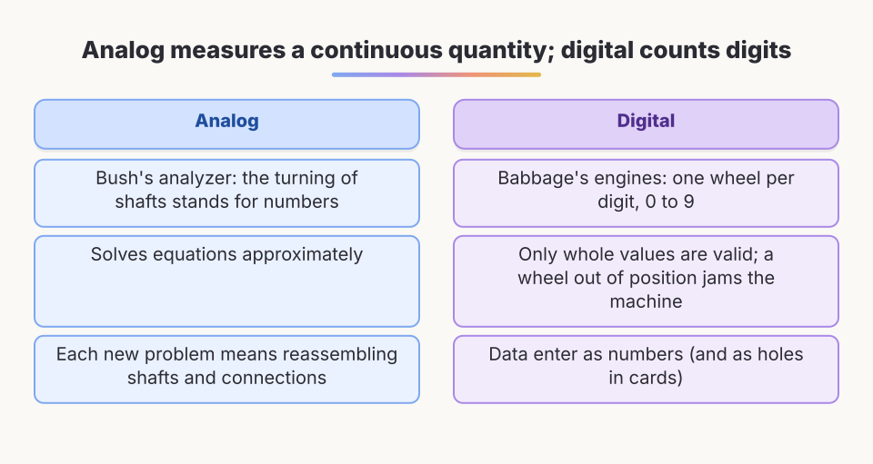

# 3. Cards, censuses and flesh-and-blood computers

> 🗺️ **In this chapter:** you learn how Hollerith's punched cards sped up the 1890 American census, find out who the flesh-and-blood "computers" were, and see why Bush's differential analyzer was still not a digital computer. · ⏱️ ~45 min

> 🔥 **Warm-up:** (1) Why does Babbage's Difference Engine only need to add? (2) What does Ada Lovelace's Note G describe?
>
> 

> 
See answers

>
> (1) Because the method of finite differences replaces a polynomial's table with a sequence of additions. (2) A stepwise sequence of operations for calculating Bernoulli numbers on a machine that was never built.
>
> 

## Where we left off

In chapter 2, Babbage's machines were designs that depended on money and on parts that the nineteenth century did not deliver. In this chapter the problem changes: there was plenty of *data* and too few people to count it. **The guiding question is: what happens when the volume of numbers grows faster than a person's ability to add them up, and who did that work while the machines could not keep up?**

## Hollerith and the 1890 census

The Constitution of the United States requires a census every ten years. In 1790 this was manageable, with fewer than four million inhabitants. By 1890 there were 63 million, and the estimates said that the 1890 census would not be finished before the 1900 one had to begin (Computer History Museum, CHM, see *Sources*). The government responded with a contest to find a faster method. The winner was **Herman Hollerith**.

Hollerith proposed recording the data on **punched cards** and reading them with a machine.

**A punched data card is a card on which each hole position represents an answer, and the pattern of holes describes a person or a fact.**

Notice the difference from chapter 1. In the Jacquard loom, the card stored *instructions*: lift this thread, leave that one. In the census, the card stores *data*: this person is married, that one is a farmer. It is the same technology, holes in paper, serving two different purposes.

> 💡 **Analogy: the recipe.** In the loom, the card was the *recipe*. In the census, the card is the *ingredient*: each one describes a person, and the machine is the kitchen that counts how many ingredients of each kind there are in the pantry. **Where the analogy breaks:** ingredients get used up, and cards do not. The same cards can go through the machine again to answer another question.

Here is how it worked, according to the Census Bureau and the CHM:

1. Enumerators wrote the answers on paper forms.
2. Clerks transferred the information to cards using a **pantograph**, a device in which the operator positions a stylus over the desired hole of a template and presses. Each clerk prepared about 500 cards a day.
3. In the **tabulating machine**, the reader was a hinged two-plate part that looked like a waffle iron. Metal pins passed through the holes and dropped into cups of mercury.
4. The mercury completed an electrical circuit wherever there was a hole, and that advanced a dial. The 1890 tabulator had 40 dials, each for one type of census data.

**A tabulating machine is a machine that reads punched cards and adds up, on dials, how many cards have each combination of holes.**

*A man operates a card-punching pantograph, c. 1908. Photo: U.S. Census Bureau employees, public domain, via Wikimedia Commons.*

The CHM's numbers: the 1890 census used about 60 million cards. An average operator processed about 7,000 cards a day, "at least ten times faster than manual methods". You can check the arithmetic: 60,000,000 ÷ 7,000 is about 8,571 operator workdays. Punching, at 500 cards a day, comes to 60,000,000 ÷ 500 = 120,000 clerk workdays. That calculation is mine, from the two numbers given by the CHM and the Census Bureau, and it suggests that the human work of *punching* weighed more than that of *counting*.

Besides counting, the machine could cross-tabulate data: with a sorter wired to combinations of holes, you could find out, for example, how many married farmers were over 40 years old (CHM). In 1895 Hollerith founded the Tabulating Machine Company (CHM); according to Prospect, it was one of the origins of IBM, which returns in chapter 6. The Census Bureau used versions of the system until the UNIVAC began to replace them, in the 1950s.

> ⚖️ **Fact vs. interpretation.** The founding date of Hollerith's company varies between sources (the CHM says 1895; others say 1896), and the chain of mergers that led to the name IBM was not checked for this chapter, so it is left for chapter 6. It is also interpretation to say that the census was "saved" by the machine: the predictions of how long the manual method would take were estimates, not measurements.

**Common mistake:** thinking that Hollerith "invented the computer". The tabulator counted and cross-tabulated cards, but it did not run a swappable program: what it did was built into the machine's wiring.

## Human computers: when "computer" was a profession

Before electronic machines, the word "computer" named a **profession**. NASA records that, before the development of electronic computers, the term referred to people, not machines: it was the job title of someone who did mathematical calculations by hand.

**A human computer is a person hired to do by hand, in large quantity, calculations that a machine does today.**

The work existed from the end of the nineteenth century, with men and women, in astronomy, statistics and ballistics (NASA). Chapter 2 had already given a hint: the British government hoped that Babbage's machine would turn out cheaper than hiring human computers.

The best-documented example we use is the Langley laboratory, in the United States, of the agency that preceded NASA (the NACA). According to NASA:

- in September 1935, Virginia Tucker arrived at Langley to join the first "computer pool", along with four other women;
- the work was reading the film records of wind-tunnel tests, doing the calculations and plotting graphs, which served aeronautical and later space research;
- the Second World War expanded the section: Langley began actively recruiting women, partly to make up for the men who went into the armed forces, and by 1946 it had trained about 400 women;
- the laboratory's "West Area" had segregated facilities, as a 1944 cafeteria plan shows, and the computing sections became more integrated after the early years; Katherine Johnson joined the West Computers in 1953, stayed a few weeks and later calculated trajectories for the missions of Alan Shepard and John Glenn.

*A woman computer at the Langley laboratory (NACA), in 1952, with a data-reading instrument and a Friden calculator beside her. Photo: NASA Langley Research Center / NACA Langley, public domain, via Wikimedia Commons.*

> ⚖️ **Fact vs. interpretation vs. legend.**
> **Fact:** NASA describes computing as a profession of men and women since the end of the nineteenth century, and the women computers at Langley did work that was central to the laboratory's research.
> **Interpretation:** why Langley recruited so many women. NASA links this to the war and the shortage of men; other explanations appear in other texts, which this book did not check.
> **Legend to avoid:** that "human computer" was only a name for unimportant assistants. NASA itself records that, at Langley, they had a central role in the research.

**Common mistake:** thinking the work "ended" when machines appeared. According to NASA, computing work at Langley runs from the mid-1930s to the 1970s, and some of the first women computers, such as Vera Huckel and Helen Willey, had careers of decades at the NACA and NASA.

## Bush's differential analyzer: the computer of gears and shafts

At the same time, at MIT, an enormous machine was attacking a different kind of problem. Vannevar Bush's **differential analyzer** was begun in 1928 by a student of his, Harold Hazen. It was a room full of gears and shafts driven by electric motors, with disc-and-wheel "integrators" connected to 18 shafts, and it solved differential equations of up to the sixth order, approximately (CHM). It was used on problems in power networks, physics, seismology and ballistics.

**An analog computer is a machine that represents numbers by a continuous physical quantity, such as the turning of a shaft, and not by digits.**

*An integrator unit of the Bush and Hazen differential analyzer (1928–1931), at the MIT Museum. Photo: Daderot, CC0, via Wikimedia Commons.*

The weak point was the **setup**. For each new problem, six integrators and several input and output tables had to be connected by hand. The CHM says this took mechanical skill and "a willingness to get covered in oil". Copies of the machine, at the Moore School and at the Aberdeen proving ground, calculated artillery tables, but were too slow, which, according to the CHM, inspired the ENIAC (chapter 5). A later version, the Rockefeller Differential Analyzer, used paper tape and relays to simplify the setup and ran until 1954.

Compare with what you saw in chapter 2: Babbage's machines were *digital* (one wheel per digit, from 0 to 9) and, in the design, worked only with whole numbers, so much so that a wheel out of position jammed the machine to signal an error (CHM). Bush's analyzer was *analog*.

**Common mistake:** thinking that "analog" means "old" and "digital" means "modern". Babbage's machine, from the nineteenth century, was already digital; and the Rockefeller Differential Analyzer, analog, ran until 1954.

## 🏋️ Practice

**1. Worked example.** Suppose an operator processes 7,000 cards a day. How many days does it take to run 14,000,000 cards, and how many days would the manual method take, assuming it is ten times slower?

- With the machine: 14,000,000 ÷ 7,000 = 2,000 days.
- Manual (ten times slower): 2,000 × 10 = 20,000 days.
- Check: 7,000 × 2,000 = 14,000,000 ✔. Notice that this is an estimate: the CHM says "at least" ten times.

**2. Complete it.** Match each situation to the type of card: "instruction" (as in the loom) or "data" (as in the census).
(a) A card says whether a loom hook goes up: ___. (b) A card says that a person is 42 years old and a farmer: ___. (c) Which of the two did Hollerith's tabulating machine read? ___.

See answer

(a) instruction; (b) data; (c) data. Common mistake: thinking that, because both are "punched cards", they play the same role. The format is similar, but the loom uses the card to say *what to do* and the census uses the card to say *what to count*.

**3. On your own.** Write one sentence each: (a) what a human computer was; (b) what the tabulating machine was; (c) why Bush's analyzer is not considered digital.

See answer

(a) A person hired to do calculations by hand in large quantity. (b) A machine that reads punched cards and counts, on dials, how many have each combination of holes. (c) Because it represents numbers by the continuous turning of shafts, not by digits, and it solves equations approximately. Common mistake: saying that "it was not digital because it was mechanical": Babbage's machines were also mechanical and they were digital.

**4. Challenge (analyze a source).** Reread the "Human computers" section. It relies on a NASA text. Answer in 4 or 5 lines: (a) who wrote the text and for whom; (b) what it stresses; (c) what a text of another kind (a newspaper of the time, an account by one of the women computers) could show that it leaves out.

See answer

Open answer. Check it against this rubric: (1) you identified that the text comes from the institution itself (NASA History), and thought about who it was written for and with what aim; (2) you pointed to what it stresses (the organization of the work, numbers, the wartime expansion, the importance of the women computers); (3) you suggested information that a personal account would bring (what everyday life was like, how each person experienced segregation, what each one thought of the work); (4) you did not treat the absence of a point as proof that it did not happen.

## 🧠 Quick review

1. What was the problem with the 1890 census that led to the contest won by Hollerith?
2. How does the role of the card in the census differ from its role in the Jacquard loom?
3. What is an analog computer? Give an example from this chapter.
4. What was a "computer" before 1940?
5. (From chapter 2) Why is Babbage's Analytical Engine considered "general purpose", and the Difference Engine not?

See answers

1. The population had grown to 63 million and the manual method would not finish before the next census. 2. In the loom, the card is an instruction; in the census, it is data. 3. A machine that represents numbers by a continuous quantity, such as the turning of shafts; Bush's differential analyzer. 4. A person who did calculations by hand. 5. The Analytical Engine would follow instructions on cards (and would have branching and repetition); the Difference Engine only made polynomial tables by additions.

## 🤖 Study with an AI tutor

- "Ask me 5 questions, one at a time, about the 1890 census, Hollerith's cards and human computers. Wait for my answer before commenting and do not give me the answers beforehand."
- "Here is my answer to exercise [exercise number]: [my answer]. Point out my mistakes without giving me the solution."

> ➡️ **Next:** so far, the machines were made of gears and shafts, and each one solved a practical problem. In chapter 4 you leave the workshops and enter mathematics: Boole's logic, Alan Turing's imaginary machine and Claude Shannon's bit.

## 📌 Summary

| Item | In one sentence |
| --- | --- |
| 1890 census | 63 million people and the estimate that the manual method would not finish in time led to the contest that Hollerith won. |
| Punched data card | A card on which each hole is an answer; in the census it stores data, in the loom it stored instructions. |
| Tabulating machine | Reads the cards with pins and mercury and adds up on dials. |
| Human computer | The profession of someone who calculated by hand, with men and women; at Langley, the team was women. |
| Bush's differential analyzer | An analog machine of shafts and gears (MIT, begun in 1928) that solved equations approximately. |
| Analog vs. digital | Continuous quantity vs. digits. |

## 📚 Sources

- Computer History Museum, [Making Sense of the Census: Hollerith's Punched Card Solution](https://www.computerhistory.org/revolution/story/2), checked on November 27, 2026.
- U.S. Census Bureau, [The Hollerith Machine](https://www.census.gov/about/history/bureau-history/census-innovations/technology/hollerith-machine.html), checked on November 27, 2026.
- NASA History, [When the Computer Wore a Skirt: Langley's Computers, 1935–1970](https://www.nasa.gov/history/when-the-computer-wore-a-skirt-langleys-computers-1935-1970/), checked on November 27, 2026.
- Computer History Museum, [Bush's Analog Solution](https://www.computerhistory.org/revolution/story/143), checked on November 27, 2026.
- Computer History Museum, [The Babbage Engine: Engines](https://www.computerhistory.org/babbage/engines/), checked on November 27, 2026.
- Patricia Fara, Prospect, [Debugging the mythology](https://prospectmagazine.co.uk/ideas/technology/38160/debugging-the-mythology-was-ada-lovelace-really-the-first-computer-programmer), checked on November 27, 2026.

> 🔁 **Review today:** chapters 2 and 1

<!-- nav:start -->
---

[◀ Previous chapter](02-babbage-and-lovelace-the-machine-that-was-never.md) · [Book map](../README.md) · [Next chapter ▶](04-the-idea-of-a-universal-machine-boole-turing.md)
<!-- nav:end -->
