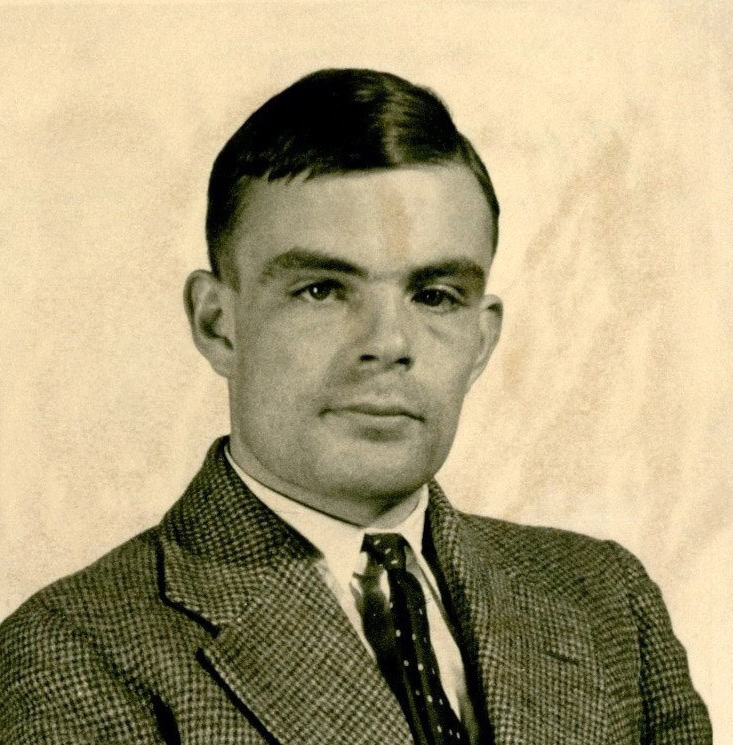

# 4. The idea of a universal machine: Boole, Turing and Shannon

> 🗺️ **In this chapter:** you learn how Boole's logic became arithmetic with 0 and 1, describe in your own words what a Turing machine does, and see why Shannon's bit brought these ideas together. · ⏱️ ~50 min

### 📇 Summary sheet: part 2

![Summary sheet for part 2: Boole's logic (works of 1847 and 1854, AND, OR, NOT, sums with 0 and 1); Turing machine (1936–37, tape, head, states, universal: reads another table); Shannon and the bit (relays and Boolean algebra, 1948 paper, bit: two options); Relay vs. vacuum tube (relay: mechanical switch, tube: glass switch, the tube is faster); Colossus (Flowers's vacuum tubes, attacks the Lorenz cipher, secret until the 1970s); ENIAC (Mauchly and Eckert, six programmers, wires and switches); Stored program (von Neumann, 1945, program next to the data, Baby 1948, EDSAC 1949); UNIVAC and IBM (UNIVAC I, 1951, 46 units, IBM: a name from 1924); Zezinho (ITA) (1961, teaching computer, did not run computations).](../img/c00-part-2-logic-war-and-memory.svg)

- [4. The idea of a universal machine: Boole, Turing and Shannon](04-the-idea-of-a-universal-machine-boole-turing.md)
- [5. War and vacuum tubes: Zuse, Colossus and ENIAC](05-war-and-vacuum-tubes-zuse-colossus-and-eniac.md)
- [6. The program moves into memory: von Neumann and the first computers for sale](06-the-program-moves-into-memory-von-neumann.md)

> 🔥 **Warm-up:** (1) In Jacquard's loom the card stored instructions; in Hollerith's census, what did it store? (2) Why is Bush's differential analyzer called analog?
>
> <details>
> <summary>See answers</summary>
>
> (1) Data: each hole was an answer about a person. (2) Because it represents numbers by a continuous quantity, the turning of shafts, and not by digits.
>
> </details>

## Where we left off

Up to chapter 3 you saw machines of gears, cards and shafts, each built for one kind of problem. In this chapter the story leaves the workshop and moves onto paper: three people, in different eras, solve in theory what machines had not yet solved in metal. **The guiding question is: which ideas in mathematics made possible a machine that does any calculation we know how to describe, and why did it all end up as 0 and 1?**

## Boole's logic: thinking with sums

George Boole published two works on the subject: *The Mathematical Analysis of Logic* (1847) and *The Laws of Thought* (1854), according to the Stanford Encyclopedia of Philosophy (see *Sources*). His idea was to treat statements such as "it is true" or "it is false" with the same discipline as algebra.

**Boolean logic is a system of calculation in which variables can only be 0 or 1 and the operations combine those values.**

According to the Stanford Encyclopedia, Boole's algebra dealt with polynomials whose variables were restricted to the values 0 and 1. In the 1847 text, the product *xy* gave the class of things that are both X and Y, and 1 − *x* gave "not X". Today we use three operations, which you will see running:

- **AND**: gives 1 only if both values are 1;
- **OR**: gives 1 if at least one is 1;
- **NOT**: swaps 0 for 1 and 1 for 0.

In Python, the code is mine, written for this book:

```python
# Truth table of AND, OR and NOT with the values 0 and 1
print("a b | AND OR NOT(a)")
for a in (0, 1):
    for b in (0, 1):
        print(a, b, "|", a & b, " ", a | b, " ", 1 - a)
```

Real output, run while writing the chapter:

```text
a b | AND OR NOT(a)
0 0 | 0   0   1
0 1 | 0   1   1
1 0 | 0   1   0
1 1 | 1   1   0
```

The AND column is Boole's multiplication: 1 × 1 = 1 and everything else gives 0. And NOT is the 1 − *a* of the same work.

> 💡 **Analogy: the recipe.** Think of a recipe with conditions: "if you have eggs **AND** flour, make the cake". Each condition is an ingredient that is present (1) or absent (0), and the AND decides whether the step happens. **Where the analogy breaks:** in the kitchen there is a middle ground ("I have a little egg"); in Boole's logic there is only 0 or 1.

**Common mistake:** thinking that Boole was thinking about computers. The Stanford Encyclopedia describes a piece of nineteenth-century logic and mathematics. The link to machines came almost a century later, and it is the subject of the next sections.

## Turing, 1936: what does it mean to calculate?

In 1936–37, Alan Turing published "On computable numbers, with an application to the Entscheidungsproblem". According to the Stanford Encyclopedia entry on Turing, the paper defined what it is to compute and showed an absolute limit on what computation can do. He described devices that he called "automatic machines", today called Turing machines. Independently of him, Emil Post and Alonzo Church arrived at different, logically equivalent formulations.



*Alan Turing in 1936, at Princeton, when he published the paper on computing. Photo: unknown photographer, public domain, via Wikimedia Commons.*

**A Turing machine is an abstract device with a tape divided into squares, each holding a symbol, and a head that reads and writes one symbol at a time, following a table of states.**

According to the Stanford Encyclopedia entry on Turing machines, the tape has squares that each carry a symbol, and the machine has a finite number of states. The "table" says: if I am in this state and I read this symbol, I write such-and-such a symbol, move to one side and switch to another state. It is a program.

Here is one that adds 1 to a binary number. I wrote the table for this book: the machine runs to the end of the tape, turns back, and keeps swapping 1 for 0 (the "carry") until it finds a 0 or an empty square, where it writes 1.

```python
# Turing machine that adds 1 to a binary number on the tape
# table: (state, symbol read) -> (symbol to write, move, new state)
table = {
    ("go_to_end", "0"): ("0", +1, "go_to_end"),
    ("go_to_end", "1"): ("1", +1, "go_to_end"),
    ("go_to_end", "_"): ("_", -1, "add"),
    ("add", "1"): ("0", -1, "add"),   # 1 + 1 = 0, carry one
    ("add", "0"): ("1", 0, "halt"),
    ("add", "_"): ("1", 0, "halt"),
}
tape = list("1011") + ["_"]
head, state = 0, "go_to_end"
steps = 0
while state != "halt":
    write, move, state = table[(state, tape[head])]
    tape[head] = write
    head += move
    if head < 0:
        tape.insert(0, "_"); head = 0
    steps += 1
print("".join(tape).strip("_"), "in", steps, "steps")
```

Real output, run while writing the chapter:

```text
1100 in 8 steps
```

Check: 1011 in binary is 8 + 0 + 2 + 1 = 11, and 1100 is 8 + 4 = 12. It added 1, correct. Notice that the Python program only *reads* the table: the table does the adding. Change the table and the same machinery does something else.

That is the idea that gives the chapter its name. According to the Stanford Encyclopedia, the **universal machine** is, roughly, a Turing machine able to compute whatever any other Turing machine computes: it reads the table of another machine and does what that machine would do. Our `while` loop above is a small version of this, with the table as data. It is the same idea as the Analytical Engine of chapter 2, in which the cards swapped the "recipe", and as Lovelace's notes, which spoke of a machine that "might act upon other things besides number". The difference is that Turing gave the idea a mathematical definition.

> 💡 **Analogy: the recipe, again.** The universal machine is a cook who can read *any* recipe written in a notebook, not only one. **Where it breaks:** a Turing machine has an unlimited tape; no real kitchen has infinite space.

**Common mistake:** thinking that Turing built the 1936 machine. It is a mathematical object, a definition. Physical machines only arrive in the next chapters.

## Shannon and circuits: logic becomes electricity

Claude Shannon wrote, at MIT, a master's thesis in electrical engineering called "A Symbolic Analysis of Relay and Switching Circuits", supervised by Frank L. Hitchcock. The MIT repository records the date as 1940 (see *Sources*); this book does not state the year the work was written, because I did not check it against an open source. The idea, which the title already hints at, is that circuits of relays and switches, which either let current through or block it, can be described with Boole's algebra: a closed switch is 1, an open one is 0.

**A logic circuit is a set of switches or gates connected so that the output is an AND, OR or NOT function of the inputs.**

This changes everything, because logic stops being only thought and becomes hardware: you can *design* a circuit that calculates by writing a formula. According to the CHM, George Stibitz's "Model K" adder, built with relays in 1937, proved the application of Boolean logic to computer design. Here is how a sum of two bits comes out of two gates, the so-called half adder:

```python
# Half adder: sum = exclusive OR (^), carry = AND (&)
print("a b | sum carry")
for a in (0, 1):
    for b in (0, 1):
        print(a, b, "|", a ^ b, "   ", a & b)
```

```text
a b | sum carry
0 0 | 0     0
0 1 | 1     0
1 0 | 1     0
1 1 | 0     1
```

In each row, the sum of two bits (0+0, 0+1, 1+0 and 1+1 = 10 in binary) appears as "sum" (the right-hand digit) and "carry" (the left-hand one). The `^` is the "exclusive OR", which gives 1 only when the two are different. The "carry" column is the AND you have already seen.

> 💡 **Analogy: the recipe.** A logic circuit is a recipe made of hardware: the executor stopped being a person and became a set of switches. **Where it breaks:** the circuit does not "understand" the recipe; the recipe is its very design.

**Common mistake:** thinking that the computer "thinks" in logic like a person. Each switch only does AND, OR or NOT; the apparent intelligence comes from an enormous number of combinations.

## The bit: the unit of information

In July 1948, Shannon published "A Mathematical Theory of Communication" in the *Bell System Technical Journal* (volume 27, pp. 379–423; see *Sources*). I could not check against an open source who coined the word **bit**, so this book does not claim it.

**A bit is the amount of information in a choice between two equally likely possibilities, and it is written with one digit, 0 or 1.**

A calculation shows why the bit works as a unit. With 1 bit you can tell 2 options apart; with 3 bits, 8; with 8 bits, 256. Seen the other way round, the calculation says that the number of bits needed is the base-2 logarithm of the number of options.

```python
import math
print(math.log2(2), math.log2(8), math.log2(256))
```

```text
1.0 3.0 8.0
```

That is why Boole's 0 and 1, Shannon's switches and Turing's tape meet: whatever fits on a tape, a card or a circuit can be written in bits, and anything written in bits can be stored and processed by the same machine.

> ⚖️ **Fact vs. interpretation.** It is a fact that Turing (1936–37), Shannon (thesis recorded in 1940 and paper of 1948) and Boole (1847 and 1854) published these works. It is interpretation to say that "computers were born from there": the machines of chapter 5 also answer practical problems of war, like the ENIAC, which the CHM links to artillery tables (chapter 3), and not only theory.

**Common mistake:** thinking that bit and byte are the same thing. A bit is a choice between two values; groups of bits form numbers and letters.

## 🏋️ Practice

**1. Worked example.** How many bits are needed to tell 16 options apart?

- Each bit doubles the number of options: 1 bit = 2, 2 bits = 4, 3 bits = 8, 4 bits = 16.
- Check: log₂(16) = 4. ✔

**2. Complete it.** Using the chapter's Turing machine, predict the final tape for the input 111 (7 in binary): the final number is ___ and, in decimal, it is worth ___. How many more squares than the input does the tape need? ___.

<details>
<summary>See answer</summary>

The machine swaps every 1 for 0 and, on reaching the start, the head leaves the tape on the left: the code inserts an empty square and writes 1. Result: 1000, which in decimal is 8 (7 + 1). The tape needs one extra square. Common mistake: forgetting the extra square and thinking the result has 3 digits.

</details>

**3. On your own.** Write one sentence each: (a) what the table of a Turing machine says; (b) what the universal machine is; (c) what Shannon discovered about switching circuits.

<details>
<summary>See answer</summary>

(a) For each combination of state and symbol read, what to write, where to move and what the next state is. (b) A machine that reads the table of another machine and does what it would do. (c) That switching circuits can be described with Boole's algebra, so they can be designed by formulas. Common mistake: saying that Shannon invented Boolean logic.

</details>

**4. Challenge (analyze a source).** MIT records Shannon's thesis with the date 1940, while many texts say 1937. Answer in 4 or 5 lines: (a) which different dates a thesis can have (written, defended, degree awarded, published); (b) which source you would trust most for each of them; (c) how you would record the doubt in the text.

<details>
<summary>See answer</summary>

Open answer. Check it against this rubric: (1) you distinguished the possible dates of a work (written, defended, degree awarded, published); (2) you justified your choice of source by a criterion (the institution's archive, the original document), not by taste; (3) you proposed recording the doubt with attribution, without picking the most repeated date; (4) you did not treat a source as infallible merely because of its type.

</details>

## 🧠 Quick review

1. What values can a variable have in Boole's algebra?
2. Which three parts form the "program" of a Turing machine?
3. What is a universal machine?
4. What relationship did Shannon see between switching circuits and Boole's logic?
5. (From chapter 3) What is the difference between an analog and a digital computer?

<details>
<summary>See answers</summary>

1. Only 0 or 1. 2. A state, the symbol read and what to do (write, move, change state), gathered in a table. 3. A Turing machine that reads the table of another and does what it would do. 4. An open or closed switch corresponds to 0 or 1, so circuits can be described with Boole's algebra. 5. The analog one uses a continuous quantity; the digital one uses digits.

</details>

## 🤖 Study with an AI tutor

- "Ask me 5 questions, one at a time, about Boole's logic, the Turing machine and the bit. Wait for my answer before commenting and do not give me the answers beforehand."
- "Here is my answer to exercise [exercise number]: [my answer]. Point out my mistakes without giving me the solution."

> ➡️ **Next:** the ideas were ready on paper, but the machines still had to be built. In chapter 5 you see what the Second World War did with them: Zuse, Colossus and ENIAC.

## 📌 Summary

| Item | In one sentence |
| --- | --- |
| Boole's logic | Sums with 0 and 1 and the operations AND, OR and NOT (works of 1847 and 1854). |
| Turing machine | Tape, head and table of states: an abstract model of computing (1936–37). |
| Universal machine | A machine that reads the table of another and does what it would do. |
| Shannon and circuits | Switches and relays described by Boole's algebra (master's thesis, MIT). |
| Bit | The unit of information: a choice between two options (1948 paper). |

## 📚 Sources

- Stanford Encyclopedia of Philosophy, [George Boole](https://plato.stanford.edu/entries/boole/), checked on November 27, 2026.
- Stanford Encyclopedia of Philosophy, [Alan Turing](https://plato.stanford.edu/entries/turing/), checked on November 27, 2026.
- Stanford Encyclopedia of Philosophy, [Turing Machines](https://plato.stanford.edu/entries/turing-machine/), checked on November 27, 2026.
- MIT DSpace, [A symbolic analysis of relay and switching circuits](https://dspace.mit.edu/handle/1721.1/11173), checked on November 28, 2026.
- Internet Archive, [BSTJ 27: 3, July 1948](https://archive.org/details/bstj27-3-379), checked on November 28, 2026.
- Computer History Museum, [Timeline of Computer History](https://www.computerhistory.org/timeline/computers/), checked on November 27, 2026.

> 🔁 **Review today:** chapters 1 and 3

<!-- nav:start -->
---

[◀ Previous chapter](03-cards-censuses-and-flesh-and-blood-computers.md) · [Book map](../README.md) · [Next chapter ▶](05-war-and-vacuum-tubes-zuse-colossus-and-eniac.md)
<!-- nav:end -->
