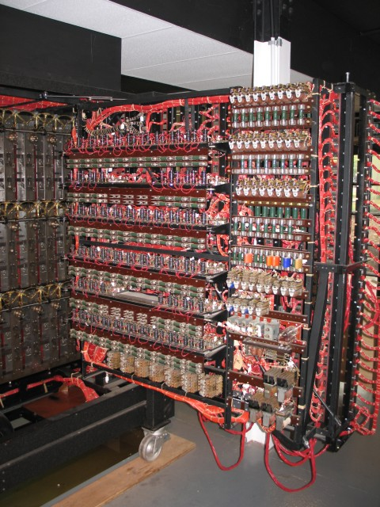
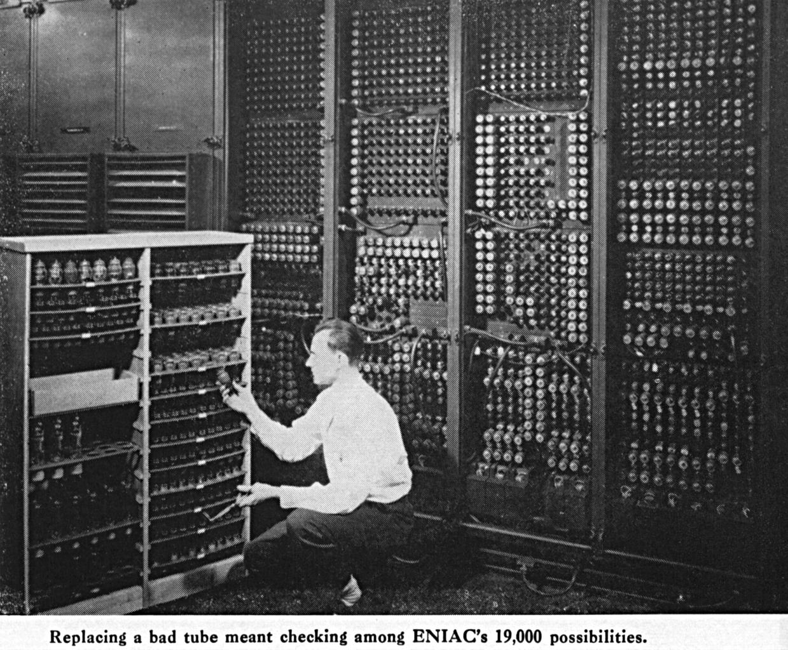

# 5. War and vacuum tubes: Zuse, Colossus and ENIAC

> 🗺️ **In this chapter:** you put in order the first electronic and electromechanical machines of the Second World War and explain why "which was the first computer?" has no single answer. · ⏱️ ~50 min

> 🔥 **Warm-up:** (1) What does a Turing machine have besides the tape? (2) How did Shannon relate switches and relays to Boole's logic?
>
> <details>
> <summary>See answers</summary>
>
> (1) A head that reads and writes, and a table of states, which is the program. (2) A closed switch is 1 and an open one is 0, so a circuit can be described with Boole's algebra.
>
> </details>

## Where we left off

In chapter 4 the ideas of computing were already on paper, and the bit gave them a unit. In this chapter the war asks for real machines: to break codes, to do artillery calculations, to go beyond what people and gears could manage. **The guiding question is: which were the first machines, and why does each source point to a different one as "the first"?**

## Relay and vacuum tube: two parts, one idea

The machines in this chapter use two kinds of part to represent 0 and 1, the same switch idea as in chapter 4.

**A relay is a switch controlled by electricity: a small current moves a mechanical part that turns another circuit on or off.**

**A vacuum tube is an electronic switch made of glass, with no moving part, which also controls the flow of current.**

The difference lies in the moving part: the relay has one, and the tube does not. But the tube burns out: according to the CHM, the ENIAC lost a tube every day or two (see *Sources*).

> 💡 **Analogy: the recipe.** Relay and tube are the cook's "hands", which carry out each step of the recipe. The relay is a cook who walks from one side of the kitchen to the other; the tube, one who only switches a light on and off. **Where the analogy breaks:** neither of them decides anything; they only do what the circuit tells them.

**Common mistake:** thinking that "electronic" and "electromechanical" are the same thing. The Z3's relays were electromechanical; the tubes of the Colossus and the ENIAC were electronic.

## Zuse and the Z3: a lone machine in Berlin

Konrad Zuse built the Z3 in Berlin, almost alone, finishing it in 1941. According to the CHM, it had 2,300 relays, a 22-bit word and binary floating-point arithmetic. The original was destroyed in a bombing raid at the end of 1943, and a reconstruction made in the 1960s is in the Deutsches Museum in Munich (CHM). Other sources give slightly different numbers for the relays; this book sticks with the CHM's.

> ⚖️ **Fact vs. interpretation.** It is a fact that the Z3 worked in 1941, with relays. It is interpretation to call it "the first computer": that depends on what you call a computer. If the definition requires vacuum tubes, it is left out; if it only requires being digital and programmable, it is in.

## Atanasoff-Berry: the ABC

The ABC, by John Atanasoff and Clifford Berry, was completed in 1942 at Iowa State (CHM). It enters the chapter because of a patent dispute, settled in 1973: according to the CHM, Mauchly saw the ABC and the computer, as a concept, was declared unpatentable. This book does not claim that Mauchly "copied" the ABC, because the source only reports the court's decision.

## Bletchley Park and the Colossus

In England, the codebreakers of Bletchley Park needed to read German messages. The CHM tells us that the Bombe, by Alan Turing and Harold Keen (1941), was based on the Polish "Bomba" of Marian Rejewski (1938). For the Lorenz cipher came the **Colossus**.



*A replica of the Bombe at Bletchley Park. Photo: Ian Petticrew, CC BY-SA 2.0, via Wikimedia Commons.*

**The Colossus was an electronic digital computer built with vacuum tubes, designed to attack encrypted messages.**

Tommy Flowers designed the Colossus, which became operational in 1944 (CHM). Ten machines were built, with up to 2,500 tubes and paper-tape reading, and they cut the time to break a Lorenz cipher from weeks to hours.

One central point: the existence of the Colossus only became public in the 1970s (CHM). That is why, for decades, it was left out of the history that people told.

**Common mistake:** thinking that the Colossus was Turing's 1936 machine in metal. It was designed by Flowers to attack a cipher; none of the sources cited presents it as Turing's universal machine.

## ENIAC and its programmers

According to the University of Pennsylvania, the ENIAC was designed by John W. Mauchly and J. Presper Eckert Jr. and announced in February 1946 (the university's page gives 14 February). The CHM adds that it was built between 1943 and 1945.



*Replacing a tube in the ENIAC. With about 18,000 of them, maintenance was routine. Photo: M. Weik, public domain, via Wikimedia Commons.*

The numbers:

- about 18,000 vacuum tubes (Penn and CHM);
- about 30 tons (Penn and CHM), in a room of 30 by 50 feet (Penn);
- the CHM sums it up: "over 1,000 times faster than any previous computer".

**The ENIAC was an electronic digital computer programmed with wires and switches: each new problem required rewiring cables between panels.**

According to Penn, the ENIAC was programmed for each job "by plugging in cables and setting switches". That task fell to women. The university names six original programmers: Kathleen McNulty (Kay) Mauchly Antonelli, Jean Jennings Bartik, Frances (Betty) Snyder Holberton, Marlyn Wescoff Meltzer, Frances Bilas Spence and Ruth Lichterman Teitelbaum. According to the CHM, Bilas and Jennings had degrees in mathematics.

> ⚖️ **Fact vs. interpretation vs. legend.**
> **Fact:** six women programmed the ENIAC by rewiring cables and setting switches, according to Penn.
> **Interpretation:** whether that work was "programming" in today's sense. It was a task of planning the order of the operations and converting it into connections, quite different from typing text into an editor.
> **Legend to avoid:** that they were only "operators" with no intellectual role. Two of them, Bilas and Jennings, had degrees in mathematics (CHM), and the task required converting a problem into connections.

> 💡 **Analogy: the recipe, again.** In the ENIAC, changing recipe meant reorganizing the kitchen: moving counters and rewiring stoves for each new dish. **Where it breaks:** chapter 6 shows how to keep the recipe inside the machine itself, and then the problem changes.

**Common mistake:** calling the ENIAC "a personal computer" or "a modern computer". It did not keep the program in memory: that is the subject of chapter 6.

## Which was the first computer?

Here is what the sources say, side by side:

| Machine | Year | Part | How it was programmed |
| --- | --- | --- | --- |
| Z3 | 1941 | relays | programmable (CHM) |
| ABC | 1942 | no data in the sources cited | no data in the sources cited |
| Colossus | 1944 | vacuum tubes | paper tape (CHM) |
| ENIAC | 1946 | vacuum tubes | wires and switches between panels |

Here is the order in Python:

```python
# Sorts the machines by the year they became operational
machines = [
    ("ENIAC", 1946),
    ("Z3", 1941),
    ("Colossus", 1944),
    ("ABC", 1942),
]
for name, year in sorted(machines, key=lambda m: m[1]):
    print(year, name)
```

Real output, run while writing the chapter:

```text
1941 Z3
1942 ABC
1944 Colossus
1946 ENIAC
```

The order changes with the criterion: "first electronic", among the machines I checked, gives the Colossus; "first programmable digital", the Z3; "first electronic and programmable by wires", the ENIAC; the weight of each criterion is interpretation. Even the law joined the conversation: in 1973, according to the CHM, the computer as a concept was declared unpatentable.

**Common mistake:** thinking that there is one right answer and the others are wrong. What exists is a badly defined question: every answer depends on a definition.

## 🏋️ Practice

**1. Worked example.** In what year was the ENIAC presented to the public, and how many years after the Z3 was that?

- ENIAC announced in 1946 (Penn).
- Z3 completed in 1941.
- 1946 − 1941 = 5 years. ✔

**2. Complete it.** Match each definition of "computer" to the machine that wins: (a) "digital and programmable, even with relays": ___; (b) "electronic, designed for a specific use": ___; (c) "electronic and programmable by wires": ___.

<details>
<summary>See answer</summary>

(a) Z3; (b) Colossus (made to attack the Lorenz cipher); (c) ENIAC. Notice that changing the definition changes the winner. Common mistake: giving a single name and thinking it holds for every definition.

</details>

**3. On your own.** Write one sentence each: (a) the difference between relay and vacuum tube; (b) why the Colossus was unknown for decades; (c) how the ENIAC was programmed.

<details>
<summary>See answer</summary>

(a) The relay is a switch with a moving part; the tube is electronic, with no moving part, but it burns out. (b) It was a military secret and only became public in the 1970s. (c) By rewiring cables between panels and setting switches, manual work that was repeated for every problem. Common mistake: saying that the ENIAC read a program kept in memory.

</details>

**4. Challenge (analyze a source).** For the ENIAC, the University of Pennsylvania says it was announced on February 14, 1946, and other publications give February 15, 1946. Answer in 4 or 5 lines: (a) why two serious sources can differ by one day; (b) which of the two you would prefer for this date and why; (c) how you would record the doubt in the text of a book.

<details>
<summary>See answer</summary>

Open answer. Check it against this rubric: (1) you recognized that the date can change depending on what is being counted (announcement, ceremony, newspaper report); (2) you preferred the source from the institution that built the machine, or a primary one; (3) you proposed recording both dates with attribution; (4) you did not choose one date merely because it is the most repeated.

</details>

## 🧠 Quick review

1. What is the difference between a relay and a vacuum tube?
2. Who designed the Colossus, and why did it only become known in the 1970s?
3. How was the ENIAC programmed?
4. Name two of the ENIAC's original programmers.
5. (From chapter 2) What did the Analytical Engine have that the ENIAC, programmed by wires, did not?

<details>
<summary>See answers</summary>

1. Relay: an electromechanical switch; tube: an electronic switch. 2. Tommy Flowers; it was a military secret. 3. With wires between panels and switches, redone for each problem. 4. For example Kay McNulty and Betty Holberton. 5. Instructions on swappable cards, separate from the calculating unit.

</details>

## 🤖 Study with an AI tutor

- "Ask me 5 questions, one at a time, about the Z3, the Colossus and the ENIAC. Wait for my answer before commenting and do not give me the answers beforehand."
- "Here is my answer to exercise [exercise number]: [my answer]. Point out my mistakes without giving me the solution."

> ➡️ **Next:** reprogramming the ENIAC meant rewiring cables for every problem. In chapter 6 you see the idea that solved this, keeping the program in memory, and the first computers for sale.

## 📌 Summary

| Item | In one sentence |
| --- | --- |
| Relay vs. vacuum tube | Electromechanical switch vs. electronic glass switch. |
| Z3 | Zuse's relay machine, finished in 1941 and destroyed in 1943. |
| ABC | Atanasoff and Berry's machine, finished in 1942; tied to the 1973 patent dispute. |
| Colossus | Flowers's vacuum-tube machine for attacking the Lorenz cipher; secret until the 1970s. |
| ENIAC | Mauchly and Eckert's vacuum-tube machine, programmed by six women with wires and switches. |
| "First computer" | Depends on the definition used. |

## 📚 Sources

- Computer History Museum, [Timeline of Computer History](https://www.computerhistory.org/timeline/computers/), checked on November 27, 2026.
- University of Pennsylvania, [ENIAC](https://www.engineering.upenn.edu/about-seas/eniac/), checked on November 28, 2026.
- Computer History Museum, [ENIAC (Revolution)](https://www.computerhistory.org/revolution/birth-of-the-computer/4/78), checked on November 27, 2026.

> 🔁 **Review today:** chapters 2 and 4

<!-- nav:start -->
---

[◀ Previous chapter](04-the-idea-of-a-universal-machine-boole-turing.md) · [Book map](../README.md) · [Next chapter ▶](06-the-program-moves-into-memory-von-neumann.md)
<!-- nav:end -->
