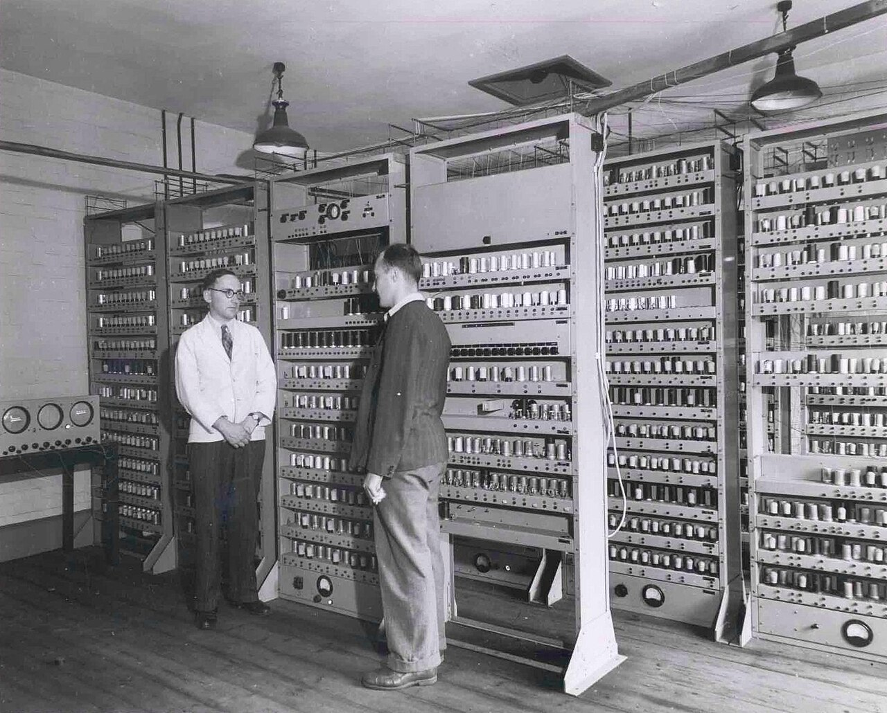

# 6. The program moves into memory: von Neumann and the first computers for sale

> 🗺️ **In this chapter:** you explain what a stored program is and why the idea ended the need to rewire cables for every problem, follow the first computers for sale and meet Zezinho, the teaching computer of the ITA. · ⏱️ ~45 min

> 🔥 **Warm-up:** (1) How was the ENIAC programmed? (2) Why does "which was the first computer?" depend on a definition?
>
> <details>
> <summary>See answers</summary>
>
> (1) With wires between panels and switches, redone for each problem. (2) Because each machine wins depending on the criterion chosen: digital, electronic, programmable, general-purpose.
>
> </details>

## Where we left off

In chapter 5, the ENIAC calculated fast, but every new problem required rewiring cables. In this chapter the idea changes place: the program stops being wire and becomes data. **The guiding question is: what changes when the program is kept in the same memory as the numbers, and how did that open the way for an industry?**

## EDVAC and von Neumann's report

In 1945, John von Neumann wrote the *First Draft of a Report on the EDVAC* (CHM). The report describes the stored-program architecture: a uniform memory that holds numbers and orders, that is, data and instructions. The IEEE cites the text as "the June 1945 EDVAC Report", which fixes the date as June 1945.

**A stored program is a program kept in the same memory as the data, so that the machine reads its instructions from there, and changing the program means writing to memory.**

It is the recipe idea that runs through the book, now inside the kitchen. Here is a minimal machine that I wrote for this book: instructions and numbers live in the same list.

```python
# Minimal stored-program machine: instructions and data in the same memory
# instruction = (operation, address); data = a plain number
def run(memory):
    acc, pc = 0, 0
    while True:
        op, addr = memory[pc]
        pc += 1
        if op == "LOAD":
            acc = memory[addr]
        elif op == "ADD":
            acc += memory[addr]
        elif op == "STORE":
            memory[addr] = acc
        elif op == "HALT":
            return memory

#            0             1            2              3            4   5   6
mem = [("LOAD", 4), ("ADD", 5), ("STORE", 6), ("HALT", 0), 20, 22, 0]
print(run(mem)[6])

# Changing the program is just writing to memory: now the sum is 20 + 20
mem = [("LOAD", 4), ("ADD", 4), ("STORE", 6), ("HALT", 0), 20, 22, 0]
print(run(mem)[6])
```

Real output, run while writing the chapter:

```text
42
40
```

Check: 20 + 22 = 42 and 20 + 20 = 40. The program occupies positions 0 to 3 of the memory, and the numbers sit in positions 4 to 6. Changing the sum meant changing one address in the list, not rewiring anything.

> 💡 **Analogy: the recipe.** In the ENIAC, the recipe was in the kitchen (cables and switches). In the stored program, the recipe is in the notebook, next to the ingredients, and the cook reads the notebook. **Where the analogy breaks:** in the kitchen, notebook and pantry are different things; in the machine, instruction and data are the same kind of thing, numbers in memory.

**Common mistake:** thinking that von Neumann "invented the computer". The draft describes the logical design of a machine, not a machine that had been built.

## Manchester Baby, EDSAC and the first to run

The idea on paper needed machines. The IEEE plaque says that, at the University of Manchester site, on June 21, 1948, the **Baby** "became the first computer to execute a program stored in addressable read-write electronic memory". The first program was a factorization, which the IEEE describes as a run of about 52 minutes and about 3.5 million operations. The sources disagree on the size of the program: the IEEE says 25 instructions and the CHM says 17. The Baby also validated the Williams–Kilburn tube memory, "later widely used".



*The EDSAC, at Cambridge, in a period photo. Photo: unknown author, CC BY 2.0, via Wikimedia Commons.*

A quick check: 3.5 million operations in 52 minutes (3,120 seconds) come to about 1,100 operations per second. ✔

The **EDSAC**, by Maurice Wilkes and his team at Cambridge, ran a program on May 6, 1949 (IEEE). According to the University of Cambridge, it went into operation in May 1949 and was "the first practical machine of its kind"; the CHM describes it as the first practical stored-program computer to provide a regular service. Cambridge's history page lists, among the machine's ideas, subroutines and microprogramming. The Baby was the first to run; the EDSAC, the first to serve regularly. This shows, once again, that the title depends on the definition.

> ⚖️ **Fact vs. interpretation.** It is a fact that the Baby ran a stored program in 1948 and that the EDSAC went into operation in 1949. It is interpretation to decide which of the two is "the first": it depends on whether you require only running, or also serving regularly.

**Common mistake:** thinking that the Baby was a useful machine. It was a test bed for the memory, and its first program only factored a number.

## UNIVAC: the computer becomes a product

The IEEE records that the sale of the UNIVAC was announced in March 1951, with delivery in June 1951. 46 units were sold, at more than US$1 million each (CHM). With these numbers, the computer stops being a laboratory project and becomes something you buy.

**A commercial computer is a computer made to be sold or rented to customers, and not only for a research institution.**

> ⚖️ **Fact vs. interpretation.** It is a fact that the UNIVAC was sold in 1951, in 46 units according to the CHM. It is interpretation to call it "the first commercial computer": the CHM says that the Ferranti Mark 1 (1951) was "probably" the first general-purpose commercial one.

## IBM enters the game

IBM already appeared in chapter 3 because of Hollerith. In June 1911 the financier Charles Ranlett Flint brought together Hollerith's Tabulating Machine Company, the International Time Recording Company and the Computing Scale Company, and the result was the Computing-Tabulating-Recording Company (C-T-R), according to IBM. In 1924, "Watson renamed C-T-R with the more expansive moniker of International Business Machines". This settles the question that chapter 3 left open: the name IBM dates neither from 1895 nor from 1911, but from 1924.

For computers, the CHM gives two milestones: the IBM 701 (1953), with 19 units rented at about US$15,000 a month, and the IBM 650 (1954), with 450 sold in a year. The arithmetic shows the difference in scale: 450 ÷ 19 is about 24 times as many machines. The CHM does not compare the prices of the two machines, so this book does not explain the difference.

> ⚖️ **Fact vs. interpretation.** It is a fact that IBM sold 450 model 650 machines in a year, according to the CHM. It is interpretation to say that this is why IBM became the leader: none of the sources cited compares IBM's sales with those of other companies.

## Brazil: the first computers and Zezinho of the ITA (1961)

In Brazil, according to *Pesquisa FAPESP* (a magazine of the São Paulo state research foundation), in 1961 electronic engineering students at the ITA (Instituto Tecnológico de Aeronáutica, the Aeronautics Institute of Technology), in São José dos Campos (SP), built **Zezinho**, "a very simple computer, whose purpose was exclusively educational" (my translation from the Portuguese). The magazine says that, in practice, it "did not carry out computing tasks" and that it was the only experiment in the area promoted with Brazilian efforts until the Patinho Feio ("Ugly Duckling"), of 1972, at the Poli-USP (the Polytechnic School of the University of São Paulo). The magazine also mentions an IBM 1620 that was already in the country, but gives no date of arrival, and this book does not say when it was.

**Common mistake:** thinking that Zezinho was a "Brazilian" computer in the commercial sense. It was educational, and the source itself says that it did not carry out computing tasks.

## 🏋️ Practice

**1. Worked example.** In the chapter's machine, what happens if we replace `("ADD", 5)` with `("ADD", 4)`?

- Position 4 holds 20 and position 5 holds 22.
- With `ADD 4`, the sum becomes 20 + 20 = 40.
- Check: the output of the second run was 40. ✔

**2. Complete it.** Write the program to add 5 and 9 and store the result in position 6: `mem = [("LOAD", ___), ("ADD", ___), ("STORE", 6), ("HALT", 0), ___, ___, 0]`.

<details>
<summary>See answer</summary>

`mem = [("LOAD", 4), ("ADD", 5), ("STORE", 6), ("HALT", 0), 5, 9, 0]`. The result is 14. Common mistake: forgetting that the numbers must be at addresses 4 and 5, and not inside the instruction.

</details>

**3. On your own.** Write one sentence each: (a) what a stored program is; (b) what the Baby proved; (c) what makes a computer "commercial".

<details>
<summary>See answer</summary>

(a) A program kept in the same memory as the data. (b) That the Williams–Kilburn memory worked and that a stored program could run. (c) Being made to sell or rent to customers. Common mistake: saying that the Baby was a machine for practical use.

</details>

**4. Challenge (analyze a source).** About the Baby's first program, the IEEE says 25 instructions and the CHM says 17. Answer in 4 or 5 lines: (a) what this shows about sources; (b) which other source you would consult; (c) how you would record the doubt in the text.

<details>
<summary>See answer</summary>

Open answer. Check it against this rubric: (1) you noticed that two serious sources can disagree; (2) you proposed an independent source (the University of Manchester's archive, an article by Kilburn); (3) you wrote the doubt into the text, with what each one says, instead of choosing silently; (4) you did not discard one of the sources because of a single point.

</details>

## 🧠 Quick review

1. What changes when the program is kept in memory?
2. What was the Baby's first program and how long did it take?
3. In what year did IBM get that name?
4. What was Zezinho?
5. (From chapter 5) How was the ENIAC programmed?

<details>
<summary>See answers</summary>

1. Changing the program becomes writing to memory. 2. A factorization; about 52 minutes. 3. 1924. 4. A teaching computer built by ITA students in 1961. 5. With wires between panels and switches.

</details>

## 🤖 Study with an AI tutor

- "Ask me 5 questions, one at a time, about the stored program, the EDSAC and the UNIVAC. Wait for my answer before commenting and do not give me the answers beforehand."
- "Here is my answer to exercise [exercise number]: [my answer]. Point out my mistakes without giving me the solution."

> ➡️ **Next:** the machines still used vacuum tubes, which burned out. In chapter 7 you see the transistor and the chip.

## 📌 Summary

| Item | In one sentence |
| --- | --- |
| Stored program | A program kept in the same memory as the data (von Neumann, 1945). |
| Manchester Baby | Ran a stored program on June 21, 1948. |
| EDSAC | Program on May 6, 1949; regular service since May 1949. |
| UNIVAC I | Sold from 1951; 46 units (CHM). |
| IBM | Name adopted in 1924, from the C-T-R of 1911. |
| Zezinho | The ITA's teaching computer (1961), which did not carry out computing tasks. |

## 📚 Sources

- IEEE ETHW, [Manchester University "Baby" Computer and its Derivatives](https://ethw.org/Milestones:Manchester_University_%22Baby%22_Computer_and_its_Derivatives,_1948-1951), checked on November 28, 2026.
- University of Cambridge, [EDSAC blue plaque](https://www.cl.cam.ac.uk/news/2026/06-23-blue-plaque-edsac/), checked on November 28, 2026.
- IBM, [C-T-R and IBM](https://www.ibm.com/history/ctr-and-ibm), checked on November 27, 2026.
- Computer History Museum, [Timeline of Computer History](https://www.computerhistory.org/timeline/computers/), checked on November 27, 2026.
- Revista Pesquisa FAPESP, [O legado do Patinho Feio](https://revistapesquisa.fapesp.br/o-legado-do-patinho-feio/) (in Portuguese), Dec. 2022, checked on November 27, 2026.

> 🔁 **Review today:** chapters 3 and 5

<!-- nav:start -->
---

[◀ Previous chapter](05-war-and-vacuum-tubes-zuse-colossus-and-eniac.md) · [Book map](../README.md) · [Next chapter ▶](07-from-the-transistor-to-the-chip.md)
<!-- nav:end -->
