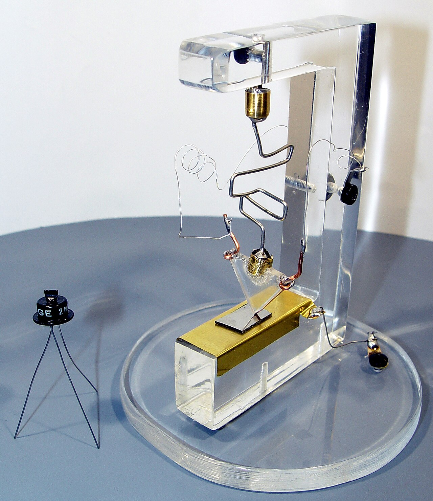

# 7. From the transistor to the chip

> 🗺️ **In this chapter:** you link the transistor, the integrated circuit and the microprocessor in a chain of cause and effect, explain what Moore's law says (and what it does not) and meet the Patinho Feio, the first computer built at the Poli-USP. · ⏱️ ~50 min

### 📇 Summary sheet: part 3

![Summary sheet for part 3: Transistor (December 1947, Bell Labs, no glass, no moving part); Integrated circuit (Kilby 1958, Noyce 1959, a circuit in one piece); System/360 (April 7, 1964, five models, same programming); Moore's law (observation of 1965, revised in 1975, doubles every two years); Intel 4004 (1971, 4 bits, 2,250 transistors, first microprocessor); Compiler (translates high level, Hopper's A-0, 1952, FORTRAN 1957, COBOL 1960); Bug and Apollo (the 1947 moth existed, the word bug is older, Margaret Hamilton); Unix and C (Unix, 1969, C, 1972, Bell Labs); PC and market reserve (Altair 1975, Alto 1974, Apple II, IBM PC, Mac, Law 7,232/1984).](../img/c00-part-3-from-the-chip-to-the-pc.svg)

- [7. From the transistor to the chip](07-from-the-transistor-to-the-chip.md)
- [8. Teaching the machine to understand people: the birth of software](08-teaching-the-machine-to-understand-people.md)
- [9. A computer on every desk](09-a-computer-on-every-desk.md)

> 🔥 **Warm-up:** (1) What was the flaw of vacuum tubes? (2) Why do the EDSAC and the Baby show that "first" depends on the definition?
>
> <details>
> <summary>See answers</summary>
>
> (1) They were made of glass, ran hot and burned out. (2) Because the Baby was the first to run a stored program, and the EDSAC was the first to provide a regular service.
>
> </details>

## Where we left off

In chapter 6 the program moved into memory, but the machines were still built from vacuum tubes, expensive and prone to burning out. In this chapter the part changes, and with it the size and the price of computers. **The guiding question is: how did a smaller, cheaper part turn the computer from a machine for the few into a machine for the many?**

## The transistor (1947)

In December 1947 John Bardeen and Walter Brattain obtained "transistor action" in a germanium device with point contacts, at Bell Labs, according to the Computer History Museum (CHM). The CHM page dates the first successful semiconductor amplifier to December 16, 1947, and says that William Shockley came back from the war in 1945 to organize the solid-state physics group where this happened.



*Replica of the first point-contact transistor, from 1947. Photo: Mister rf, CC BY-SA 4.0, via Wikimedia Commons.*

**A transistor is an electronic switch made of semiconductor material, with no glass and no moving part, that also amplifies signals.**

Compare it with chapter 5: the relay had a moving part; the vacuum tube, glass and a heated filament. The transistor does the same switching job inside a solid piece of material. According to the CHM, the TX-0, from 1956, was the first general-purpose programmable computer built with transistors.

> 💡 **Analogy: the recipe.** The transistor is a cook who turns the light on and off without heating up the kitchen. **Where the analogy breaks:** the real difference is in materials physics, and the analogy does not show why germanium and silicon work.

**Common mistake:** thinking that the transistor "was invented by a single person". The CHM names Bardeen and Brattain for the device and Shockley as the organizer of the group.

> ⚖️ **Fact vs. interpretation.** It is a fact that the device worked in December 1947 at Bell Labs, according to the CHM. It is interpretation to say who "deserves" the credit: this book only reports whom the source cites.

## The integrated circuit

A computer with thousands of loose transistors needs thousands of wires soldered by hand. The way out was to make several components together, in the same piece of material. According to the CHM, in 1958 Jack Kilby produced a microcircuit with active and passive components made of semiconductor material, and in 1959 Robert Noyce, starting from Jean Hoerni's planar process, patented a monolithic integrated circuit structure.

**An integrated circuit is a complete circuit, with several components and the connections between them, made in a single piece of semiconductor material.**

Two people, two companies, almost at the same time: a good example of how ripe ideas appear in more than one place. The CHM also records the Apollo Guidance Computer as one of the first uses of integrated circuits.

**Common mistake:** thinking that "chip" and "transistor" are synonyms. A chip contains many transistors.

## System/360 and mainframes

With cheaper parts, the problem changed: every new computer required rewriting all the programs. According to the CHM, the IBM 1401 (1961) sold more than 12,000 units. On April 7, 1964, IBM announced the **System/360**: five models that used the same programming, with an investment of US$5 billion, according to the CHM.

**A mainframe is a large general-purpose computer, installed in a company or institution and used by many people through operators and terminals.**

What the CHM highlights in the 360 is compatibility: the same programming across all the models. The CHM also records, at about the same time, the PDP-8, at US$18,000, one fifth of the price of a small 360. It opens the way to smaller computers.

> 💡 **Analogy: the recipe.** The 360 is a recipe that works on any stove of the same brand, from the small one to the industrial one. **Where it breaks:** real recipes do not need compatibility, and programs do.

## Moore's law

On April 19, 1965, Gordon Moore, then director of research at Fairchild, published the article "Cramming more components onto integrated circuits" in the magazine *Electronics*. According to the CHM, he drew a line through five points, from 1959 to 1964, showing the number of components per integrated circuit at the lowest cost per component. Extrapolating to 1975, he projected 65,000 components on a chip, "a doubling every 12 months". In 1975 Moore corrected the pace to a doubling every two years, and the CHM says that the prediction became "a self-fulfilling prophecy": the industry began to use it as a target. The name "law" came from Carver Mead.

**Moore's law is the observation that the number of components per chip doubles at regular intervals, today counted at about two years.**

See what doubling does to the arithmetic. We start from the 2,250 transistors of the Intel 4004 and simulate doubling every one or every two years. It is my own projection, not historical data:

```python
# Simple projection: starts at the 2,250 transistors of the Intel 4004 (1971)
base = 2250
for years_per_doubling in (1, 2):
    print(f"doubling every {years_per_doubling} year(s):")
    for year in (1971, 1981, 1991, 2001):
        n = base * 2 ** ((year - 1971) / years_per_doubling)
        print(f"  {year}: {n:,.0f}")
```

Real output, run while writing the chapter:

```text
doubling every 1 year(s):
  1971: 2,250
  1981: 2,304,000
  1991: 2,359,296,000
  2001: 2,415,919,104,000
doubling every 2 year(s):
  1971: 2,250
  1981: 72,000
  1991: 2,304,000
  2001: 73,728,000
```

Doubling every year would lead to trillions of transistors on a chip in 2001, which did not happen. The 1975 correction to two years shows that the "law" is an observation about a pace, one that Moore himself adjusted. It is not a law of nature. This book does not compare the projection with real chips, because the sources cited do not give the numbers of real chips.

**Common mistake:** thinking that Moore's law says computers get "twice as fast" every two years. The observation is about components per chip, not about speed.

> ⚖️ **Fact vs. interpretation.** It is a fact that Moore published the prediction in 1965 and revised it in 1975. It is interpretation to say that it "caused" the progress: the CHM calls it a self-fulfilling prophecy, which already suggests that part of the effect came from companies taking it as a target.

## The Intel 4004 (1971)

When thousands of transistors fit on a chip, the part of a whole computer that does the processing fits too. According to the CHM, the 4004 was developed for Busicom, a Japanese calculator maker, and had 2,250 transistors, with up to 90,000 operations per second, in blocks of four bits. Federico Faggin led the project and Ted Hoff the architecture. The CHM calls it the first microprocessor.

**A microprocessor is the central processing unit of a computer entirely inside a single chip.**

Notice the chain of cause and effect: the integrated circuit (1958–59) gave the means of manufacture, Moore's law (1965) gave the pace, and the 4004 (1971) showed what fit on a chip. It went into a calculator, not a "personal computer", and chapter 9 tells what came next.

**Common mistake:** thinking that the 4004 was already a personal computer. It was a component for calculators.

## Brazil: the Patinho Feio, the G-10 and Cobra

The same wave reached Brazil by another road. According to *Revista Pesquisa FAPESP* (a magazine of the São Paulo state research foundation), in 1972 the Escola Politécnica of the USP (the Poli-USP, the University of São Paulo's engineering school) built the **Patinho Feio** ("Ugly Duckling"), the final project of the graduate course in Computer Architecture. It weighed about 100 kg and had 450 integrated-circuit chips, about 3 thousand logic blocks, 45 boards and 4 kB of memory. The same report says that it was the basis of the **G-10**, developed by the Poli-USP and the PUC-Rio at the Navy's request, and that the G-10 was the prototype of the **MC 500**, from **Cobra**, a state-owned company created in 1974. The magazine also tells that, in 1968, the Poli studied an IBM 1620 by reverse engineering, and cites Edith Ranzini among the people on the project. The report does not give the year the MC 500 was launched, and this book does not state it either.

> 💡 **Analogy: the recipe.** Building the Patinho Feio was like learning to cook by taking apart an imported dish, and then creating your own. **Where it breaks:** the reverse engineering of an IBM 1620 was a study, and the Patinho Feio was a new design, according to the source.

**Common mistake:** thinking that the Patinho Feio was a commercial product. It was an academic project; the source links the next steps to it, the G-10 and the MC 500.

## 🏋️ Practice

**1. Worked example.** How much did a small 360 cost, if the PDP-8 cost US$18,000 and, according to the CHM, was one fifth of that price?

- The PDP-8 cost US$18,000, "one fifth of the price" of a small 360 (CHM).
- So the small 360 cost 5 × 18,000 = US$90,000.
- Check: 90,000 ÷ 18,000 = 5. ✔

**2. Complete it.** Match each part to its era and to the problem it solved: (a) vacuum tube → ___ (problem: ___); (b) transistor → 1947 (problem: ___); (c) integrated circuit → ___ (problem: ___).

<details>
<summary>See answer</summary>

(a) The 1940s, the ENIAC; problem: it was made of glass and burned out. (b) It eliminated the moving part and the glass. (c) 1958–59; problem: thousands of loose transistors required thousands of connections made by hand. Common mistake: confusing transistor and chip.

</details>

**3. On your own.** Write one sentence each: (a) what a microprocessor is; (b) what Moore's law says; (c) what the System/360 brought that was new.

<details>
<summary>See answer</summary>

(a) The whole CPU on a single chip. (b) That the number of components per chip doubles at regular intervals, adjusted by Moore to about two years. (c) Compatibility: the same programming across different models. Common mistake: saying that Moore's law is about speed.

</details>

**4. Challenge (analyze a source).** The CHM calls Moore's prediction a "self-fulfilling prophecy", and the literature around it uses the term "observation". Answer in 4 or 5 lines: (a) what is the difference between a law, a prediction and an observation; (b) why a prediction can come true because it is taken as a target; (c) what evidence you would ask for before saying that it "holds" today.

<details>
<summary>See answer</summary>

Open answer. Check it against this rubric: (1) you distinguished law (always holds), prediction (looks ahead) and observation (describes the past); (2) you explained the target effect (companies plan to meet it); (3) you asked for current data from manufacturers, not a repeated phrase; (4) you did not treat "law" as a law of nature.

</details>

## 🧠 Quick review

1. Who obtained "transistor action" in 1947, and where?
2. What is an integrated circuit?
3. What was new about the System/360?
4. What is the difference between the 1965 prediction and the 1975 one?
5. (From chapter 6) Why is the EDSAC remembered as the first to provide a regular service?

<details>
<summary>See answers</summary>

1. Bardeen and Brattain, at Bell Labs. 2. A complete circuit made in a single piece of semiconductor material. 3. The same programming across five models. 4. Doubling every 12 months in 1965; every two years in 1975. 5. Because it went into regular operation in 1949, according to the sources.

</details>

## 🤖 Study with an AI tutor

- "Ask me 5 questions, one at a time, about the transistor, the integrated circuit, Moore's law and the Intel 4004. Wait for my answer before commenting and do not give me the answers beforehand."
- "Here is my answer to exercise [exercise number]: [my answer]. Point out my mistakes without giving me the solution."

> ➡️ **Next:** cheap, fast machines are only useful if someone knows how to instruct them. In chapter 8 you see how software was born.

## 📌 Summary

| Item | In one sentence |
| --- | --- |
| Transistor | A semiconductor switch, with no glass and no moving part; December 1947, Bell Labs. |
| Integrated circuit | A complete circuit in a single piece of material; Kilby (1958) and Noyce (1959). |
| System/360 | Announced on April 7, 1964; five models with the same programming. |
| Moore's law | An observation from 1965, revised in 1975 to a doubling every two years. |
| Intel 4004 | First microprocessor (1971); 2,250 transistors; 4 bits. |
| Patinho Feio | Poli-USP computer (1972); basis of the G-10 and of Cobra's MC 500. |

## 📚 Sources

- Computer History Museum, [Invention of the Point-Contact Transistor](https://www.computerhistory.org/siliconengine/invention-of-the-point-contact-transistor/), checked on November 28, 2026.
- Computer History Museum, [Silicon Engine Timeline](https://www.computerhistory.org/siliconengine/timeline/), checked on November 28, 2026.
- Computer History Museum, [Moore's Law Predicts the Future of Integrated Circuits](https://www.computerhistory.org/siliconengine/moores-law-predicts-the-future-of-integrated-circuits/), checked on November 28, 2026.
- Computer History Museum, [1971](https://www.computerhistory.org/timeline/1971/), checked on November 28, 2026.
- Computer History Museum, [Timeline of Computer History](https://www.computerhistory.org/timeline/computers/), checked on November 27, 2026.
- Revista Pesquisa FAPESP, [O legado do Patinho Feio](https://revistapesquisa.fapesp.br/o-legado-do-patinho-feio/) (in Portuguese), Dec. 2022, checked on November 27, 2026.

> 🔁 **Review today:** chapters 4 and 6

<!-- nav:start -->
---

[◀ Previous chapter](06-the-program-moves-into-memory-von-neumann.md) · [Book map](../README.md) · [Next chapter ▶](08-teaching-the-machine-to-understand-people.md)
<!-- nav:end -->
