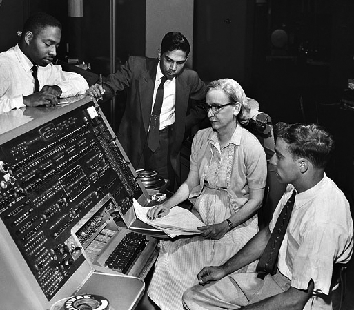

# 8. Teaching the machine to understand people: the birth of software

> 🗺️ **In this chapter:** you explain what a compiler does, recognize the milestones of FORTRAN, COBOL and Unix, and separate fact from legend in the "first bug". · ⏱️ ~50 min

> 🔥 **Warm-up:** (1) What is a stored program? (2) What was new about the System/360?
>
> <details>
> <summary>See answers</summary>
>
> (1) A program kept in the same memory as the data. (2) The same programming across five different models.
>
> </details>

## Where we left off

In chapters 6 and 7 the machines became smaller and cheaper, but programming them still meant writing numbers and operation codes, like the `("LOAD", 4)` of chapter 6. **The guiding question is: how did people stop speaking the machine's language and start asking the machine to understand theirs?**

## Grace Hopper and the A-0

According to the Computer History Museum (CHM), in 1952 the mathematician Grace Hopper completed the A-0, a program that let the people using the computer write in words close to English. In 1957 the CHM returns to her and calls the A-0 a "compiler".



*Grace Hopper at the UNIVAC console, with colleagues. Photo: unknown author, CC BY 2.0, via Wikimedia Commons.*

**A compiler is a program that translates a text written in a language close to human language, into the instructions that the machine executes.**

To see the idea, here is a minimal compiler that I wrote for this book. It translates a line like `total = 20 + 22` into a program for the chapter 6 machine and then runs it:

```python
# Minimal compiler: translates "x = a + b" for the chapter 6 machine
def compile_line(line):
    target, expression = [p.strip() for p in line.split("=")]
    a, b = [int(p) for p in expression.split("+")]
    # program (positions 0 to 3), data (4 and 5) and the result (6)
    return [("LOAD", 4), ("ADD", 5), ("STORE", 6), ("HALT", 0), a, b, 0]

def run(mem):
    acc, pc = 0, 0
    while True:
        op, arg = mem[pc]
        pc += 1
        if op == "LOAD":
            acc = mem[arg]
        elif op == "ADD":
            acc += mem[arg]
        elif op == "STORE":
            mem[arg] = acc
        elif op == "HALT":
            return mem

program = compile_line("total = 20 + 22")
print(program)
print(run(program)[6])
```

Real output, run while writing the chapter:

```text
[('LOAD', 4), ('ADD', 5), ('STORE', 6), ('HALT', 0), 20, 22, 0]
42
```

Whoever wrote the line `total = 20 + 22` did not need to know in which memory position the numbers sit. The compiler decided that. Note a limitation of my example: it only understands sums of two numbers and ignores the name `total`. A real compiler handles names, many kinds of operations and errors.

> 💡 **Analogy: the recipe.** The compiler is a translator who takes the recipe in English and hands it to the cook in the cook's own language. **Where the analogy breaks:** the compiler translates the whole program before it runs, and the translated program no longer needs the translator.

**Common mistake:** thinking that the compiler "executes" the program. It only translates; the machine executes it, afterwards.

## FORTRAN and COBOL

With the compiler came programming languages. According to the CHM, in 1957 an IBM team led by John Backus developed **FORTRAN**, and at about the same time Hopper completed FLOW-MATIC and MATH-MATIC. IBM says that the first FORTRAN compiler was made available shortly afterwards to users of the IBM 704.

In 1960, according to the CHM, a team made up of several manufacturers and the Pentagon developed **COBOL**, and many of its specifications came from FLOW-MATIC. This book does not state Hopper's exact role in COBOL, because the pages cited do not detail it.

**A high-level language is a programming language close to human language or to mathematics, which a compiler translates into machine language.**

> ⚖️ **Fact vs. interpretation.** It is a fact that FORTRAN and FLOW-MATIC appeared around 1957 and COBOL in 1960. It is interpretation to call someone the "mother" or "father" of a language: the sources describe teams, not a single person.

**Common mistake:** thinking that COBOL and FORTRAN were the same language. One was born in an IBM team; the other, from a group of several manufacturers and the Pentagon.

## The myth of the first "bug"

A famous story says that the first "bug" was a moth found in a computer. *JSTOR Daily* sorts out what is true in it. In 1947 a moth was found in Harvard's Mark II and taped into the logbook with the note "first actual case of a bug being found". The logbook is at the Smithsonian. But the word "bug" for a defect already appeared in a letter from Edison in 1878 and in the *Pall Mall Gazette* of March 11, 1889, and "debug" appears in 1945 in the *Journal of the Royal Aeronautical Society*. The article adds that the logbook probably did not belong to Hopper.

> ⚖️ **Fact vs. interpretation vs. legend.**
> **Fact:** in 1947 a moth was taped into a Mark II logbook and the note called it "first actual case of a bug being found".
> **Interpretation:** the "actual" in the note suggests that "bug" was already a word for a defect; this is my own reading, and the source does not state it.
> **Legend to avoid:** that the word "bug" was born with the moth, or that Hopper found it.

**Common mistake:** repeating the legend as if it were the origin of the word.

## Margaret Hamilton and Apollo

The CHM describes Margaret Hamilton as the person who led the software team of NASA's Apollo program and developed the flight software that took human beings to the Moon. She joined the MIT effort to build the software of the Apollo Guidance Computer, the computer that chapter 7 cited as one of the first to use integrated circuits. The CHM says that she helped establish software engineering as a discipline of its own, and that President Obama gave her the Presidential Medal of Freedom in 2016. This book does not state that she "coined" the term, because I could not confirm that in an open source.

**Software engineering is the application of engineering methods (planning, testing, record-keeping) to the building of programs, so that they work reliably.**

A flight program that takes people to the Moon shows why software engineering came to be discussed as a discipline.

**Common mistake:** thinking that software "always existed alongside the computer". Chapter 6 itself showed that the program only became a separate object when it moved into memory.

## Atlas, Unix and C

Before Unix, computers already needed a program to manage the other programs. According to the CHM, the Atlas (1962) had virtual memory and the "Atlas Supervisor", considered by some to be the first real operating system.

**An operating system is the program that manages the machine and shares out memory, processor and devices among the other programs.**

According to the CHM, in 1969 the programmers Kenneth Thompson and Dennis Ritchie, of AT&T's Bell Labs, developed **Unix** on a spare DEC minicomputer. In 1972, Ritchie and his team created the **C** language, based on the earlier language BCPL.

> 💡 **Analogy: the recipe.** The operating system is the kitchen manager: it decides who uses which stove and when. **Where it breaks:** the kitchen manager is a person who sees everything; the system only knows what the machine shows it.

**Common mistake:** thinking that the operating system and the hardware are the same thing. The system is a program like the others, which runs on the machine.

## 🏋️ Practice

**1. Worked example.** How many years separate the A-0 (1952) from Unix (1969)?

- A-0: 1952.
- Unix: 1969.
- 1969 − 1952 = 17 years. ✔

**2. Complete it.** In the chapter's minimal compiler, write the line it would accept to add 15 and 27: `compile_line("total = ___ + ___")`. The expected result is ___.

<details>
<summary>See answer</summary>

`compile_line("total = 15 + 27")`. The result is 42, since 15 + 27 = 42. Common mistake: thinking that the compiler understands `15 × 27`; the example only adds.

</details>

**3. On your own.** Write one sentence each: (a) what a compiler does; (b) what an operating system is; (c) why the moth story does not explain the origin of the word "bug".

<details>
<summary>See answer</summary>

(a) It translates a text in a high-level language into machine instructions. (b) The program that manages the machine and shares out its resources. (c) Because the word was already used for a defect before 1947 (Edison in 1878, a newspaper in 1889). Common mistake: saying that the compiler executes the program.

</details>

**4. Challenge (analyze a source).** The moth story appears in many places as "the first bug". Answer in 4 or 5 lines: (a) what evidence refutes the legend; (b) why an anecdote like this spreads; (c) how you would check a similar anecdote before repeating it.

<details>
<summary>See answer</summary>

Open answer. Check it against this rubric: (1) you cited the earlier use of the word (Edison, 1878; a newspaper, 1889); (2) you explained why the story is good (simple, visual, has a famous character); (3) you proposed going back to the original document or to a historian who has examined it; (4) you did not state what the source does not say, such as the authorship of the logbook.

</details>

## 🧠 Quick review

1. What is a compiler?
2. Who led the development of FORTRAN at IBM?
3. Which two uses of the word "bug" predate 1947?
4. What does the CHM say Margaret Hamilton did on Apollo?
5. (From chapter 5) Why did the ENIAC have to be rewired for every problem?

<details>
<summary>See answers</summary>

1. A program that translates a high-level language into the machine's. 2. John Backus. 3. Edison's letter of 1878 and the *Pall Mall Gazette* of 1889. 4. She led the flight software team. 5. Because the program was in cables and switches, not in memory.

</details>

## 🤖 Study with an AI tutor

- "Ask me 5 questions, one at a time, about the compiler, FORTRAN, COBOL, the bug myth and Unix. Wait for my answer before commenting and do not give me the answers beforehand."
- "Here is my answer to exercise [exercise number]: [my answer]. Point out my mistakes without giving me the solution."

> ➡️ **Next:** with software, computers became useful, and with chips they became cheap. In chapter 9 they reach homes, and the Brazil of the 1980s.

## 📌 Summary

| Item | In one sentence |
| --- | --- |
| Compiler | A program that translates a high-level language into machine instructions. |
| A-0 | Grace Hopper's program of 1952, which used words close to English. |
| FORTRAN | An IBM language, from John Backus's team, 1957. |
| COBOL | A language of 1960 from a team of manufacturers and the Pentagon; it drew on FLOW-MATIC. |
| The 1947 moth | True, but the word "bug" already existed (1878, 1889). |
| Margaret Hamilton | Led Apollo's flight software (CHM). |
| Unix and C | Bell Labs: Unix in 1969 (Thompson and Ritchie), C in 1972. |

## 📚 Sources

- Computer History Museum, [1952](https://www.computerhistory.org/timeline/1952/), checked on November 28, 2026.
- Computer History Museum, [1957](https://www.computerhistory.org/timeline/1957/), checked on November 28, 2026.
- Computer History Museum, [Software and Languages](https://www.computerhistory.org/timeline/software-languages/), checked on November 28, 2026.
- Computer History Museum, [Margaret Hamilton in her own words](https://computerhistory.org/blog/margaret-hamilton-in-her-own-words/), checked on November 28, 2026.
- IBM, [FORTRAN](https://www.ibm.com/history/fortran), checked on November 28, 2026.
- JSTOR Daily, [The Bug in the Computer Bug Story](https://daily.jstor.org/the-bug-in-the-computer-bug-story), checked on November 27, 2026.
- Computer History Museum, [Timeline of Computer History](https://www.computerhistory.org/timeline/computers/), checked on November 27, 2026.

> 🔁 **Review today:** chapters 1, 5 and 7

<!-- nav:start -->
---

[◀ Previous chapter](07-from-the-transistor-to-the-chip.md) · [Book map](../README.md) · [Next chapter ▶](09-a-computer-on-every-desk.md)
<!-- nav:end -->
