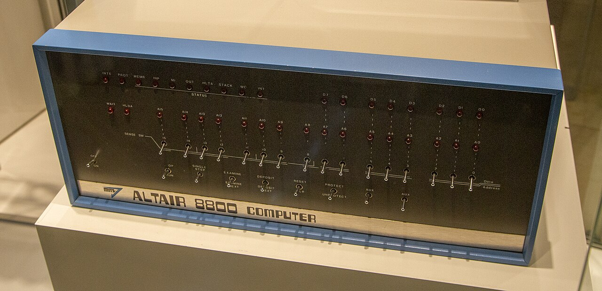
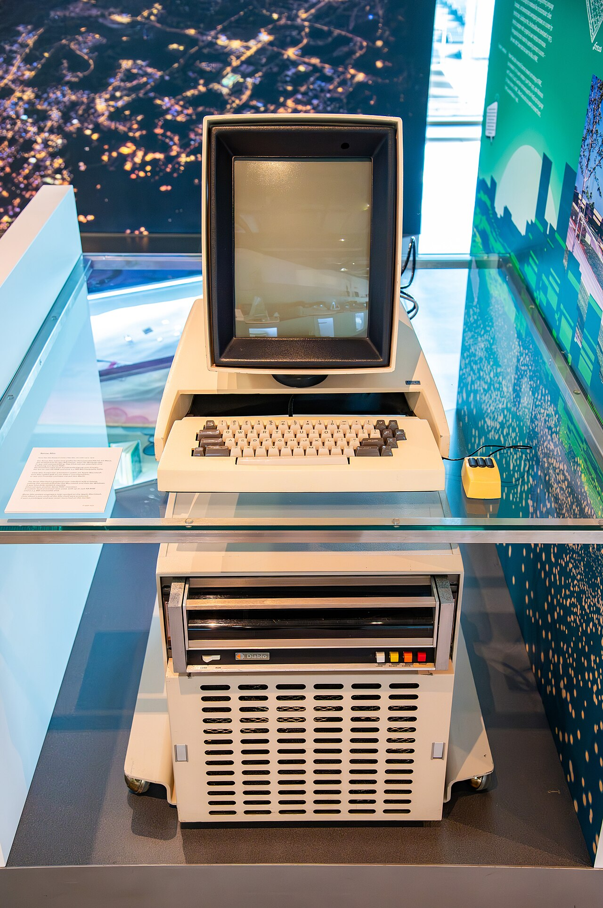

# 9. A computer on every desk

> 🗺️ **In this chapter:** you explain why the personal computer appeared in the 1970s, which Xerox PARC ideas have reached us, and what Law 7,232/1984 said about computing in Brazil. · ⏱️ ~45 min

> 🔥 **Warm-up:** (1) What was the Intel 4004 and who was it made for? (2) Why do Unix and C matter in the history of software?
>
> <details>
> <summary>See answers</summary>
>
> (1) The first microprocessor, made for Busicom, a Japanese calculator maker. (2) They were created at Bell Labs (1969 and 1972) and gave software an operating system and a language that other programmers reused.
>
> </details>

## Where we left off

In chapter 7 the chip became cheap, and in chapter 8 people learned to write programs without speaking the machine's language. One piece is missing: someone buying a computer for themselves. **The guiding question is: what made the computer leave the data-processing center and reach a person's desk?**

## The Altair and the clubs

The **Altair 8800** appeared on the cover of *Popular Electronics* in January 1975, according to the Computer History Museum (CHM). The CHM gives the prices: "$297, or $395 with a case", that is, the kit to assemble cost US$297 and, with a case, US$395. Bill Gates and Paul Allen licensed BASIC to the manufacturer, MITS, according to the CHM.



*An Altair 8800. Photo: Maksym Kozlenko, CC BY-SA 4.0, via Wikimedia Commons.*

**A personal computer is a computer cheap and small enough to be bought and used by one person, rather than by an institution.**

Notice what changed compared with chapter 7: the 4004 went into a calculator, and the Altair into the hands of anyone who wanted to build a computer at home. It was a machine for enthusiasts, sold as a kit.

> 💡 **Analogy: the recipe.** The Altair is a kitchen in a kit: the stove comes in pieces and you do the rest. **Where the analogy breaks:** in the kit kitchen the recipe already exists, while for the Altair almost everything, even BASIC, had to be written.

**Common mistake:** thinking that the Altair came ready to use. It was a kit, and the version with a case cost extra, according to the CHM itself.

## Xerox PARC and the graphical interface

The CHM records, in 1974, the **Xerox Alto**, "a groundbreaking computer with wide influence on the computer industry". According to the CHM, it had a graphical interface with windows, icons and a mouse, a local network and a laser printer, and the Lisa and the Macintosh were inspired by it.



*A Xerox Alto. Photo: Bc4040, CC BY 4.0, via Wikimedia Commons.*

**A graphical user interface (GUI) is a way of using the computer through images (windows, icons, a pointer) instead of typed commands.**

To see the contrast, imagine asking to "copy file A to folder B". On the command line you type the words; in a graphical interface, you drag the icon. The second way spares you from memorizing commands; that is the usual argument in its favor, which the chapter's sources do not discuss.

**Common mistake:** thinking that the graphical interface was born with the Macintosh. The CHM places it in the Alto, ten years earlier, and says that the Macintosh was inspired by it.

## Apple II, IBM PC and Macintosh

In 1977 the CHM records the **Apple II**, sold complete, with logic board, power supply, keyboard, case and manual. In 1981 comes the **IBM PC**, formally the IBM Model 5150, and in 1984 the **Macintosh**, at US$2,500, introduced in a commercial shown during Super Bowl XVIII, on January 22, 1984. The CHM also lists the Osborne 1 (US$1,795), the first mass-produced portable, and the Commodore 64 (1982, US$595).

See the prices side by side, in dollars of the day, without inflation adjustment:

```python
# CHM launch prices (US dollars of the day, not inflation-adjusted)
machines = [
    ("Altair 8800 (kit)", 1975, 297),
    ("Altair 8800 (with case)", 1975, 395),
    ("Osborne 1", 1981, 1795),
    ("Commodore 64", 1982, 595),
    ("Macintosh", 1984, 2500),
]
for name, year, price in sorted(machines, key=lambda m: m[2]):
    print(f"{price:>5}  {year}  {name}")
print("Macintosh / Commodore 64 =", round(2500 / 595, 1))
```

Real output, run while writing the chapter:

```text
  297  1975  Altair 8800 (kit)
  395  1975  Altair 8800 (with case)
  595  1982  Commodore 64
 1795  1981  Osborne 1
 2500  1984  Macintosh
Macintosh / Commodore 64 = 4.2
```

The Macintosh cost about 4.2 times the Commodore 64. Since the prices are from different years and not adjusted, the calculation shows an order of magnitude, not an exact comparison.

> ⚖️ **Fact vs. interpretation.** It is a fact that the IBM PC came out in 1981 and the Macintosh in 1984, at US$2,500, according to the CHM. It is interpretation to say that one "beat" the other: the sources cited do not compare sales.

**Common mistake:** thinking that the IBM PC was the first personal computer. It came after the Altair and the Apple II.

## Software as a product

The Altair shows a less obvious fact: the program could be sold separately from the machine. According to the CHM, Gates and Allen licensed BASIC to MITS. To say that this is why software became a business in its own right would be interpretation, and the sources cited do not make it.

**Software as a product is a program sold or licensed separately from the machine it runs on.**

**Common mistake:** thinking that before 1975 "there was no software for sale". Chapter 8 showed languages such as FORTRAN and COBOL, which already existed in 1957 and 1960. What changes here is the audience: the individual, not the institution.

## Brazil: Law 7,232/1984 and the market reserve

In Brazil, the personal computer arrived under a different rule. **Law No. 7,232 of October 29, 1984** established the National Informatics Policy. According to the original text (published in the *Diário Oficial*, the official gazette, on October 30, 1984; the quotations below are my translation from the Portuguese):

- Art. 2: the policy aims at "national capacity-building in computing activities, for the benefit of social development".
- Art. 9: to protect national companies "while they are not consolidated and able to compete in the international market", the law provides for "restrictions of a transitory nature".
- Art. 11: public bodies "shall give preference, in purchasing computing goods and services, to those produced by national companies".
- Arts. 1 and 8: it creates the National Council for Informatics and Automation (CONIN), and the Special Secretariat for Informatics (SEI) is a body subordinate to it.
- Art. 4, VIII: it provides for "the control of imports of computing goods and services for 8 (eight) years from the publication of this Law".
- Art. 45: the law comes into force 60 days after publication.

Note that the expression "market reserve" does not appear in the text. It is the name later given to the set of restrictions. The acronym CAPRE, which many people associate with the subject, does not appear either, and so this book does not explain that agency.

**Brazil's computing market reserve was the policy of protecting national companies in the sector with import restrictions and preference in public purchasing.**

What happened afterwards? In 2004, José Ellis Ripper Filho told *Revista Pesquisa FAPESP*, speaking of the Collor government: "They wanted to end the reserve and they ended the market" (my translation), and explained that, in the case of components, "it became cheaper to import a kit to assemble the equipment here". He is talking about one specific sector, components, and this is testimony, not an assessment of the period. Law No. 8,248 of 1991 returned to the subject: it defines a "Brazilian company of national capital" by reference to Law 7,232 and lays down benefits and incentives, but the text of the law does not say that it ends the reserve.

> ⚖️ **Fact vs. interpretation.** It is a fact that the law provided for import control for eight years and for preference in public purchasing. It is interpretation to say whether the policy "worked" or "set the country back": the sources cited give the text of the law and one testimony, not an assessment.

**Common mistake:** thinking that Law 7,232 banned imported computers. The text speaks of "restrictions of a transitory nature" and of import control, not of a ban.

## 🏋️ Practice

**1. Worked example.** How much more did the Altair with a case cost than the kit?

- Kit: US$297. With a case: US$395.
- 395 − 297 = US$98.
- Check: 297 + 98 = 395. ✔

**2. Complete it.** Write what each acronym or name stands for: Altair 8800 → ___ (year ___); Xerox Alto → ___ (year ___); Law 7,232 → ___ (year ___).

<details>
<summary>See answer</summary>

Altair: a kit computer for enthusiasts, 1975. Alto: a computer with a graphical interface and a mouse, 1974. Law 7,232: the National Informatics Policy, 1984. Common mistake: swapping the years of the Alto (1974) and the Altair (1975).

</details>

**3. On your own.** Write one sentence each: (a) what a graphical interface is; (b) what Article 9 of Law 7,232 provided; (c) why the expression "market reserve" does not appear in the text of the law.

<details>
<summary>See answer</summary>

(a) Using the computer through windows, icons and a pointer, instead of typed commands. (b) Restrictions of a transitory nature to protect national companies until they were able to compete. (c) Because it is a name given later to the set of measures. Common mistake: saying that the law banned imports.

</details>

**4. Challenge (analyze a source).** Ripper says, in a 2004 interview, that "they ended the market". The law, for its part, is a text from 1984. Answer in 4 or 5 lines: (a) what kind of source each one is; (b) what each one proves and what it does not; (c) how you would reach a conclusion about the effects of the policy.

<details>
<summary>See answer</summary>

Open answer. Check it against this rubric: (1) you distinguished a legal text (it says what the rule provided) from testimony (it says what a person saw and remembers); (2) you recognized that neither measures the result; (3) you proposed data such as production, prices and jobs, from independent sources; (4) you did not take the interviewee's sentence as a general assessment.

</details>

## 🧠 Quick review

1. How much did the Altair 8800 cost as a kit?
2. Which ideas does the CHM attribute to the Xerox Alto?
3. In what year did the IBM PC come out, and in what year the Macintosh?
4. What does Article 9 of Law 7,232 say?
5. (From chapter 8) What is a compiler?

<details>
<summary>See answers</summary>

1. US$297. 2. Windows, icons, mouse, local network and laser printer. 3. 1981 and 1984. 4. Transitory restrictions to protect national companies until they can compete. 5. A program that translates a high-level language into machine instructions.

</details>

## 🤖 Study with an AI tutor

- "Ask me 5 questions, one at a time, about the Altair, the Xerox Alto, the IBM PC and Law 7,232. Wait for my answer before commenting and do not give me the answers beforehand."
- "Here is my answer to exercise [exercise number]: [my answer]. Point out my mistakes without giving me the solution."

> ➡️ **Next:** computers at home soon want to talk to each other. In chapter 10 you see how the network and the internet were born.

## 📌 Summary

| Item | In one sentence |
| --- | --- |
| Altair 8800 | A kit computer, on the cover of *Popular Electronics* in January 1975; US$297 (kit) or US$395 (with a case). |
| Xerox Alto | A 1974 machine with windows, icons, a mouse and a local network; it influenced the Lisa and the Macintosh. |
| Apple II, IBM PC, Macintosh | 1977, 1981 and 1984; the Macintosh cost US$2,500. |
| Software as a product | A program sold separately from the machine; the Altair's BASIC is an example. |
| Law 7,232/1984 | National Informatics Policy: transitory protection for national companies, preference in public purchasing and import control for 8 years. |

## 📚 Sources

- Computer History Museum, [1974](https://www.computerhistory.org/timeline/1974/), checked on November 28, 2026.
- Computer History Museum, [1975](https://www.computerhistory.org/timeline/1975/), checked on November 28, 2026.
- Computer History Museum, [1977](https://www.computerhistory.org/timeline/1977/), checked on November 28, 2026.
- Computer History Museum, [1981](https://www.computerhistory.org/timeline/1981/), checked on November 28, 2026.
- Computer History Museum, [1984](https://www.computerhistory.org/timeline/1984/), checked on November 28, 2026.
- Computer History Museum, [Timeline of Computer History](https://www.computerhistory.org/timeline/computers/), checked on November 27, 2026.
- Câmara dos Deputados, [Lei nº 7.232, de 29 de outubro de 1984 (publicação original)](https://www2.camara.leg.br/legin/fed/lei/1980-1987/lei-7232-29-outubro-1984-356182-publicacaooriginal-1-pl.html) (in Portuguese), checked on November 28, 2026.
- Presidência da República, [Lei nº 8.248, de 1991](https://www.planalto.gov.br/ccivil_03/leis/l8248.htm) (in Portuguese), checked on November 28, 2026.
- Revista Pesquisa FAPESP, [José Ellis Ripper Filho: alternativas do saber](https://revistapesquisa.fapesp.br/jos%C3%A9-ellis-ripper-filho-alternativas-do-saber/) (in Portuguese), July 2004, checked on November 28, 2026.

> 🔁 **Review today:** chapters 2, 6 and 8

<!-- nav:start -->
---

[◀ Previous chapter](08-teaching-the-machine-to-understand-people.md) · [Book map](../README.md) · [Next chapter ▶](10-everything-connected-arpanet-the-web.md)
<!-- nav:end -->
