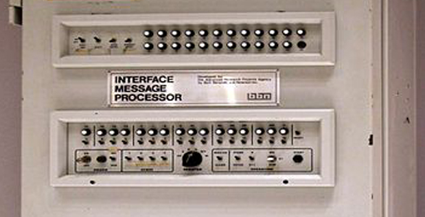
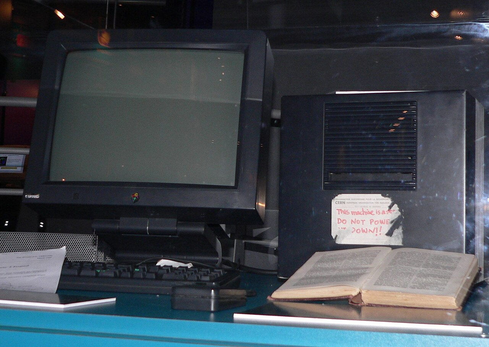
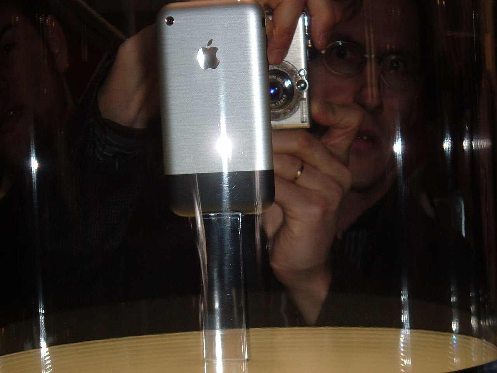

# 10. Everything connected: ARPANET, the web and the phone

> 🗺️ **In this chapter:** you tell the internet from the web, explain packet switching and TCP/IP, follow the path from ARPANET to the smartphone and learn how the internet began in Brazil (AlterNex, RNP and CGI.br). · ⏱️ ~50 min

### 📇 Summary sheet: part 4

![Summary sheet for part 4: Packet switching (message in packets, numbered and reassembled, different paths); ARPANET and TCP/IP (switched on October 1969, TCP/IP on Jan. 1, 1983, links different networks); The web (Berners-Lee, 1989, released at CERN, 1991, web ≠ internet); iPhone (announced Jan. 9, 2007, phone, iPod, internet, the phone becomes a computer); Internet in Brazil (AlterNex, July 1989, RNP and CGI.br (1995), commercial internet); Test and Dartmouth (Turing, 1950, Dartmouth, Aug. 31, 1955, AI winters); Deep Blue to AlphaGo (Deep Blue 1997, 2012 network: 18.9% error, AlphaGo 4 to 1, 2016); Transformer (attention, 2017, ChatGPT, 2022, AI Act in force 2024); Museum (15 milestones with causes, check one legend, 2+ Brazilian milestones).](../img/c00-part-4-network-ai-and-museum.svg)

- [10. Everything connected: ARPANET, the web and the phone](10-everything-connected-arpanet-the-web.md)
- [11. Machines that learn: the long road of artificial intelligence](11-machines-that-learn-the-long-road-of-artificial.md)
- [12. Final project: your computing museum](12-final-project-your-computing-museum.md)

> 🔥 **Warm-up:** (1) Which idea did the Xerox Alto bring that we still use today? (2) What did article 9 of Law 7,232/1984 provide for?
>
> <details>
> <summary>See answers</summary>
>
> (1) The graphical interface, with windows, icons and a mouse, and also the local network. (2) "Restrictions of a transitory nature" to protect domestic companies until they could compete. (My translation of the Portuguese text.)
>
> </details>

## Where we left off

In chapter 9 the computer reached one person's desk. Each machine, however, worked alone. In this chapter computers learn to talk to each other. **The guiding question is: what is the difference between the internet and the web, and how did connecting different machines become possible?**

## Packet switching

Connecting two computers over a phone line ties up the whole line for the whole conversation. The way out was to cut the message into small parts and let each part find its own way.

**Packet switching is the technique of splitting a message into pieces (packets), sending each one separately and reassembling everything at the destination.**

According to the Internet Society, Leonard Kleinrock published the first paper on packet switching theory in July 1961 and the first book on the subject in 1964. See the idea in a minimal simulation, written for this book: the message is cut up, the packets arrive out of order and each one carries the number that lets us put them back together.

```python
import random

message = "The recipe travels in pieces and arrives whole."
size = 8
n = (len(message) + size - 1) // size
packets = [(i, message[i * size:(i + 1) * size]) for i in range(n)]
for number, text in packets:
    print("Sent:", number, repr(text))

random.seed(1)
arrived = packets[:]
random.shuffle(arrived)
print("Arrived:", [n for n, _ in arrived])

reassembled = "".join(text for _, text in sorted(arrived))
print("Reassembled:", reassembled)
print("Same as the original?", reassembled == message)
```

Real output, run while writing the chapter:

```text
Sent: 0 'The reci'
Sent: 1 'pe trave'
Sent: 2 'ls in pi'
Sent: 3 'eces and'
Sent: 4 ' arrives'
Sent: 5 ' whole.'
Arrived: [2, 3, 5, 0, 4, 1]
Reassembled: The recipe travels in pieces and arrives whole.
Same as the original? True
```

Check: the message has 47 characters, and 47 divided into blocks of 8 gives 5 full blocks and one of 7 characters, that is, 6 packets. ✔ The order of arrival (2, 3, 5, 0, 4, 1) does not matter, because each packet's number lets us line them up again.

> 💡 **Analogy: the recipe.** Instead of sending the whole notebook, you send the recipe on numbered sheets, by different routes, and the recipient stacks them in order. **Where the analogy breaks:** in real life a lost sheet stays lost; on the network, the protocol has to notice the gap and ask again.

**Common mistake:** thinking that all packets follow the same path and arrive in order. The example above shows the opposite: the order of arrival can change, which is why each packet carries a number.

## ARPANET and TCP/IP

According to the CHM, the **ARPAnet** was "switched on in late October 1969" and was the first large-scale, general-purpose network to connect different types of computer. The Internet Society gives more detail: in September 1969 BBN installed the first interface message processor (IMP) at UCLA, and the Stanford Research Institute (SRI) was the second node. Earlier, in 1965, Lawrence Roberts and Thomas Merrill had linked two computers over an ordinary phone line, the TX-2 in Massachusetts and the Q-32 in California, according to the same source.

The CHM adds that other networks appeared within weeks or months: the NPL in the United Kingdom, ALOHANET in Hawaii and the CYCLADES project in France. ARPANET, therefore, was not the only network of its time, but the CHM says its large funding put it ahead of its rivals.

Each network spoke its own protocol. A common rule was needed.

**A protocol is a set of agreed rules so that two computers can understand each other. TCP/IP is the protocol that lets different networks join into a single network of networks.**

According to the Internet Society, Robert Kahn and Vinton Cerf specified what would become TCP/IP, and the first written version circulated as INWG#39 at a September 1973 meeting at the University of Sussex; a refined version was published in 1974. The same source lists rules Kahn considered essential: each network would have to work on its own, with no internal changes to connect, and communication would be "best effort": if a packet did not arrive, the source would retransmit it.

On January 1, 1983, ARPANET replaced its old protocol (NCP) with TCP/IP, all computers at the same time. The Internet Society says the transition was planned for years and went "surprisingly smoothly", so much so that buttons were handed out with the phrase "I survived the TCP/IP transition". The CHM calls 1983 the official launch of the Internet, then still an experimental network of US government networks. By 1989 it had 100,000 computers connected, and the CHM considers the decisive factor to have been "probably" government money, especially NSFNET's.



*An IMP, the computer that connected each machine to ARPANET. Photo: ARPANET IMP, public domain, via Wikimedia Commons.*

> ⚖️ **Fact vs. interpretation.** It is a fact that ARPANET was switched on in 1969 and that TCP/IP became its protocol on January 1, 1983. It is an interpretation to say that public money "was the reason" for the internet's success: the CHM presents it as the probably decisive factor, among others.

**Common mistake:** thinking that ARPANET "is" the internet. ARPANET was one of the networks that joined through TCP/IP, and the internet is the set of networks joined that way.

## Berners-Lee and the web

Now the distinction that gives the guiding question its name. The internet is the infrastructure: networks joined by TCP/IP. The web is a service that runs on top of it.

**The World Wide Web is a system of pages linked by hyperlinks, which you access through a browser using the internet.**

According to the W3C's history, in March 1989 Tim Berners-Lee wrote the proposal "Information Management: A Proposal" at CERN. CERN records that his boss, Mike Sendall, jotted on the proposal: "Vague, but exciting". In October 1990 Berners-Lee began writing a browser-editor on a NeXT computer and coined the name "WorldWideWeb". The W3C dates the general release of the WWW on CERN's central machines to May 17, 1991, and the first web server outside Europe, at SLAC, to December 12, 1991.

The web did not win alone. The CHM says that Gopher, which organized content in folders rather than clickable links, grew faster than the web in the early 1990s and was its most direct competitor. On browsers, the CHM says that in 1994 half of the Mosaic team left and founded Netscape with Jim Clark, and that in 1995 Netscape and Microsoft were fighting over the market in a "Browser War II".

> 💡 **Analogy: the recipe.** The internet is the network of roads and trucks; the web is the bookshop of recipes with a cross-referenced index, where one recipe sends you to another. **Where the analogy breaks:** the bookshop exists only because the roads exist, but the roads serve many other things besides it, such as e-mail.



*CERN's NeXT server. Photo: Rama, CC BY-SA 2.0 fr, via Wikimedia Commons.*

**Common mistake:** using "internet" and "web" as synonyms. E-mail and ARPANET existed before the web, and the Internet Society cites the web as an example of an application built on top of the infrastructure.

## Search and social networks

Search engines and social networks are also part of this story, but the open sources consulted for this chapter give no dates or numbers about them. That is why the book does not say who founded each service or when: it leaves the gap instead of repeating a date from memory. One thing follows from the web's own history: with pages scattered across servers all over the world, finding one of them became a new problem.

## The smartphone

On January 9, 2007, Apple announced the iPhone, which the press release describes as the combination of three products: a mobile phone, a widescreen iPod with touch controls and an internet communications device, with e-mail, browsing, search and maps. Sales in the US would begin in June 2007, at US$499 (4 GB) and US$599 (8 GB). The CHM records the device as the union of a browser, a music player and a mobile phone, able to download new functions in the form of "apps" from an online store.



*An iPhone at Macworld 2007. Photo: ArnoldReinhold, CC BY-SA 4.0, via Wikimedia Commons.*

**A smartphone is a mobile phone that is also a pocket computer: it has a touch screen, a browser and runs applications installed by the user.**

The price calculation shows what has changed since chapter 9. The Macintosh cost US$2,500 in 1984 and the 8 GB iPhone US$599 in 2007 (dollars of the day, not corrected): the iPhone cost about 24% of the Macintosh's price. Since the values were not corrected for inflation, the calculation is only an order of magnitude.

> ⚖️ **Fact vs. interpretation.** It is a fact that Apple presented the iPhone in 2007, with apps and web access. It is an interpretation to call it "the first smartphone": the chapter's documents do not compare the iPhone with earlier devices, so this book does not give that title to anyone.

**Common mistake:** thinking that the mobile phone is only a cordless telephone. The CHM describes it as a browser, a music player and a phone at once.

## Brazil: AlterNex, RNP, CGI.br and the commercial internet (1995)

According to Carlos Alberto Afonso, in a 1996 article published by CGI.br, until 1994 the internet in Brazil was restricted, with one exception, to academic initiatives coordinated by **RNP**, the Rede Nacional de Pesquisa (National Research Network). It was funded by CNPq (the national research council), with support from the United Nations Development Programme, and the experimental phase of the national backbone began in 1990.

The exception was **AlterNex**, of Ibase (Instituto Brasileiro de Análises Sociais e Econômicas, a Brazilian social and economic research institute), officially inaugurated in July 1989: an e-mail and computer conferencing service, on UNIX systems. The article says that international mail went through a partnership with IGC, of San Francisco, and that an IGC machine called AlterNex twice a day.

The article says that press interest, from early 1994, made the number of users grow fast. At the end of 1994 Embratel, the state long-distance monopoly, began an experimental internet service, and in May 1995 the Ministries of Science and Technology and of Communications created the Comitê Gestor da Internet no Brasil (Brazilian Internet Steering Committee). **CGI.br**, as it presents itself today, sets strategic guidelines for the internet in the country, the registration of .br domains and the allocation of IP addresses.

The 1996 numbers, according to the same article, show the pace. See the calculation:

```python
# Hosts on the Brazilian internet in 1996, according to Afonso (CGI.br)
hosts = {"Jan 1996": 17429, "Feb 1996": 25960, "Mar 1996": 28473}
months = list(hosts)
for a, b in zip(months, months[1:]):
    print(f"{a} -> {b}: +{hosts[b] - hosts[a]} hosts "
          f"({hosts[b] / hosts[a]:.2f}x)")
print(f"Jan -> Mar: {hosts['Mar 1996'] / hosts['Jan 1996']:.2f}x")
```

Real output, run while writing the chapter:

```text
Jan 1996 -> Feb 1996: +8531 hosts (1.49x)
Feb 1996 -> Mar 1996: +2513 hosts (1.10x)
Jan -> Mar: 1.63x
```

In March 1996 the article estimated about 200,000 users in Brazil and 28,473 connected computers (hosts), and noted that the whole telecommunications infrastructure was under the state monopoly of Telebras. In two months hosts grew 1.63 times, but the article does not explain the reason for this pace. This book does not pick a single date for the "commercial opening" of the Brazilian internet either: the open sources consulted give the milestones above, not a single act.

> ⚖️ **Fact vs. interpretation.** It is a fact that AlterNex was inaugurated in July 1989 and that CGI.br was created in May 1995, according to Afonso's article. It is an interpretation to say that Brazil "arrived late" to the internet: the text compares only Latin America, where it says the country already led in users and hosts in 1996.

**Common mistake:** thinking that the Brazilian internet was born commercial. According to the article, it was born academic, with AlterNex as the exception.

## 🏋️ Practice

**1. Worked example.** How many years separate Roberts and Merrill's link between two computers (1965) from ARPANET's switch to TCP/IP (1983)?

- Roberts and Merrill's link: 1965.
- TCP/IP on ARPANET: 1983.
- 1983 − 1965 = 18 years. ✔

**2. Complete it.** Write what each name stands for and the year: ARPAnet → ___ (year ___); TCP/IP → ___ (year of adoption on ARPANET ___); WorldWideWeb → ___ (year of the name ___).

<details>
<summary>See answer</summary>

ARPAnet: network of different computers, switched on in 1969. TCP/IP: common protocol between networks, adopted in 1983. WorldWideWeb: name of Berners-Lee's first browser-editor, 1990. Common mistake: saying the web was born in 1969 together with ARPANET.

</details>

**3. On your own.** Write one sentence each: (a) the difference between the internet and the web; (b) what a packet is; (c) why AlterNex is an exception in the history of the Brazilian internet.

<details>
<summary>See answer</summary>

(a) The internet is the infrastructure of networks joined by TCP/IP; the web is a service of pages with hyperlinks that runs on it. (b) A piece of a message, with a number, that travels separately and is reassembled at the destination. (c) Until 1994 the internet in Brazil was academic, and AlterNex, of Ibase, was the service outside that circuit. Common mistake: saying that e-mail only existed after the web.

</details>

**4. Challenge (analyzing a source).** Afonso's article is from 1996, written by someone who took part in the process. Answer in 4 or 5 lines: (a) what advantage and what limit this gives the source; (b) what other source you would look for to compare; (c) how you would record, in a book's text, a number like "28,473 hosts".

<details>
<summary>See answer</summary>

Open answer. Check it against this rubric: (1) recognized that someone who took part knows the facts up close, but also has an interest in telling them a certain way; (2) proposed an independent source (RNP, CGI.br or an official domain registry); (3) recorded the number with its source, its date and the month it refers to; (4) did not treat the 1996 number as a current value.

</details>

## 🧠 Quick review

1. What is packet switching?
2. What changed on ARPANET on January 1, 1983?
3. Who wrote the proposal for the web, and where?
4. Who was the academic exception on the Brazilian internet until 1994?
5. (From chapter 9) Which ideas does the CHM attribute to the Xerox Alto?

<details>
<summary>See answers</summary>

1. Splitting the message into numbered packets, sending them separately and reassembling at the destination. 2. The protocol went from NCP to TCP/IP, on all computers at the same time. 3. Tim Berners-Lee, at CERN, in March 1989. 4. AlterNex, of Ibase. 5. Windows, icons, a mouse, a local network and a laser printer.

</details>

## 🤖 Study with an AI tutor

- "Ask me 5 questions, one at a time, about packet switching, TCP/IP, the web and the internet in Brazil. Wait for my answer before commenting and do not give me the answers beforehand."
- "Here is my answer to exercise [exercise number]: [my answer]. Point out my mistakes without giving me the solution."

> ➡️ **Next:** machines can now talk to each other and store enormous amounts of data. In chapter 11 you see the long road of artificial intelligence.

## 📌 Summary

| Item | In one sentence |
| --- | --- |
| Packet switching | A message cut into numbered packets, sent separately and reassembled at the destination. |
| ARPANET | Switched on in late October 1969; first node at UCLA (September 1969). |
| TCP/IP | Protocol that links different networks; adopted by ARPANET on January 1, 1983. |
| The web | Service of pages with hyperlinks on top of the internet; Berners-Lee's proposal in 1989, released at CERN in 1991. |
| iPhone | Announced on January 9, 2007: phone, touch iPod and internet device in one. |
| AlterNex | Ibase service, inaugurated in July 1989, outside RNP's academic circuit. |
| CGI.br | Committee created in May 1995; sets guidelines and manages .br domains and IPs. |

## 📚 Sources

- Computer History Museum, [1969](https://www.computerhistory.org/timeline/1969/), checked on 11/28/2026.
- Computer History Museum, [1989](https://www.computerhistory.org/timeline/1989/), checked on 11/28/2026.
- Computer History Museum, [1993](https://www.computerhistory.org/timeline/1993/), [1995](https://www.computerhistory.org/timeline/1995/) and [2007](https://www.computerhistory.org/timeline/2007/), checked on 11/28/2026.
- Internet Society, [Brief History of the Internet](https://www.internetsociety.org/internet/history-internet/brief-history-internet/), checked on 11/28/2026.
- W3C, [A little history of the World Wide Web](https://www.w3.org/History.html), checked on 11/28/2026.
- CERN, [Tim Berners-Lee's proposal](https://info.cern.ch/Proposal.html), checked on 11/28/2026.
- Apple, [Apple Reinvents the Phone with iPhone](https://www.apple.com/newsroom/2007/01/09Apple-Reinvents-the-Phone-with-iPhone/), 1/9/2007, checked on 11/28/2026.
- Carlos Alberto Afonso, [Internet no Brasil](https://www.cgi.br/noticia/releases/internet-no-brasil/) (CGI.br, 1996, in Portuguese; quoted here in my translation), checked on 11/28/2026.
- CGI.br, [Sobre o CGI.br](https://cgi.br/sobre/) (in Portuguese), checked on 11/28/2026.

> 🔁 **Review today:** chapters 3, 7 and 9

<!-- nav:start -->
---

[◀ Previous chapter](09-a-computer-on-every-desk.md) · [Book map](../README.md) · [Next chapter ▶](11-machines-that-learn-the-long-road-of-artificial.md)
<!-- nav:end -->
