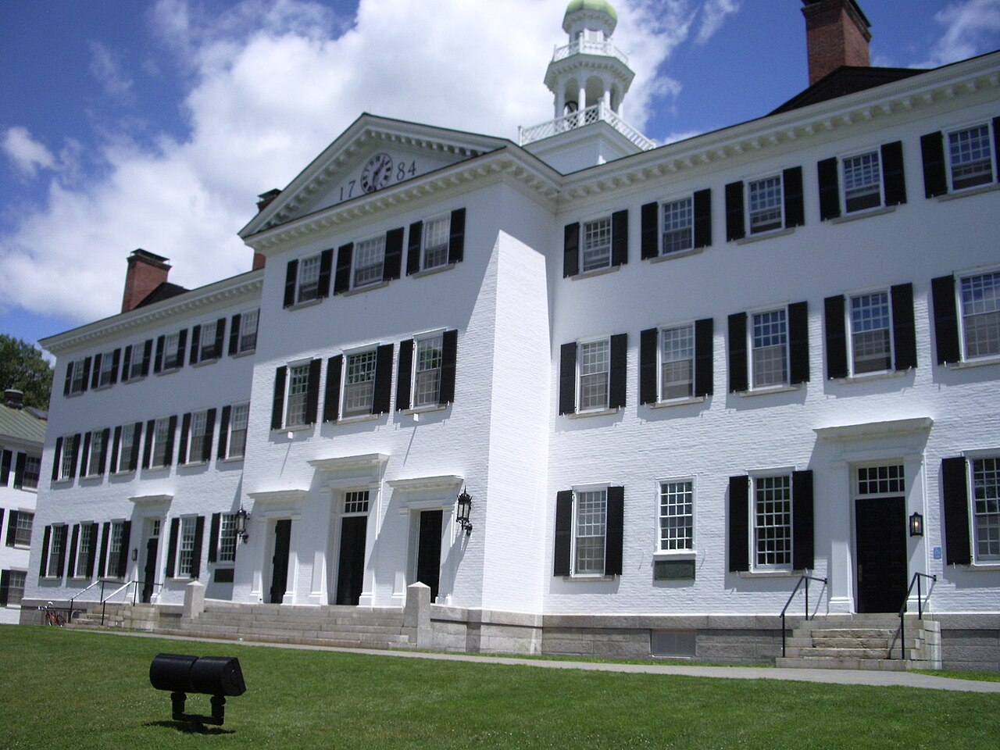
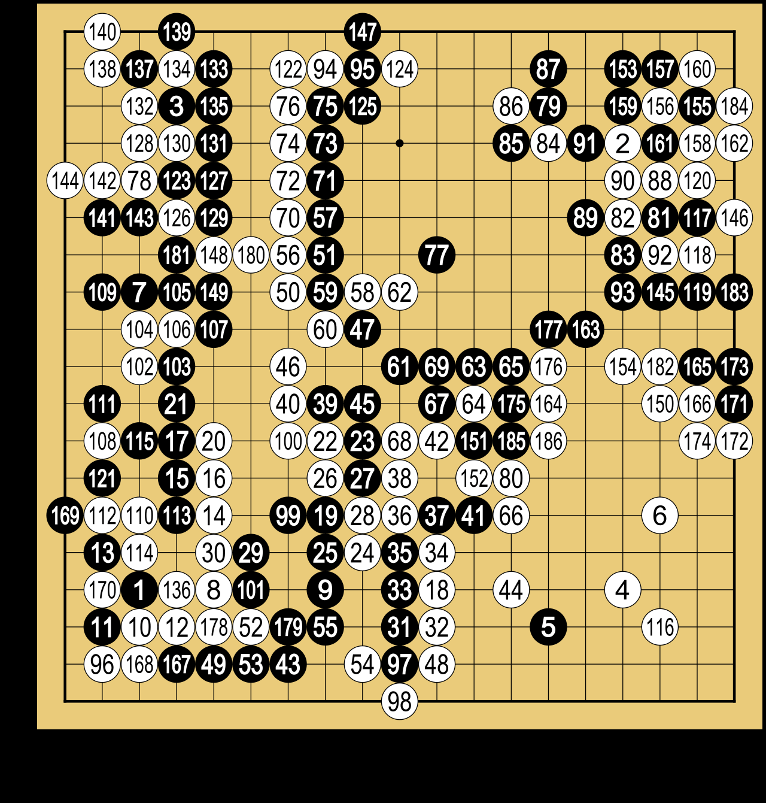

# 11. Machines that learn: the long road of artificial intelligence

> 🗺️ **In this chapter:** you tell the phases of artificial intelligence, from the Dartmouth proposal to large language models, and separate what the sources show from what people say about AI. · ⏱️ ~55 min

> 🔥 **Warm-up:** (1) What is the difference between the internet and the web? (2) What is a packet, in packet switching?
>
> <details>
> <summary>See answers</summary>
>
> (1) The internet is the infrastructure of networks joined by TCP/IP; the web is a service of pages with hyperlinks that runs on it. (2) A numbered piece of the message, sent separately and reassembled at the destination.
>
> </details>

## Where we left off

In chapter 10 machines began to connect to one another. This chapter goes back in time to follow a question older than ARPANET: can a machine learn? **The guiding question is: what changed from one phase of AI to the next, and what did each phase really prove?**

## The Turing test and the Dartmouth proposal

In 1950 Alan Turing proposed an imitation game. According to the *Stanford Encyclopedia of Philosophy*, the test uses a remote text channel to separate intelligence from other human faculties, and it is not a game in which the machine imitates a man who imitates a woman, as some readers have assumed. The encyclopedia also says that Turing argued for "fair play for machines": if we judge that other people think only from what we observe of them, the same criterion would apply to machines.

**The Turing test is a criterion of observation: if, in a text conversation, a person cannot tell the machine from a human being, the machine passes the test.**

The expression "artificial intelligence" appears in the title of a document dated August 31, 1955, the proposal for a summer project at Dartmouth College, signed by John McCarthy, Marvin Minsky, Nathaniel Rochester and Claude Shannon. They proposed a two-month study with ten people, in the summer of 1956, "on the basis of the conjecture that every aspect of learning or any other feature of intelligence can in principle be so precisely described that a machine can be made to simulate it". The document said that the main obstacle was not the machines' capacity, but "our inability to write programs taking full advantage of what we have".



*Dartmouth Hall, on the Dartmouth College campus, where the 1956 project was proposed. Photo: Kane5187, public domain, via Wikimedia Commons.*

> ⚖️ **Fact vs. interpretation.** It is a fact that the 1955 proposal exists and contains the conjecture quoted above. It is an interpretation to say that it "invented" AI: the document is a proposal for a summer study, and the text itself treats AI as a problem to investigate.

**Common mistake:** thinking that the Turing test proves the machine "thinks". According to the encyclopedia, it is a criterion of external observation, chosen precisely to avoid the discussion about what thinking is.

## The first games and the Lighthill report

According to the CHM, the IBM 701 was already running Arthur Samuel's checkers program in 1953. It was an idea that would repeat itself: using a game as a testing ground, because the rules are clear and the result can be measured.

In July 1972, Sir James Lighthill delivered to the UK's Science Research Council the report *Artificial Intelligence: A General Survey*, commissioned to assess a growing number of requests for support for AI research. The text says that expectations "have been frequently disappointed" and that progress in speech recognition and machine translation had so far been "very disappointing".

This period is sometimes called an "AI winter". The name is a later interpretation: the sources consulted for this chapter record the report and its critical tone, but give no data on funding cuts, so the book does not claim that the report caused any.

> 💡 **Analogy: the recipe.** The first AI programs were recipes written by hand, step by step, by people who believed that writing enough rules would be enough. **Where the analogy breaks:** Dartmouth's promise ("learning" or simulating any feature of intelligence) is broader than a recipe; a recipe does not change by itself.

**Common mistake:** thinking that the Lighthill report "killed" AI. It is an assessment by someone from outside the field, at the request of the research council; what happened afterwards is not in this chapter's sources.

## Deep Blue: brute force against the champion

According to IBM, in May 1997 Deep Blue became the first system to defeat a reigning world chess champion, Garry Kasparov, in a six-game match under tournament rules. IBM says the computer had 32 processors and evaluated about 200 million positions per second; the CHM gives the same number and reports that Deep Blue won two games, Kasparov won one and three ended in draws.

Under tournament chess scoring (a win is worth 1 point, a draw half a point), that gives 2 + 1.5 = 3.5 points for Deep Blue and 1 + 1.5 = 2.5 for Kasparov. ✔ The calculation is the book's; the sources cite the games, not the score.

**Brute force is solving a problem by examining an enormous number of possibilities, instead of learning from experience.**

IBM says that Deep Blue got its performance from "brute force computing power". It did not "learn" to play the way the neural networks that come next do.

**Common mistake:** thinking that Deep Blue "thought like a person". According to IBM, its strength came from the number of positions it examined.

## Deep learning: the 2012 network

A **neural network** is a program organized in layers of simple units, whose weights are adjusted from examples. In 2012 Alex Krizhevsky and colleagues trained a deep convolutional network to classify 1.3 million ImageNet images into 1,000 classes. In the paper presented at NeurIPS, the network reached top-1 and top-5 error rates of 39.7% and 18.9%, "considerably better than the previous state-of-the-art results", with 60 million parameters and 500,000 neurons.

**Deep learning is training neural networks with many layers, which extract from the data, on their own, the patterns that used to be written by hand.**

To get a feel for the size of this result, see a calculation made for this book, together with the gaps between the chapter's milestones:

```python
# AI milestones with a source in the chapter
# (+n) = years since the previous milestone
milestones = [
    (1955, "Dartmouth proposal"),
    (1972, "Lighthill report"),
    (1997, "Deep Blue beats Kasparov"),
    (2012, "Convolutional network on ImageNet"),
    (2016, "AlphaGo beats Lee Sedol"),
    (2017, "Transformer paper"),
    (2022, "ChatGPT introduced"),
]
for (a, _), (b, name) in zip(milestones, milestones[1:]):
    print(f"{b}  (+{b - a:>2})  {name}")

# Guessing 5 classes out of 1,000, the top-5 error would be:
print("Top-5 error by guessing:", f"{(1 - 5 / 1000) * 100:.1f}%")
print("Top-5 error of the 2012 network:", "18.9%")
```

Real output, run while writing the chapter:

```text
1972  (+17)  Lighthill report
1997  (+25)  Deep Blue beats Kasparov
2012  (+15)  Convolutional network on ImageNet
2016  (+ 4)  AlphaGo beats Lee Sedol
2017  (+ 1)  Transformer paper
2022  (+ 5)  ChatGPT introduced
Top-5 error by guessing: 99.5%
Top-5 error of the 2012 network: 18.9%
```

Check: 2022 − 2017 = 5; 2017 − 2016 = 1; 2016 − 2012 = 4. ✔ The gaps get shorter among the last milestones, but that shows only what this chapter chose to list, not a pace of the field. As for the error: guessing 5 of 1,000 classes hits the right one with probability 5/1,000, that is, it is wrong 99.5% of the time, and the network was wrong 18.9% of the time.

**Common mistake:** thinking that 18.9% error "is low" or "is high" without comparing. The number says something only when compared with a reference point, such as guessing (99.5%) or the best previous result.

## AlphaGo: learning by playing

According to DeepMind, Go is a far more complex game than chess: about 10 to the power of 170 possible board configurations. The best Go programs only reached the level of human amateurs. AlphaGo combined deep neural networks with search: one network, called the "policy network", chooses the next move; another, the "value network", predicts who will win. First it studied thousands of games by experts, then it played thousands of times against versions of itself.

In October 2015 AlphaGo beat the European champion Fan Hui 5 to 0, and in March 2016 it beat the world champion Lee Sedol 4 to 1, in Seoul, in a contest that, according to DeepMind, more than 200 million people followed.



*Record of game 1 between Lee Sedol (black) and AlphaGo (white). Diagram: Wesalius, CC BY-SA 4.0, via Wikimedia Commons.*

> ⚖️ **Fact vs. interpretation.** It is a fact that AlphaGo beat Lee Sedol 4 to 1 in March 2016. It is an interpretation to say that it "has creativity" or "understands" the game: the DeepMind page, which is an interested party, calls the system creative when quoting players, and its text is a project source, not an independent assessment.

**Common mistake:** thinking that AlphaGo is a faster version of Deep Blue. By IBM's and DeepMind's descriptions, Deep Blue evaluated positions in great quantity, while AlphaGo learned from games, with neural networks and search.

## Transformers and generative AI

On June 12, 2017, Vaswani and colleagues submitted the paper "Attention Is All You Need" to arXiv. They proposed the **Transformer**, a network architecture "based solely on attention mechanisms, dispensing with recurrence and convolutions entirely". On the WMT 2014 English-to-German translation task, the model reached 28.4 BLEU, and the paper says it was superior to earlier ones and more parallelizable, meaning it needed far less training time.

On November 30, 2022, OpenAI introduced **ChatGPT**, a model that converses. According to the launch text, it was trained with reinforcement learning from human feedback (RLHF), using the same methods as InstructGPT, and could answer follow-up questions, admit mistakes and refuse inappropriate requests. At the time it was free to use, during a research preview.

**Generative AI is a system that produces new content (text, image, sound) from what it learned from many examples.**

The same launch text lists limitations: ChatGPT "sometimes writes plausible-sounding but incorrect or nonsensical answers", is sensitive to small changes in how a question is phrased and may, with one phrasing, say it does not know and, with another, answer. This matters to anyone studying alone: a well-written answer is not proof that it is right, and it is worth checking against a source.

> 💡 **Analogy: the recipe.** A language model is a cook who has read millions of recipes and writes a new one that looks right. **Where the analogy breaks:** a real cook tastes the dish; the model writes the recipe without knowing whether it works, and so it can be wrong with confidence.

> ⚖️ **Fact vs. interpretation vs. legend.**
> **Fact:** ChatGPT was introduced on 11/30/2022, and the launch text admits answers that are plausible but incorrect.
> **Interpretation:** whether these models "understand" or "reason". The chapter's sources describe how they were trained, not what goes on inside them.
> **Legend to avoid:** that today's AI is "as intelligent as a person". The chapter's sources show results on specific tasks, such as playing, classifying images and conversing in text.

**Common mistake:** thinking that the chapter says what AI is like today. The sources run from 2012 to 2024, and the state of AI in November 2026 was not verified here; check the date of any source before trusting it.

## From 2023 onwards: what open sources show

On March 15, 2023, OpenAI submitted the *GPT-4 Technical Report* to arXiv. The paper's abstract describes GPT-4 as a multimodal model that accepts "image and text inputs" and produces text, and says it "exhibits human-level performance on various professional and academic benchmarks". The same abstract states that the model is "less capable than humans in many real-world scenarios". Since the abstract comes from the company itself, it is a project source, not an independent assessment.

On August 1, 2024, the AI Act, the European artificial intelligence law, entered into force. According to the European Commission, it takes "a risk-based approach": most systems, such as spam filters, have no obligations at all; chatbots must disclose that the user is talking to a machine; high-risk systems, such as those used in recruitment, have strict requirements; and "social scoring" is banned. The page says that the rules on general-purpose AI would apply 12 months later.

> ⚖️ **Fact vs. interpretation.** It is a fact that the GPT-4 report and the European law exist, with the dates above. It is an interpretation to say that GPT-4 is "as intelligent as a person": the paper's abstract, which is from OpenAI itself, says "human-level" for certain tests and "less capable than humans" in many real-world situations.

> ⚠️ **Declared gap.** This chapter opened dated sources only from 2023 and 2024. The milestones of 2025 and 2026 were not verified here, and the book does not claim them. This part ages fast: that is why the book's `review_by` is November 2027.

## 🏋️ Practice

**1. Worked example.** How many years separate the Dartmouth proposal (1955) from Deep Blue (1997)?

- Dartmouth: 1955.
- Deep Blue: 1997.
- 1997 − 1955 = 42 years. ✔

**2. Complete it.** Match each milestone to its main technique: Deep Blue → ___; AlphaGo → ___; Transformer → ___.

<details>
<summary>See answer</summary>

Deep Blue: brute force, searching about 200 million positions per second. AlphaGo: deep neural networks (policy and value) combined with search. Transformer: an architecture based on attention alone. Common mistake: saying that AlphaGo is merely "a faster Deep Blue".

</details>

**3. On your own.** Write one sentence each: (a) what the Turing test is; (b) what the Lighthill report said about progress; (c) one limitation that the ChatGPT launch text admits.

<details>
<summary>See answer</summary>

(a) A criterion of observation: in a text conversation, the machine passes if it cannot be told apart from a person. (b) That expectations had been frequently disappointed and that progress in speech and translation was "very disappointing". (c) Answers that sound plausible but are incorrect or nonsensical. Common mistake: saying that the report caused funding cuts, which the chapter's sources do not show.

</details>

**4. Challenge (analyzing a source).** The text about AlphaGo is from DeepMind itself, and the one about ChatGPT is from OpenAI itself. Answer in 4 or 5 lines: (a) what kind of source each one is; (b) what each can prove and what it cannot; (c) what other source you would look for before claiming something about what these systems do.

<details>
<summary>See answer</summary>

Open answer. Check it against this rubric: (1) identified that they are the companies' own sources, from someone with an interest in highlighting the product; (2) separated what is technical description and result (games, training) from what is assessment ("creative", "capable"); (3) proposed an independent source, such as the peer-reviewed paper, a third-party evaluation or a news report with data; (4) did not treat the company's text as a neutral balance sheet.

</details>

## 🧠 Quick review

1. What does the Turing test measure?
2. What conjecture does the Dartmouth proposal make?
3. How did Deep Blue beat Kasparov?
4. What did the Transformer dispense with, according to the 2017 paper?
5. (From chapter 10) What does TCP/IP let different networks do?

<details>
<summary>See answers</summary>

1. Whether, in a text conversation, the machine can be told apart from a person. 2. That every aspect of learning or intelligence can be described precisely enough for a machine to simulate it. 3. By evaluating about 200 million positions per second (brute force). 4. Recurrence and convolutions. 5. Join into a single network of networks.

</details>

## 🤖 Study with an AI tutor

- "Ask me 5 questions, one at a time, about the Turing test, Dartmouth, Deep Blue, AlphaGo and Transformers. Wait for my answer before commenting and do not give me the answers beforehand."
- "Here is my answer to exercise [exercise number]: [my answer]. Point out my mistakes without giving me the solution."

> ➡️ **Next:** in chapter 12 you put the pieces of the book together and see where the open questions point.

## 📌 Summary

| Item | In one sentence |
| --- | --- |
| Turing test | A criterion of observation by text, proposed in 1950. |
| Dartmouth | Proposal of 8/31/1955 for a summer study on artificial intelligence. |
| Lighthill report | Assessment of July 1972 that called progress in speech and translation disappointing. |
| Deep Blue | Beat Kasparov in May 1997 by brute force (200 million positions per second). |
| 2012 network | Deep convolutional network with 18.9% top-5 error on ImageNet. |
| AlphaGo | Neural networks and search; beat Lee Sedol 4 to 1 in March 2016. |
| Transformer and ChatGPT | Attention architecture (2017) and conversation model (2022), with admitted limitations. |
| GPT-4 and AI Act | Report of March 2023 and European law in force since 8/1/2024; 2025–2026 not verified. |

## 📚 Sources

- Stanford Encyclopedia of Philosophy, [Alan Turing](https://plato.stanford.edu/entries/turing/), checked on 11/28/2026.
- J. McCarthy et al., [A Proposal for the Dartmouth Summer Research Project on Artificial Intelligence](http://www-formal.stanford.edu/jmc/history/dartmouth/dartmouth.html), 1955, checked on 11/28/2026.
- Computer History Museum, [Timeline of Computer History](https://www.computerhistory.org/timeline/computers/), checked on 11/27/2026, and [1997](https://www.computerhistory.org/timeline/1997/), checked on 11/28/2026.
- J. Lighthill, [Artificial Intelligence: A General Survey](https://www.chilton-computing.org.uk/inf/literature/reports/lighthill_report/p001.htm), 1972, checked on 11/28/2026.
- IBM, [Deep Blue](https://www.ibm.com/history/deep-blue), checked on 11/27/2026.
- A. Krizhevsky et al., [ImageNet Classification with Deep Convolutional Neural Networks](https://papers.nips.cc/paper/2012/hash/c399862d3b9d6b76c8436e924a68c45b-Abstract.html), NeurIPS 2012, checked on 11/28/2026.
- Google DeepMind, [AlphaGo](https://deepmind.google/research/breakthroughs/alphago/), checked on 11/28/2026.
- A. Vaswani et al., [Attention Is All You Need](https://arxiv.org/abs/1706.03762), arXiv, 2017, checked on 11/28/2026.
- OpenAI, [Introducing ChatGPT](https://openai.com/index/chatgpt/), 11/30/2022, checked on 11/28/2026.
- OpenAI, [GPT-4 Technical Report](https://arxiv.org/abs/2303.08774), arXiv, 2023, checked on 11/28/2026.
- European Commission, [AI Act enters into force](https://commission.europa.eu/news/ai-act-enters-force-2024-08-01_en), 8/1/2024, checked on 11/28/2026.

> 🔁 **Review today:** chapters 4, 8 and 10

<!-- nav:start -->
---

[◀ Previous chapter](10-everything-connected-arpanet-the-web.md) · [Book map](../README.md) · [Next chapter ▶](12-final-project-your-computing-museum.md)
<!-- nav:end -->
